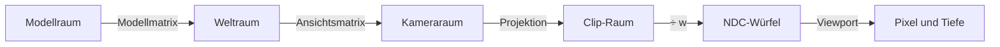
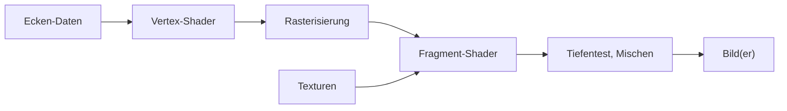
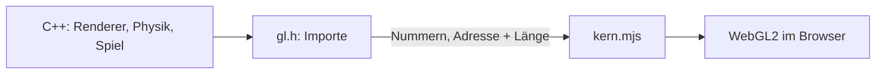

# Anhang B – Grundlagen: Wie aus Dreiecken Bilder werden

> **Kurz gesagt:** Dieser Anhang erklärt das Handwerk hinter jedem 3D-Spiel: wie Koordinaten und
> Matrizen eine Figur an die richtige Stelle des Bildschirms bringen, wie die Grafikkarte Dreiecke in
> Pixel verwandelt und wie Licht, Schatten, Glanz und Farbe berechnet werden – 60-mal pro Sekunde im
> Browser. Bei jedem Grundbegriff erfährst du kurz, wie Kern ihn umsetzt.

Wie Kern die Bausteine im Detail zusammensetzt, steht in [Kapitel 4](04-grafik.md) und
[Kapitel 5](05-szene-und-geometrie.md). Hier geht es um das „Warum“.

## B.1 Koordinatenräume

### Warum es mehrere Räume gibt

Der Rumpf der Micro Duck wird einmal in seinem **eigenen** Koordinatensystem beschrieben. Dann steht
die Ente irgendwo in der Welt, eine Kamera schaut auf sie, und am Ende landet sie auf Pixeln. Jeder
Schritt wechselt das Koordinatensystem:



> **Stell dir vor …** … den Weg zu deinem Lieblingstisch im Café: „hinten links am Fenster“
> (Modellraum), „das Café liegt Hauptstraße 12“ (Weltraum), „von mir aus schräg rechts vorne“
> (Kameraraum), „auf meinem Handyfoto oben rechts“ (Bildschirm). Ein Tisch, vier Beschreibungen.

Im **Kameraraum** sitzt die Kamera im Ursprung und blickt entlang −z. In den **NDC** („normalisierte
Gerätekoordinaten“) liegt alles Sichtbare im Würfel von −1 bis 1; auf dem **Bildschirm** gibt es
Pixel und einen Tiefenwert zwischen 0 und 1.

### Homogene Koordinaten: der Trick mit der vierten Zahl

Drehen und Strecken kann eine 3×3-Matrix, Verschieben nicht – „plus 5 m nach rechts“ ist keine
Multiplikation. Der Trick: eine **vierte Zahl w**. Ein **Punkt** bekommt w = 1, eine **Richtung**
w = 0. Die Verschiebung steht in der letzten Spalte einer 4×4-Matrix und wirkt nur, wo w = 1 ist.

Beispiel: Verschiebung um (5, 0, 0). Der Punkt (1, 2, 3, **1**) wird zu (6, 2, 3, 1). Die Richtung
(1, 2, 3, **0**) bleibt, wie sie ist – eine Richtung hat keinen Ort. Und weil jetzt alle Schritte
4×4-Matrizen sind, kann man sie hintereinander multiplizieren:

```
p_clip = P · V · M · p_modell
```

(M Modell-, V Ansichts-, P Projektionsmatrix.) In Kern rechnet `Mat4::transform_point` mit w = 1,
`transform_vector` mit w = 0.

### Kerns Konventionen

Der Kopf von `math.h` sagt es in einem Satz: spaltenweise 4×4-Matrizen im OpenGL-Layout, Meter,
rechtshändig, Z oben. Also: Längen in **Metern**; **Z zeigt nach oben**, x und y spannen den Boden auf
(die Standardkamera steht bei (0, −18, 8) und schaut auf (0, 0, 2); auch Physik und Himmel rechnen so).
Matrizen sind **spaltenweise** gespeichert, die Verschiebung steht in den Feldern 12–14 – genau das
Layout, das WebGL erwartet. Eine Matrix wirkt **von links**: Bei A · B wirkt zuerst B. Drehungen
beschreibt Kern mit **Quaternionen**, vier Zahlen ohne die Tücken von drei Winkeln.

> **Achtung, Falle!** Reihenfolge zählt! Erst drehen, dann 5 m schieben ist etwas anderes als erst
> schieben, dann drehen – im zweiten Fall schwenkt das Objekt auf einem Kreis um den Ursprung. Kerns
> „Verschieben · Drehen · Skalieren“ heißt deshalb: erst skalieren, dann drehen, dann verschieben.

### Ansicht und Perspektive

Die **Ansichtsmatrix** (`Mat4::look_at`) baut aus Augpunkt, Zielpunkt und „oben“ drei senkrechte
Kamera-Achsen. Liegen Blick und „oben“ auf einer Linie (gleich oder genau entgegengesetzt), ist die Kamera unbestimmt; Kern verweigert
dann das Bild („degenerate camera direction/up“).

**Perspektive** heißt: Doppelt so weit weg erscheint halb so groß – die Bildposition ist x geteilt durch
die Entfernung. Eine Matrix kann nicht dividieren, aber sie kann die Entfernung nach w schreiben, und
die Grafikkarte teilt danach durch w: die **perspektivische Division**. Kerns Projektion hat einen
senkrechten Öffnungswinkel von 60°, also den Zoomfaktor f = 1 / tan(30°) ≈ 1,732, und eine nahe und
ferne Ebene bei 0,05 m und 1800 m.

**Durchgerechnet:** Bild 960 × 540 (Seitenverhältnis 1,778, waagerechter Faktor 1,732 / 1,778 ≈ 0,974),
Punkt im Kameraraum (1; 0,5; −10), also 10 m vor der Kamera:

| Schritt | Rechnung | Ergebnis |
|---|---|---|
| Clip x, y, w | 0,974 · 1; 1,732 · 0,5; 10 | 0,974; 0,866; 10 |
| NDC | durch w teilen | 0,0974; 0,0866 |
| Pixel | (NDC + 1) / 2 · (960; 540) | (526,8; 293,4) |

Der Punkt landet knapp rechts oberhalb der Bildmitte (480; 270), gezählt von unten links. Für Editor-Ansichten gibt es die **parallele**
Projektion (`Mat4::ortho`), in der Fernes nicht kleiner wird.

> **Probier's aus!** Schalte in Kern Studio im Viewport-Menü **≡** den **Field of View** zwischen 50°
> und 110° um – bei 110° wirkt die Welt wie durchs Weitwinkelobjektiv, an den Rändern stark gestreckt. Mit **Alt+J** (Top) springst du in eine
> orthografische Ansicht: Ferne Gebäude sind plötzlich so groß wie nahe.

### Tiefe ist ungleich verteilt

Der gespeicherte Tiefenwert ist (bis auf Konstanten) proportional zu **1 / Entfernung**. Die Werte
drängen sich in der Ferne gegen 1. Mit Kerns Ebenen und einem 24-Bit-Tiefenpuffer:

| Entfernung | Tiefenwert | kleinster trennbarer Abstand |
|---|---|---|
| 1 m | 0,950026 | |
| 10 m | 0,995028 | ≈ 0,1 mm |
| 100 m | 0,999528 | ≈ 1,2 cm |
| 1000 m | 0,999978 | ≈ 1,2 m |

Schon bei 1 m sind 95 % des Wertebereichs verbraucht! Die Genauigkeit wird **quadratisch** mit der
Entfernung schlechter und hängt fast nur von der nahen Ebene ab: Sie zu verdoppeln, verdoppelt die
Genauigkeit überall. Kerns Ambient Occlusion rechnet die Formel rückwärts, um die echte Entfernung
zurückzubekommen (`viewDepth`).

> **Wusstest du?** Daher flackern in manchen Spielen ferne, dicht beieinanderliegende Flächen
> („Z-Fighting“): Der Tiefenpuffer kann sie dort schlicht nicht mehr auseinanderhalten.

### Normalen

Eine **Normale** zeigt senkrecht von einer Fläche weg. Staucht man ein Objekt ungleichmäßig, stünde
eine einfach mittransformierte Normale schief. Richtig ist die **inverse Transponierte** des 3×3-Teils
der Modellmatrix – grob: Was die Fläche streckt, muss die Normale stauchen. Kern rechnet sie auf der
CPU, einmal pro Instanz. Eine Matrix mit Skalierung 0 lehnt er ab, denn sie hat keine Inverse.

## B.2 Rasterisierung und Tiefenpuffer

Nach der Projektion liegen die Ecken eines Dreiecks als Bildschirmpunkte vor. Die **Rasterisierung**
prüft, welche Pixelmittelpunkte innen liegen; für jeden entsteht ein **Fragment**, ein Pixel-Kandidat.

```
     v2
     /\
    /  \       ■ = Pixelmittelpunkt im Dreieck → Fragment
   / ■■ \
  / ■■■■ \
 /________\
v0        v1
```

Was an den Ecken steht (Farbe, Normale, Texturkoordinate), wird dazwischen **gemischt**, mit drei
Gewichten, die zusammen 1 ergeben – ein Fragment genau in der Mitte bekommt von jeder Ecke ein Drittel.
Weil die Perspektive Abstände verzerrt, mischt die Grafikkarte **perspektivisch korrekt**.

Treffen mehrere Dreiecke dasselbe Pixel, entscheidet der **Tiefenpuffer** (Z-Buffer): Er merkt sich pro
Pixel die kleinste bisherige Tiefe, und nur ein Fragment, das den Test besteht, wird geschrieben. Für
Undurchsichtiges ist die Reihenfolge damit egal – für die Geschwindigkeit nicht. Kern malt
Undurchsichtiges von vorne nach hinten, Durchsichtiges von hinten nach vorne, den Himmel in die Lücken
und die Ego-Ebene nach einem Löschen der Tiefe ([Kapitel 4](04-grafik.md), 4.7).

Bei geschlossenen Körpern sind Dreiecke, die von der Kamera wegzeigen, immer verdeckt. Die
Grafikkarte erkennt sie am **Umlaufsinn** ihrer Ecken (im oder gegen den Uhrzeigersinn) und verwirft
sie: **Backface Culling**. Eine Spiegelung kehrt den Umlaufsinn um, deshalb behandelt Kern gespiegelte
Instanzen gesondert (Kapitel 4, 4.4).

> **Probier's aus!** Schalte in Kern Studio mit **Alt+2** auf **Wireframe** und sieh die Dreiecke, aus
> denen alles besteht. **Alt+3** zeigt **Unlit** (Farbe ohne Licht), **Alt+4** wieder **Lit**.

## B.3 Die GPU-Pipeline und Shader

Die Grafikkarte arbeitet wie ein Fließband:



Zwei Stationen sind programmierbar: Der **Vertex-Shader** läuft pro Ecke und liefert ihre
Bildschirmposition, der **Fragment-Shader** pro Fragment und liefert Farben. Sie arbeiten mit
vier Arten von Daten:

| Begriff | ändert sich | Beispiel |
|---|---|---|
| Attribut | pro Ecke oder Instanz | Position, Normale, Modellmatrix |
| Uniform | pro Zeichenaufruf | Sonnenrichtung, Materialfarbe |
| Varying | gemischt pro Fragment | Weltposition, Farbe |
| Textur | Bild, abgetastet | Farbbild, Schattenkarte |

**Instancing:** Hundert gleiche Bäume malt man mit **einem** Aufruf; ein Attribut, das „pro Instanz“
statt pro Ecke vorrückt, gibt jedem Baum Ort und Farbton. In Kern ist jedes Mesh instanziert.
**Skinning:** Bei Figuren folgt jede Ecke bis zu vier Knochen, gewichtet, Gewichte zusammen 1 – in Kern
mit bis zu 32 Knochen. **Mehrere Ziele:** Ein Fragment-Shader kann gleichzeitig in mehrere Bilder
schreiben. Kern füllt drei – fertiges Bild, echtes Licht für Bloom, AO-Datensatz – und braucht so für
Bloom und AO **keinen zweiten Durchgang** über alle Dreiecke.

## B.4 Beleuchtung

### Was ein Pixel hell macht

Die **Rendering-Gleichung** (nach Kajiya) sagt in Worten: *Licht, das herauskommt = Eigenleuchten +
alles einfallende Licht, gewichtet damit, wie die Oberfläche es Richtung Auge wirft, und mit dem
Einfallswinkel.* Wie eine Oberfläche Licht umlenkt, beschreibt die **BRDF** – ihr „Charakterprofil“.
Alles aufzusummieren ist zu teuer; Echtzeit teilt auf in **direktes Licht** (Sonne, Lampen, genau
gerechnet) und **indirektes Licht** aus der Umgebung (stark vereinfacht).

### Lambert: matte Flächen

Eine matte Fläche streut Licht gleichmäßig in alle Richtungen. Ihre Helligkeit hängt nur vom
**Einfallswinkel** ab.

> **Stell dir vor …** … eine Taschenlampe senkrecht auf den Tisch: ein kleiner, heller Kreis. Kippst
> du sie, wird der Fleck zum langen, blassen Oval – gleiches Licht, mehr Fläche.

Formel: Helligkeit = Albedo / π · Lichtstärke · cos(Einfallswinkel), Licht von hinten zählt 0. Die
**Albedo** ist der Anteil, den die Fläche zurückwirft; das 1/π verhindert, dass eine weiße Fläche mehr
Licht abgibt, als sie bekommt. **Beispiel:** graue Fläche (0,5), Sonne unter 45° (cos = 0,707), Kerns
Sonne im roten Kanal 2,8: 0,5 · 2,8 · 0,707 / π ≈ **0,315**. Metalle haben keinen matten Anteil.

**Punktlichter** werden in Wirklichkeit mit dem Quadrat der Entfernung schwächer, aber nie null – jede
Lampe müsste die ganze Welt beleuchten. Kern lässt sie deshalb **an der Reichweite glatt auf 0**
abfallen, bei höchstens 6 Lampen.

### Glanz

Glänzende Flächen werfen Licht gerichtet zurück. Das klassische **Blinn-Phong** nimmt den
**Halbvektor** genau zwischen Licht und Auge: Liegt die Normale nahe daran, siehst du einen Glanzpunkt.

Modernes **PBR** (physikalisch basiertes Rendern) nutzt die **Mikrofacetten-Theorie**: Eine raue
Fläche besteht aus Millionen winziger, verschieden gekippter Spiegel. Drei Fragen bestimmen den Glanz
(die Cook-Torrance-Formel): **D**, die Verteilung – wie viele Spiegelchen werfen Licht ins Auge? (meist
nach **GGX**; glatt heißt kleiner, scharfer Punkt, rau heißt breiter Schimmer). **F**, Fresnel – wie
viel wird überhaupt gespiegelt? Bei flachem Blick viel mehr, wie bei einem See, der schräg betrachtet
den Himmel spiegelt; die Näherung nach **Schlick** startet senkrecht bei etwa **4 %** für Nichtmetalle
und bei der Grundfarbe für Metalle. **G**, Geometrie – wie sehr verdecken sich die Spiegelchen?

**Kern** hat zwei Regler, Rauheit und Metallanteil, und ein **vereinfachtes PBR**: Lambert für mattes
Licht, GGX und Schlick für den Sonnen-Glanzpunkt, eine Spiegelung des Himmels. Abkürzungen: Glanz nur
bei Metall oder Rauheit unter 0,95; ein Schlick, bei dem raue Flächen am Rand weniger glänzen; kein
eigener G-Term – mit der einfachsten Annahme kürzt sich die Formel bis auf den Faktor 1/4, der im Shader
steht; und D gedeckelt bei 40 gegen einzelne Riesenpixel.

**Indirektes Licht** rechnet Kern aus wenigen Farben: ein **Hemisphärenlicht** (oben Himmels-, unten
Bodenfarbe, gemischt nach der Neigung) und eine **Umgebungskuppel** aus Zenit, Horizont und Boden. Es
läuft getrennt mit, damit die Umgebungsverdeckung (B.8) nur diesen Anteil abdunkelt.

## B.5 Schattenkarten

Ein Punkt liegt im Schatten, wenn zwischen ihm und der Sonne etwas ist. Also malt man die Szene einmal
**aus Sicht der Sonne** und notiert pro Kartenpunkt nur die Entfernung zum ersten Objekt – die
**Schattenkarte**. Beim normalen Malen fragt jeder Punkt: „Bin ich weiter weg als das Notierte?“ Wenn
ja, steht etwas davor.

```
   Sonne ═══╗  (parallele Strahlen)
            ║  ↓   ↓   ↓   ↓
            ║     ███          gespeicherte Tiefe: Dach
            ║  ↓  ███  ↓   ↓
            ║  ── ─── ─────    Boden dahinter → Schatten
```

| Problem | Ursache | Gegenmittel |
|---|---|---|
| Schattenakne (Streifen) | Fläche beschattet sich selbst | Bias, Polygon-Offset |
| Peter Panning | zu viel Bias, Schatten löst sich | Bias klein halten |
| gezackte Kanten | ein Kartenpunkt deckt viele Pixel | Filtern (PCF) |
| Flimmern | Karte rutscht um Bruchteile | am Raster einrasten |
| unscharf in der Nähe | Karte deckt zu viel ab | an die Sicht anpassen |

Kern nutzt für die Sonne eine parallele (orthografische) Projektion, rastet auf ganze Kartenpunkte ein,
passt die Karte an die Sicht an (Schattendistanz), kombiniert drei Arten Bias (Polygon-Offset, kleiner
Vergleichsabstand, **Normal Offset**) und filtert mit **PCF** (*percentage closer filtering*: mehrere
Vergleiche, gemittelt). Wie das zusammenspielt, steht in [Kapitel 4](04-grafik.md), 4.8.1. Warum die
Anpassung so wichtig ist: Mit den Standardwerten (512 Kartenpunkte über ±120 m) ist ein Kartenpunkt
2 · 120 / 512 ≈ **0,47 m** breit – viel zu grob für etwas so Kleines wie die Micro Duck.

## B.6 HDR, Tonemapping und Gamma

### Tonemapping

Echtes Licht hat einen riesigen Bereich; Kerns Sonne liegt bei bis zu 2,8, ein Bildschirm kann nur 0
bis 1. Man rechnet deshalb in **linearem HDR** (*high dynamic range*) und presst erst am Ende auf den
Bildschirm. Diese Abbildung heißt **Tonemapping**. Eine gute Kurve ist in der Mitte fast gerade und
rundet die Lichter weich ab:

```
 Ausgabe
  1 |            ____________
    |        _--
    |      /
    |    /
    |  /
  0 |/________________________ Eingabe (linear)
    0    1    2    3    4
```

Kern nutzt die **ACES-Filmkurve** in der Fassung von three.js (Belichtung einrechnen, eine rationale
Näherung der Filmkurve, auf 0 bis 1 begrenzen), danach optional sein Farbgrading.

> **Probier's aus!** Dreh in den **World Settings** die **Exposure** hoch und runter. Helle Stellen laufen
> weich ins Weiß, statt hart abzuschneiden – die Filmkurve bei der Arbeit.

### Gamma und sRGB

Bildschirme und Bilddateien speichern Farben in **sRGB**: Dunkle Töne bekommen mehr der 256 Stufen,
weil das Auge dort feiner unterscheidet. Licht addiert sich aber **linear**. Also: Eingangsfarben **nach
linear** umrechnen, linear rechnen, am Ende **nach sRGB** zurück. Für hellere Werte gilt grob
sRGB = 1,055 · linear^(1/2,4) − 0,055 (ganz dunkle Werte haben einen kleinen geraden Abschnitt).

**Beispiel:** Lineares Mittelgrau 0,18 wird zu 1,055 · 0,18^(1/2,4) − 0,055 ≈ **0,461** – fast die
halbe Skala, obwohl es nur 18 % des Lichts sind.

> **Achtung, Falle!** Wer in sRGB rechnet, bekommt zu dunkle Übergänge und falsche Mischfarben. Liegen
> Farben schon linear vor, muss man es sagen – in Kern über `linear_colors` bzw. im Browser
> `markLinearColors` –, sonst werden sie doppelt umgewandelt.

### Nebel

Nach dem Tonemapping mischt Kern Nebel ein, wie three.js: Nebelanteil = 1 − e^(−(Dichte ·
Entfernung)²). Mit der Standarddichte 0,00085 sind das bei 100 m 0,085² ≈ 0,0072, also **0,7 %**, bei
1000 m 0,85² ≈ 0,72 und 1 − e^(−0,72) ≈ **51 %**. Durch das Quadrat bleibt die Nähe lange klar, dann
zieht der Dunst rasch zu. Mit Höhenabfall wird er nach oben dünner, mit Sonnenstreuung leuchtet er in
Sonnenrichtung.

## B.7 Bloom

**Bloom** ist der Lichthof um sehr helle Stellen, wie Gegenlicht im Auge. Rezept: helle Anteile
ausschneiden, unscharf machen (gern auf verkleinerten Bildern – billiger und breiter), zurückaddieren.

Ein Gauß-Weichzeichner ist **trennbar**: Statt 9 × 9 = 81 Zugriffen reichen 9 waagerecht plus 9
senkrecht. Noch billiger: Liest man **zwischen** zwei Texeln, mischt die Hardware sie gratis, also
ersetzen **fünf** Zugriffe neun Gewichte. Kerns Gewichte: 0,2270 in der Mitte, je 0,3162 bei ±1,3846
und je 0,0703 bei ±3,2308 Texeln – zusammen 0,2270 + 2 · 0,3162 + 2 · 0,0703 = **1**, damit das Bild
nicht heller oder dunkler wird.

Kern addiert beim Zusammensetzen nur den **Unterschied**, den das Glühen nach dem Tonemapping macht;
Pixel ohne Glühen bleiben bitgenau. Mehr in Kapitel 4, 4.8.3.

## B.8 Umgebungsverdeckung: SSAO und GTAO

In Ecken, Fugen und unter Dingen kommt weniger Umgebungslicht an, weil ein Teil des Himmels verdeckt
ist. Diese **Umgebungsverdeckung** (*ambient occlusion*, AO) lässt Dinge auf dem Boden „stehen“ statt
schweben. Sie fragt: *Wie viel Himmel über diesem Punkt ist frei?* – wobei steile Richtungen mehr zählen
als flache. Die Sonne hat eigene Schatten; AO betrifft nur indirektes Licht.

> **Stell dir vor …** … du liegst in einer Mulde im Gras und schaust nach oben. Je tiefer die Mulde,
> desto kleiner dein Stück Himmel – und desto dunkler ist es bei dir, auch ohne Sonnenschatten.

Strahlen durch die ganze Szene sind zu teuer. **SSAO** (*Screen-Space AO*) nutzt den Tiefenpuffer und
prüft mit Stichproben, ob Nachbarpixel „über“ dem Punkt liegen – eine grobe Schätzung. **GTAO**
(*Ground-Truth AO*, Jimenez und Kollegen 2016) geht systematisch vor: Pro Pixel ein paar Richtungen
(„Scheiben“) wählen, in jeder links und rechts den **Horizont** suchen – den höchsten Winkel, unter dem
Nachbargeometrie den Himmel verdeckt –, für den freien Bogen dazwischen eine **fertige Formel**
einsetzen und über die Scheiben mitteln.

```
             Horizont h1
   Blick ↓      ╲   │n   ╱  Horizont h0
                 ╲  │   ╱
   ████████       ╲ │  ╱      ████
   ████████████────●────────████████
                  Pixel
   sichtbarer Himmel: Bogen zwischen h0 und h1
```

Kern folgt Intels XeGTAO: Normale aus der Tiefe, Radius in Metern (Standard 1,6), ein 4×4-Muster, das
die Scheiben dreht und ein kantenbewusster Filter wieder wegmittelt, und eine
**Mehrfachreflexions-Korrektur**: Helle Flächen gewinnen Licht zurück, das zwischen den Verdeckern
hin- und herspringt. Weil der Standard-Shader den indirekten Anteil ohnehin kennt, braucht Kern dafür
keinen zweiten Geometrie-Durchgang (Kapitel 4, 4.8.4).

## B.9 Himmel und Atmosphäre

Der Himmel ist blau, weil Luftmoleküle blaues Licht viel stärker streuen als rotes – die
**Rayleigh-Streuung**, proportional zu 1 / Wellenlänge⁴. Blau (etwa 450 nm) wird so gut viermal stärker
gestreut als Rot (etwa 650 nm). Am Horizont ist der Weg durch die Luft länger, das Licht heller und bei
tiefer Sonne rötlich. Um die Sonne streuen größere Teilchen nach vorn: Die **Mie-Streuung** macht den
hellen Hof.

Echte Himmelsmodelle rechnen diese Streuung entlang des Sichtstrahls aus. Kerns Himmel ist bewusst
**kein** solches Integral, sondern ein billiges Rezept, das ähnlich aussieht: Farbverlauf, goldene
Stunde, Sonnenscheibe mit Mie-artigem Hof, Mond, Sterne, Wolken aus Rauschen und ein Übergang in den
Nebel der Szene – gemalt als bildschirmfüllendes Dreieck, das nur die Lücken füllt (Kapitel 4, 4.8.2).

## B.10 Culling und Szenenstrukturen

Was außerhalb des Bildes liegt, muss man nicht malen. Der sichtbare Bereich einer Kamera ist ein
**Pyramidenstumpf** (*frustum*) aus sechs Ebenen. Gribb und Hartmann haben gezeigt, dass man sie durch
Addieren und Subtrahieren der Zeilen der Kameramatrix direkt ablesen kann. Kern testet pro Mesh eine
**Hüllkugel**: Liegt ihr Mittelpunkt mehr als einen Radius hinter einer Ebene, ist das Mesh unsichtbar.

```
       \         /
        \  ●    /     ● sichtbar
   ○     \     /      ○ verworfen: ganz hinter der linken Ebene
          \   /
           \ /
          Kamera
```

Der Test ist **vorsichtig**: Er wirft nie Sichtbares weg, lässt aber manchmal Unsichtbares durch
(Kugeln nahe einer Ecke). Figuren mit Skelett prüft Kern nicht so, denn ihre Knochen können die Kugel
verlassen; bei instanzierten Meshes umschließt die Kugel alle Instanzen.

> **Probier's aus!** Schalte in Kern Studio unter **Show** die **Bounds** ein und sieh die Hüllen, mit
> denen Kern entscheidet, was in der Sichtpyramide liegt.

Bei vielen Objekten hilft eine **BVH** (*Bounding Volume Hierarchy*): ein Baum, in dem jeder Knoten eine
Hüllbox um alle Kinder hat. Trifft ein Strahl einen Knoten nicht, fällt der ganze Ast weg – wie beim
Zahlenraten mit „größer oder kleiner?“, wo zehn Fragen statt tausend Versuchen reichen.

```
            [ alle ]
           /        \
     [ links ]    [ rechts ]
      /    \        /    \
   [△△]  [△△]   [△△]  [△△]   Blätter: Dreiecke
```

In Kern dient die BVH dem **Anklicken**, nicht dem Malen: Unbewegte Weltobjekte ab 36 Dreiecken bekommen
einen Baum, bewegte werden direkt geprüft. Die Physik hat ihre eigene BVH in Box3D
([Anhang C](C-grundlagen-physik.md)).

## B.11 Draw Calls und Zustandswechsel

Jeder **Draw Call** (Zeichenaufruf) kostet Prozessorzeit: Zustand prüfen, Puffer binden, Uniforms
hochladen – im Browser noch der Weg von WebAssembly über JavaScript samt Prüfung. Tausende kleine
Aufrufe können länger dauern als die eigentliche Arbeit der Grafikkarte. Auch **Zustandswechsel**
(anderes Programm, andere Textur) kosten.

> **Stell dir vor …** … du gehst einkaufen. Hundertmal für je eine Zutat in den Laden zu laufen dauert
> viel länger als einmal mit vollem Korb – obwohl am Ende dasselbe im Kühlschrank steht.

Kerns Gegenmittel: **ein** Standardprogramm, Instancing, ein Uniform-Cache, Bild-Werte einmal pro Bild,
gemerkte Textur und Rückseiten-Einstellung, Schattenkarte nur bei Bedarf, Sichtprüfung vor dem Malen
und Geometrie nur einmal hochladen. Den Ablauf eines Bildes zeigt [Kapitel 4](04-grafik.md), 4.7.

## B.12 Warum WebAssembly und WebGL2 so verbunden sind

Kern ist C++, der Browser bietet aber nur JavaScript-Schnittstellen. **WebAssembly** (WASM) ist ein
kompaktes Format, das der Browser in Maschinencode übersetzt. Ein WASM-Modul hat einen **linearen
Speicher** (ein großes Byte-Feld) und darf nur Funktionen aufrufen, die man ihm beim Laden als
**Importe** gibt. **WebGL2** ist die Grafikschnittstelle des Browsers, im Wesentlichen OpenGL ES 3.0.
Kern übersetzt mit wasi-sdk; `gl.h` meldet genau die gebrauchten WebGL2-Funktionen an, `kern.mjs`
übersetzt Nummern in WebGL-Objekte und reicht Daten **ohne Kopie** weiter (Kapitel 4, 4.2).



| Entscheidung | Grund |
|---|---|
| alles in C++/WASM | eine Codebasis für Browser, Tests, Lehrer, Server |
| JavaScript hauchdünn | Logik in JS wäre doppelt und schlechter testbar |
| kleine, feste Importliste | alles Gebrauchte steht an einer Stelle |
| Nummern statt JS-Objekten | WASM kann nur Zahlen halten |
| Kopien aller Meshes, Texturen | Wiederaufbau nach Kontextverlust |
| wenige Aufrufe, Uniform-Cache | jeder Aufruf überquert die Grenze |
| Headless-Modus | der Lehrer rechnet dieselbe Welt ohne Grafik |
| ein Thread im WASM | Box3D einfädig; Parallelität über Web Worker |

## Das nimmst du mit

- Ein Punkt wandert über **Modell-, Welt-, Kamera- und Clip-Raum** auf den Bildschirm; die vierte
  Zahl w macht Verschieben und Perspektive zu Matrix-Multiplikationen.
- Kern rechnet in **Metern, Z oben**, mit spaltenweisen Matrizen.
- Der Tiefenpuffer ist nah extrem genau, fern grob; die **nahe Ebene** entscheidet.
- Vertex-Shader rechnen Ecken, Fragment-Shader Pixel.
- Licht = matter Anteil (Lambert) + Glanz (GGX, Fresnel) + vereinfachtes Umgebungslicht.
- Schattenkarten sind ein Foto aus Sicht der Sonne; Bias, Einrasten und PCF machen sie sauber.
- Rechnen **linear in HDR**, pressen mit einer **Filmkurve**, zuletzt **sRGB**.
- Wenige Zeichenaufrufe machen ein Spiel im Browser schnell.

## Knobelecke

1. Warum bekommt eine Richtung w = 0 und ein Punkt w = 1?
2. Ein Punkt ist doppelt so weit weg wie ein anderer. Wie groß erscheint er?
3. Du willst ferne Flächen genauer trennen. Was hilft am meisten?
4. Warum darf man Farben nicht einfach in sRGB addieren?
5. Warum malt Kern den Himmel *nach* den undurchsichtigen Objekten?

### Lösungen

1. Mit w = 0 wirkt die Verschiebung nicht – eine Richtung hat keinen Ort.
2. Halb so groß: Die perspektivische Division teilt durch die Entfernung.
3. Die nahe Ebene vergrößern: doppelt so weit draußen heißt überall doppelt so genau.
4. Licht addiert sich linear; in sRGB werden Mischungen und Verläufe falsch, meist zu dunkel.
5. Dann bestehen nur freie Pixel den Tiefentest, und der teure Himmelsshader läuft nur, wo Himmel ist.

---

© 2026 Christian Heinrich Hohlfeld · Alle Rechte vorbehalten · [Impressum und Rechte](00-impressum.md)
