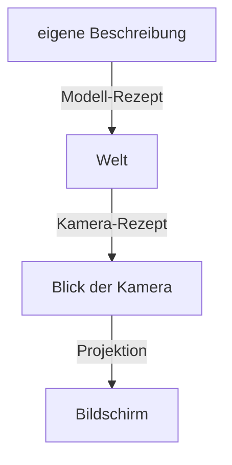
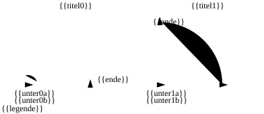
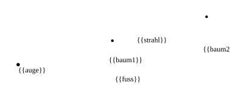
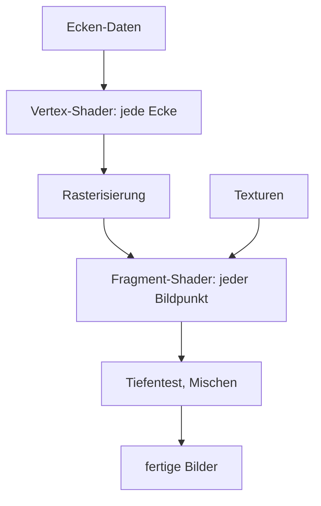
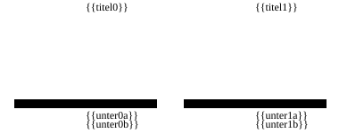
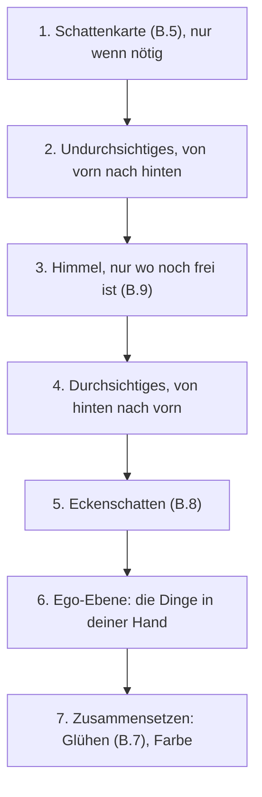
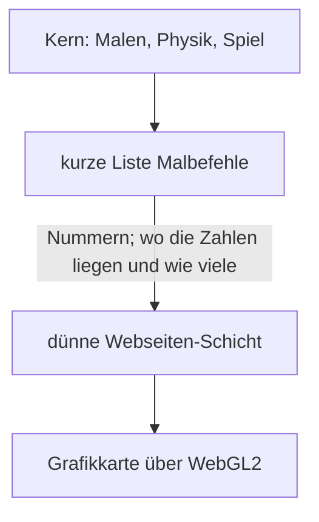

# Anhang B – Grundlagen: Wie aus Dreiecken Bilder werden

> **Kurz gesagt:** Dieser Anhang erklärt das Handwerk hinter jedem 3D-Spiel: wie ein Ding an die
> richtige Stelle des Bildschirms kommt, wie die Grafikkarte Dreiecke in Bildpunkte verwandelt und wie
> Licht, Schatten, Glanz und Farbe entstehen – 60-mal pro Sekunde im Browser. Bei jedem Grundbegriff
> erfährst du kurz, wie Kern ihn umsetzt.

> **Begriffe vorab:**
> - **Pixel** – ein einzelner Bildpunkt des Bildschirms; ein Bild besteht aus Millionen davon.
> - **Koordinaten** – drei Zahlen, die sagen, wo etwas ist: wie weit nach rechts, nach vorne, nach oben.
> - **Grafikkarte** (auch GPU) – der Spezialchip, der Millionen Bildpunkte gleichzeitig ausmalt.
> - **Mesh** – das Drahtgitter aus Dreiecken, aus dem ein 3D-Ding besteht.
> - **Shader** – ein kleines Malprogramm, das auf der Grafikkarte läuft.
> - **Textur** – ein Bild, das wie ein Aufkleber auf ein Mesh geklebt wird.

Lies diesen Anhang am besten **vor** [Kapitel 4](04-grafik.md): Dort geht es darum, wie Kern die
Bausteine zusammensetzt, hier um das „Warum“. Die genauen Namen und Werte stehen im blauen Buch,
Anhang B.

## B.1 Koordinatenräume

### Die Matrix: ein Rezept für jeden Punkt

Ein Ding in einem 3D-Spiel muss ständig bewegt werden: verschoben, gedreht, größer oder kleiner
gemacht. Dafür benutzt man eine **Matrix**. Stell sie dir als **Rezept** vor, das man auf jeden
einzelnen Punkt eines Dings anwendet: „Strecke ihn auf das Doppelte, drehe ihn um 90 Grad, schiebe ihn
5 m nach rechts.“ Man wirft einen Punkt hinein, und der neue Punkt kommt heraus. Wendet man dasselbe
Rezept auf alle Ecken eines Meshes an, bewegt sich das ganze Ding.

Aufgeschrieben ist so ein Rezept als kleine Tabelle aus 4 × 4 = 16 Zahlen. Wie man mit ihr rechnet,
musst du nicht können – wichtig sind drei Eigenschaften:

- **Ein Rezept für alles:** Strecken, Drehen und Verschieben passen in eine einzige Matrix.
- **Rezepte lassen sich zusammenfassen:** Zwei Rezepte hintereinander ergeben wieder ein Rezept. Das
  nennt man Matrizen **multiplizieren**. Die Grafikkarte muss dann nur noch ein Rezept anwenden statt
  vieler.
- **Die Reihenfolge zählt:** Erst drehen, dann verschieben ist etwas anderes als erst verschieben,
  dann drehen (dazu gleich die Falle).

### Die vierte Zahl w

Ein Punkt hat drei Koordinaten. Trotzdem hängt man ihm eine **vierte Zahl** an, w genannt. Warum?

Ein Rezept kann nur mit den Zahlen rechnen, die der Punkt mitbringt: Es kann sie malnehmen und
zusammenzählen, mehr nicht. „Plus 5 m“ ist aber eine feste Zugabe, die
mit keiner Koordinate des Punkts zu tun hat. Der Trick: Man gibt jedem Punkt eine feste vierte Zahl
mit, die einfach **1** ist. Dann kann das Rezept sagen: „plus 5 m mal diese vierte Zahl“ – und 5 m
mal 1 sind genau 5 m.

Eine **Richtung** dagegen („nach Norden“, „senkrecht nach oben“) bekommt als vierte Zahl eine **0**.
„5 m mal 0“ ist nichts: Sie wird gedreht, aber nie verschoben – eine Richtung hat keinen Ort. Beispiel
mit dem Rezept „5 m nach rechts“:

| Was | vorher (x; y; z; w) | nachher |
|---|---|---|
| Punkt | (1; 2; 3; **1**) | (**6**; 2; 3; 1) |
| Richtung | (1; 2; 3; **0**) | (1; 2; 3; 0), unverändert |

> **Stell dir vor …** … eine Hausnummer und die Angabe „Richtung Norden“. Zieht die ganze Stadt 5 km
> nach Osten um, hat dein Haus einen neuen Ort. „Norden“ bleibt Norden.

Später hilft w noch ein zweites Mal, bei der Perspektive (weiter unten).

**In Kern:** Es gibt zwei Rechenwege, einen für Punkte (w = 1) und einen für Richtungen (w = 0).

### Warum es mehrere Räume gibt

Der Rumpf der Micro Duck wird einmal in seiner **eigenen** Beschreibung festgelegt: „Der Kopf sitzt
ein Stück über der Mitte.“ Dann steht die Ente irgendwo in der Welt, eine Kamera schaut auf sie, und am Ende
landet sie auf Pixeln. Jeder Schritt ist ein anderes Koordinatensystem – ein anderer **Raum** –, und
für jeden Wechsel gibt es ein Rezept:

> **Stell dir vor …** … den Weg zu deinem Lieblingstisch im Café: „hinten links am Fenster“ (eigene
> Beschreibung des Cafés), „das Café liegt Hauptstraße 12“ (Welt), „von mir aus schräg rechts vorne“
> (Blick der Kamera), „auf meinem Handyfoto oben rechts“ (Bildschirm). Ein Tisch, vier Beschreibungen.

Weil alle Schritte Rezepte sind, fasst man sie zu einem einzigen zusammen. So rechnet die Grafikkarte
jede Ecke in einem Rutsch von der eigenen Beschreibung bis auf den Bildschirm.

### Kerns Gewohnheiten

Kern rechnet in **Metern**, und **Z zeigt nach oben** – x und y spannen den Boden auf
([Kapitel 3](03-grundlagen.md)). Die Lage eines Dings baut Kern immer in derselben Reihenfolge: erst
**strecken**, dann **drehen**, dann **verschieben**.

> **Achtung, Falle!** Reihenfolge zählt! Stell dir einen Spielstein in der Mitte eines Tischs vor
> (● ist die Tischmitte; das Rezept soll um 90° drehen und 5 m nach rechts schieben; die Spitze von
> ▶ und ▲ zeigt, wohin der Stein schaut). Im Bild unten steht der Stein im ersten Fall am Ende rechts
> neben der Mitte, im zweiten über ihr: Die Drehung wirkt immer um die Tischmitte, und wer schon
> weggefahren ist, wird mit herumgeschwenkt.

> **Für Neugierige:** In der Formel schreibt man so ein zusammengesetztes Rezept „rückwärts“ als
> Verschieben · Drehen · Strecken. Das Rezept, das direkt neben dem Punkt steht, wirkt zuerst. Deshalb
> heißt es in Kapitel 3, der Punkt wird „von rechts“ an die Matrix multipliziert – gemeint ist dasselbe.
> Drehungen speichert Kern übrigens als **Quaternion**, vier Zahlen statt drei Winkeln: Drei Winkel
> nacheinander können sich gegenseitig blockieren, sodass plötzlich eine Drehrichtung fehlt.

### Ansicht und Perspektive

Das **Kamera-Rezept** macht etwas Überraschendes: Es bewegt nicht die Kamera, sondern die **ganze
Welt** – so lange, bis die Kamera in der Mitte steht und geradeaus schaut. Wie beim Filmdreh im Auto:
Statt das Auto fahren zu lassen, zieht man die Kulisse am Fenster vorbei. Gebaut wird das Rezept aus
drei Angaben: wo die Kamera steht, wohin sie schaut und wo „oben“ ist.

Schaut die Kamera genau in Richtung „oben“ (oder genau entgegen), geht das nicht: Wer senkrecht
nach oben schaut, weiß nicht mehr, wo oben im Bild sein soll. Kern verweigert dann das Bild, statt Unsinn zu malen.

**Perspektive** heißt: Doppelt so weit weg erscheint halb so groß. Wie groß etwas im Bild erscheint,
ist also seine Größe **geteilt durch die Entfernung**.

Ein 2 m hoher Baum in 10 m Entfernung erscheint also genauso groß wie ein 1 m hoher in 5 m. Ein
Rezept kann aber nur malnehmen und zusammenzählen, nicht teilen. Also notiert es die Entfernung in der
vierten Zahl, und die Grafikkarte teilt am Ende selbst alles durch diese Zahl.

Für Editor-Ansichten gibt es auch die **Parallelansicht** ohne Perspektive: Dort wird Fernes nicht
kleiner, wie auf einem Bauplan. Kerns Standardwerte für die Kamera stehen im blauen Buch, Anhang B.

Das blaue Buch rechnet einen Punkt 10 m vor der Kamera Schritt für Schritt bis auf seinen Bildpunkt
durch, samt der Zwischenstationen zwischen Kamera und Bildschirm.

> **Probier's aus!** Öffne in Kern Studio oben im Ansichtsfenster das Menü **≡** und schalte das
> **Sichtfeld** (Field of View), also den Öffnungswinkel, zwischen 50° und 110° um – bei 110° wirkt
> die Welt wie durchs Weitwinkelobjektiv, an den Rändern stark gestreckt. Mit **Alt+J** springst du
> in die Ansicht **Oben** (Top), eine Parallelansicht von oben: Ferne Gebäude sind plötzlich so groß wie nahe.

### Tiefe ist ungleich verteilt

Für jeden Bildpunkt merkt sich die Grafikkarte, wie weit das Gemalte entfernt ist (der Tiefenpuffer,
B.2). Diese Tiefe speichert sie aber nicht wie ein normales Maßband. Nah an der Kamera sind die Striche
sehr eng, in der Ferne sehr weit.

> **Stell dir vor …** … ein Lineal, dessen Striche nah am Auge im Abstand von Haaren liegen und hinten
> im Abstand von Metern. Nah kannst du winzige Unterschiede messen, fern nur grobe.

Warum? Die Grafikkarte teilt am Ende alles durch die Entfernung, wie im vorigen Abschnitt, und die
Tiefe ist davon nicht ausgenommen. Dasselbe Teilen, das ferne Bäume im Bild klein macht, drückt auch
ferne Entfernungen auf der Tiefenskala eng zusammen: Zwischen 100 m und 200 m liegen dort kaum mehr
Striche als zwischen 1 m und 2 m.

Wie grob, zeigt diese kleine Tabelle mit Kerns Einstellungen:

| Entfernung | kleinster Abstand, den die Tiefe noch trennt |
|---|---|
| 10 m | etwa 0,1 mm |
| 1000 m | etwa 1,2 m |

Wie eng die Striche vorne liegen, hängt vor allem von der **nahen Ebene** ab: der Entfernung, ab der
die Kamera überhaupt etwas sieht (in Kern 5 cm). Alles davor wird abgeschnitten. Das Lineal beginnt
an der nahen Ebene, und dort liegen seine engsten Striche. Liegt sie ganz dicht vor der Linse, gehen
viele dieser kostbaren Striche für den leeren Raum direkt vor der Kamera drauf, wo fast nie etwas
steht. Schiebt man die nahe Ebene doppelt so weit hinaus, rutschen die Striche mit, und die Tiefe
wird **überall doppelt so genau**.

> **Wusstest du?** Daher flackern in manchen Spielen ferne, dicht beieinanderliegende Flächen
> („Z-Fighting“): Der Tiefenpuffer kann sie dort schlicht nicht mehr auseinanderhalten und malt mal die
> eine, mal die andere.

### Normalen

Eine **Normale** ist ein gedachter Pfeil, der senkrecht aus einer Fläche zeigt. Sie ist der „Blick“
der Fläche und bestimmt, wie hell die Fläche im Licht ist: Schaut sie zur Sonne, ist sie hell, schaut
sie weg, dunkel (B.4).

Staucht man ein Ding ungleichmäßig, darf man die Normalen nicht einfach mitstauchen – sonst stehen
sie schief. Ein Beispiel: Ein Dach ist 45° geneigt, seine Normale zeigt schräg nach oben. Staucht man
das Haus auf halbe Höhe, wird das Dach flacher – seine Normale müsste also *steiler* nach oben zeigen.
Staucht man den Pfeil aber einfach mit, kippt er *flacher*. Genau falsch herum!

Die Faustregel: Was die Fläche streckt, muss die Normale stauchen, und umgekehrt. Dafür braucht jedes
Ding ein eigenes kleines Rezept nur für seine Normalen.

**In Kern:** Dieses Normalen-Rezept rechnet Kern einmal pro Ding aus; ein auf Größe null gestauchtes
Ding lehnt er ab, weil es dafür keins gibt.

## B.2 Vom Dreieck zu Bildpunkten

Nach der Projektion liegen die drei Ecken eines Dreiecks als Punkte auf dem Bildschirm. Nun schaut die
Grafikkarte nach, welche Pixel innerhalb des Dreiecks liegen. Das heißt **Rasterisierung**. Für jeden
solchen Pixel entsteht ein **Fragment**, ein Kandidat für einen Bildpunkt – „Kandidat“, weil es
später noch durchfallen kann, etwa wenn schon etwas Näheres an dieser Stelle steht (gleich beim
Tiefenpuffer).

Was an den Ecken steht – Farbe, Normale, Texturkoordinate –, wird dazwischen **gemischt**
(interpoliert). Jede Ecke bekommt einen Anteil, und die Anteile ergeben zusammen 100 %. Ein Fragment
genau in der Mitte bekommt von jeder Ecke ein Drittel; eines direkt an Ecke v0 fast alles von v0. So
entstehen weiche Farbverläufe über das Dreieck.

Einen Haken hat das Mischen: Weil Fernes kleiner erscheint, liegt auf einem schräg nach hinten
laufenden Dreieck die hintere Hälfte auf weniger Bildpunkten als die vordere. Mischte die Grafikkarte
gleichmäßig über das Bild, verzerrte sich eine Textur – die Fugen eines Fliesenbodens lägen hinten zu
weit auseinander. Darum mischt sie **perspektivisch richtig**: Sie berücksichtigt beim Mischen die
Entfernung jeder Ecke, und die Fliesen werden nach hinten gleichmäßig kleiner.

**Der Tiefenpuffer.** Treffen mehrere Dreiecke dasselbe Pixel, muss die Grafikkarte entscheiden, was
vorne ist. Dafür führt sie den **Tiefenpuffer**: ein unsichtbares zweites Bild, in dem für jeden Pixel
steht, wie weit das bisher Gemalte entfernt ist. Ein neues Fragment wird nur gemalt, wenn es näher
ist.

> **Stell dir vor …** … einen Maler, der neben jedem Pinselstrich notiert, wie weit das Gemalte weg
> war. Kommt ein neuer Strich für dieselbe Stelle, schaut er auf seinen Zettel: Liegt der neue weiter
> hinten, malt er ihn gar nicht erst.

Für Undurchsichtiges ist die Reihenfolge damit egal – für die Geschwindigkeit nicht. Kern malt
Undurchsichtiges **von vorne nach hinten**: Verdecktes fällt so früh durch, bevor der teure Shader
läuft. **Durchsichtiges** kommt danach **von hinten nach vorne** und wird mit dem Dahinterliegenden
gemischt; hier zählt die Reihenfolge, wie bei Folien übereinander. Der **Himmel** füllt nur die Lücken,
und die Dinge in deiner Hand (die Ego-Ebene) kommen zuletzt ([Kapitel 4](04-grafik.md), 4.7).

**Rückseiten.** Bei geschlossenen Körpern sind Dreiecke, die von der Kamera wegzeigen, immer verdeckt
– wie die Rückseite eines Würfels. Die Grafikkarte erkennt sie daran, ob ihre Ecken auf dem Bildschirm
im oder gegen den Uhrzeigersinn aufeinanderfolgen, und lässt sie weg (**Backface Culling**). Eine
Spiegelung dreht diesen Umlaufsinn um; deshalb behandelt Kern gespiegelte Kopien gesondert
([Kapitel 4](04-grafik.md), 4.4).

> **Probier's aus!** Schalte in Kern Studio mit **Alt+2** auf **Drahtgitter** (Wireframe) und sieh
> die Dreiecke, aus denen alles besteht. **Alt+3** zeigt **Unbeleuchtet** (Unlit), also Farbe ohne
> Licht, **Alt+4** wieder **Beleuchtet** (Lit), mit Licht.

## B.3 Das Fließband der Grafikkarte

Die Grafikkarte arbeitet wie ein Fließband. Jeder Malauftrag – ein **Zeichenaufruf** (englisch *draw
call*), also „Male diese Form“ – läuft durch dieselben Stationen:

Zwei Stationen sind programmierbar: Der **Vertex-Shader** läuft einmal pro Ecke und sagt, wo sie auf
dem Bildschirm landet. Der **Fragment-Shader** läuft einmal pro Fragment und sagt, welche Farbe es
bekommt. Dabei arbeiten sie mit vier Arten von Daten:

| Art | Beispiel |
|---|---|
| Steckbrief jeder Ecke (oder Kopie) | Position, Normale |
| Ansage für den ganzen Malauftrag | Sonnenrichtung, Materialfarbe |
| Zwischenwert, der übers Dreieck gemischt wird | Farbe zwischen den Ecken |
| aufgeklebtes Bild (Textur) | Holzmaserung, Schattenkarte |

Die Fachwörter dafür stehen im blauen Buch, Anhang B.

Drei Tricks machen das Fließband schnell:

- **Instancing (Kopien):** Hundert gleiche Bäume malt man mit **einem** Malauftrag. Die Form ist nur
  einmal da; jede Kopie bringt nur ihren Ort und Farbton mit. Bewegt sich etwas, ändern sich nur diese
  Angaben – die Form selbst bleibt auf der Grafikkarte.
- **Skinning (Haut über Knochen):** Bei Figuren folgt jede Ecke bis zu vier Knochen, jeder mit einem
  Anteil, zusammen 100 % – so biegt sich die Haut am Ellbogen weich.
- **Mehrere Bilder auf einmal:** Ein Fragment-Shader kann gleichzeitig in mehrere Bilder schreiben. So
  spart man sich einen zweiten Durchgang über alle Dreiecke.

**In Kern:** Jede Form wird als Kopien-Paket gemalt, und der eine Standard-Shader schreibt drei Bilder
auf einmal – das fertige Foto, das echte Licht fürs Glühen (B.7) und Notizen für die Eckenschatten
(B.8).

## B.4 Beleuchtung

### Was einen Bildpunkt hell macht

Das Licht, das von einer Fläche in dein Auge kommt, ist ihr **eigenes Leuchten** plus alles Licht, das
auf sie fällt und das sie **in deine Richtung zurückwirft**. Wie eine Oberfläche das tut, ist ihr
„Charakterprofil“: Ein Spiegel wirft alles in eine Richtung, eine Wand verteilt es gleichmäßig.

Alles Licht der Welt aufzusummieren, auch das, was von Wänden zurückprallt, wäre viel zu teuer. Spiele
teilen deshalb auf: **direktes Licht** (Sonne, Lampen) wird genau gerechnet, **indirektes Licht** aus
der Umgebung nur grob geschätzt.

### Matte Flächen

Eine matte Fläche, etwa Papier oder ein Acker, verteilt Licht gleichmäßig in alle Richtungen. Wie hell
sie ist, hängt nur davon ab, **wie steil das Licht auftrifft**.

> **Stell dir vor …** … eine Taschenlampe senkrecht auf den Tisch: ein kleiner, heller Kreis. Kippst
> du sie, wird der Fleck zum langen, blassen Oval – gleiches Licht, mehr Fläche.

| Licht fällt … | Anteil der vollen Helligkeit |
|---|---|
| senkrecht ein | 100 % |
| um 45° gekippt | gut 70 % |
| um 60° gekippt | 50 % |
| streifend (90°) | 0 % |
| von hinten | 0 % |

Dazu kommt die **Albedo**: wie viel Licht eine Fläche überhaupt zurückwirft – Schnee sehr viel,
Asphalt wenig. Eine graue Fläche mit halber Albedo ist also halb so hell wie eine weiße im selben
Licht. Diese Regel trägt den Namen ihres Entdeckers **Lambert**. Metalle haben übrigens keinen matten
Anteil; ihr Licht steckt ganz im Glanz.

Eine Grenze gilt dabei immer: **Keine Fläche wirft mehr Licht zurück, als auf sie fällt** – auch
blütenweißes Papier nicht. Das Licht wird nur verteilt, nicht vermehrt, wie Wasser aus einem Eimer,
das man über viele Becher gießt. Kerns Rechnung ist so gebaut, dass sie diese Regel einhält; sonst
würde eine weiße Wand heller leuchten als die Sonne, die sie bescheint.

**Lampen** werden in Wirklichkeit mit der Entfernung schwächer, aber nie ganz null – jede Lampe müsste
also die ganze Welt beleuchten. Das wäre viel zu teuer.

**In Kern:** Jede Lampe hat eine Reichweite, an der ihr Licht weich auf null ausläuft, und es leuchten
höchstens sechs Lampen gleichzeitig.

### Glanz

Glänzende Flächen werfen Licht gerichtet zurück, daher der helle Fleck auf einem Apfel. Die heutige
Erklärung: Eine Fläche besteht aus Millionen winziger, verschieden schief stehender **Spiegelchen**.

Drei Fragen bestimmen den Glanz:

1. **Wie viele Spiegelchen zeigen genau so, dass sie Licht in mein Auge werfen?** Bei glatten Flächen
   zeigen alle Spiegelchen gleich: Nur aus einer Richtung siehst du den Glanz, dafür sehr hell. Bei
   rauen zeigen sie kreuz und quer: Aus vielen Richtungen siehst du ein bisschen Glanz, dafür schwach.
2. **Wie stark spiegelt die Fläche bei diesem Blickwinkel?** Bei flachem Blick viel mehr – wie ein
   See, der schräg betrachtet den Himmel spiegelt, von oben aber durchsichtig wirkt. Das heißt
   **Fresnel-Effekt**. Senkrecht spiegeln Nichtmetalle nur wenig, Metalle dagegen stark und in ihrer
   eigenen Farbe: Ein Goldring spiegelt eine weiße Lampe golden, eine rote Tasse spiegelt sie weiß.
3. **Verdecken sich die Spiegelchen gegenseitig?** Bei rauen Flächen werfen sie sich kleine Schatten.

**In Kern:** Zwei Regler, **Rauheit** und **Metall**, steuern ein vereinfachtes Glanzmodell mit
Sonnen-Glanzpunkt und Himmelsspiegelung.

> **Für Neugierige:** Die Fachnamen der drei Fragen lauten Verteilung (meist nach „GGX“), Fresnel
> (meist nach „Schlick“) und Geometrie. Kern beantwortet die dritte Frage mit der einfachsten Annahme
> und begrenzt die erste nach oben, damit keine einzelnen Riesen-Glanzpunkte flackern.

### Licht aus der Umgebung

Das indirekte Licht – wir nennen es **Umgebungslicht** – kommt nicht von einer Lampe, sondern von
ringsum: vom blauen Himmel, vom Boden, von Wänden. Genau ausrechnen kann man es nicht, also schätzt
man es mit wenigen Farben: oben Himmelsfarbe, unten Bodenfarbe, dazwischen gemischt nach der Neigung
der Fläche. Eine Wand bekommt so halb Himmel, halb Boden; ein Dach fast nur Himmel. Feiner ist eine
bunte Kuppel, die vom Boden über den Horizont bis zum Himmel über dir verläuft.

**In Kern:** Beides gibt es, und das Umgebungslicht läuft getrennt mit, damit die Eckenschatten (B.8)
nur dieses abdunkeln.

## B.5 Schattenkarten

Ein Punkt liegt im Schatten, wenn zwischen ihm und der Sonne etwas steht. Also malt man die Szene
einmal **aus Sicht der Sonne** und notiert für jeden Punkt dieser Karte nur, wie weit das erste
getroffene Ding entfernt ist – die **Schattenkarte**. Beim normalen Malen fragt jede Stelle: „Bin ich
weiter weg als das Notierte?“ Wenn ja, steht etwas davor.

Das klingt einfach, hat aber Tücken:

| Problem | Ursache | Gegenmittel |
|---|---|---|
| feine Streifen („Schattenakne“) | Fläche beschattet sich selbst | kleiner Sicherheitsabstand |
| Schatten löst sich vom Ding | Sicherheitsabstand zu groß | Abstand klein halten |

Weitere Tücken wie Treppchenkanten oder Flimmern und ihre Gegenmittel stehen im blauen Buch,
Anhang B.

Der **Sicherheitsabstand** ist das wichtigste Gegenmittel: Die Fläche gilt erst als beschattet, wenn
sie ein klein wenig weiter weg ist als das Notierte. Sonst würde sie sich wegen der groben Karte selbst
verdunkeln – wie die Streifen auf einem Foto vom Bildschirm. Ist der Abstand zu groß, schwebt der
Schatten dagegen ein Stück neben dem Ding; Fachleute nennen das nach der Märchenfigur „Peter Panning“,
weil Peter Pan seinen Schatten verliert.

Das zweite Gegenmittel ist ein **Schritt zur Seite**: Bevor eine Stelle auf der Karte nachschaut,
rückt sie ein Stückchen in die Richtung, in die ihre Fläche zeigt – bei schräg einfallendem Licht
etwas weiter, denn dort ist die Gefahr am größten. So misst die Fläche nicht gegen sich selbst, und
der Sicherheitsabstand darf klein bleiben.

**In Kern:** Die Karte deckt nur ab, was man bis zur Schattendistanz sieht, rastet auf ganze Punkte ein
und wird nur neu gemalt, wenn sich etwas ändert – warum das so wichtig ist und wie es zusammenspielt,
steht in [Kapitel 4](04-grafik.md), 4.8.1.

## B.6 Helles Licht, Bildschirm und Farbe

### Tonemapping

Echtes Licht hat einen riesigen Bereich, von fast dunkel bis gleißend hell. Ein Bildschirm kann
dagegen nur von Schwarz bis Weiß. Man rechnet deshalb mit dem **echten** Licht, auch
wenn es viel heller als Weiß ist (Fachwort **HDR**, *high dynamic range*), und presst es erst ganz am
Ende auf den Bildschirmbereich. Dieses Zusammenpressen heißt **Tonemapping**. Eine gute Kurve lässt
mittlere Helligkeiten fast, wie sie sind, und rundet sehr Helles weich ab:

**In Kern:** Die Kurve ist eine bewährte Filmkurve aus der Kinotechnik, wie sie auch andere
verbreitete Grafikprogramme benutzen; danach kann noch eine Farbkorrektur folgen.

> **Probier's aus!** Dreh im Reiter **Welteinstellungen** (World Settings) die **Belichtung**
> (Exposure) hoch und runter.
> Helle Stellen laufen weich ins Weiß, statt hart abzuschneiden – die Filmkurve bei der Arbeit.

### Gamma und sRGB

Bildschirme und Bilddateien speichern Helligkeit nicht so, wie Licht sich verhält, sondern so, wie
unser Auge es empfindet: Ein Bildschirm kennt pro Grundfarbe nur 256 Helligkeitsstufen, und dunkle
Töne bekommen viel mehr davon, weil wir dort
feinere Unterschiede sehen. Diese Schreibweise heißt **sRGB**. Die Schreibweise, die echtes Licht
abbildet, heißt **linear**: Doppelt so viel Licht ist dort doppelt so viel Zahl.

| echtes Licht (linear) | als sRGB-Wert gespeichert |
|---|---|
| 5 % | etwa 25 % |
| 18 % | etwa 46 % |
| 50 % | etwa 74 % |
| 100 % | 100 % |

Die zweite Zeile ist berühmt: 18 % des Lichts empfindet das Auge als **mittleres Grau**, und in sRGB
steht es tatsächlich fast in der Mitte der Skala.

Das Problem: Licht addiert sich **linear**. Zwei Lampen machen doppelt so viel Licht – aber der
sRGB-Wert verdoppelt sich nicht. Wer mit sRGB-Zahlen rechnet, rechnet falsch, ungefähr so, als würde
man Schuhgrößen addieren. Darum gilt: Farben **erst nach linear** umrechnen, linear rechnen, ganz am
Ende **zurück nach sRGB**.

> **Achtung, Falle!** Wer in sRGB rechnet, bekommt zu dunkle Übergänge und falsche Mischfarben.

### Nebel

Nebel wird mit der Entfernung dichter. Kern mischt ihn so ein, dass die Nähe lange klar bleibt und der
Dunst dann rasch zuzieht. Mit Kerns Standardnebel:

| Entfernung | Anteil Nebel |
|---|---|
| 100 m | kaum, unter 1 % |
| 500 m | etwa 17 % |
| 1000 m | etwa die Hälfte |
| 2000 m | fast alles |

**In Kern:** Auf Wunsch wird der Nebel nach oben dünner und leuchtet in Richtung Sonne in
Sonnenfarbe.

## B.7 Bloom: das Glühen

**Bloom** ist der Lichthof um sehr helle Stellen, wie Gegenlicht im Auge oder in einer Kamera. Das
Rezept: das sehr Helle ausschneiden, unscharf machen und wieder darüberlegen. Das Unscharfmachen
geschieht gern auf verkleinerten Bildern – das ist billiger und gibt einen breiteren Schein.

Unscharf machen heißt: Jeder Bildpunkt wird mit seinen Nachbarn in einem Quadrat gemischt. Das sind
viele Blicke pro Punkt. Viel schneller geht es in zwei Durchgängen.

> **Stell dir vor …** … du willst ein Kästchenbild verwischen. Statt jedes Kästchen mit allen
> Nachbarn im Quadrat zu mischen, verwischst du erst jede Zeile nach links und rechts und dann jede
> Spalte nach oben und unten. Das Ergebnis ist dasselbe – aber bei einem Quadrat von 9 × 9 Kästchen
> brauchst du statt 81 Blicken nur 18.

Die Mischanteile ergeben zusammen genau 100 %, damit das Bild weder heller noch dunkler wird. Weitere
Spartricks stehen im blauen Buch, Anhang B.

**In Kern:** Das Glühen entsteht aus dem echten Licht des Shaders, wird auf zwei verkleinerten Stufen
verwischt und als feine Folie über das fertige Foto gelegt ([Kapitel 4](04-grafik.md), 4.8.3).

## B.8 Eckenschatten: Umgebungsverdeckung

In Ecken, Fugen und unter Dingen kommt weniger Umgebungslicht an, weil ein Teil des Himmels verdeckt
ist. Diese **Umgebungsverdeckung** (englisch *ambient occlusion*, kurz AO) lässt Dinge auf dem Boden
„stehen“ statt schweben. Sie fragt: *Wie viel Himmel über diesem Punkt ist frei?* Dabei zählt Himmel
direkt über der Fläche mehr als Himmel knapp über dem Horizont – aus demselben Grund wie bei der
Taschenlampe: Steil einfallendes Licht trifft eine Fläche kräftiger als flaches. Die Sonne hat ihre
eigenen Schatten; AO betrifft nur das Umgebungslicht.

> **Stell dir vor …** … du liegst in einer Mulde im Gras und schaust nach oben. Je tiefer die Mulde,
> desto kleiner dein Stück Himmel – und desto dunkler ist es bei dir, auch ohne Sonnenschatten.

Strahlen durch die ganze Szene zu schicken, wäre zu teuer. Darum schätzt man die Verdeckung aus dem
fertigen Tiefenpuffer, also aus dem, was ohnehin schon auf dem Bildschirm ist. Das Verfahren **GTAO**
schaut von jedem Punkt in ein paar Richtungen, sucht links und rechts, wie hoch die Umgebung den
Himmel verdeckt (den **Horizont**), und rechnet aus, wie viel Himmel dazwischen frei bleibt.

**In Kern:** Kern nutzt GTAO, dunkelt damit nur das Umgebungslicht ab, das der Shader nebenbei notiert
hat, und braucht dafür keinen zweiten Durchgang über alle Dreiecke ([Kapitel 4](04-grafik.md), 4.8.4).

## B.9 Himmel und Atmosphäre

Der Himmel ist blau, weil die Luft blaues Licht viel stärker zur Seite ablenkt (**streut**) als
rotes – um ein Mehrfaches stärker. Von überall am Himmel kommt also abgelenktes
Blau in dein Auge. Am Horizont ist der Weg durch die Luft länger; das Licht wird mehrfach abgelenkt,
der Himmel dort heller, und bei tiefer Sonne wird er rötlich – das Blau ist unterwegs schon
herausgestreut. Um die Sonne herum lenken größere Teilchen wie Staub und Tröpfchen das Licht nur
wenig ab, fast geradeaus weiter, und machen den hellen Hof.

> **Für Neugierige:** Die Fachnamen lauten **Rayleigh-Streuung** (die Luft, die das Blau streut) und
> **Mie-Streuung** (die größeren Teilchen, die den Hof um die Sonne machen).

Echte Himmelsmodelle verfolgen das Licht Schritt für Schritt entlang jedes Blicks durch die Luft.
**In Kern:** Der Himmel ist bewusst keine solche Lichtrechnung, sondern ein billiges Rezept aus
Farbverlauf, goldener Stunde, Sonne, Mond, Sternen und Wolken, das ähnlich aussieht und nur die Lücken
füllt ([Kapitel 4](04-grafik.md), 4.8.2).

## B.10 Unsichtbares weglassen

Was außerhalb des Bildes liegt, muss man nicht malen. Der Bereich, den eine Kamera sieht, ist eine
liegende Pyramide mit abgeschnittener Spitze, die **Sichtpyramide** (englisch *frustum*). Um zu prüfen,
ob ein Ding darin liegt, steckt man es in eine gedachte **Hüllkugel** und fragt: Liegt die Kugel ganz
hinter einer der Wände der Pyramide? Dann ist das Ding unsichtbar.

Der Test ist **vorsichtig**: Er wirft nie Sichtbares weg, lässt aber manchmal Unsichtbares durch, etwa
Kugeln nahe einer Ecke der Pyramide. Im Zweifel wird eben gemalt.

**In Kern:** So prüft Kern jedes Ding vor dem Malen – außer Figuren mit Skelett, deren Arme und Beine
aus der Kugel ragen können. Ein Paket mit vielen Kopien (B.3) bekommt eine Kugel, die **alle** Kopien
umschließt. Ist auch nur eine Kopie sichtbar, wird das ganze Paket gemalt – es ist ja ein einziger
Malauftrag.

> **Probier's aus!** Schalte in Kern Studio unter **Fenster › Anzeigen** (Window › Show) die
> **Begrenzungen** (Bounds) ein und sieh die Hüllen,
> mit denen Kern entscheidet, was in der Sichtpyramide liegt – auch um Bäume, Gebäude und die Ente.

Ein verwandtes Problem ist das **Anklicken**: Welches Dreieck liegt unter der Maus? Dafür schickt man
einen gedachten **Strahl** vom Auge durch den Mauszeiger in die Welt und sucht das erste Dreieck, das
er trifft. Bei vielen Dreiecken hilft ein **Baum aus Kästen** (englisch *BVH*): Ganz oben ein Kasten
um alles, darin zwei kleinere Kästen, darin wieder zwei, bis unten einzelne Dreiecke liegen. Trifft
der Strahl einen Kasten nicht, fällt alles darin auf einen Schlag weg – wie beim Zahlenraten mit
„größer oder kleiner?“, wo zehn Fragen statt tausend Versuchen reichen.

**In Kern:** Der Baum aus Kästen dient dem **Anklicken** – welches Dreieck liegt unter der Maus? –,
nicht dem Malen; die Physik hat ihren eigenen ([Anhang C](C-grundlagen-physik.md)). Einen Baum
bekommen nur **unbewegte** Formen der Welt. Warum? Bewegt sich eine Form, stimmen ihre Kästen im
nächsten Bild nicht mehr, und der Baum müsste ständig neu gebaut werden. Bewegte Formen prüft Kern
deshalb direkt, Dreieck für Dreieck.

## B.11 Wenige große Aufträge

Jeder **Zeichenaufruf** kostet Zeit, bevor die Grafikkarte überhaupt anfängt: Einstellungen prüfen,
Daten bereitlegen, Werte schicken – im Browser zusätzlich der Weg über die Brücke zur Webseite samt
Prüfung. Tausende kleine Aufrufe können länger dauern als die eigentliche Malarbeit. Auch jedes
Umschalten, etwa auf eine andere Textur, kostet.

> **Stell dir vor …** … du gehst einkaufen. Hundertmal für je eine Zutat in den Laden zu laufen dauert
> viel länger als einmal mit vollem Korb – obwohl am Ende dasselbe im Kühlschrank steht.

### Der Ablauf eines Bildes

Wie greifen Schatten, Himmel, Eckenschatten und Glühen aus diesem Anhang ineinander? Für jedes Bild
geht Kern die Arbeit in fester Reihenfolge durch, wie eine Malerin, die erst den Hintergrund und
zuletzt die Lichter setzt:

Undurchsichtiges kommt von vorn nach hinten, damit verdeckte Bildpunkte gar nicht erst ausgerechnet
werden; Durchsichtiges von hinten nach vorn, damit Glas das richtig mischt, was dahinter liegt.

**In Kern:** Ein einziges Malprogramm, Kopien statt Duplikate, ein Merkzettel gegen doppelte Werte,
Schattenkarte nur bei Bedarf und Formen nur einmal hochladen – und eine Statistik zeigt, wie viele
Aufträge ein Bild gekostet hat ([Kapitel 4](04-grafik.md), 4.7 und 4.12).

## B.12 Warum Kern und Browser so zusammenarbeiten

Kern ist ein eigenes, schnelles Programm, das **in** der Webseite läuft. Geschrieben ist es in einer
Programmiersprache für schnelle Programme (C++); Browser verstehen von Haus aus aber nur ihre eigene
Sprache (JavaScript). Die Brücke heißt **WebAssembly**: ein kompaktes Format, das der Browser fast so
schnell wie ein normales Programm ausführt. Ein WebAssembly-Programm darf allerdings nur Zahlen
austauschen und nur das benutzen, was ihm die Webseite beim Start ausdrücklich in die Hand gibt. Die
Grafikkarte erreicht allein die Webseite, über **WebGL2**, die Malschnittstelle des Browsers.

> **Stell dir vor …** … Kern wohnt als Untermieter in der Webseite. Nur die Hauptmieterin, die Seite,
> hat den Schlüssel zum Keller mit der Grafikkarte. Kern schreibt seine Wünsche auf Zettel und reicht
> sie durch die Tür – und auf den Zetteln stehen nur Zahlen.

Daraus folgen Kerns wichtigste Entscheidungen, in Alltagssprache:

| Entscheidung | Warum |
|---|---|
| alles in einer Sprache | dann rechnet es überall gleich – im Browser, in Tests, im Lehrer |
| Webseiten-Schicht hauchdünn | nichts doppelt, nichts, was anders rechnen könnte |
| kurze, feste Liste der Malbefehle | alles Gebrauchte steht an einer Stelle |
| Nummern statt Dingen | über die Brücke passen nur Zahlen (Garderobenmarken) |
| Kopien von allem | Versicherung, falls der Browser die Grafikkarte wegnimmt |
| wenige Aufträge, Merkzettel | jeder Weg über die Brücke kostet |
| Malen ohne Bildschirm möglich | der Lehrer rechnet dieselbe Welt ohne Grafik |
| ein Arbeitsfaden pro Kern-Kopie | mehr Tempo über Helfer mit eigener Kern-Kopie |

Der **Lehrer** ist Kerns Trainingsschule, die der Micro Duck neue Bewegungen beibringt
([Kapitel 14](14-lehrer.md)). Er braucht kein Bild, nur dieselbe Welt mit derselben Physik. Und er
zeigt die letzte Zeile der Tabelle: Im Browser arbeitet Kern auf einem einzigen **Arbeitsfaden**, wie
ein Koch, der alles nacheinander erledigt. Soll mehr gleichzeitig geschehen, startet die Webseite
zusätzliche Helfer (**Web Worker**), und jeder bekommt seine eigene Kopie von Kern – mehrere Köche,
jeder in seiner eigenen Küche, statt vieler Köche an einem Herd.

Die genauen Namen der Bauteile stehen im blauen Buch, Anhang B.

## Das nimmst du mit

- Eine **Matrix** ist ein Rezept, das jeden Punkt streckt, dreht und verschiebt; Rezepte lassen sich
  zu einem zusammenfassen, und die Reihenfolge zählt.
- Die **vierte Zahl w** ist 1 für Orte und 0 für Richtungen – die Hausnummer zieht um, „Norden“ nicht.
- Ein Ding wandert wie der Café-Tisch durch vier Beschreibungen bis auf den Bildschirm.
- **Doppelt so weit weg, halb so groß**; die Grafikkarte teilt dafür durch w.
- Der Tiefenpuffer misst nah sehr fein, fern grob; die **nahe Ebene** entscheidet.
- Vertex-Shader rechnen Ecken, Fragment-Shader Bildpunkte.
- Licht = matter Anteil (Taschenlampe) + Glanz (Spiegelchen, See) + grobes Umgebungslicht.
- Schattenkarten sind ein Foto aus Sicht der Sonne, mit kleinem Sicherheitsabstand.
- Gerechnet wird mit **echtem, linearem Licht**; eine **Filmkurve** presst es auf den Bildschirm.
- Wenige große Aufträge machen ein Spiel schnell – einmal einkaufen mit vollem Korb.

## Knobelecke

1. Warum bekommt eine Richtung w = 0 und ein Ort w = 1?
2. Ein Ding ist doppelt so weit weg wie ein gleich großes anderes. Wie groß erscheint es?
3. In der Ferne flackern zwei dicht beieinanderliegende Flächen. Was hilft am meisten?
4. Warum darf man Farben nicht einfach als sRGB-Zahlen addieren?
5. Warum malt Kern den Himmel *nach* den undurchsichtigen Dingen?

### Lösungen

1. Mit w = 0 wird nichts verschoben – eine Richtung hat keinen Ort. Die Hausnummer zieht um, „Norden“
   bleibt Norden.
2. Halb so groß: Die Grafikkarte teilt durch die Entfernung.
3. Die nahe Ebene weiter hinausschieben: Doppelt so weit heißt überall doppelt so genau, denn die
   feinen Striche werden nicht mehr für den leeren Raum direkt vor der Kamera verbraucht.
4. Licht addiert sich linear, sRGB-Zahlen aber nicht – wie Schuhgrößen. Mischungen und Verläufe werden
   dann falsch, meist zu dunkel.
5. Dann kommt der Himmel nur an Stellen durch, auf denen noch nichts liegt, und der teure Himmels-Shader
   läuft nur dort, wo wirklich Himmel ist.

---

© 2026 Christian Heinrich Hohlfeld · Alle Rechte vorbehalten · [Impressum und Rechte](00-impressum.md)
