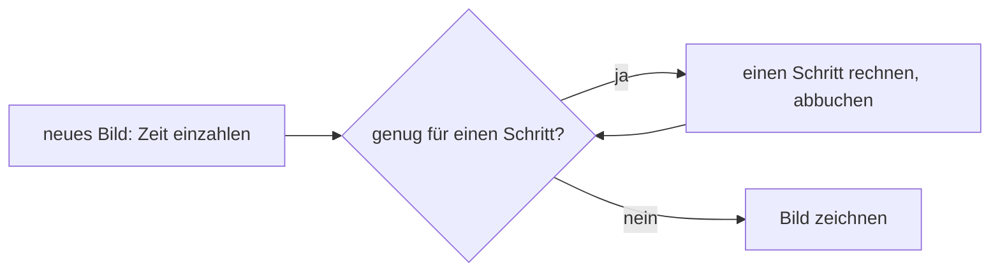
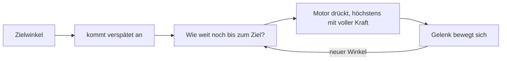

# Anhang C – Grundlagen: Wie eine Physiksimulation denkt

> **Kurz gesagt:** Wie bringt man einem Computer bei, dass Kisten fallen, Bälle abprallen und Türen
> schwingen? Dieser Anhang erklärt die Ideen hinter jeder Physiksimulation: Zustand, Zeitschritte,
> Kollisionen, Reibung, Gelenke, den Solver, Servos als Regelkreis – und warum Kern auf jedem Rechner
> Bit für Bit dasselbe Ergebnis liefert.

> **Begriffe vorab:**
> - **Hertz (Hz)** – „wie oft pro Sekunde“. Eine Schaukel, die zweimal pro Sekunde hin- und
>   herschwingt, schwingt mit 2 Hz.
> - **Radiant** – das Winkelmaß der Mathematiker: Ein voller Kreis sind gut 6,28 Radiant, ein
>   Radiant sind etwa 57 Grad.
> - **Drehmoment** – Drehkraft. Mit einem langen Schraubenschlüssel erzeugt dieselbe Hand mehr
>   davon. Gemessen in Newtonmeter (N·m).
> - **Kraft und Impuls** – eine Kraft schiebt eine Weile, ein Impuls ist ein kurzer Stoß, wie ein
>   Tritt gegen einen Ball.
> - **Regel (Constraint)** – eine Bedingung, die die Physik einhalten muss, etwa „diese zwei Dinge
>   stecken nicht ineinander“ oder „diese zwei Punkte bleiben zusammen“.
> - **Solver** – der Teil der Physik, der in jedem Schritt alle Regeln gleichzeitig erfüllt.
> - **Netz** – das gelernte Steuerprogramm der Micro Duck, ein neuronales Netz, trainiert durch viel
>   Ausprobieren in der Simulation ([Kapitel 13](13-micro-duck.md) und [14](14-lehrer.md)).
> - **Bit** – die kleinste Stelle einer Zahl im Computer. „Bit für Bit gleich“ heißt: bis in die
>   allerletzte Stelle gleich.

Kern rechnet mit **Box3D** von Erin Catto. Wie Kern Box3D konkret benutzt, steht in
[Kapitel 6](06-physik.md); hier geht es um das Warum.

## C.1 Starrkörper und ihr Zustand

Ein **Starrkörper** verformt sich nie: Zwei Punkte auf ihm haben immer denselben Abstand. Das ist eine
Vereinfachung, denn jedes echte Ding gibt ein bisschen nach. Für Kisten, Autos und Roboterglieder
passt sie aber sehr gut. Der große Vorteil: Ein paar Angaben beschreiben die ganze Bewegung.

> **Stell dir vor …** du sollst jemandem am Telefon genau beschreiben, was ein geworfener Ziegelstein
> gerade tut. Vier Angaben reichen: wo er ist, wie er gedreht ist, wie schnell er fliegt und wie
> schnell er sich dreht. Weil der Stein sich nicht verbiegt, ist damit alles gesagt.

Diese vier Angaben heißen der **Zustand**. Dazu kommen Eigenschaften, die sich nie ändern:

- die **Masse** – wie schwer sich der Körper anschieben lässt,
- der **Schwerpunkt** – der Punkt, an dem man ihn balancieren könnte,
- die **Trägheit beim Drehen** – wie schwer er sich um jede Richtung drehen lässt. Ein langer Stab
  lässt sich um seine Längsachse leicht zwirbeln, quer dazu nur schwer schwenken.

Die Physik rechnet nun aus, wie sich der Zustand von Augenblick zu Augenblick ändert: Kräfte
beschleunigen den Körper, Drehmomente bringen ihn ins Drehen. Dazu kommt ein verblüffender Effekt:
Lange, dünne Körper taumeln, wenn sie sich nicht genau um eine ihrer bevorzugten Achsen drehen.

> **Stell dir vor …** du wirfst ein Handy hochkant mit Dreh in die Luft (über dem Bett!). Um die lange
> und die kurze Achse dreht es sich sauber, um die mittlere fängt es an zu taumeln. Box3D rechnet
> diesen Effekt mit.

Weil man die Bewegung nicht in einem Stück ausrechnen kann, geht man in kleinen Zeitschritten vor.
Das heißt **Integration**.

> **Für Neugierige:** Die Drehung eines Körpers speichert Box3D als **Quaternion**: vier Zahlen, die
> eine Drehung platzsparend und ohne Sonderfälle festhalten.

## C.2 Integration: das Daumenkino

Integration heißt: aus dem jetzigen Bild das nächste ausrechnen. Dabei muss man eine Annahme treffen,
und je nach Annahme bleibt eine schwingende Feder ruhig, schaukelt sich auf oder wird gebremst.

> **Stell dir vor …** ein Daumenkino. Du kennst das aktuelle Bild und sollst das nächste zeichnen. Du
> weißt, wie schnell sich alles gerade bewegt – aber während du umblätterst, ändert sich auch das.
> Welche Geschwindigkeit nimmst du für das ganze Blatt? Die vom Anfang? Die vom Ende? Jede Antwort ist
> ein anderes Verfahren.

Das beste Testobjekt ist ein Gewicht an einer Feder. Ohne Reibung schwingt es ewig gleich weit. Ein
gutes Verfahren sollte daran nichts ändern. Drei Kandidaten:

| Verfahren | Die Wette | Die Schwingung … |
|---|---|---|
| vorwärts | Geschwindigkeit vom Anfang des Blatts | **wächst** immer weiter, bis alles explodiert |
| halb-halb | erst neue Geschwindigkeit, dann damit weiterrücken | bleibt gleich, solange die Blätter dicht genug liegen |
| rückwärts | Kräfte vom Ende des Blatts | wird **kleiner**, bleibt aber immer brav |

Das Problem der mittleren Methode: Schwingt eine Feder sehr schnell, liegen die Blätter des
Daumenkinos zu weit auseinander, um die Schwingung noch zu erfassen. Dann wird auch sie instabil.

Die Lehre: **Steife Federn und große Schritte vertragen sich nicht** – außer man rechnet rückwärts.

> **Für Neugierige:** Die Fachwörter sind explizit, semi-implizit und implizit. Ein Beispiel: Die
> Physik schaut nur zweimal pro Hin und Her einer Feder hin. Die vorwärts rechnende Methode lässt die
> Schwingung dann mit jedem Schritt mehr als dreimal so groß werden, nach zehn Schritten auf das
> 150 000-Fache.

> **Probier's aus!** Öffne in Kern Studio auf https://kernengine.de/ über **File › Example Levels** das
> **Physics Lab**, starte Simulate (Alt+S) und halte mit **Play › Pause** (Taste **Pause**) an. Mit
> **.** (Advance One Frame) rückst du einen Schritt weiter. Du blätterst das Daumenkino Blatt für
> Blatt um. Welche Methode dahintersteckt, siehst du dabei nicht, wohl aber die einzelnen Blätter.

### Was Box3D tut

Box3D nimmt die **mittlere Methode**. Sie ist schnell, hält Energie gut und passt darum zu Spielen.
Die eingebaute Dämpfung (eine Bremse, die Bewegungen langsam ausklingen lässt) rechnet Box3D dagegen
rückwärts, also immer stabil. Daher Kerns Regel: Dämpfung nur über Box3Ds Einstellung, nie selbst
gebastelt. Eine selbst gebaute Bremse wäre vorwärts gerechnet und würde an leichten Körpern
explodieren.

### Fester Zeitschritt und Teilschritte

Weil große Schritte Federn sprengen, darf eine Simulation **nie** mit der schwankenden Zeit zwischen
zwei Bildschirmbildern rechnen. Ein einziges langsames Bild wäre ein riesiger Schritt, und das
Ergebnis hinge davon ab, wie schnell der Rechner gerade ist.

> **Stell dir vor …** ein Zeitkonto. Jedes Bild zahlt die Zeit ein, die seit dem letzten vergangen
> ist. Die Physik bucht immer nur gleich große Portionen ab. Was übrig bleibt, wartet auf das nächste
> Bild.

Zusätzlich zerlegt Box3D jeden Schritt in **Teilschritte** (Sub-Steps). Kleinere Schritte machen
Gelenkketten steifer, weil Fehler weniger Zeit haben, sich aufzubauen. Wie Kern Schritt und
Teilschritte einstellt, steht in [Kapitel 6](06-physik.md).

## C.3 Kollisionserkennung

Bei 1000 Körpern gibt es fast 500 000 mögliche Paare. Alle genau zu prüfen, wäre viel zu teuer. Darum
arbeitet man in zwei Runden: erst grob, dann genau.

**Grob:** Jede Form bekommt einen unsichtbaren Karton, der immer gerade steht und sie ganz umschließt.
Zwei Formen können sich nur berühren, wenn ihre Kartons sich überlappen – das ist schnell geprüft.
Die Kartons sind wie in [Kapitel 5](05-szene-und-geometrie.md) in Kartons in Kartons sortiert. Damit
findet man die Nachbarn sehr schnell: Bei doppelt so vielen Körpern kommt nur ein kleiner Schritt
dazu, statt dass sich die Arbeit verdoppelt. Und weil die Kartons etwas Luft haben, muss nicht jeder
Körper in jedem Schritt neu einsortiert werden.

**Genau:** Hier zählen **konvexe** Formen, also solche ohne Dellen: Die Verbindungslinie zweier
Punkte liegt immer ganz drin. Kugel, Kapsel, Kiste und Hüllen sind konvex, eine Banane nicht. Für
konvexe Formen gibt es zwei bewährte Ideen:

> **Stell dir vor …** zwei Kartons auf dem Tisch. Wenn du dich so hinknien kannst, dass du einen
> Lichtspalt zwischen ihnen siehst, berühren sie sich nicht. Findest du aus keiner Richtung einen
> Spalt, berühren sie sich.

- Die **Lichtspalt-Idee** (Fachname SAT) prüft genau das: Gibt es eine Richtung, aus der man
  zwischen den Körpern hindurchschauen kann? Box3D merkt sich die zuletzt gefundene Richtung, denn
  meist stimmt sie im nächsten Schritt wieder.
- Die **Abstands-Idee** (Fachname GJK) misst, wie weit zwei Formen voneinander entfernt sind. Das
  Schöne: Sie muss von jeder Form nur eine einzige Frage beantworten lassen: „Welcher deiner Punkte
  liegt in dieser Richtung am weitesten außen?“ Darum funktioniert sie mit jeder konvexen Form.

Heraus kommt, wo sich die beiden berühren und in welche Richtung sie sich wegdrücken müssen.

Eine **Hülle** ist die kleinste konvexe Form um eine Punktwolke, wie ein Gummituch, das man straff
darum spannt. Dinge mit Dellen (ein Auto, ein Fuß mit Aussparung) setzt man aus mehreren Hüllen
zusammen. Beliebige Dreiecksnetze gibt es nur für Dinge, die sich nie bewegen.

> **Für Neugierige:** Die Abstands-Idee arbeitet mit einem Trick, der **Minkowski-Differenz**: Man
> zieht jeden Punkt der einen Form von jedem Punkt der anderen ab. Liegt der Nullpunkt in der so
> entstandenen Form, berühren sich die beiden.

### Vorausschauende Kontakte

Ein schneller Körper könnte zwischen zwei Blättern des Daumenkinos durch eine dünne Wand „springen“:
Auf dem einen Blatt ist er davor, auf dem nächsten schon dahinter. Das heißt *Tunneling*.

> **Stell dir vor …** ein Tennisball, fotografiert mit zwei Bildern pro Sekunde. Auf dem ersten Foto
> fliegt er vor dem Netz, auf dem zweiten liegt er dahinter. Hat er das Netz berührt? Aus den Fotos
> kann man es nicht wissen.

Box3D legt darum Kontakte schon **kurz vor** der Berührung an und erlaubt in diesem Schritt nur so viel
Annäherung, wie Platz ist. Für sehr schnelle Körper prüft es zusätzlich die ganze Bahn zwischen zwei
Schritten. Weil dieser Spielraum in Metern fest ist, gilt die Größenregel aus
[Kapitel 6](06-physik.md).

## C.4 Kontakte, Reibung und Restitution

### Die Kontaktregel

Für jeden Berührpunkt gelten drei einfache Sätze:

1. Die Körper dürfen nicht ineinanderstecken.
2. Ein Kontakt kann nur **drücken, nie ziehen**. (Ein Tisch hält eine Tasse, aber er saugt sie nicht
   fest.)
3. Entweder sie berühren sich und drücken, oder sie sind getrennt, und es gibt keine Kraft.

Solche Entweder-oder-Regeln erfüllt der Solver nicht ganz exakt, aber sehr gut (C.6).

### Reibung

Reibung hält fest, solange man nicht zu stark schiebt. Wird mehr verlangt, rutscht es.

> **Stell dir vor …** du schiebst einen schweren Schrank. Erst drückst du, und nichts passiert: Die
> Reibung hält dagegen. Du drückst fester, und plötzlich rutscht er. Ist der Schrank voller Bücher,
> musst du noch fester drücken.

Wie viel die Reibung höchstens halten kann, hängt von zwei Dingen ab: vom **Material** (dem Reibwert:
Gummi hält viel, Eis wenig) und davon, **wie fest die Dinge aufeinanderdrücken** (der volle Schrank).
Box3D kennt dabei nur einen Reibwert, nicht getrennte Werte für Haften und Rutschen. Außerdem bremst
es das Verdrehen auf der Stelle, damit sich ein flach liegendes Ding nicht ewig um sich selbst dreht.

> **Für Neugierige:** Alle Kräfte, die die Reibung noch halten kann, bilden zusammen einen
> **Reibungskegel**: je griffiger das Material, desto breiter der Kegel. Box3D rechnet ihn wirklich
> rund, gleich stark in jede Rutschrichtung.

### Zwei Reibwerte, ein Kontakt

Jede Form hat ihren eigenen Reibwert. Der Kontakt braucht aber **einen**. Box3D nimmt eine besondere
Art Mittelwert, das **geometrische Mittel**: Man multipliziert die beiden Werte und zieht die Wurzel.

| Material A | Material B | geometrisches Mittel | normaler Mittelwert |
|---|---|---|---|
| 0,6 | 1,0 | 0,775 | 0,8 |
| 0,05 (Eis) | 1,0 (Gummi) | 0,224 | 0,525 |
| 0 | 1,0 | 0 | 0,5 |

Die schöne Eigenschaft: Das geometrische Mittel liegt näher am rutschigeren Partner. Eis mit Gummi
bleibt rutschig, und eine ganz glatte Fläche bleibt glatt, egal womit sie sich paart.

Trotzdem ist es nur eine Faustregel; echte Paare haben eigene Werte. Darum gibt Kern bestimmten
Paaren eine eigene Reibung ([Kapitel 6](06-physik.md)). Der Grund ist die Micro Duck: Sie hebt eine
Socke mit dem Schnabel auf. Schnabelpolster auf Socke muss greifen, Socke auf Boden muss rutschen.
Ein einziger Wert pro Form kann nicht beides.

### Restitution

Die **Restitution** sagt, wie viel Schwung nach einem Aufprall übrig bleibt: 0 heißt liegen
bleiben, 1 heißt verlustlos zurückspringen. Von zwei Formen zählt die sprungfreudigere – ein
Gummiball springt auch auf Beton. Ganz leichte Stöße prallen gar nicht ab, sonst würde ein ruhender
Körper wegen winziger Reste ewig zittern.

### Rollwiderstand

Eine ideale Kugel auf idealem Boden rollt ewig, denn sie berührt ihn nur in einem Punkt. Echte Kugeln
und Böden geben ein bisschen nach, und das bremst: **Rollwiderstand**. In Kerns Notizen zum Lehrer, seinem Trainingsprogramm, steht,
wozu man ihn braucht: „Die Socke kroch von selbst über den Boden (runde Stoffklumpen rollten).“ und
„Der Ball rollte ewig.“ Beide haben jetzt Rollwiderstand.

## C.5 Gelenke als Regeln

Ein **Gelenk** ist für die Physik eine Regel, die immer gelten soll, etwa: „Dieser Punkt der Tür und
dieser Punkt des Rahmens bleiben zusammen.“ Daraus folgt eine Regel für die Bewegung: Die beiden Punkte
dürfen sich nicht auseinanderbewegen.

Der Solver sucht dann in jedem Schritt genau den Stoß, der die Regel einhält. Wie groß der sein muss,
hängt davon ab, **wie schwer sich die Bewegung anfühlt**.

> **Stell dir vor …** du hältst eine Tür an, die zufällt. Eine leichte Zimmertür bremst du mit einem
> Finger, eine schwere Haustür brauchst du die ganze Hand. Das Gelenk muss genauso „mit der ganzen
> Hand“ oder „mit einem Finger“ zupacken, je nachdem, was dranhängt.

Weil beim Rechnen kleine Fehler entstehen, schiebt der Solver außerdem jeden Schritt ein wenig nach,
damit sich die Punkte nicht langsam voneinander entfernen.

Welche Gelenke Box3D kennt (Scharnier, Schublade, Kugelgelenk, Seil, Rad …), zeigt die Tabelle in
[Kapitel 6](06-physik.md). Wichtig für alle: Ein Roboter wird in seiner **Ruhelage** gebaut, denn dort
liegt der Winkel null, und die Grenzen müssen ihn enthalten.

> **Für Neugierige:** In Lehrbüchern steht an dieser Stelle die **Jacobi-Matrix**, eine Tabelle, die
> sagt, wie jede Geschwindigkeit eine Regel beeinflusst. Daraus rechnet der Solver, wie schwer sich
> eine Bewegung anfühlt.

## C.6 Der Solver

### Viele Regeln auf einmal

Ein Roboter hat viele Gelenke und Dutzende Berührpunkte. Jeder Stoß an einer Stelle stört die anderen.

> **Stell dir vor …** eine Gruppe richtet sich für ein Gruppenfoto aus. Einer rückt nach links,
> dadurch steht der Nächste schief, der korrigiert sich, und so weiter. Nach ein paar Runden stehen
> alle ordentlich. So arbeitet der Solver: Regel für Regel, mehrere Runden.

**Warmstart:** Ein ruhender Stapel braucht jeden Schritt fast dieselben Stöße. Beginnt der Solver mit
den Stößen vom letzten Mal statt bei null, ist er nach wenigen Runden fertig – so, als würde sich die
Gruppe für das zweite Foto gleich wieder so hinstellen wie beim ersten.

> **Für Neugierige:** Fachleute nennen das Verfahren Gauß-Seidel oder *Sequential Impulses*. Die Regel
> „nur drücken, nie ziehen“ gilt dabei für die Summe aller Stöße eines Schritts: Eine Runde darf
> zurücknehmen, was eine frühere zu viel gedrückt hat.

### Weiche Regeln

Würde jeder Fehler sofort und vollständig korrigiert, würde alles zittern, und es käme sogar Energie
hinein.

> **Stell dir vor …** ein Kind ist einen Millimeter in eine Matratze gesunken. Reißt man es ruckartig
> heraus, fliegt es in die Luft. Hebt man es sanft heraus, liegt es einfach wieder obenauf.

Box3D macht darum **alle** Regeln weich: Jede wirkt wie eine sehr steife, gut gedämpfte Feder, die
Fehler sanft in Sekundenbruchteilen abbaut. Weil diese Feder rückwärts gerechnet wird (C.2), bleibt
sie immer stabil. Ein Millimeter zu tief wird so sanft herausgeschoben statt mit einem Ruck.

Ein letzter Durchgang in jedem Teilschritt, **Relax** genannt, nimmt danach den Extra-Schwung wieder
heraus, der beim Herausschieben entstanden ist. Ohne ihn würde ein Körper nach einer Korrektur mit
diesem Schwung weiterfliegen.

### Grenzen der Steifigkeit

Eine Feder lässt sich nur rechnen, wenn sie langsamer schwingt, als die Physik hinschaut.

> **Stell dir vor …** du schaust einer schnellen Schaukel nur einmal pro Sekunde zu. Sie schwingt
> zweimal pro Sekunde hin und her. Jedes Mal, wenn du hinschaust, ist sie an derselben Stelle – du
> hältst sie für stillstehend. Um eine Schwingung zu erfassen, muss man pro Hin und Her mindestens
> zweimal hinschauen.

Darum gilt: **Steifer geht nur mit mehr Teilschritten.** Box3D und Kern begrenzen jede Feder auf
das, was die Teilschritte noch sauber erfassen können.

> **Für Neugierige:** Diese Grenze „mindestens zwei Blicke pro Schwingung“ heißt
> **Nyquist-Grenze**. Kern hält jede Feder im Level sicher darunter.

> **Probier's aus!** Stelle im Physics Lab unter **World Settings › Physics (Box3D)** die
> **Sub-steps** einmal auf 1 und einmal auf 16, starte jeweils Simulate und zieh mit der Maus an der
> Seilbrücke. Achte darauf, wie sehr die Kette nachgibt: Mit wenigen Teilschritten dehnt sie sich
stärker, mit vielen hält sie fester zusammen.

> **Achtung, Falle!** Ein schwerer Körper an einem sehr leichten braucht viele Solver-Runden, bis die
> Stöße durchgereicht sind; solange dehnen sich die Gelenke. Wie ein Lastwagen, der an einem Fahrrad
> abgeschleppt wird. Darum sollen benachbarte Teile nicht allzu verschieden schwer sein, und ein starres
> Teil wird **ein** Körper mit mehreren Formen ([Kapitel 6](06-physik.md)).

## C.7 Servos als Regelkreis

Ein **Servo** ist ein kleiner Stellmotor, wie in Modellflugzeugen. Die Micro Duck hat in jedem
Gelenk einen. Er bekommt einen **Zielwinkel** und regelt sich selbst dorthin: messen, mit dem Ziel
vergleichen, nachdrücken, wieder messen. Das ist ein **Regelkreis**.

> **Stell dir vor …** du regelst unter der Dusche die Temperatur. Fühlen: zu kalt. Etwas aufdrehen.
> Wieder fühlen: fast richtig. Noch ein bisschen. Und weil das warme Wasser erst nach einem Moment
> ankommt, drehst du manchmal zu weit.

### Feder und Stoßdämpfer

Der einfachste brauchbare Regler hat zwei Teile:

> **Stell dir vor …** eine Drehfeder („zieh zum Ziel“) und einen Stoßdämpfer („nicht so hektisch“),
> beide am Gelenk. Je weiter das Gelenk vom Ziel weg ist, desto stärker zieht die Feder. Je schneller
> es sich bewegt, desto stärker bremst der Dämpfer.

Fachleute nennen das einen **PD-Regler**. Wie stark der Dämpfer im Vergleich zur Feder ist,
entscheidet über den Weg zum Ziel:

| Dämpfer ist … | Das Gelenk … |
|---|---|
| schwach | schießt übers Ziel hinaus und pendelt sich ein |
| genau passend | erreicht das Ziel auf dem schnellsten Weg, ohne darüber hinauszuschießen |
| stark | kriecht langsam zum Ziel |

Der Servo der Micro Duck ist **weich und gut gedämpft**: Er schießt kaum über und gibt nach, wenn
etwas dagegendrückt.

### Sättigung, Reibung, Verspätung

- **Sättigung:** Ein Motor hat eine Höchstkraft. Ab einem gewissen Abstand zum Ziel drückt er schon mit
  voller Kraft – noch weiter weg bringt nichts mehr. Weil der Servo der Ente so weich ist, muss ihr Netz
  das Ziel oft weit über die Stelle hinaus setzen, an der das Gelenk landen soll, um genug Kraft zu
  bekommen.
- **Reibung:** Das Getriebe hält ein ruhendes Gelenk fest, bis genug Kraft anliegt.
- **Verspätung:** Zwischen Befehl und Wirkung vergeht Zeit, wie beim Warmwasser in der Dusche. Das
  kann einen sonst ruhigen Regler ins Schwingen bringen. Ein Netz, das nie mit Verspätung geübt hat,
  versagt am echten Roboter.

### In Kern

Kern baut den Servo nur aus Box3Ds **eigenen** Teilen, ohne Zusatzkräfte: Die Feder des Scharniers ist
der Regler, ein Motor, der stillstehen will, ist die Reibung, und die Verspätung ist eine
Warteschlange. Dieselbe Rechnung treibt Studio, den Lehrer (das Trainingsprogramm) und den Prüfstand für die Messungen. Wie
das im Einzelnen geht, erklärt [Kapitel 6](06-physik.md), Abschnitt 6.15.

> **Für Neugierige:** Box3D möchte Federn als „so viele Hertz, so stark gedämpft“ bekommen, Servos
> werden aber in Drehmoment pro Radiant angegeben. Kern rechnet in jedem Schritt um. Die Formel
> dafür lautet ω = √(K / m): Die Schwinggeschwindigkeit ω (in Radiant pro Sekunde) ergibt sich aus der
> Steifigkeit K und davon, wie schwer sich das Gelenk anfühlt (m). Weil sich das mit der Haltung
> ändert, rechnet Kern jeden Schritt neu.

## C.8 Was man nicht tun sollte

Aus den Grundlagen folgen ein paar Verbote:

- **Dauerlasten als Kraft, jeden Schritt neu.** Kräfte vergisst die Physik nach jedem Schritt.
- **Sprünge als Impuls**, also als kurzer Stoß, nicht als einfach gesetzte Geschwindigkeit.
- **Keine Geschwindigkeiten an Körpern mit Gelenken oder Kontakten setzen.** Das umgeht den Solver,
  kämpft gegen seine Regeln und pumpt Energie hinein.
- **Keine Hilfskräfte für Roboter.** „In der echten Welt gibt es sie auch nicht.“

> **Stell dir vor …** du schubst ein Kind auf der Schaukel – aber im falschen Moment, gegen die
> Bewegung, und dann wieder mit. Die Schaukel ruckelt, und mal fliegt sie höher als gedacht. Wer an
> der Physik vorbei Geschwindigkeiten setzt, schubst genauso zur Unzeit.

## C.9 Determinismus

Eine Simulation ist **deterministisch**, wenn gleiche Anfänge und gleiche Eingaben **Bit für Bit**
dasselbe ergeben. Für Kern ist das zentral: Ein Training soll überall dasselbe Netz liefern, ein Fehler
soll sich nachstellen lassen, und eine Roboter-Aufzeichnung soll überall gleich ablaufen.

„Fast gleich“ reicht nicht, denn Physik ist **chaotisch**: Winzige Unterschiede wachsen schnell. Oder
wie es in Kerns Notizen heißt: „Ein Bit wird in einer Robotersimulation in Sekunden zu einem anderen
Gang.“

### Die Fallen der Kommazahlen

Computer runden nach jeder Rechnung. Jede einzelne Rechnung ist genau festgelegt, aber die
**Reihenfolge** zählt:

> **Wusstest du?** (0,1 + 0,2) + 0,3 ergibt im Computer 0,6000000000000001, aber 0,1 + (0,2 + 0,3)
> ergibt 0,6.

Daraus folgen Kerns Gegenmittel:

| Gefahr | Gegenmittel |
|---|---|
| Das Übersetzungsprogramm sortiert Rechnungen um, damit es schneller geht | verboten |
| Mehrere Rechenkerne addieren in wechselnder Reihenfolge | feste Reihenfolge, die Physik rechnet mit einem einzigen Faden |
| Manche Prozessoren nehmen eine Abkürzung für „mal und plus“ | abgeschaltet, überall |
| Jedes System rechnet Sinus & Co. minimal anders | Kern bringt seine eigene Sinus-Rechnung mit |
| Die Bildzeit schwankt | fester Schritt, Zeit zählt Schritte |
| Zufall | eigener Zufallsgenerator mit festen Startzahlen |

Plus, Mal und Wurzel schreibt der Standard für Kommazahlen exakt vor, Sinus und Co. aber nicht. Darum
reicht es nicht, nur die Reihenfolge festzulegen: Kern muss auch die Rechenregeln für Sinus selbst
mitbringen.

> **Für Neugierige:** Die mitgebrachte Mathebibliothek stammt aus dem freien Projekt musl. Die
> genauen Schalter und Namen stehen im blauen Buch, Anhang C.

### Prüfen

Determinismus muss man messen. Ein Test lässt das Netz von Pollen Robotics die Ente eine Weile
steuern und bildet nach jedem Takt einen **Fingerabdruck** ihres Zustands: eine kurze Prüfzahl, die
sich bei der kleinsten Änderung völlig ändert. Zwei Fassungen von Kern sind genau dann gleich, wenn alle
Fingerabdrücke gleich sind. Der erste Unterschied zeigt, wann sie auseinanderlaufen. Geprüft wird
regelmäßig auf einem Linux-PC, auf einem Mac und im Browser.

## Das nimmst du mit

- Ein Starrkörper ist durch vier Angaben vollständig beschrieben: wo, wie gedreht, wie schnell, wie
  schnell drehend.
- Integration ist ein Daumenkino; steife Federn brauchen dicht liegende Blätter. Box3D nimmt die
  mittlere Methode, seine Dämpfung ist immer stabil.
- Kollision läuft in zwei Runden: grob mit Kartons, genau mit Lichtspalt- und Abstands-Idee auf
  Formen ohne Dellen.
- Kontakte drücken nur; Reibung hält bis zu einer Grenze, aus zwei Reibwerten wird ein Mittel, das
  zum rutschigeren neigt.
- Der Solver richtet alle Regeln Runde für Runde aus wie ein Gruppenfoto, beginnt mit dem Ergebnis vom
  letzten Mal und korrigiert sanft statt ruckartig.
- Ein Servo ist Feder plus Stoßdämpfer, mit Höchstkraft, Reibung und Verspätung.
- Gleiches Ergebnis auf jedem Rechner braucht feste Reihenfolgen und eigene Rechenregeln für Sinus
  & Co.

## Knobelecke

1. Eine Feder schwingt 40-mal pro Sekunde hin und her, die Physik schaut aber nur 50-mal pro Sekunde
   hin. Was droht?
2. Eis (0,05) trifft Gummi (1,0). Welcher Reibwert gilt in Box3D, und warum ist das plausibler als der
   normale Mittelwert 0,525?
3. Warum braucht der Solver den Relax-Durchgang?
4. Ein Servo ist schon so weit vom Ziel entfernt, dass er mit voller Kraft drückt. Du setzt das Ziel
   noch weiter weg. Drückt er jetzt stärker?
5. Warum reicht „fast gleich“ beim Determinismus nicht?

### Lösungen

1. Weniger als zwei Blicke pro Schwingung: Die Physik kann die Schwingung nicht mehr erfassen, die
   Feder wird instabil. Abhilfe: mehr Teilschritte oder eine weichere Feder.
2. Etwa 0,224 (Wurzel aus 0,05 mal 1,0). Eis bleibt rutschig – das geometrische Mittel neigt zum
   rutschigeren Partner.
3. Er nimmt den Schwung heraus, der beim sanften Herausschieben entstanden ist; sonst flöge der Körper
   damit weiter.
4. Nein. Mit voller Kraft ist voll; mehr Abstand bringt nicht mehr Kraft. Das heißt Sättigung.
5. Physik ist chaotisch: Ein Unterschied in der letzten Stelle wächst schnell, bis der Roboter anders
   läuft.

---

© 2026 Christian Heinrich Hohlfeld · Alle Rechte vorbehalten · [Impressum und Rechte](00-impressum.md)
