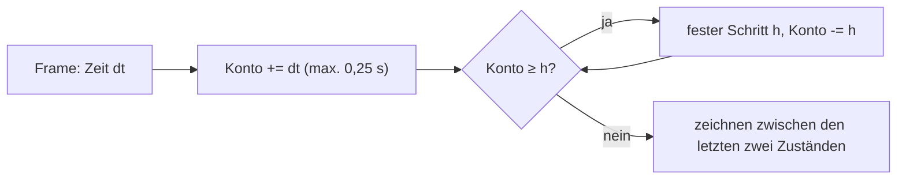
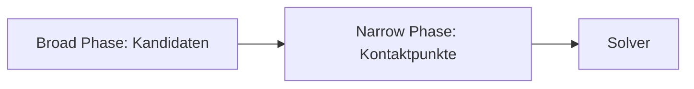
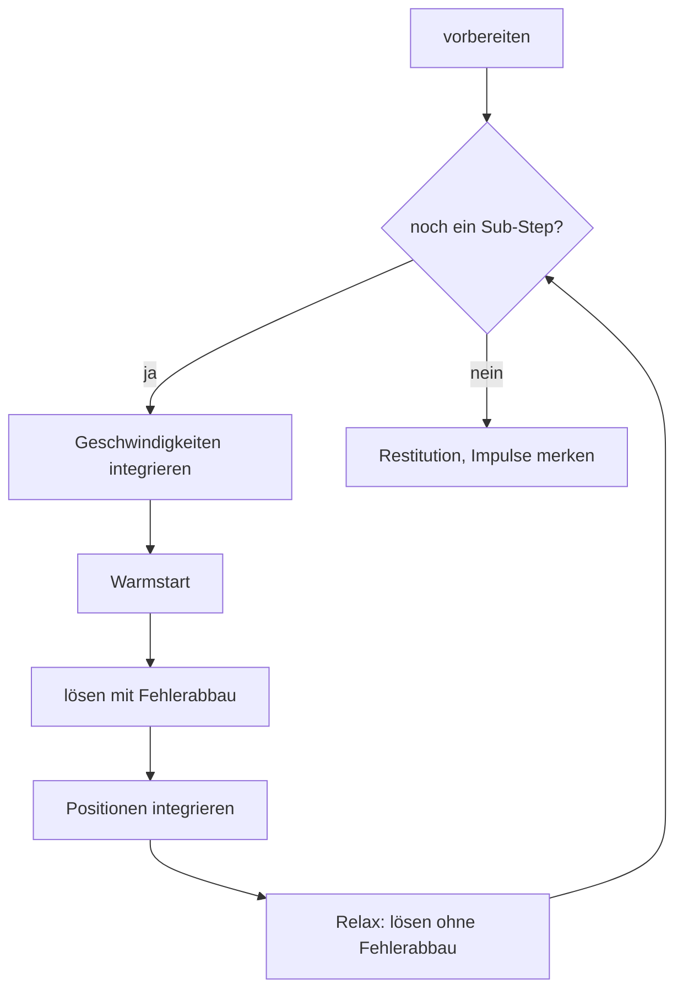
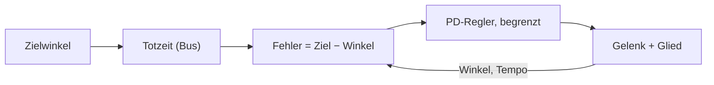

# Anhang C – Grundlagen: Wie eine Physiksimulation denkt

> **Kurz gesagt:** Wie bringt man einem Computer bei, dass Kisten fallen, Bälle abprallen und Türen
> schwingen? Dieser Anhang erklärt die Ideen hinter jeder Starrkörpersimulation: Zustand, Zeitschritte,
> Kollisionen, Reibung, Gelenke, den Solver, Servos als Regelkreis – und warum Kern auf jedem Rechner
> Bit für Bit dasselbe Ergebnis liefert.

Kern rechnet mit **Box3D** von Erin Catto. Wie Kern Box3D konkret benutzt, steht in
[Kapitel 6](06-physik.md); hier geht es um das Warum.

## C.1 Starrkörper und ihr Zustand

Ein **Starrkörper** verformt sich nie: Der Abstand zweier seiner Punkte bleibt immer gleich. Das ist
eine Näherung (jeder echte Körper gibt etwas nach), aber für Kisten, Autos und Roboterglieder eine sehr
gute. Ihr großer Vorteil: Wenige Zahlen beschreiben die Bewegung vollständig.

Der **Zustand** besteht aus vier Größen: wo der Schwerpunkt ist (Position), wie der Körper gedreht ist
(Orientierung, gespeichert als Quaternion), wie schnell er sich bewegt und wie schnell er sich dreht.
Dazu kommen Eigenschaften, die sich nie ändern: die **Masse** (wie schwer er sich beschleunigen lässt),
der **Schwerpunkt** und der **Trägheitstensor** – eine 3 × 3-Tabelle, die sagt, wie schwer er sich um
jede Achse drehen lässt. Ein langer Stab dreht sich um seine Längsachse leicht, quer dazu schwer. Im
Körper selbst ist diese Tabelle fest; von der Welt aus gesehen dreht sie mit dem Körper mit.

In Kern entstehen Masse und Trägheit aus den Formen und ihrer Dichte. Importierte Roboter bringen ihre
gemessenen Werte mit ([Kapitel 6](06-physik.md)).

Die Bewegung folgt zwei Gesetzen: **Newton** (Kraft = Masse × Beschleunigung) für das Verschieben und
**Euler** für das Drehen. In Eulers Gleichung steckt ein Extra, der **Kreiselterm**. Er sorgt dafür, dass
lange, dünne Körper taumeln, wenn sie sich nicht genau um eine ihrer Hauptachsen drehen. Diese
Die Drehung selbst ändert sich über ein Quaternionenprodukt mit der Drehgeschwindigkeit. Diese
Gleichungen beschreiben, wie sich der Zustand *ändert*. Eine Simulation muss sie in kleinen
Zeitschritten lösen. Das heißt **Integration**.

## C.2 Integration: das Daumenkino

> **Stell dir vor …** ein Daumenkino. Du kennst das aktuelle Bild und sollst das nächste zeichnen. Du
> weißt, wie schnell sich alles gerade bewegt – aber während du umblätterst, ändert sich auch das.
> Jedes Integrationsverfahren ist eine andere Wette darauf, welche Geschwindigkeit man für das ganze
> Blatt nimmt.

Das beste Testobjekt ist eine Masse an einer Feder. Ohne Reibung schwingt sie ewig gleich stark. Ein
gutes Verfahren sollte ihre Energie weder aufblähen noch vernichten. Drei Kandidaten:

| Verfahren | Was es nimmt | Was passiert |
|---|---|---|
| explizit | alles vom alten Bild | Energie **wächst** immer – explodiert |
| semi-implizit | erst neue Geschwindigkeit, damit neue Position | Energie bleibt, solange der Schritt klein genug ist |
| implizit | Kraft vom Ende des Schritts | Energie **fällt**, immer stabil |

Genauer: Semi-implizit bleibt stabil, solange Schrittweite × Kreisfrequenz (2π × Hertz) unter 2 liegt.

**Zahlenbeispiel:** Eine Feder mit 30 Hz, Schrittweite 1/60 s (Schrittweite × Kreisfrequenz ≈ 3,14). Explizit wächst die Schwingung pro Schritt
um den Faktor 3,3 – nach zehn Schritten auf das 150 000-Fache. Semi-implizit ist der Schritt hier zu
groß; auch das wird instabil. Implizit wird die Schwingung stark gedämpft, bleibt aber brav.

Die Lehre: **Steife Federn und große Schritte vertragen sich nicht** – außer man rechnet implizit.

> **Probier's aus!** Öffne in Kern Studio auf https://kernengine.de/ über **File › Example Levels** das
> **Physics Lab**, starte Simulate (Alt+S) und drücke Pause. Mit **.** rückst du genau einen
> Physikschritt weiter – ein Blatt im Daumenkino.

### Was Box3D tut

Box3D rechnet **semi-implizit**. In jedem Teilschritt werden erst die Geschwindigkeiten aus Kräften und
Schwerkraft aktualisiert, dann löst der Solver Kontakte und Gelenke (C.6), dann rücken die Positionen
**mit der neuen Geschwindigkeit** vor; die Drehung wird danach wieder normiert.

- Die eingebaute **Dämpfung** wird mit einem Faktor zwischen 0 und 1 eingerechnet und ist deshalb immer
  stabil. Kerns Regel daraus: Dämpfung über Box3Ds Einstellung, nie selbst gebaut als Kraft gegen die
  Geschwindigkeit – die wäre explizit und wird an leichten Körpern instabil.
- Den **Kreiselterm** löst Box3D implizit („This improves the simulation of long skinny bodies“).
- Geschwindigkeiten sind gedeckelt: in Kern 400 m/s, Drehung höchstens eine Achteldrehung (π/4) pro
  Zeitschritt.

### Fester Zeitschritt und Sub-Steps

Weil große Schritte Federn sprengen, darf eine Simulation **nie** mit der schwankenden Bildzeit
rechnen. Ein langsamer Frame wäre ein riesiger Schritt, und das Ergebnis hinge vom Rechner ab. Die
Lösung ist Glenn Fiedlers **Akkumulator**:

Wie Kern das genau umsetzt (60 Hz Standard, höchstens 0,1 s Simulation pro Frame, Zeit als
Schrittzähler), steht in [Kapitel 6](06-physik.md). Zusätzlich teilt Box3D jeden Schritt in
**Sub-Steps**: Bei der Micro Duck sind es 100 Hz × 16 Sub-Steps, also ein Teilschritt von 1/1600 s =
0,625 ms. Kleine Schritte machen Gelenkketten steifer.

## C.3 Kollisionserkennung

Bei 1000 Körpern gibt es fast 500 000 mögliche Paare. Alle genau zu prüfen, wäre viel zu teuer. Darum
arbeitet man in zwei Phasen:

**Broad Phase (grob):** Jede Form bekommt einen achsenparallelen Hüllquader. Zwei Formen können sich nur
berühren, wenn ihre Quader überlappen – sechs Vergleiche. Die Quader liegen in einem Baum (einer BVH,
wie in [Kapitel 5](05-szene-und-geometrie.md)). Damit der Baum nicht jeden Schritt umgebaut werden
muss, sind die Quader etwas größer (bis 50 mm). Erst wer seinen Quader verlässt, wird umsortiert.
Feste Körper haben einen eigenen Baum. Mit dem Baum findet man die Nachbarn eines Quaders in
logarithmischer Zeit: Bei doppelt so vielen Körpern kommt nur ein Schritt dazu, statt dass sich die
Arbeit verdoppelt.

**Narrow Phase (genau):** Hier zählen **konvexe** Formen, also solche ohne Dellen: Die Verbindungslinie
zweier Punkte liegt immer ganz drin. Kugel, Kapsel, Quader und konvexe Hüllen sind konvex. Für sie gibt
es robuste Verfahren:

- **GJK** (nach Gilbert, Johnson und Keerthi) misst den Abstand zweier konvexer Formen. Der Trick:
  Man zieht jeden Punkt von B von jedem Punkt von A ab (die **Minkowski-Differenz**). Liegt der
  Ursprung darin, berühren sich die Formen. GJK tastet sich mit einfachen Formen (Punkt, Strecke,
  Dreieck, Tetraeder) an den Ursprung heran und braucht von jeder Form nur eine Auskunft: „Welcher
  Punkt liegt in dieser Richtung am weitesten außen?“
- **SAT** (*Separating Axis Theorem*): Zwei konvexe Körper berühren sich genau dann nicht, wenn es eine
  Richtung gibt, in der man zwischen ihnen hindurchschauen kann – eine **trennende Achse**. Infrage
  kommen nur die Flächennormalen beider Körper und Kreuzprodukte ihrer Kanten. Box3D baut so die
  Kontakte zwischen Hüllen und merkt sich die zuletzt gefundene Achse, denn meist stimmt sie im
  nächsten Schritt wieder.

> **Stell dir vor …** zwei Kartons auf dem Tisch. Wenn du dich so hinknien kannst, dass du einen
> Lichtspalt zwischen ihnen siehst, berühren sie sich nicht. Das ist die ganze Idee von SAT.

Das Ergebnis ist ein **Manifold**: eine Kontaktrichtung (Normale) und einige Kontaktpunkte mit Abstand
(negativ, wenn sie sich durchdringen).

Eine **konvexe Hülle** ist die kleinste konvexe Form um eine Punktwolke – wie ein Gummituch, das man
darum spannt. Box3D erlaubt bis 128 Ecken. Dellige Dinge (ein Auto, ein Fuß mit Aussparung) setzt man
aus mehreren Hüllen zusammen. Flache oder entartete Punktwolken lehnt Box3D ab. Beliebige
Dreiecksnetze gibt es nur für feste Körper. Zum Anzeigen baut Kern die Dreiecke einer Hülle mit
`hull_mesh`.

### Spekulative Kontakte

Ein schneller Körper könnte in einem Schritt durch eine dünne Wand fliegen (*Tunneling*). Box3D legt
Kontaktpunkte deshalb schon **vor** der Berührung an, ab 20 mm Abstand, und erlaubt in diesem Schritt
nur so viel Annäherung, wie Platz ist. Für sehr schnelle Körper gibt es zusätzlich **Continuous
Collision**; Kern lässt sie an und macht schnelle Spielerfahrzeuge zu „Bullets“. Die festen Toleranzen
in Metern: 5 mm erlaubte Durchdringung (Linear Slop), 20 mm spekulative Distanz (das Vierfache),
50 mm für das Wiederverwenden von Kontakten. Weil diese Toleranzen in Metern fest sind, gilt die Größenregel aus
[Kapitel 6](06-physik.md): bewegte Körper 0,1 bis 10 m – die Micro Duck wird darum vierfach skaliert.

## C.4 Kontakte, Reibung und Restitution

### Die Kontaktregel

Für jeden Kontaktpunkt gelten drei einfache Sätze:

1. Die Körper dürfen sich nicht durchdringen.
2. Ein Kontakt kann nur **drücken, nie ziehen**.
3. Entweder sie berühren sich und drücken, oder sie sind getrennt, und es gibt keine Kraft.

Solche Entweder-oder-Regeln heißen **Komplementaritätsbedingungen**. Ein Solver erfüllt sie nicht
exakt, aber sehr gut näherungsweise (C.6).

### Reibung nach Coulomb

Reibung wirkt in der Kontaktebene gegen das Rutschen. Sie ist höchstens **Reibwert μ × Andruck**. Solange
weniger nötig ist, **haftet** der Kontakt; wird mehr verlangt, **gleitet** er. Was hier wirkt, ist ein
**Impuls** (Kraft × Zeit); der Impuls senkrecht zur Fläche heißt Normalimpuls.

Alle erlaubten Kräfte bilden einen **Reibungskegel** um die Normale: Kraft innen heißt Haften, am Rand
Gleiten; der Kegel ist umso breiter, je größer μ (halber Öffnungswinkel arctan μ). In der Physik
unterscheidet man Haft- und Gleitreibung; Box3D kennt nur **einen** Reibwert. Es löst die Reibung
einmal in der Mitte des Manifolds, begrenzt durch die Summe der Normalimpulse aller Punkte, mit einem
**runden** Kegel (ein zu großer Reibungsimpuls wird als Ganzes gekürzt), und bremst zusätzlich das
Verdrehen um die Normale.

### Zwei Reibwerte, ein Kontakt

Jede Form hat ihren eigenen Reibwert (Standard 0,6). Der Kontakt braucht aber einen. Box3D nimmt das
**geometrische Mittel**: die Wurzel aus dem Produkt.

| μ A | μ B | √(A · B) | normaler Mittelwert |
|---|---|---|---|
| 0,6 | 1,0 | 0,775 | 0,8 |
| 0,05 (Eis) | 1,0 (Gummi) | 0,224 | 0,525 |
| 0 | 1,0 | 0 | 0,5 |

Die schöne Eigenschaft: Eine reibungsfreie Fläche bleibt reibungsfrei, egal womit sie sich paart. Eis
mit Gummi bleibt rutschig. Trotzdem ist es nur eine Faustregel; echte Paare haben eigene Werte. Kern
gibt solchen Paaren eigene Reibung über Oberflächen wie `cloth`, `tpu` und `floor`
([Kapitel 6](06-physik.md)). Warum? Die Micro Duck hebt eine Socke mit dem Schnabel auf: Schnabelpolster
auf Socke muss greifen, Socke auf Boden muss rutschen. Ein einziger Wert pro Form kann nicht beides.

### Restitution

Die **Restitution** e sagt, wie viel Geschwindigkeit nach einem Stoß übrig bleibt: e = 0 heißt liegen
bleiben, e = 1 perfekt elastisch. Box3D nimmt das **Maximum** beider Formen – ein Gummiball springt auch
auf Beton. Stöße unter 1 m/s prallen gar nicht ab, sonst würde ein ruhender Körper wegen winziger Reste
ewig zittern. Angewendet wird die Restitution nach dem eigentlichen Lösen, mit der
Annäherungsgeschwindigkeit von vor dem Schritt (Kern: 2 Durchgänge).

### Rollwiderstand

Eine ideale Kugel auf idealem Boden rollt ewig, denn der Kontakt ist ein Punkt. Echte Kugeln und Böden
geben ein bisschen nach, und das bremst: **Rollwiderstand**. Box3D begrenzt dafür das Drehmoment, das das
Rollen bremst, mit Beiwert × Radius × Andruck. In Kerns Lehrer-Notizen steht, wozu man ihn braucht:
„Die Socke kroch von selbst über den Boden (runde Stoffklumpen rollten).“ und „Der Ball rollte ewig.“
Beide haben jetzt Rollwiderstand.

## C.5 Gelenke als Regeln

Ein **Gelenk** ist mathematisch eine Bedingung, die immer gelten soll, etwa „dieser Punkt von Körper A
und dieser Punkt von Körper B fallen zusammen“. Leitet man sie ab, wird daraus eine Regel für die
Geschwindigkeiten: Die beiden Punkte dürfen sich nicht auseinanderbewegen. Eine Tabelle namens
**Jacobi-Matrix** sagt, wie jede Geschwindigkeit die Regel beeinflusst.

Der Solver sucht dann einen Impuls, der die Regel erfüllt. Wie groß der sein muss, hängt an der
**effektiven Masse**: Wie schwer fühlt sich diese Bewegung an? Beim Türscharnier ist das die Trägheit
der Tür um die Scharnierachse. Eine schwere Tür braucht einen großen Impuls, eine leichte einen kleinen.
Bei einem Drehgelenk zwischen zwei Körpern ist sie genau 1 geteilt durch die Summe der „Drehleichtigkeiten“
(inversen Trägheiten) beider Körper um die Achse. Ein Korrekturanteil baut außerdem Fehler ab, die sich
schon eingeschlichen haben (Drift).

Welche Gelenke Box3D kennt (Scharnier, Schiene, Kugelgelenk, Seil, Rad …), zeigt die Tabelle in
[Kapitel 6](06-physik.md). Wichtig für alle: Ein Preset wird in seiner **Ruhepose** gebaut, denn dort liegt
der Nullwinkel, und die Grenzen müssen ihn enthalten.

## C.6 Der Solver

### Viele Regeln auf einmal

Ein Roboter hat 15 Gelenke und Dutzende Kontaktpunkte. Jeder Impuls an einer Stelle stört die anderen.

> **Stell dir vor …** eine Gruppe richtet ein Gruppenfoto aus. Einer rückt nach links, dadurch steht der
> Nächste schief, der korrigiert sich, und so weiter. Nach ein paar Runden stehen alle ordentlich. So
> arbeitet der Solver: Regel für Regel, mehrere Runden.

Dieses Verfahren heißt **projiziertes Gauß-Seidel**, in der Spielephysik **Sequential Impulses**.
Ungleichungen wie „nur drücken, nie ziehen“ gelten dabei für den **aufsummierten** Impuls: Ein einzelner
Schritt darf zurücknehmen, was vorher zu viel war, nur die Summe darf nie ziehen.

**Warmstart:** Ein ruhender Stapel braucht jeden Schritt fast dieselben Impulse. Startet man mit den
Impulsen vom letzten Mal statt mit null, ist der Solver nach wenigen Runden fertig.

### Weiche Regeln und der Soft Step

Ein harter Constraint korrigiert Fehler sofort und vollständig. Das zittert und kann Energie
hineinpumpen. Box3D macht darum **alle** Constraints weich: Jeder verhält sich wie eine sehr steife,
gedämpfte Feder mit einer Frequenz in Hertz und einem Dämpfungsgrad – und wird **implizit** gelöst, also
stabil (C.2). Aus Frequenz, Dämpfung und Sub-Step-Länge rechnet Box3D drei Zahlen: wie schnell ein
Fehler abgebaut wird, und zwei Anteile, die zusammen 1 ergeben – der eine steht für „ganz hart“, der
andere für „gar nicht“. Dazwischen liegt jeder Constraint.

**Zahlenbeispiel** mit Kerns Kontaktwerten (30 Hz, Dämpfung 10) bei der Micro Duck: Eine Durchdringung von
1 mm wird mit etwa 6,6 mm/s herausgeschoben – sanft statt ruckartig. Gegen feste Körper, etwa Füße auf
dem Boden, rechnet Box3D mit doppelter Frequenz und halber Dämpfung (60 Hz, 5); dort sind es etwa
26 mm/s. Höchstens geht es mit 3 m/s (Kerns Contact push-out speed).

Der **Relax**-Durchgang entfernt die Extra-Geschwindigkeit, die beim Fehlerabbau entstanden ist. Ohne
ihn würde ein Körper nach einer Korrektur damit weiterfliegen.

### Grenzen der Steifigkeit

Eine Feder lässt sich nur rechnen, wenn sie langsamer schwingt, als die Sub-Steps „hinschauen“. Box3D
begrenzt Gelenkfedern auf ein Viertel und Kontaktfedern auf ein Achtel der Sub-Step-Rate. Bei der Micro
Duck (1600 Sub-Steps pro Sekunde) also höchstens 400 Hz für Gelenke und 200 Hz für Kontakte; Kerns
Servogelenke nutzen 240 Hz. Steifer geht nur mit mehr Sub-Steps. Federn im Level hält Kern zusätzlich
unter der halben Sub-Step-Frequenz (Nyquist-Grenze: Eine Schwingung braucht mindestens zwei
„Blicke“ pro Periode).

> **Probier's aus!** Stelle im Physics Lab unter World Settings › Physics (Box3D) die **Sub-steps** einmal
> auf 1 und einmal auf 16, starte jeweils Simulate und zieh an der Seilbrücke. Achte darauf, wie sehr
> die Gelenkkette nachgibt. Schalte unter **Window › Show** die **Contact Points** dazu.

> **Achtung, Falle!** Ein schwerer Körper an einem sehr leichten braucht viele Solver-Runden, bis die
> Impulse durchgereicht sind; solange dehnen sich die Gelenke. Halte Nachbarmassen innerhalb von etwa
> 10 : 1. Kern gibt deshalb den 5-g-Hüftbügeln der Ente eine Mindestmasse und macht starre Teile zu
> **einem** Körper mit mehreren Formen.

## C.7 Servos als Regelkreis

Ein Modellbauservo wie der Dynamixel XL330 der Micro Duck bekommt einen **Zielwinkel** und regelt sich
selbst dorthin: messen, mit dem Ziel vergleichen, Moment erzeugen, wieder messen. Das ist ein
**Regelkreis**.

### Der PD-Regler

Der **PD-Regler** rechnet: Moment = K × Fehler − D × Drehgeschwindigkeit.

> **Stell dir vor …** eine Drehfeder (K, „zieh zum Ziel“) und einen Stoßdämpfer (D, „nicht so
> hektisch“), beide am Gelenk. Zusammen mit der Trägheit des Glieds entsteht ein gedämpfter Schwinger.

Ob er über das Ziel hinausschwingt, sagt der Dämpfungsgrad: unter 1 schwingt er über, genau 1 ist der
schnellste Weg ohne Überschwingen, über 1 kriecht er hin. Mit den XL330-Werten aus Kern (K = 0,554 N·m/rad,
D = 0,053 N·m·s/rad, nur die Rotorträgheit 0,0018 kg·m²) ergibt sich eine Eigenfrequenz von etwa 2,8 Hz
und ein Dämpfungsgrad von 0,84: ein weicher, gut gedämpfter Servo. Mit angehängtem Glied wird er noch
langsamer.

### Sättigung, Reibung, Totzeit

- **Sättigung:** Ein Motor hat ein Höchstmoment T. Erreicht wird es bei einer Abweichung von T/K, beim
  XL330 0,963/0,554 ≈ 1,74 rad. Darum sagen Kerns Lehrer-Notizen: „Das Netz muss Ziele weit hinter den
  Gelenkgrenzen setzen.“
- **Reibung:** Das Getriebe hält ein ruhendes Gelenk bis zu einem kleinen Moment fest (XL330:
  0,0048 N·m).
- **Totzeit:** Zwischen Befehl und Wirkung vergeht Zeit (Bus, Verarbeitung). Bei 2,8 Hz und 20 ms ist
  das eine Verschiebung von etwa 20°. Totzeit kann einen stabilen Regler ins Schwingen bringen – und ein
  Netz, das nie mit Totzeit geübt hat, versagt am echten Roboter.

### In Kern

Kern baut den Servo nur aus Box3Ds eigenen Teilen ([Kapitel 6](06-physik.md), Abschnitt 6.17): Der
PD-Regler **ist** die Gelenkfeder des Scharniers und damit implizit stabil. Die Sättigung entsteht,
indem das **Ziel** auf höchstens T/K Abstand begrenzt wird. Die Reibung ist ein Motor mit
Sollgeschwindigkeit 0. Die Rotorträgheit ist eine Scheibe auf der Achse, und die Totzeit eine
Warteschlange: 20 ms × √4 (Zeitskalierung) × 100 Hz = 4 Weltschritte.

Box3D will Federn aber als Frequenz und Dämpfungsgrad, nicht in N·m/rad. `set_joint_spring` rechnet um,
mit der effektiven Masse m aus C.5: Kreisfrequenz ω = √(K / m), Frequenz = ω / 2π, Dämpfungsgrad =
D / (2 · m · ω). Weil m von der Lage abhängt, geschieht das jeden Schritt. Alle Werte stehen in einem
**Geräteprofil**: K, D, F, T, Armature, Totzeit – und für das Training ihre Streuungen. Dieselbe Funktion treibt Studio,
Lehrer und Kalibrierstand ([Kapitel 16](16-kalibrierung.md)).

## C.8 Was man nicht tun sollte

- **Dauerlasten als Kräfte, jeden Schritt** – Kräfte werden nach jedem Schritt zurückgesetzt.
- **Sprünge als Impuls** (Masse × Geschwindigkeitsänderung), keine gesetzte Geschwindigkeit.
- **Keine Geschwindigkeiten an Körpern mit Gelenken oder Kontakten setzen.** Das übergeht den Solver
  und pumpt Energie hinein.
- **Keine Hilfskräfte für Roboter.** „In der echten Welt gibt es sie auch nicht.“

## C.9 Determinismus

Eine Simulation ist **deterministisch**, wenn gleiche Anfänge und gleiche Eingaben **Bit für Bit**
dasselbe ergeben. Für Kern ist das zentral: Ein Training soll überall dasselbe Netz liefern, ein Fehler
reproduzierbar sein, ein Roboterlog überall gleich ablaufen. Und „fast gleich“ reicht nicht, denn
Physik ist **chaotisch**: „Ein Bit wird in einer Robotersimulation in Sekunden zu einem anderen Gang.“

### Die Fallen der Kommazahlen

Computer runden nach jeder Rechnung. Jede einzelne Rechnung ist genau festgelegt, aber die
**Reihenfolge** zählt:

> **Wusstest du?** (0,1 + 0,2) + 0,3 ergibt im Computer 0,6000000000000001, aber 0,1 + (0,2 + 0,3)
> ergibt 0,6.

Daraus folgen Kerns Gegenmittel:

| Gefahr | Gegenmittel |
|---|---|
| Compiler ordnet Summen um (`-ffast-math`) | verboten |
| Threads summieren in wechselnder Reihenfolge | feste Teile, feste Reihenfolge; Box3D mit einem Thread |
| FMA: a × b + c mit einer statt zwei Rundungen | überall `-ffp-contract=off`, Box3D ohne SIMD |
| sin, cos, exp … runden je nach System anders | eigene Bibliothek (musl) unter `kern::dm::` |
| schwankender Zeitschritt, Zeitmessung | fester Schritt, Zeit zählt Schritte |
| Zufall | eigener Zufallsgenerator mit festen Seeds |

FMA ist eine Prozessor-Abkürzung, die Multiplikation und Addition in einem Rutsch rechnet. Beide
Ergebnisse sind korrekt, aber verschieden – und WebAssembly macht es nicht, native Builds manchmal schon.
Plus, Mal und Wurzel schreibt der Gleitkomma-Standard exakt vor, Sinus & Co. aber nicht: glibc, Apples
libm, Androids bionic und wasi-libc runden sie im letzten Bit verschieden. Deshalb
bringt Kern die Umsetzungen von musl (MIT-Lizenz) mit, und alles, was die Simulation speist, nutzt
`kern::dm::sin` statt `std::sin`. `sqrt`, `fabs` und `floor` sind exakt und bleiben `std::`; Box3D hat
eigene deterministische Winkelfunktionen.

### Prüfen

Determinismus muss man messen. Ein Test lässt das Netz von Pollen Robotics die Ente 400 Regeltakte
steuern und speichert pro Takt einen Fingerabdruck des exakten Zustands. Zwei Builds sind genau dann
bitgleich, wenn alle Abdrücke gleich sind; der erste Unterschied zeigt, wann sie auseinanderlaufen. CI
prüft das mit GCC auf x86, mit WebAssembly und mit Apple clang auf ARM. Und ein frei hängendes
Servo-Bein läuft in 1- und 4-facher Größe Bit für Bit gleich, weil die Skalierungsfaktoren Zweierpotenzen
sind und dann identisch gerundet wird.

## Das nimmst du mit

- Ein Starrkörper ist durch Lage, Drehung, Geschwindigkeit und Drehgeschwindigkeit vollständig beschrieben.
- Box3D integriert semi-implizit; steife Federn brauchen kleine Schritte oder implizites Lösen.
- Kollision läuft in zwei Phasen: grob mit Hüllquadern, genau mit GJK und SAT auf konvexen Formen.
- Kontakte drücken nur; Reibung ist durch μ × Andruck begrenzt, zwei Reibwerte werden zu √(a · b).
- Der Solver löst Regel für Regel in Runden, mit Warmstart und weichen, implizit gelösten Constraints.
- Ein Servo ist ein PD-Regler mit Sättigung, Reibung und Totzeit.
- Bit-für-Bit-Determinismus braucht feste Reihenfolgen, kein FMA und eine eigene Mathebibliothek.

## Knobelecke

1. Warum ist eine Feder mit 30 Hz bei 1/60 s Schrittweite gefährlich?
2. Eis (0,05) trifft Gummi (1,0). Welcher Reibwert gilt in Box3D, und warum ist das plausibler als 0,525?
3. Warum braucht der Solver einen Relax-Durchgang?
4. Ein XL330 soll 2 rad vom Ziel entfernt sein. Bekommt er mehr Moment als bei 1,8 rad?
5. Warum reicht „fast gleich“ beim Determinismus nicht?

### Lösungen

1. Der Schritt ist zu grob für so eine schnelle Schwingung: Explizit wächst sie pro Schritt um das
   3,3-Fache, und auch semi-implizit wird sie instabil.
2. √(0,05 · 1,0) ≈ 0,224. Eis bleibt rutschig – das geometrische Mittel zieht zur kleineren Reibung.
3. Er entfernt die Geschwindigkeit, die beim Abbau von Fehlern entstanden ist; sonst flöge der Körper
   damit weiter.
4. Nein. Ab etwa 1,74 rad ist das Höchstmoment erreicht; mehr Abstand bringt nicht mehr Kraft.
5. Physik ist chaotisch: Ein Unterschied im letzten Bit wächst schnell, bis der Roboter anders läuft.

---

© 2026 Christian Heinrich Hohlfeld · Alle Rechte vorbehalten · [Impressum und Rechte](00-impressum.md)
