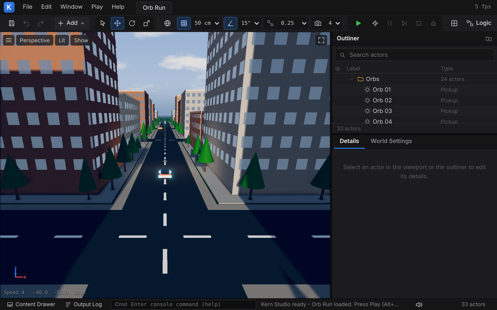
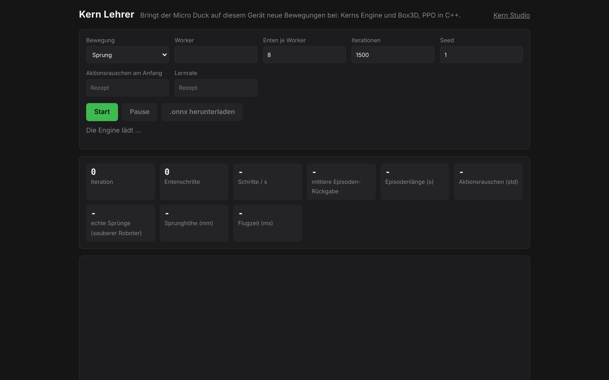

# 1 Einführung

Kern ist eine 3D-Engine in **C++20**. Sie wird mit **wasi-sdk** nach **WebAssembly** übersetzt und
zeichnet im Browser über **WebGL2**. Im selben WebAssembly-Modul laufen die Physik (**Box3D**), eine
eigene **Sound-Engine**, eine **Spiel-Laufzeit** aus Levels, Actors und Komponenten, **Logik-Graphen**
mit einem JIT, ein **Netzwerk-Stack** und der Editor **Kern Studio**. Dazu kommen die **Micro Duck**,
der zweibeinige Roboter von Pollen Robotics, der in Kern mit seinen echten trainierten Netzen läuft,
und der **Lehrer**, der neue Netze für diesen Roboter in C++ trainiert – nativ und im Browser.

Live: <https://kernengine.de/> – Startseite mit Kern Studio (`/editor/`), dem Lehrer
(`/lehrer/`), spielbaren Levels (`kern/web/studio/play.html?level=orbRun` bzw. `physicsLab`) und den
C++-Beispielen `orbrun` und `hello`.



Dieses Kapitel erklärt, was Kern ist, nach welchen Grundsätzen es gebaut ist, wie die Schichten
zusammenhängen und wie das Repository aufgebaut ist. Am Ende steht eine Leseanleitung für das Buch.

---

## 1.1 Was Kern ist

Kern ist aus SpawnCity entstanden, einem Spiel, das über Kern rendert. Das
Repository enthält die Engine mit ihrer Commit-Historie aus SpawnCity, beschränkt auf die
Engine-Dateien. Die Engine selbst kennt SpawnCity nicht; Spiele werden nur gegen die Engine-API
geschrieben.

Kern besteht aus diesen Teilen:

| Teil | Namensraum / Ort | Kurz |
|---|---|---|
| Grundlagen | `kern` (`core/`), `kern::json`, `kern::dm` | Typen, Fehlerkanal, Logging, `Span`, Hashes, JSON, deterministische Mathematik |
| Mathematik | `kern` (`math/math.h`) | `Vec2/3/4`, `Quat`, `Mat4` (spaltenweise), `Sphere`, `Aabb`, `Camera`; Meter, rechtshändig, Z oben |
| Renderer | `kern` (`gfx/`) | WebGL2-Renderer: ein Standard-Shader, Instancing, Skinning, PBR, Sonnenschatten, Himmel, Bloom, GTAO, Partikel, Shader-Erweiterungen |
| Szene | `kern` (`scene/`) | Frustum-Culling, BVH, Picking |
| Geometrie | `kern` (`geo/`) | Earcut, Primitive, Welding, Gebäude, Straßen, Terrain |
| App-Laufzeit | `kern` (`app/`) | `App`/`Engine`/`Input` für Spiele, die ganz in C++ laufen |
| Physik | `kern::physics` | C++-Schicht über Box3D: Welt, Körper, Shapes, Gelenke, Raycast, `MouseGrab` |
| Audio | `kern::audio` | Software-Mixer, 3D-Klang, Busse, Hall, Limiter, Synthesizer, Stimme der Ente |
| Spiel-Laufzeit | `kern::game` | `Level` (`.klevel`), `GameWorld`, Controller, Regeln, Sound, Touch, Walker (Micro Duck), Mehrspieler |
| Logik | `kern::logic` | Blueprint-artige Graphen; Interpreter, JIT nach WebAssembly, Export als C++ |
| Netzwerk | `kern::net` | Serialisierung, Zuverlässigkeit, Kanäle, Client/Server, Transporte |
| Studio | `kern::studio` | der Editor nach dem Vorbild verbreiteter Game-Engine-Editoren, komplett in C++ und ohne Browser testbar |
| Lehrer | `kern::lehrer` | Umgebungen, MLP, PPO, DAgger, CMA-ES, ONNX-Export, Kalibrierung |
| C-ABI | `src/api`, `src/studio/api.cpp`, … | flache `extern "C"`-Funktionen für den JavaScript-Host |
| Plattformschicht | `kern/web/*.mjs` | Laden des Moduls, WebGL2-Importe, Eingabe, DOM – keine Engine-Logik |

---

## 1.2 Ziele und Grundsätze

### Kein three.js, kein Emscripten

Kern benutzt keine fremde Render-Engine und keine Emscripten-Laufzeit. Der Renderer ist eigener
C++-Code, der die WebGL2-Funktionen direkt als WebAssembly-Importe aufruft
(`include/kern/gfx/gl.h`, Import-Modul `kern_gl`). Übersetzt wird mit dem reinen LLVM-Werkzeugkasten
von **wasi-sdk** (clang, wasm-ld, wasi-libc, libc++). Das Modul ist ein **WASI-„Reactor“**: Der Host
ruft einmal `_initialize` auf und danach die exportierten Funktionen
(`kern/build.sh`, Linker-Option `-mexec-model=reactor`).

Der Feature-Satz ist bewusst konservativ: `-mcpu=mvp` plus `sign-ext`, `bulk-memory`,
`nontrapping-fptoint` und `mutable-globals`. Damit läuft das Modul auf jedem WebGL2-fähigen Browser
ab Safari 15.

### Keine Engine-Logik in JavaScript

Im Browser sind WebGL2, Canvas, Eingabe-Ereignisse, `requestAnimationFrame`, Web Audio, Dateidialoge
und Zwischenablage nur über JavaScript erreichbar. Genau das – und nur das – erledigt die
Plattformschicht `kern/web/`. Ihr eigener Kopfkommentar fasst es zusammen
(`kern/web/kern.mjs`):

```js
// The engine is C++ compiled to WebAssembly (kern/build.sh). The browser only
// offers WebGL2, canvas events and timing to JavaScript, so this file does
// exactly three things and contains no engine logic:
//   1. instantiate the module with the `kern_gl` (WebGL2) and `kern_env`
//      imports plus a minimal WASI shim,
//   2. own the GPU object handle tables and context-loss plumbing,
//   3. expose `KernRenderer`, a thin typed-array marshalling facade over the
//      engine's C ABI (kern/include/kern/api/c_api.h).
```

Dasselbe gilt für den Editor: `kern/web/studio/studio.mjs` zeichnet die Panels aus dem JSON, das
der C++-Editor liefert, leitet Eingaben weiter und erledigt Browser-Aufgaben (Menüs und Dialoge als
DOM, Dateiauswahl, Downloads, Zwischenablage, Pointer-Lock, Bilddekodierung, lokaler Speicher,
Schreiben exportierter Spiele). Auch der Blueprint-Editor `logic.mjs` hält keinen Graphen: Jede
Änderung ist ein Studio-Befehl an die Engine.

Das Ergebnis: Was ein Spiel tut, steht in C++, ist nativ mit Sanitizern testbar
([Kapitel 2](02-bauen-und-testen.md)) und verhält sich im exportierten Spiel genauso wie im Editor.

### Determinismus

Eine Simulation, ein Trainingslauf oder ein abgespieltes Roboter-Log kommt in Kern überall gleich
heraus, Bit für Bit, auf allen in der CI geprüften Plattformen (GCC/x86, Apple clang/ARM,
WebAssembly). Dafür sorgen (`kern/build.sh`, `include/kern/core/dmath.h`,
`third_party/box3d/README.md`, `src/lehrer/ppo.cpp`):

- **Keine FMA-Zusammenfassung:** Kern, Box3D und die libm werden mit `-ffp-contract=off` übersetzt.
- **Box3D im Skalar-Pfad** (`BOX3D_DISABLE_SIMD`), wie in WebAssembly.
- **Eigene libm:** `sin`, `cos`, `atan2`, `exp`, `log`, `pow` … stammen aus musl
  (`third_party/musl_math`, umbenannt in `kern_musl_*`) und werden über `kern::dm::` aufgerufen.
- **Lernen unabhängig von der Zahl der Worker:** Seeds je Umgebung aus (Seed, globaler Index),
  kanonische Reihenfolge der Rollouts, Summen in fester Reihenfolge.

Geprüft wird das mit einem **Fingerabdruck** (`kern_lehrer --fingerprint 400`), dessen Referenz in
`kern/tests/determinism_fingerprint.txt` liegt und den die CI auf drei Plattformen vergleicht. Die
Einzelheiten stehen in [Kapitel 3](03-grundlagen.md) und [Kapitel 2](02-bauen-und-testen.md).

Determinismus ist kein Selbstzweck: Ein Fehler der Simulation ist damit ein fester, reproduzierbarer
Fehler und kein Rauschen, das je nach Rechner anders aussieht. Ein Unterschied zwischen einem echten
Roboter-Log und der Simulation ist ein echter Modellfehler ([Kapitel 16](16-kalibrierung.md)).

### Weitere Grundsätze

- **Ohne Ausnahmen und RTTI.** Alles wird mit `-fno-exceptions -fno-rtti` gebaut. Fehlbare
  Operationen geben `bool` (oder 0 / `nullptr`) zurück und hinterlegen eine lesbare Meldung mit
  `fail()`; der Host liest sie mit `kern_last_error()` ([Kapitel 3](03-grundlagen.md)).
- **Eingaben aus dem Host werden geprüft.** Ein ungültiges `upsert` lässt das vorhandene Mesh
  unangetastet, weil vor jeder Änderung validiert wird; Zahlenströme der Geometrie-Jobs werden auf
  Endlichkeit und Länge geprüft; der JSON-Parser lehnt zu tiefe Verschachtelung und die Schlüssel
  `__proto__`, `prototype` und `constructor` ab.
- **Keine Allokationen im Frame auf der JS-Seite.** Die Fassade `KernRenderer` kopiert Typed Arrays
  in einen wiederverwendeten Staging-Bereich im WebAssembly-Speicher (`kern/README.md`).
- **Die Physik nicht umgehen.** Box3D wird unverändert mitkompiliert. Die Micro Duck steht allein
  durch ihre Servos und Kontakte – keine Hilfskräfte, keine gesetzten Geschwindigkeiten; Servos
  bestehen nur aus Box3Ds eigenen Gelenkteilen (`docs/walker.md`, Abschnitt 1;
  [Kapitel 6](06-physik.md), [Kapitel 13](13-micro-duck.md)).
- **Eine Implementierung für alle Orte.** Editor, exportiertes Spiel, Lehrer und native Werkzeuge
  benutzen dieselbe `GameWorld`, dieselben Servos und dieselbe Physik. Ein Netz, das im Lehrer
  lernt, läuft deshalb unverändert im Studio (`docs/lehrer.md`).
- **Robust gegen Kontextverlust.** Bei Verlust des WebGL-Kontexts pausiert der Renderer; bei der
  Wiederherstellung baut er alle Programme neu und lädt Meshes und Engine-Texturen aus ihren
  CPU-Kopien neu hoch ([Kapitel 4](04-grafik.md)).

---

## 1.3 Architektur: die Schichten

Das folgende Bild zeigt die Schichten eines Kern-Moduls im Browser, von der Plattformschicht oben
bis zu den Grundlagen unten. Jede Schicht benutzt nur die Schichten darunter; zwischen Browser und
Modul gibt es nur Importe und Exporte.


### Was immer im Modul ist und was zuschaltbar ist

`kern/build.sh` übersetzt alle Quellen unter `kern/src`, **außer** den fünf Komponentenordnern
`app`, `physics`, `game`, `studio` und `lehrer`. Diese kommen nur mit dem passenden Schalter
hinzu ([Kapitel 2](02-bauen-und-testen.md)):

| Schalter | Fügt hinzu | Zieht mit |
|---|---|---|
| (immer) | `src/api`, `src/audio`, `src/core`, `src/geo`, `src/gfx`, `src/logic`, `src/net`, `src/scene`, musl-libm | – |
| `--app` | `src/app` | – |
| `--physics` | Box3D (`third_party/box3d`, C17), `src/physics` | – |
| `--game` | `src/game` | `--physics` |
| `--studio` | `src/studio` | `--game`, `--physics` |
| `--lehrer` | `src/lehrer` | `--game`, `--physics` |

### Die Grenze zwischen C++ und JavaScript

Daten überqueren die Grenze ausschließlich durch den linearen Speicher des Moduls:

- **Vom Host in die Engine:** Der Host reserviert Speicher mit `kern_alloc`, schreibt Typed Arrays
  und Deskriptoren mit festen Wortoffsets (`KERN_MD_*`, `KERN_ID_*`, `KERN_RP_*` in
  `include/kern/api/c_api.h`) und übergibt Zeiger. Diese Offsets müssen mit den Konstanten in
  `kern/web/kern.mjs` übereinstimmen.
- **Strings** gehen als Paar (Zeiger, Länge) hinein.
- **JSON-Ergebnisse** des Studios kommen als Zeiger auf einen NUL-terminierten Puffer zurück, der bis
  zum nächsten Aufruf gültig ist (`kern_studio_result_length()` gibt die Länge).
- **Aus der Engine in den Host** ruft der C++-Code Importfunktionen auf: die WebGL2-Einsprungpunkte
  (`kern_gl`), Zeit, Log, Höhenabfrage, Status, Pointer-Lock und die Logik-JIT-Übergabe
  (`kern_env`) sowie einige WASI-Funktionen, die ein minimaler Shim in `kern.mjs` bedient
  (`fd_write` landet in der Konsole, `random_get`, `clock_time_get`; unbekannte Aufrufe liefern
  `ENOSYS`).

Die vollständige Liste der exportierten Funktionen steht in [Kapitel 17](17-referenz.md).

---

## 1.4 Wie die Teile zusammenspielen

Kern wird in vier Formen ausgeliefert. Alle vier bestehen aus demselben C++-Code, unterschiedlich
zusammengestellt.

### Ein Spiel ganz in C++ (`--app`)

Ein Spiel leitet von `kern::App` ab und definiert `kern_create_app()`. Die Plattformschicht
`kern/web/app.mjs` (`runKernApp`) betreibt es: Frame-Schleife, Größe des Drawing Buffers, Eingabe,
Kontextverlust und ein Statuskanal. Das kleinste Beispiel ist `kern/examples/hello/hello.cpp`:

```cpp
class Hello final : public App {
 public:
  RendererOptions configure() override {
    RendererOptions o;
    o.shadows = true;
    o.shadow.resolution = 1024;
    o.shadow.extent = 40;
    return o;
  }

  bool start(Engine& engine) override {
    Renderer& r = engine.renderer;
    ground_ = r.allocate_id();
    MeshInput g = ground_mesh_.as_input();
    g.material.color = {0.42f, 0.47f, 0.40f, 1};
    if (!r.upsert(ground_, g)) return false;
    // ...
  }
  // update(): Kamera, Instanzen, Picking, engine.set_status(...)
};

App* kern_create_app() {
  static Hello app;
  return &app;
}
```

Pro Bildschirm-Frame ruft der Host `kern_app_frame(now_ms, page_hidden)` auf; das ruft `update()`
und rendert danach ([Kapitel 12](12-eigene-spiele.md)). Das größere Beispiel
`kern/examples/orbrun/orbrun.cpp` zeigt ein vollständiges Spiel mit prozeduraler Stadt, Fahrphysik,
Verkehr, Tag/Nacht und einer eigenen Shader-Erweiterung.

### Der Renderer aus JavaScript (wie SpawnCity)

Ein JavaScript-Programm kann den Renderer allein benutzen: `loadKern()` lädt das Modul,
`new KernRenderer(canvas, options, kern)` legt den Renderer an, `upsert`, `updateInstances`,
`setCamera`, `render` und `pick` rufen die C-ABI. So nutzt SpawnCity Kern ([Kapitel 4](04-grafik.md)).

### Kern Studio und exportierte Spiele (`--studio`)

`tools/build_studio.sh` baut das Modul `generated/kern_studio.wasm` (Engine, Box3D, Spiel-Laufzeit,
Studio) und bettet es zusammen mit `kern.mjs`, `game.mjs`, `logic.mjs`, `studio.mjs` und
`studio.css` in **eine** HTML-Datei ein: `generated/studio.html`. Sie läuft offline, auch per
Doppelklick.

Das Studio bearbeitet ein `Level` (Actors mit Komponenten), stellt es mit einer `GameWorld` dar und
spielt es mit **Spielen** (Play) oder **Simulieren** (Simulate) direkt im Viewport. **Datei › Spiel
verpacken (HTML)...** (File › Package Game (HTML)...) schreibt ein Spiel als eigenständige HTML-Datei: Engine-Modul (base64), `kern.mjs`, `game.mjs` und das Level.
Das exportierte Spiel startet dasselbe Modul im Player-Modus (`kern_studio_init(w, h, 1)`) und
spielt das Level mit denselben C++-Klassen wie der Editor ([Kapitel 8](08-spiel-laufzeit.md),
[Kapitel 11](11-studio.md)).

Studio zeigt seine Oberfläche auf Deutsch oder Englisch. Dieses Buch nennt die Beschriftungen, wie
Studio sie auf Deutsch zeigt, in Klammern die englischen. Wer Studio auf Englisch nutzt (Knopf
**DE | EN** unten rechts in der Statusleiste oder `?lang=en`), findet sie dort.


### Der Lehrer (`--lehrer` und nativ)

Der Lehrer trainiert Netze für die Micro Duck. Er läuft

- **nativ** als Kommandozeilenprogramm `kern_lehrer` auf allen Kernen (`kern/tools/lehrer.sh`), auch
  headless auf einem Server, und
- **im Browser** auf der Seite `/lehrer/`: `kern/build.sh --lehrer` baut `kern_lehrer.wasm`; jeder Web
  Worker lädt ein eigenes Modul und ist Sammler oder Lerner (`src/lehrer/lehrer_api.cpp`).

Beide benutzen dieselben Rezepte (`include/kern/lehrer/recipe.h`) und dieselbe `GameWorld`. Gleicher
Seed und gleich viele Enten ergeben dasselbe Netz – nativ wie im Browser. Exportiert wird ONNX im
Format von Pollens Netzen; das Studio lädt es wie diese ([Kapitel 14](14-lehrer.md)).



### Die Micro Duck im Zusammenspiel

Die Micro Duck zeigt, wie die Schichten ineinandergreifen: Ihr Modell stammt aus Pollens MJCF
(`third_party/microduck`), ihre Glieder sind Box3D-Körper mit Gelenken (`kern::physics`), ihre Servos
ein Gerätemodell (`kern::game::ServoProfile`), ihre Netze ONNX-Dateien, die Kern selbst auf der CPU
rechnet (`kern::game::WalkerPolicy`), ihre Stimme kommt aus dem Mixer (`kern::audio`), Logik-Knoten
der Kategorie *Robots* steuern sie (`kern::logic`), und im Studio sitzt sie als Actor in einem Level.


---

## 1.5 Verzeichnisaufbau

Das Repository hat die Engine im Unterordner `kern/`; daneben liegen Werkzeuge, die Startseite und
erzeugte Dateien.

```
/                                Repository-Wurzel
  README.md                      Überblick, Schnellstart, CI und Pages
  LICENSE                        Lizenz von Kern: Apache License 2.0 (dazu LICENSING.md, NOTICE, TRADEMARKS.md)
  .github/workflows/ci.yml       CI: native Tests, Determinismus (macOS), Build, e2e, Deploy
  tools/
    build_studio.sh              Kern Studio als eine HTML-Datei -> generated/studio.html
    net_relay.mjs                WebSocket-Relay für Mehrspieler über Rechnergrenzen
    micro_duck_import.py         Import von Pollens Micro Duck (Modell, Laufpolicy)
    mesh_simplify.py, qem_simplify.cpp   Mesh-Vereinfachung für den Import
  site/
    index.html                   Startseite von GitHub Pages (Fußzeile: Rechteinhaber, Lizenz-Links)
    editor/                      App-Dateien des Editors (Manifest, Service Worker, Icons)
  generated/                     Build-Ergebnisse (studio.html, *.wasm, ...)

  kern/                          die Engine
    README.md                    Engine-Überblick
    LICENSES.md                  Bestandteile Dritter und ihre Lizenzen (Box3D, Earcut, musl, Micro Duck ...)
    build.sh                     WebAssembly-Build (--app, --physics, --game, --studio, --lehrer)
    include/kern/                öffentliche Header (kern/kern.h bindet App, Grundlagen, Geometrie,
                                 Renderer, Mathematik und Szene ein)
      core/                      base.h, json.h, dmath.h
      math/                      math.h
      gfx/                       gl.h, program.h, shader.h, mesh.h, passes.h, renderer.h, particles.h
      scene/                     bvh.h, frustum.h, picking.h
      geo/                       earcut.h, primitives.h, mesh_data.h, buildings.h, roads.h
      app/                       app.h
      api/                       c_api.h
      physics/                   physics.h
      audio/                     audio.h, synth.h, duck_voice.h
      game/                      level.h, runtime.h, geometry.h, demos.h, sound.h, touch.h,
                                 walker.h, walker_policy.h, servo.h, net_game.h, builtin_meshes.h
      logic/                     logic.h
      net/                       serialize.h, reliable.h, connection.h, client_server.h, transport.h
      studio/                    studio.h
      lehrer/                    env.h, nn.h, ppo.h, backend.h, recipe.h, vorbild.h, spielen.h,
                                 cmaes.h, kalibrierung.h, onnx_export.h
    src/                         Implementierung, gleiche Gliederung wie include/
                                 (src/api: C-ABI des Renderers, der Partikel und der Geometrie;
                                  src/studio/api.cpp: kern_studio_*; src/lehrer/lehrer_api.cpp:
                                  kern_lehrer_*; src/logic/logic_api.cpp: kern_logic_*)
    web/
      kern.mjs                   Browser-Plattformschicht + KernRenderer
      app.mjs                    Host für C++-Spiele
      studio/                    index.html, studio.css, studio.mjs, logic.mjs, game.mjs, play.html
      lehrer/                    index.html, lehrer.mjs, worker.mjs
    tools/
      kern_lehrer.cpp            der Lehrer als Kommandozeilenprogramm
      lehrer.sh                  baut kern_lehrer nativ
    tests/
      run.sh                     native Unit-Tests (ASan/UBSan)
      test_main.cpp              die Tests
      gl_stub.cpp/.h             aufzeichnende WebGL-Attrappe
      logic_cases.h, logic_*     Logik-Tests über alle drei Ausführungsstufen
      lehrer_wasm_test.mjs       Lehrer im WebAssembly-Modul
      determinism_fingerprint.txt  Referenz-Hashes des Determinismus
      e2e/studio_e2e.mjs         Browser-Test (Playwright)
    examples/
      hello/                     das kleinste Spiel
      orbrun/                    ein vollständiges Spiel in C++
    policies/                    Kerns eigene Netze (jump.onnx, play.onnx)
    third_party/
      box3d/                     Box3D (Erin Catto, MIT), unverändert als C17
      musl_math/                 deterministische libm aus musl (MIT)
      microduck/                 Pollens Micro-Duck-Modell und Policy-Set
    docs/                        Einzeldokumente (studio, physics, walker, lehrer, kalibrierung, net)
      buch/                      dieses Buch
```

Die Einzeldokumente unter `kern/docs/` sind die Quellen, aus denen dieses Buch schöpft. Bei
Änderungen an Physik oder Micro Duck sind `docs/physics.md` und `docs/walker.md` verbindlich.

Im `kern/README.md` werden einige SpawnCity-Dateien genannt (`games/spawncity`, `sim/kern_*.mjs`,
`tools/build_kern_wasm.sh`, `tests/kern_*_test.mjs`). Diese liegen im SpawnCity-Repository, nicht
in diesem.

---

## 1.6 Leseanleitung

Das Buch ist von unten nach oben aufgebaut: erst Werkzeuge und Grundlagen, dann die Engine-Schichten,
dann Spiel, Editor und Roboter, zum Schluss die Referenz.

| Kapitel | Inhalt |
|---|---|
| [01 Einführung](01-einfuehrung.md) | dieses Kapitel: Ziele, Architektur, Verzeichnisse |
| [02 Bauen und Testen](02-bauen-und-testen.md) | wasi-sdk, `build.sh`, Studio-Build, native Tests, Logik- und Browser-Tests, Determinismus, CI, Deployment |
| [03 Grundlagen](03-grundlagen.md) | `kern::core`, JSON, Mathematik und ihre Konventionen, deterministische Mathematik |
| [04 Grafik](04-grafik.md) | Renderer, Standard-Shader, Passes, Shader-Erweiterungen, Kontextverlust, JS-Fassade |
| [05 Szene und Geometrie](05-szene-und-geometrie.md) | Culling, BVH, Picking, Earcut, Primitive, Welding, Gebäude, Straßen, Terrain |
| [06 Physik](06-physik.md) | die Box3D-Schicht und die Regeln für ihren Gebrauch |
| [07 Audio](07-audio.md) | Mixer, 3D-Klang, Synthesizer, Sound in Spielen |
| [08 Spiel-Laufzeit](08-spiel-laufzeit.md) | Levels, Actors, Komponenten, `.klevel`, `GameWorld`, Controller, Regeln |
| [09 Logik](09-logik.md) | Logik-Graphen, Interpreter, JIT, Export als C++ |
| [10 Netzwerk](10-netzwerk.md) | Kern Net und Mehrspieler |
| [11 Studio](11-studio.md) | Kern Studio: Oberfläche, Steuerung, Protokoll, Export |
| [12 Eigene Spiele](12-eigene-spiele.md) | Spiele in C++ und im Studio bauen |
| [13 Micro Duck](13-micro-duck.md) | der Roboter, seine Netze, Servos und Sensoren |
| [14 Lehrer](14-lehrer.md) | Training: PPO, Vorbild und Nachahmung, Determinismus, Browser |
| [15 Eigene Modelle](15-eigene-modelle.md) | eigene Netze und Modelle in Kern |
| [16 Kalibrierung](16-kalibrierung.md) | Servoprofile, Prüfstand, Abgleich mit dem Roboter |
| [17 Referenz](17-referenz.md) | C-ABI, Kommandozeile von `kern_lehrer`, Dateiformate, Glossar |

Drei Anhänge liefern das Grundlagenwissen, das die Kapitel voraussetzen:

| Anhang | Inhalt |
|---|---|
| [A Neuronale Netze und Reinforcement Learning](A-grundlagen-neuronale-netze.md) | Grundlagen zu Kapitel 14 und 15 |
| [B Echtzeit-Rendering](B-grundlagen-rendering.md) | Grundlagen zu Kapitel 4 und 5 |
| [C Physiksimulation](C-grundlagen-physik.md) | Grundlagen zu Kapitel 6 |

**Vorschläge für den Einstieg:**

- **Wer Kern bauen und ändern will,** liest Kapitel 2 und 3 und danach das Kapitel der Schicht,
  die er ändert. Vor Änderungen an Physik oder Roboter gehören Kapitel 6 und 13 dazu.
- **Wer ein Spiel bauen will,** beginnt mit Kapitel 11 (Studio) oder Kapitel 12 (C++), mit
  Kapitel 8 und 9 als Hintergrund.
- **Wer mit der Micro Duck arbeitet,** liest Kapitel 13, 14 und 16 in dieser Reihenfolge.
- **Wer Kern aus JavaScript einbettet,** liest Kapitel 4 und die C-ABI in Kapitel 17.

Codebeispiele in diesem Buch stammen aus dem Repository oder entsprechen exakt dessen API. Pfade
sind relativ zum Ordner `kern/` angegeben, sofern sie nicht mit `tools/`, `site/` oder `generated/`
der Repository-Wurzel beginnen oder ausdrücklich anders gekennzeichnet sind.

---

© 2026 Christian Heinrich Hohlfeld · Alle Rechte vorbehalten · [Impressum und Rechte](00-impressum.md)
