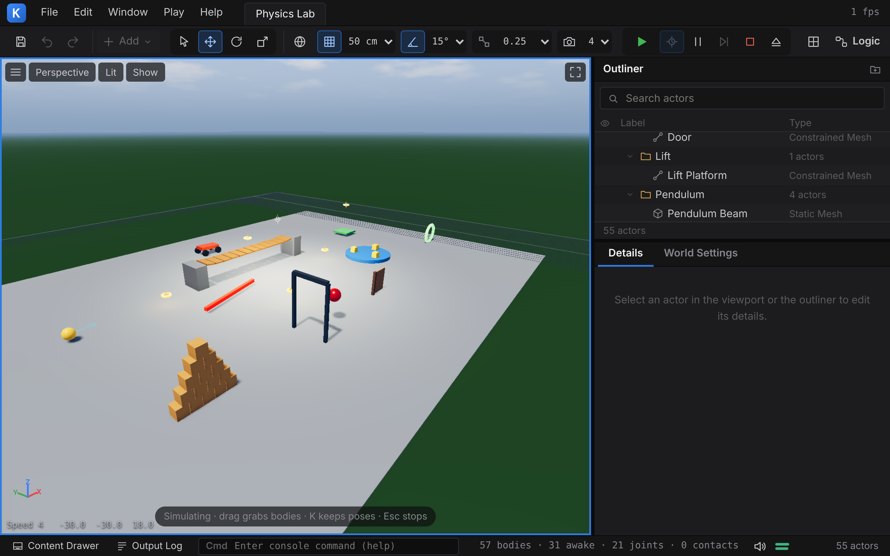

# 6 Physik

Kern simuliert starre Körper mit Box3D, Erin Cattos
3D-Nachfolger von Box2D v3. Box3D liegt unverändert unter `third_party/box3d` und wird in dasselbe
WebAssembly-Modul übersetzt wie Renderer und Spiel-Laufzeit. Darüber liegt eine schmale C++-Schicht,
`kern::physics` (`include/kern/physics/physics.h`, `src/physics/physics.cpp`). Sie ist die **einzige
Stelle**, an der Kern mit Box3D spricht.

Dieses Kapitel beschreibt diese Schicht vollständig: Welt, Körper, Formen, Materialien, Gelenke,
Abfragen, Kontakte, den Maus-Griff und den Character Mover. Danach folgen Zeitschritt, Sub-Steps und
Determinismus, die verbindlichen Regeln aus `docs/physics.md` und am Ende das Servomodell
(`game/servo.cpp`), auf dem die Micro Duck in [Kapitel 13](13-micro-duck.md) läuft.

Eine Grundregel vorweg, weil sie alles Weitere prägt: **Box3D wird nie an Kerns Bedürfnisse
angepasst.** Weder der Quelltext noch seine Konstanten werden verändert, und Kern verstellt keine
Solver-Parameter, um ein Modell „zum Laufen zu bringen“. Passt ein Modell nicht in Box3Ds
Arbeitsbereich, wird das Modell angepasst (skaliert, Massen verteilt, Sub-Steps erhöht), nicht die
Physik. Was ein echtes Gerät über die Starrkörperphysik hinaus tut, etwa ein Servo mit Regler und
Reibung, ist ein eigenes kleines Gerätemodell in echten Einheiten (Abschnitt 6.17).

Die Grundbegriffe, die dieses Kapitel voraussetzt (Starrkörperzustand, Integration, Kollision,
Kontakte, Constraints, Solver, Servos als Regelkreis, Determinismus), erklärt
[Anhang C](C-grundlagen-physik.md).



---

## 6.1 Aufbau der Schicht

```
include/kern/physics/physics.h   World, Body/Shape/Joint-Handles, Einstellungen, MouseGrab,
                                 CharacterMover, hull_mesh
src/physics/physics.cpp          Umsetzung auf die Box3D-C-API
third_party/box3d                Box3D (unverändert)
```

Konventionen der Schicht (Kopfkommentar von `physics.h`):

- Meter, Sekunden, Kilogramm; **Z zeigt nach oben**; Quaternionen in der Reihenfolge (x, y, z, w) –
  dieselben Konventionen wie der Renderer.
- Winkel sind in der Physikschicht **Radiant**. Grad gibt es nur in Leveldateien und im
  Details-Panel; die Spiel-Laufzeit rechnet beim Aufbau um.
- Handles (`Body`, `Shape`, `Joint`) sind einfache 64-Bit-Werte, in die Box3Ds IDs gepackt sind.
  `0` heißt „keins“, `valid()` prüft genau das.
- Eine `World` besitzt alles, was in ihr erzeugt wurde. Wird die Welt zerstört (auch im Destruktor),
  ist alles freigegeben.
- Fehlgeschlagene Aufrufe liefern ein ungültiges Handle bzw. `false` und setzen `last_error()`
  (siehe [Kapitel 3](03-grundlagen.md)). Alle Eingaben werden auf Endlichkeit geprüft: Eine
  Pose mit `NaN`, ein negativer Radius oder ein flacher Hull erreicht Box3D nie.

Gebaut wird die Schicht mit `kern/build.sh --physics` ([Kapitel 2](02-bauen-und-testen.md)).

---

## 6.2 Einheiten und Größen

Box3D rechnet mit Toleranzen, die **in Metern** festgelegt sind
(`box3d:include/box3d/constants.h:47-97`):

| Toleranz | Wert |
|---|---|
| Linear Slop | 5 mm |
| Speculative Distance | 20 mm |
| AABB-Margin | bis 50 mm |
| Contact Recycling | 50 mm |

Daraus folgt die erste Regel: **Bewegte Körper gehören zwischen 0,1 m und 10 m, nie unter 1 cm**
(`box3d:docs/loose_ends.md:56-58`, `box3d:docs/overview.md:171-181`). Ein Körper, dessen Glieder in der
Größenordnung der Toleranzen liegen, wird vom Solver nicht mehr sauber gehalten.

Die Spiel-Laufzeit setzt das beim Aufbau durch: Formen bewegter Körper werden auf mindestens 1 cm
Kantenlänge (Kugeln: 5 mm Radius) angehoben, statische dürfen bis 2 mm dünn sein
(`add_shape` in `src/game/runtime.cpp`).

*[gemessen]* Die Micro Duck in echter Größe (Glieder von 2–4 cm): Der Rumpf sank innerhalb von
10 Frames 9 cm durch die Beine, selbst mit verschweißten Gelenken. In 4-facher Größe halten die
Gelenke.

### Skalieren statt Toleranzen verstellen

Box3D bietet `b3SetLengthUnitsPerMeter`, das die Toleranzen umstellt. Kern nutzt es **nicht**: Es gilt
für die *ganze* Welt, und in einem Kern-Level stehen Autos und kleine Roboter nebeneinander.
Stattdessen gilt (`box3d:docs/loose_ends.md:59-61`): **Einheiten an genau einer Stelle umrechnen, an
der Grenze zu Box3D**, nie verstreut im Simulationscode.

Kerns Regel für kleine reale Modelle: das ganze Modell mit einem Faktor S skalieren, jede Größe mit
ihrer Dimension (Froude-Ähnlichkeit – Posen und Gangart bleiben gleich). Für die Micro Duck ist
S = 4 (`game::kWalkerScale` in `include/kern/game/walker.h`, im Code als `kDuckScale`):

| Größe | Faktor | bei S = 4 | Bemerkung |
|---|---|---|---|
| Länge | S | ×4 | |
| Zeit | √S | ×2 | 1 echte Sekunde = 2 Sekunden der Welt |
| Masse | S³ | ×64 | gleiche Dichte |
| Trägheitsmoment (kg·m²) | S⁵ | ×1024 | `scaled()` in `src/game/walker.cpp` |
| Drehmoment, Steifigkeit (N·m/rad) | S⁴ | ×256 | |
| Dämpfung (N·m·s/rad) | S^4,5 | ×512 | |
| Geschwindigkeit | √S | ×2 | |
| Beschleunigung, Schwerkraft | 1 | ×1 | g bleibt 9,81 m/s² |
| Frequenzen (Federn, Kontakt- und Gelenkweichheit) | 1/√S | ×½ | |

**Verhält sich die 4-fache Ente noch wie das Modell des echten Roboters?** Im Rahmen der
Modellgenauigkeit ja: Die Skalierung ist ein Wechsel der Einheiten,
kein größerer Roboter: Wird jede Größe mit ihrer Dimension skaliert, rechnet Box3D dieselbe
Bewegung. Was nach außen geht, ist in echten Einheiten: `walker_probe`, die Beobachtungen der Netze,
Logs und Kalibrierung ([Kapitel 16](16-kalibrierung.md)). Simulationsergebnisse sind keine Garantie
für sicheres Verhalten auf echter Hardware.

Der Test `physics_scale_is_a_unit_system` (`tests/test_main.cpp`) baut ein kleines Servo-Bein
(72 g Rumpf, zwei 5-cm-Glieder, Federservos mit Reibung) in 1-, 4- und 8-facher Größe:

- **Frei hängend** (Gelenke, Federn, Reibung, Schwerkraft): 1× und 4× laufen **Bit für Bit gleich**.
  Die Faktoren sind Zweierpotenzen, die Gleitkommarundung ist identisch.
- **Auf dem Boden, in die Knie gehend:** Hier wirken Box3Ds feste Längen (Linear Slop 5 mm,
  Speculative Distance 20 mm), die nicht mitskalieren. 4× und 8× liegen 0,23 mm auseinander, 1× und
  4× 0,27 mm. Bei 4× entsprechen die Toleranzen 1,25 mm bzw. 5 mm am echten Roboter – feiner als bei
  echter Größe.

Was in echten Einheiten fest eingestellt ist, wird deshalb **kalibriert, nicht skaliert**:

| Wert in der Welt | entspricht am echten Roboter |
|---|---|
| Kontaktsteifigkeit 30 Hz, Dämpfung 10 | 60 Hz, Dämpfung 10 |
| Kontakt-Ausdrückgeschwindigkeit 3 m/s | 1,5 m/s |
| Restitutionsschwelle 1 m/s | 0,5 m/s |
| Gelenkweichheit der Servo-Gelenke 240 Hz, Dämpfung 2 | 480 Hz, Dämpfung 2 |

Abweichungen zum echten Roboter kommen also nicht aus der Skalierung, sondern aus den Modellen
(Servo, Kontakt, Massen). Die werden mit Messungen am echten Gerät abgeglichen und über Logs
nachkorrigiert ([Kapitel 16](16-kalibrierung.md)). Ein Roboter mit anderer Größe bekommt einfach
ein anderes S.

---

## 6.3 Die Welt

```cpp
physics::WorldSettings ws;          // Standardwerte siehe Tabelle
physics::World world;
if (!world.create(ws)) { /* last_error() */ }
...
world.step(1.0f / 60, 4);           // ein fester Schritt mit 4 Sub-Steps
```

`physics::WorldSettings` entspricht Box3Ds `b3WorldDef`:

| Feld | Standard | Bedeutung |
|---|---|---|
| `gravity` | (0, 0, −9,80665) | m/s², muss endlich sein |
| `enable_sleep` | `true` | ruhende Inseln schlafen |
| `enable_continuous` | `true` | Continuous Collision (siehe 6.15, „Continuous Collision, Events, Schlaf“) |
| `restitution_threshold` | 1 m/s | langsamere Stöße prallen nicht ab |
| `restitution_iterations` | 2 | 0..63 |
| `restitution_propagation` | `false` | Box3Ds `enableRestitutionPropagation` |
| `hit_event_threshold` | 1 m/s | ab dieser Annäherungsgeschwindigkeit meldet Box3D Hit-Events |
| `contact_hertz` | 30 Hz | Kontaktsteifigkeit („Contact softness“) |
| `contact_damping_ratio` | 10 | Kontaktdämpfung |
| `contact_speed` | 3 m/s | Obergrenze, mit der Überlappungen ausgedrückt werden |
| `maximum_linear_speed` | 400 m/s | Box3Ds Geschwindigkeitsgrenze |

Werte ≤ 0 bei den Kontaktgrößen und der Höchstgeschwindigkeit lassen Box3Ds Standard stehen.

Zwei Dinge setzt `World::create` immer selbst:

- **`workerCount = 1`.** WebAssembly läuft einfädig; Box3D bekommt keinen Task-Scheduler.
- **Den Reibungs-Callback** `pair_friction` (Abschnitt 6.6) für Oberflächenpaare.

Box3D hält seine Welten in einer globalen Tabelle; Erzeugen und Zerstören sind nicht threadsicher.
Nativ schützt `WorldTableLock` (ein `std::mutex`) diese Aufrufe, weil der Lehrer eine Welt pro
Umgebung auf mehreren Threads betreibt ([Kapitel 14](14-lehrer.md)). In WebAssembly ist der Lock leer.

### Ein Schritt

`World::step(dt, substeps)`:

1. leert die Event-Listen des vorigen Schritts,
2. ignoriert ungültige `dt` (≤ 0, nicht endlich),
3. ruft `b3World_Step` mit `substeps` auf 1..64 begrenzt,
4. zählt `step_count()` hoch,
5. sammelt Kontakt-, Hit-, Sensor- und Gelenk-Events dieses Schritts (Abschnitt 6.10).

Den festen Zeitschritt und die Sub-Step-Zahl wählt nicht die Physikschicht, sondern ihr Aufrufer –
in Spielen `GameWorld::step` (Abschnitt 6.13).

Weitere Abfragen der Welt: `valid()`, `body_count()`, `awake_body_count()`, `step_count()`,
`gravity()`.

---

## 6.4 Körper (Bodies)

```cpp
physics::BodySettings bs;
bs.type = physics::BodyType::dynamic;
bs.position = {0, 0, 3};
bs.user = 42;                       // frei verwendbar, zurück über body_user()
const physics::Body ball = world.create_body(bs);
```

`BodyType` kennt `fixed` (statisch), `kinematic` und `dynamic`. Die Felder von `BodySettings`:

| Feld | Standard | Bedeutung |
|---|---|---|
| `type` | `dynamic` | Körpertyp |
| `position`, `rotation` | Ursprung, Identität | Anfangspose (endlich, sonst Fehler) |
| `linear_velocity`, `angular_velocity` | 0 | Anfangsgeschwindigkeiten (m/s, rad/s) |
| `linear_damping`, `angular_damping` | 0 | Box3Ds eingebaute (implizite) Dämpfung, ≥ 0 |
| `gravity_scale` | 1 | Faktor auf die Schwerkraft |
| `enable_sleep` | `true` | darf schlafen |
| `awake` | `true` | startet wach |
| `enabled` | `true` | nimmt an der Simulation teil |
| `bullet` | `false` | Continuous Collision auch gegen dynamische Körper |
| `user` | 0 | Benutzerwert (`body_user()`) |

### Zustand und Kräfte

| Methode | Wirkung |
|---|---|
| `pose(b)` / `set_pose(b, p)` | Pose lesen / setzen (Teleport, siehe Regeln) |
| `set_target_pose(b, p, dt)` | kinematischen Körper so bewegen, dass er `p` nach `dt` erreicht; weckt Berührte |
| `linear_velocity`, `angular_velocity`, `set_linear_velocity`, `set_angular_velocity` | Geschwindigkeiten |
| `apply_force(b, f, p)`, `apply_force_to_center(b, f)`, `apply_torque(b, t)` | Dauerlasten, gelten für **einen** Schritt |
| `apply_linear_impulse(b, i, p)`, `apply_linear_impulse_to_center(b, i)`, `apply_angular_impulse(b, i)` | Impulse (N·s) |
| `set_awake`, `awake` | Schlafzustand |
| `mass(b)`, `body_type(b)`, `set_body_type(b, t)` | Masse, Typ (Typwechsel ist teuer) |
| `local_point`, `world_point`, `world_vector` | Koordinatenumrechnung |
| `body_user(b)`, `shape_user(s)`, `shape_body(s)` | Benutzerwerte, Zuordnung |
| `set_motion_locks(b, locks)` | Translation / Rotation je Weltachse sperren (`MotionLocks`) |

Alle Kraft- und Impulsfunktionen wecken den Körper.

### Masse und Trägheit

Ohne Eingriff bestimmen die Formen und ihre Dichten Masse, Schwerpunkt und Trägheit. Zwei Wege, das
zu überschreiben:

- **`set_mass(b, m)`** setzt nur die Masse und skaliert die Trägheit der Formen im gleichen
  Verhältnis mit. So bleibt der Körper in sich stimmig.
- **`set_mass_data(b, m, center, inertia[6])`** setzt alles: Masse (kg), Schwerpunkt (körperlokal)
  und den vollen Trägheitstensor um den Schwerpunkt in Körperachsen, Reihenfolge
  `xx yy zz xy xz yz` (kg·m²). Das ist der Weg für importierte Roboter (MJCF, URDF): Die
  Beschreibung liefert die Masseneigenschaften, die Kollisionsformen bestimmen dann nur noch den
  Kontakt. Die Diagonale muss positiv sein, sonst geschieht nichts.

---

## 6.5 Formen (Shapes)

Formen hängen an genau einem Körper. Ein Körper kann beliebig viele Formen tragen (ein *Compound*).

```cpp
physics::ShapeSettings ss;
ss.kind = physics::ShapeKind::sphere;
ss.radius = 0.5f;
ss.material.friction = 0.8f;
const physics::Shape s = world.create_shape(ball, ss);
```

`ShapeKind` und was jede Form liest:

| Art | Felder | Umsetzung |
|---|---|---|
| `box` | `size` (volle Kantenlängen, alle > 0), `center`, `rotation` | ein transformierter Box-Hull (`b3MakeTransformedBoxHull`) |
| `sphere` | `radius` > 0, `center` | Box3D-Kugel |
| `capsule` | `radius` > 0, `length` ≥ 0, `center`, `rotation` | Kapsel entlang der Z-Achse der Form; `length` ist der Abstand der Halbkugelmittelpunkte |
| `hull` | `points` (≥ 4), `center`, `rotation` | konvexe Hülle (`b3CreateHull`, auf Box3Ds Höchstzahl an Ecken reduziert) |
| `mesh` | `points` (Ecken), `indices` (3 je Dreieck, gegen den Uhrzeigersinn) | Dreiecksnetz, **nur an statischen Körpern** |

Was abgelehnt wird (ungültiges Handle, `last_error()` erklärt warum): nicht endliche Platzierung,
Radius ≤ 0, negative Kapsellänge, eine Box mit Kantenlänge ≤ 0, weniger als vier Hull-Punkte oder
ein flacher/entarteter Hull, ein Mesh an einem nicht statischen Körper, Indizes außerhalb der Ecken
oder keine ganzen Dreiecke.

Bei Meshes schweißt Kern Ecken mit 0,5 mm Toleranz zusammen und lässt Box3D innere Kanten erkennen
(`identifyEdges`) – so gibt es keine „Geisterkollisionen“ an Kanten zwischen zwei Dreiecken. Die
Mesh-Daten gehören der Welt und werden nach ihr freigegeben.

### Material und Filter

Jede Form trägt ein `ShapeMaterial`:

| Feld | Standard | Bedeutung |
|---|---|---|
| `density` | 1 kg/m³ | mindestens 0,0001 |
| `friction` | 0,6 | Coulomb-Reibungskoeffizient, ≥ 0 |
| `restitution` | 0 | Elastizität 0..1 |
| `rolling_resistance` | 0 | Rollwiderstand, ≥ 0 (Abschnitt 6.7) |
| `surface` | `Surface::none` | Oberflächenmaterial für Paar-Reibung (Abschnitt 6.6) |
| `sensor` | `false` | nur Überlappung, kein Kontakt |
| `category_bits`, `mask_bits` | 1, alle Bits | Kollisionskanäle: A und B kollidieren, wenn jeweils die Kategorie des einen in der Maske des anderen liegt |
| `group_index` | 0 | gleiche positive Gruppe kollidiert immer, gleiche negative nie |
| `contact_events`, `sensor_events`, `hit_events` | `true`, `true`, `false` | welche Events diese Form erzeugt |
| `user` | 0 | Benutzerwert (`shape_user()`) |

Die Spiel-Laufzeit stellt die Event-Schalter gezielt ein (siehe 6.10), denn Events kosten.

### `hull_mesh`

`physics::hull_mesh(points, out, color)` erzeugt die flach schattierten Dreiecke der konvexen Hülle
mit Box3Ds Hull-Bauer – dieselbe Hülle, die auch kollidiert. Die Spiel-Laufzeit zeichnet damit
Hull-Collider als Debug-Linien (`shape_lines` in `src/game/runtime.cpp`). Für
weniger als 4 oder mehr als 4096 Punkte oder eine flache Punktmenge liefert sie `false`
(Test `physics_hull_mesh`).

---

## 6.6 Oberflächenmaterialien mit Paar-Reibung

Box3D kombiniert die Reibung zweier Formen standardmäßig als **√(a · b)** und die Restitution als
**Maximum**. Für die meisten Dinge reicht das. Es stimmt aber nicht für jedes reale Paar: Zwei
Materialien kombinieren sich nicht einfach: *TPU auf Baumwolle hat einen eigenen gemessenen Wert,
nicht das Mittel aus TPU auf TPU und Baumwolle auf Baumwolle* (Kommentar in `physics.h`). Für solche Paare kennt Kern Oberflächenmaterialien mit eigener,
gemessener Paar-Reibung.

### Das Modell

```cpp
enum class Surface : u8 { none, cloth, tpu, floor };
const char* surface_name(Surface s);                  // "", "cloth", "tpu", "floor"
bool parse_surface(const std::string& name, Surface& out);
/// Reibung eines Paares, oder < 0, wenn das Paar keinen eigenen Wert hat.
f32 surface_friction(Surface a, Surface b);
```

Die Paartabelle (`surface_friction` in `src/physics/physics.cpp`, symmetrisch):

| Paar | Reibung | Herkunft laut Quelltext |
|---|---|---|
| cloth – cloth | 0,5 | Baumwollstrick auf Baumwollstrick (Faden auf Faden 0,3, Strick auf sich 0,4–0,6) |
| cloth – tpu | 0,8 | TPU (die weichen gedruckten Pads des Schnabels) auf Baumwolle (Elastomere auf Textil 0,6–1,0, je weicher, desto höher) |
| cloth – floor | 0,4 | Baumwolle auf Holz- oder Laminatboden (Stoff auf Holz 0,3–0,5) |

Es sind Haftreibungswerte trockener Paare; der Solver kennt nur einen Coulomb-Koeffizienten.

### Wie es in Box3D wirkt

Kern ändert Box3D dafür nicht, sondern nutzt zwei Erweiterungspunkte, die Box3D vorsieht:

1. `create_shape` schreibt das Material als `baseMaterial.userMaterialId` in die Form.
2. `World::create` setzt den Reibungs-Callback der Welt:

```cpp
float pair_friction(float fa, uint64_t ma, float fb, uint64_t mb) {
  const f32 f = ma && mb && ma <= 3 && mb <= 3
                    ? surface_friction(static_cast<Surface>(ma), static_cast<Surface>(mb)) : -1.0f;
  return f >= 0 ? f : sqrtf(fa * fb);
}
```

Box3D ruft ihn bei jeder Aktualisierung eines Kontakts mit den Reibwerten und Material-IDs beider
Formen auf (`b3UpdateConvexContact` in `box3d:src/contact.c`, Mesh-Kontakte in `src/mesh_contact.c`). Hat das Paar einen eigenen Wert, gilt der; sonst die
übliche Kombination √(a · b). Ein Paar, in dem eine Seite `none` ist, nutzt also immer die
Reibwerte der Formen. Restitution und Rollwiderstand bleiben unberührt.

> Wer eine Oberfläche ergänzt: Der Callback prüft die IDs gegen den größten Enum-Wert (`<= 3`).
> Ein neuer Wert in `Surface` braucht also auch eine Anpassung dieser Grenze, dazu einen Namen in
> `surface_name` / `parse_surface` und seine Paare in `surface_friction`.

### Im Level

Drei Stellen tragen eine Oberfläche, jeweils als Zeichenkette (`""`, `"cloth"`, `"tpu"`, `"floor"`):

| Stelle | Feld (C++) | Schlüssel im `.klevel` |
|---|---|---|
| automatisch erzeugter Collider eines Meshes | `MeshComponent::surface` | `components.mesh.surface` |
| eigener Collider | `ColliderComponent::surface` | `components.colliders[i].surface` |
| endloser Boden | `WorldSettings::ground_surface` | `world.groundSurface` |

Die Schlüssel werden nur geschrieben, wenn sie nicht leer sind. Beim Aufbau übersetzt
`GameWorld::create_body` die Zeichenkette mit `parse_surface`; ein unbekannter Name ergibt `none`.
Im Details-Panel gibt es (Stand dieses Codes) kein eigenes Feld für die Oberfläche; sie wird im
Leveldokument gesetzt.

Die Micro Duck nutzt alle drei ([Kapitel 13](13-micro-duck.md)):

- Die Klumpen der Socke (`micro_duck_sock_actors`) sind `cloth`.
- Die gedruckten Pads des Schnabels (Hull-Collider mit Reibung > 0, die keine Sohlen sind) sind `tpu`.
- Im Beispiel-Level Micro Duck ist der Holzboden (`floor.mesh->surface`) `floor`. Das Level setzt
  auch `ground_surface = "floor"`, schaltet den endlosen Boden aber ab (`ground = false`) – der
  Holzboden ist dort der Boden.

Die Sohlen und Gehäuse der Ente haben **keine** Oberfläche: Sie behalten die Reibwerte, mit denen
die Policy trainiert wurde (Sohlen 1,0 auf einem Boden mit 1,0 ergibt √(1 · 1) = 1).


---

## 6.7 Reibung, Restitution, Rollwiderstand

**Kontaktreibung** ist pro Form eingestellt (`ColliderComponent::friction`, Standard 0,6). Im
Editor: **Details › Statisches Mesh › Physik** (Details › Static Mesh › Physics) mit Reibung,
Restitution und Rollwiderstand des automatisch erzeugten Colliders, direkt über dem Render-Material,
oder **Details › Kollider** (Details › Collider) bei eigenen Collidern. Der endlose Boden:
**Welteinstellungen › Physik (Box3D)** (World Settings › Physics (Box3D)), Felder **Bodenreibung**
(Ground friction) und **Bodenelastizität** (Ground bounciness).

**Restitution** (0..1) kombiniert Box3D als Maximum der beiden Formen. Stöße unterhalb der
Restitutionsschwelle (`restitution_threshold`, Standard 1 m/s) prallen nicht ab.

**Kontaktweichheit** (Box3Ds World Definition) stellt man in den **Welteinstellungen** ein:
**Kontaktsteifigkeit** (Contact stiffness), Standard 30 Hz; **Kontaktdämpfung** (Contact damping
ratio), Standard 10; **Kontakt-Ausstoßgeschwindigkeit** (Contact push-out speed), Standard 3 m/s.

**Rollwiderstand** bremst das Rollen über die Kontaktnormale. In der eingebundenen Box3D-Fassung
(`box3d:src/contact.c`, `src/contact_solver.c`) gilt:

- Der Kontakt bekommt das **Maximum** der beiden Rollwiderstände, multipliziert mit dem größten
  „Rollradius“ der beiden Formen: Radius bei Kugeln und Kapseln, ein Viertel des Innenradius bei
  Hulls.
- Im Solver begrenzt er den Rollimpuls auf Rollwiderstand × gesamter Normalimpuls des Kontakts.

`docs/physics.md` und der Kommentar in `physics.h` sagen dasselbe: Rollwiderstand wirkt auf Kugeln
und Kapseln (Radius) und auf konvexe Hüllen (ein Viertel ihres Innenradius; auch Quader sind in
Box3D Hüllen). Eingesetzt ist er für runde Dinge: der Ball im Micro-Duck-Level (0,03, „ein
Gummiball auf Holzboden rollt aus“), die Reifen des Rovers im Physics Lab (0,02) und die
Socken-Klumpen (0,5: „ein Stoffklumpen rollt nicht; runde Klumpen würden es, und der Haufen
krabbelt“).

**Roboterfüße** sind breite, flache Quader bzw. Hulls mit hoher Reibung.

---

## 6.8 Gelenke

Kern bildet Box3Ds native Gelenke ab. Ein `JointSettings` beschreibt jedes Gelenk; jeder Typ liest
die Felder, die er braucht.

```cpp
physics::JointSettings j;
j.type = physics::JointType::revolute;
j.body_a = frame_body;  j.body_b = door;
j.frame_a = physics::frame_from_axis(world.local_point(frame_body, hinge), {0, 0, 1}, false);
j.frame_b = physics::frame_from_axis(world.local_point(door, hinge), {0, 0, 1}, false);
j.enable_limit = true;  j.lower = -1.7f;  j.upper = 1.7f;   // Radiant
const physics::Joint joint = world.create_joint(j);
```

### Lokale Frames und Achsen

Jedes Gelenk verbindet zwei Körper über einen lokalen Frame je Körper (`frame_a`, `frame_b`,
körperlokal). Box3D misst B relativ zu A.

- Revolute-, Spherical- und Parallel-Gelenke arbeiten **um die Z-Achse** des Frames.
- Prismatic- und Wheel-Gelenke arbeiten **entlang der X-Achse** des Frames.
- `physics::frame_from_axis(anchor, axis, x_axis)` baut einen Frame am Ankerpunkt, dessen X- bzw.
  Z-Achse entlang `axis` zeigt (auch für die genau entgegengesetzte Richtung).
- Der Nullwinkel liegt dort, wo die beiden Frames übereinstimmen.

### Typen

| `JointType` | Box3D | Feder | Limit | Motor |
|---|---|---|---|---|
| `revolute` | Revolute | `enable_spring`, `hertz`, `damping_ratio` | `lower`/`upper` (rad) | `motor_speed` (rad/s), `max_motor_torque` |
| `distance` | Distance | ja | `lower`/`upper` = min./max. Länge; `length` = Ruhelänge (≥ 1 mm) | `motor_speed` (m/s), `max_motor_force` |
| `prismatic` | Prismatic | ja | `lower`/`upper` (m) | `motor_speed` (m/s), `max_motor_force` |
| `wheel` | Wheel | Federung (`hertz`, `damping_ratio`) | Federweg `lower`/`upper` (m) | Antrieb `motor_speed` (rad/s), `max_motor_torque` |
| `weld` | Weld | Weichheit `linear_hertz`, `angular_hertz` (+ Dämpfung; 0 Hz = starr) | – | – |
| `motor` | Motor | Feder zur Frame-Deckung (`linear_hertz`, `angular_hertz`, `max_spring_force/_torque`) | – | Geschwindigkeitsantrieb (`linear_velocity`, `angular_velocity`, `max_velocity_force/_torque`) |
| `spherical` | Spherical | ja | Kegel mit Öffnung `upper` | `motor_velocity` (Vektor), `max_motor_torque` |
| `parallel` | Parallel | `hertz`, `damping_ratio` | – | `max_torque` |
| `filter` | Filter | – | – | – (verhindert nur die Kollision zweier Körper) |

Untere und obere Grenze werden bei Revolute-, Prismatic- und Wheel-Gelenken bei Bedarf vertauscht,
negative Höchstkräfte auf 0 gesetzt. Ein Seil ist ein begrenztes Distance-Gelenk; der Editor führt
es als „Distance / rope“.

Gemeinsame Felder: `collide_connected` (Standard: verbundene Körper kollidieren nicht), `user` und
die **Gelenkweichheit des Solvers** `constraint_hertz` / `constraint_damping_ratio` (0 = Box3Ds
Standard, 60 Hz und 2). Ein Gelenk, das einen Körper mit sich selbst verbinden soll, oder eines mit
ungültigen Körpern wird abgelehnt.

### Zur Laufzeit

| Methode | Wirkung |
|---|---|
| `set_joint_motor(j, enable, speed, max_force)` | Motor von Revolute (rad/s, N·m), Prismatic (m/s, N), Distance (m/s, N), Spherical (nur Moment); weckt die Körper |
| `joint_angle(j)` | Revolute: Winkel von B relativ zu A (rad, ab dem Referenzwinkel); sonst 0 |
| `joint_speed(j)` | Revolute: Winkelgeschwindigkeit von B relativ zu A um die Scharnierachse (rad/s); sonst 0 |
| `set_joint_spring(j, target, stiffness, damping)` | Revolute: Feder-Dämpfer zum Zielwinkel in physikalischen Einheiten (siehe unten) |
| `joint_force(j)`, `joint_torque(j)` | Zwangskraft (N) und Zwangsmoment (N·m) des Gelenks |
| `set_joint_thresholds(j, force, torque)` | ab diesen Werten meldet `joint_events()` das Gelenk (0 = nie) |
| `destroy_joint(j, wake)` | entfernt das Gelenk, weckt die Körper |

### Gelenkkräfte und Bruch

`joint_force` und `joint_torque` liefern Box3Ds Zwangskraft und -moment des letzten Schritts. Mit
`set_joint_thresholds` meldet Box3D ein Gelenk nach dem Schritt in `joint_events()`, sobald es die
Schwelle überschreitet (intern `FLT_MAX` für „nie“). Die Spiel-Laufzeit macht daraus brechende
Gelenke: `JointComponent::break_force` / `break_torque` werden als Schwellen gesetzt, und
`GameWorld::handle_events` zerstört gemeldete Gelenke, zählt sie (`SimStats::broken_joints`),
schreibt „Joint on "…" broke“ ins Log und spielt den Bruch-Sound. Die Seilbrücke im Physics Lab
bricht so (Test `game_world_physics_lab`).

### Die Gelenkfeder in physikalischen Einheiten

Box3D stellt Federn in Hertz und Dämpfungsgrad ein, relativ zur effektiven Masse des Gelenks.
Servos und Roboterbeschreibungen rechnen in N·m/rad und N·m·s/rad. `set_joint_spring` rechnet an
der Grenze um, genau wie Box3D es intern in `revolute_joint.c` tut:

- axiale effektive Masse m = 1 / (a · (I_A⁻¹ + I_B⁻¹) · a), mit der Scharnierachse a in Weltkoordinaten
  (Z-Achse von Frame A) und den inversen Weltträgheiten der Körper (statische und kinematische
  tragen 0 bei),
- ω = √(k / m), Federfrequenz = ω / 2π,
- Dämpfungsgrad ζ = c / (2 m ω),
- Zielwinkel auf ±π begrenzt (Box3D prüft |Ziel| ≤ π).

Weil die effektive Masse von der aktuellen Lage abhängt, wird die Funktion **jeden Schritt**
aufgerufen. Die Feder wird von Box3D implizit gelöst (Soft Step) und ist bei jeder Steifigkeit
stabil. `stiffness ≤ 0` schaltet sie ab.

---

## 6.9 Abfragen: Strahlen, Kugeln, Explosionen

| Methode | Ergebnis |
|---|---|
| `cast_ray(origin, translation, mask, ignore)` | nächster Treffer entlang `origin + translation`; Sensoren werden übersprungen, ebenso die Formen des Körpers `ignore` (z. B. der Körper, in dem der Strahl beginnt) |
| `cast_ray_ignoring(origin, translation, ignore[], mask)` | wie oben, mit einer Liste ignorierter Körper (ein Robotersensor sieht seine eigenen Glieder nicht) |
| `cast_sphere(origin, radius, translation, mask, ignore)` | „dicker Strahl“: eine Kugel wird entlang `translation` geschoben – Bodenproben, die keine Kante verfehlen |
| `explode(center, radius, falloff, impulse_per_area, mask)` | radialer Impuls auf Kugeln, Kapseln und Hulls (`b3World_Explode`); negativ = Implosion |
| `push_body(b, point, normal, velocity)` | Impuls, den ein mit `velocity` bewegter Mover an einem dynamischen Körper aufbringt (nur so viel, wie nötig ist, damit der Körper an diesem Punkt nicht langsamer als der Mover entlang der Normalen ist) |

`RayHit` enthält `hit`, `shape`, `body`, `point`, `normal` und `fraction` (0..1 entlang der
Strecke). `mask` filtert über die Kategorie-Bits der Formen.

Für den Character Mover gibt es zwei weitere Abfragen auf Box3Ds Mover-API: `cast_mover` (wie weit
eine Kapsel fahren kann, 0..1) und `collide_mover` (die Ebenen, die sie berührt; höchstens 32).

---

## 6.10 Kontakte und Events

Nach jedem `step` stehen die Events **dieses** Schritts bereit:

| Liste | Typ | Inhalt |
|---|---|---|
| `contact_begin()`, `contact_end()` | `TouchEvent` | Formen beginnen / hören auf, sich zu berühren |
| `sensor_begin()`, `sensor_end()` | `TouchEvent` | `shape_a`/`body_a` = Sensor, `shape_b`/`body_b` = Besucher |
| `hits()` | `HitEvent` | Stoß über der Hit-Schwelle: Punkt, Normale, Annäherungsgeschwindigkeit |
| `joint_events()` | `Joint` | Gelenke über ihrer Kraft-/Momentschwelle |

Formen können seit dem Schritt zerstört worden sein; die Events tragen deshalb auch die Körper, und
für ungültige Formen ist der Körper 0.

**Events sind nicht kostenlos.** Box3D meldet Kontakt-, Sensor- und Hit-Events nur für Formen, die
danach fragen. Die Spiel-Laufzeit schaltet sie deshalb nur dort ein, wo das Spiel sie liest
(`GameWorld::create_body`):

- Sensor-Events: an Sensoren, an Spielerkörpern, und an allen nicht statischen Formen, wenn das
  Level Logik-Graphen hat.
- Kontakt-Events: nur am Spieler (Pickups und Trigger).
- Hit-Events: an dynamischen Körpern, wenn sie der Spieler sind, einen Aufprall-Sound haben oder
  das Level Logik hat.

### Kontaktpunkte und Berührungen

Zwei Abfragen lesen Box3Ds Kontaktdaten eines Körpers direkt:

- **`contact_points(body, out)`** liefert alle berührenden Manifold-Punkte als `ContactPoint`
  (Weltposition, Normale von Form A zu B, Separation – negativ bei Durchdringung – und den
  Normalimpuls des letzten Sub-Steps). `GameWorld::debug_lines` zeichnet damit Kontakte (im Viewport
  **Fenster › Anzeigen › Kontaktpunkte** (Window › Show › Contact Points)).
- **`touching(body, out)`** liefert die Körper, die `body` gerade berührt (Manifolds mit Punkten),
  jeweils mit der Summe der Normalimpulse des letzten Sub-Steps (N·s) – das, was ein Kontaktsensor
  meldet: eine Sohle auf dem Boden, ein Glied auf einem anderen. Die Walker-Sonde nutzt das für
  Fußkontakt und Eigenkollision ([Kapitel 13](13-micro-duck.md)).

---

## 6.11 MouseGrab: Körper mit der Maus ziehen

`physics::MouseGrab` zieht einen dynamischen Körper mit einer Feder – dieselbe Technik wie in den
Box3D-Samples:

```cpp
physics::MouseGrab grab;
if (grab.begin(world, body, hit_point)) {   // Federfrequenz Standard 7,5 Hz; 5. Argument hold_rotation
  grab.set_target(cursor_point);
  // jeden Schritt, vor World::step:
  grab.update(h);
  world.step(h, substeps);
}
grab.end();
```

So funktioniert es:

- `begin` erzeugt einen **kinematischen „Maus“-Körper** am Griffpunkt (schläft nie) und ein
  **Motor-Gelenk** zum gegriffenen Körper, dessen Frame B am Griffpunkt im Körper sitzt.
- Die lineare Feder hat `stiffness_hertz` (Standard 7,5 Hz) und Dämpfungsgrad 1 (kritisch
  gedämpft). Ihre Höchstkraft ist auf 100 × Masse × g begrenzt (g mindestens 1 m/s²). Die
  Drehfeder ist aus: Der Körper darf am Griff kippen und schwingen.
- Mit `hold_rotation = true` hält der Griff zusätzlich die Ausrichtung, die der Körper beim Greifen
  hatte, wie eine Hand: Drehfeder mit der halben Frequenz, kritisch gedämpft, Höchstmoment ein
  Viertel der Höchstkraft (ein Viertelmeter Hebel). `GameWorld::begin_grab` nutzt das für den Rumpf
  einer Micro Duck, damit sie hochgehoben aufrecht bleibt, statt am Punkt zu pendeln
  ([Kapitel 13](13-micro-duck.md)).
- `update(dt)` bewegt den Maus-Körper per `set_target_pose` zum Ziel. Der Körper bleibt ganz in der
  Physik: Er stößt an, kippt und fliegt beim Loslassen mit seinem Schwung weiter.
- Statische und kinematische Körper lassen sich nicht greifen (`begin` liefert `false`).
- Verschwindet der Körper, beendet `update` den Griff selbst.

Studio nutzt den Griff beim **Simulieren** (Simulate), nach dem Aussteigen aus dem Spieler (F8) und
mit der **Beobachterkamera (Spielen: fliegen, zuschauen, Körper ziehen)** (Observer camera (Play: fly,
watch, drag bodies)) der Welteinstellungen (`GameWorld::begin_grab` / `move_grab` / `end_grab`; Test `physics_joints_and_grab`,
`studio_observer_camera_grabs_bodies`).

---

## 6.12 CharacterMover

`physics::CharacterMover` ist ein kinematischer Charakter-Controller auf Box3Ds experimenteller
Mover-API (`box3d:docs/character.md`, Box3D-Sample „Mover“, Z oben). Die Kapsel läuft **außerhalb
des Solvers**: Sie kämpft nicht gegen Kontakte, sondern rechnet ihre Bewegung selbst und schiebt
dynamische Körper an, in die sie läuft.

`Settings` (Standardwerte):

| Feld | Standard | Bedeutung |
|---|---|---|
| `radius` | 0,4 m | Kapselradius |
| `height` | 1,8 m | Füße bis Kopf |
| `step_height` | 0,45 m | so hoch trägt die „Pogo“-Feder die Kapsel über den Boden (Stufen) |
| `max_speed` | 6 m/s | |
| `accelerate` | 10 1/s | |
| `friction` | 8 1/s | Bodenreibung |
| `air_control` | 0,25 | Anteil der Beschleunigung in der Luft |
| `stop_speed` | 3 m/s | unterhalb wirkt die Reibung konstant |
| `jump_speed` | 6 m/s | |
| `sprint` | 1,6 | Geschwindigkeitsfaktor beim Sprinten |
| `gravity` | 20 m/s² | eigene Schwerkraft (knackiger als die der Welt) |
| `max_slope_deg` | 50° | steilere Flächen sind kein Boden |
| `push_strength` | 1 | 0 = dynamische Körper werden nicht geschoben |
| `mask_bits` | alle | |

Ein `step(world, dt, wish, jump, sprint, self)`:

1. Bodenreibung (linear über `stop_speed`, darunter konstant), Beschleunigung in Wunschrichtung bis
   zur Wunschgeschwindigkeit, Sprung, Schwerkraft.
2. **Pogo-Feder:** Eine Kugelprobe (`cast_sphere`, 0,6 × Radius) unter der unteren Halbkugel misst
   den Bodenabstand; eine gedämpfte Feder (4 Hz, Dämpfungsgrad 0,7, implizit integriert) hält die
   Kapsel auf `step_height` – so läuft sie Stufen und Rampen hinauf.
3. Bis zu fünf Iterationen: `collide_mover` sammelt Kontaktebenen, `b3SolvePlanes` löst die
   Bewegung gegen sie, `cast_mover` begrenzt sie, der Rest wird an den Ebenen beschnitten
   (`b3ClipVector`) – gegen eine Wand Drücken baut keine Geschwindigkeit auf.
4. Dynamische Körper in den berührten Ebenen bekommen per `push_body` einen Stoß.

`position()` sind die Füße, `planes()` die zuletzt berührten Ebenen (Trigger und Pickups, in die der
Mover lief), `jump(speed)` lässt ihn abheben. Die Spiel-Laufzeit setzt den Mover für
Charakter- und Soldaten-Spieler ein und macht deren Körper dafür kinematisch
([Kapitel 8](08-spiel-laufzeit.md); Test `game_character_mover`).

---

## 6.13 Zeitschritt und Sub-Steps

### Fester Zeitschritt

Box3D bekommt **nie ein variables dt**. Die Schrittrate ist eine Level-Einstellung
(`WorldSettings::step_hz`, Standard 60 Hz, erlaubt 15..480 Hz; nie gröber als 30 Hz verwenden).
`GameWorld::step` folgt dem Akkumulator aus Glenn Fiedlers Artikel
„Fix Your Timestep!“:

```cpp
const f64 h = 1.0 / clamp(level_.world.step_hz, 15.0f, 480.0f);
accumulator_ += clamp(dt, 0.0, 0.25);                     // lange Frames begrenzen
const u32 max_steps = std::ceil(0.1 / h);                 // höchstens 0,1 s Simulation pro Frame
while (accumulator_ >= h && steps < max_steps) { ... fixed_step(input, h); accumulator_ -= h; }
if (accumulator_ >= h) accumulator_ = std::fmod(accumulator_, h);   // im Rückstand: ganze Schritte fallen weg
const f32 alpha = accumulator_ / h;                       // Rest für die Interpolation
```

- Der Frame liefert Zeit, die Simulation verbraucht sie in festen Schritten h; der Rest bleibt im
  Akkumulator.
- Ein langer Frame (Ruckler, Hintergrund-Tab) wird auf 0,25 s begrenzt, und pro Frame laufen
  höchstens 0,1 s Simulation – gegen die „Spiral of Death“, in der ein Schritt mehr kostet als h und
  die Simulation nie aufholt. Ist man trotzdem im Rückstand, fallen ganze Schritte weg; die Phase
  bleibt erhalten.
- **Die Simulationszeit zählt Schritte** (`step_count_`; `sim_time_ = step_count_ / step_hz`) statt
  Gleitkommazeit aufzusummieren, die mit der Laufzeit driften würde.
- **Eingaben gelten pro festem Schritt.** Steuerungen, die seltener rechnen (eine Policy mit
  50 Hz), zählen Schritte, nicht Sekunden.
- Gleiche Eingaben ergeben damit Bit für Bit denselben Ablauf
  (Glenn Fiedlers Artikel „Deterministic Lockstep“).

### Interpolation beim Zeichnen

Vor jedem festen Schritt merkt sich `GameWorld` die Pose jedes nicht statischen Körpers. Gezeichnet
wird zwischen den beiden letzten Physikständen (`alpha` = Rest / h; Position linear, Rotation
normiert linear auf der kürzeren Seite). So ist Bewegung bei jeder Bildrate glatt. Die Spielkamera
folgt der **interpolierten** Pose des Spielers (`presented_player_`). Mit der rohen Physik-Pose
wackelten schnelle Autos und Kugeln im Bild; `studio_fast_player_does_not_shake_on_screen` sichert
das ab.

### Sub-Steps

Jeder feste Schritt wird in Box3D in Sub-Steps geteilt (`WorldSettings::substeps`, Standard 4,
Level erlaubt 1..16). Lange Gelenkketten brauchen mehr: „long joint chains will stretch less with
more sub-steps“ (`box3d:docs/simulation.md:155-159`).

- *[gemessen]* Hüfte der Ente bei 4 Sub-Steps: Die Gelenklücke wuchs unter Last auf 5 cm und
  federte zurück. Bei 16 Sub-Steps bleibt sie unter 1 mm.
- Fügt Studio einen Roboter ein, stellt es 16 Sub-Steps und dessen Schrittrate ein (Micro Duck:
  100 Hz, `kWalkerStepHz`; `add_micro_duck` setzt `kWalkerSubsteps = 16`) und meldet das.

### Steifigkeit ist durch die Sub-Step-Rate gedeckelt

Box3D begrenzt `constraintHertz` auf 0,25 × Sub-Step-Rate und die Kontakt-Hertz auf 0,125 ×
(`box3d:src/joint.c:1484-1486`, `src/physics_world.c:1127-1129`). `constraintHertz` zu erhöhen hilft
also nur zusammen mit mehr Sub-Steps.

Federn bleiben unter der Nyquist-Grenze. `GameWorld::create_joints` begrenzt jede Feder des Levels
auf `max_hertz = 0,5 × step_hz × substeps` (die halbe Sub-Step-Frequenz). Servogelenke bekommen eine
Gelenkweichheit von `min(240 Hz, max_hertz)` mit Dämpfungsgrad 2.

---

## 6.14 Determinismus

Kern ist Bit für Bit deterministisch – nicht nur auf derselben Maschine, sondern auf allen in der CI
geprüften Plattformen (GCC/x86, Apple clang/ARM, WebAssembly). Die Physik trägt dazu bei:

- fester Zeitschritt, Simulationszeit als Schrittzähler, Eingaben pro Schritt (6.13);
- `workerCount = 1`: keine Reihenfolge, die von Threads abhängt;
- Box3D im Skalar-Pfad (`BOX3D_DISABLE_SIMD`), wie in WebAssembly;
- alles mit `-ffp-contract=off` übersetzt (keine FMA-Zusammenfassung von `a*b+c`);
- transzendente Funktionen aus Kerns eigener libm (`kern::dm::sin` usw., deklariert in
  `include/kern/core/dmath.h`, die musl-Implementierungen liegen in `third_party/musl_math`);
  `sqrt`, `fabs`, `floor` sind in IEEE exakt und bleiben `std::`.
  Box3D hat eigene deterministische Winkelfunktionen.

Geprüft wird das mit einem Fingerabdruck: Die Ente geht 400 Regeltakte, jeder Takt wird gehasht, und
die Hashes müssen `tests/determinism_fingerprint.txt` treffen – nativ
(`determinism_is_bit_identical_across_builds_and_platforms`), als WebAssembly
(`tests/lehrer_wasm_test.mjs`) und auf ARM. Einzelheiten in [Kapitel 14](14-lehrer.md).
**Regel für neuen Code, der die Simulation speist:** `kern::dm::` statt `std::` für sin, cos, tan,
asin, acos, atan, atan2, exp, expm1, log, log10, pow und hypot; keine Summen, deren Reihenfolge von
Threads abhängt; keine `-ffast-math`-Optionen.

---

## 6.15 Regeln und No-Gos

`docs/physics.md` ist verbindlich für jeden Code in Kern, der Bodies, Shapes, Joints oder Motoren
anlegt – **zu lesen, bevor man `src/physics` oder `src/game/runtime.cpp` ändert oder einen Roboter,
ein Fahrzeug oder einen Ragdoll-Preset baut.** Die Regeln stützen sich auf drei Quellen: Erin Cattos eigene
Dokumentation und Samples (zitiert als `box3d:datei:zeile`), seine Blogposts und GDC-Vorträge auf
box2d.org, und Messungen in Kern (*[gemessen]*, jeweils mit einem Kern-Test belegt). Hier sind sie
vollständig zusammengestellt, jede mit ihrem Grund.

### Größen und Einheiten (§1)

| Regel | Warum |
|---|---|
| Durchgehend MKS (m, kg, s); Radiant in der Physik, Grad nur in Leveldateien und Details-Panel. | Eine Einheitenwelt, eine Umrechnung. |
| Bewegte Körper zwischen 0,1 m und 10 m, nie unter 1 cm. | Box3Ds Toleranzen sind in Metern fest (5 mm Slop, 20 mm Speculative). |
| Einheiten an genau einer Stelle umrechnen, an der Grenze zu Box3D. | Verstreute Umrechnungen machen Fehler unauffindbar (`box3d:docs/loose_ends.md:59-61`). |
| Kleine reale Modelle als Ganzes mit S skalieren (Längen ×S, Massen ×S³, Momente ×S⁴, Zeiten ×√S). | Froude-Ähnlichkeit: dieselbe Bewegung in Box3Ds Arbeitsbereich. |
| **No-Go:** `b3SetLengthUnitsPerMeter`. | Verstellt die Toleranzen der ganzen Welt; Autos und Roboter teilen sich ein Level. |

### Massenverhältnisse (§2)

| Regel | Warum |
|---|---|
| Schwere Körper nicht an leichten aufhängen; Nachbarmassen innerhalb von etwa 10:1. | Extreme Verhältnisse führen zu „joint stretching“ (Box2D v2.4 `docs/loose_ends.md`, `box3d:docs/loose_ends.md:133-134`). Erin Cattos Lösung für einen Panzer mit 467:1: leichte Teile schwerer, schwere leichter machen (Diskussion #132 im GitHub-Projekt von Box3D). |
| Ein starres Teil ist **ein** Body mit mehreren Shapes. **No-Go:** Bodies zusammenschweißen. | „the approximate solver cannot hold many bodies together rigidly“ (`box3d:docs/simulation.md:1523-1526`). Kern schweißt Kinder, die nur ein Mesh haben, als Shapes in den nächsten Vorfahren mit Body ein. |
| Leichten Gliedern eine Mindestmasse geben, statt den Solver zu verstellen. | Die 5-g-Hüftbügel der Ente wiegen in echter Größe mindestens 20 g (×64 bei S = 4). |

### Zeitschritt und Sub-Steps (§3)

| Regel | Warum |
|---|---|
| Fester Zeitschritt, Standard 60 Hz, nie gröber als 30 Hz. **No-Go:** variables dt. | Stabilität und Determinismus (6.13). |
| Akkumulator mit Begrenzung, Interpolation, Zeit als Schrittzähler, Eingaben pro Schritt. | Glatte Darstellung, keine Spiral of Death, Bit-für-Bit-Wiederholbarkeit. |
| Kamera folgt der interpolierten Pose. | Sonst wackeln schnelle Körper im Bild. |
| Lange Gelenkketten: mehr Sub-Steps (Roboter 16). | Weniger Dehnung (`box3d:docs/simulation.md:155-159`); *[gemessen]* Hüftlücke 5 cm → < 1 mm. |
| `constraintHertz` nur zusammen mit mehr Sub-Steps erhöhen. | Box3D deckelt auf 0,25 × Sub-Step-Rate. |
| Federn unter der halben Sub-Step-Frequenz (`max_hertz = 0,5 × step_hz × substeps`). | Nyquist; steifere Federn werden instabil (Box3D „Distance Joint“). |

### Gelenke (§4)

| Regel | Warum |
|---|---|
| Jeden Preset mit Gelenken **in seiner Ruhepose bauen**; Limits müssen die Null enthalten. | Der Nullwinkel liegt dort, wo die Frames übereinstimmen (`box3d:docs/simulation.md:1414-1417`). |
| Revolute-Gelenke drehen um die Z-Achse des Frames; Kern baut den Frame aus der Achse im Actor (`frame_from_axis`). | Eine Konvention statt Rechnen von Hand. |
| Eigenkollision: verbundene Bodies kollidieren nicht (ohne `collideConnected`); den Rest mit einer negativen Kollisionsgruppe pro Roboter oder Filter-Joints für einzelne Paare filtern. | So macht es Erin Cattos Ragdoll (`box3d:shared/human.c:399-410`). |
| Die Standardwerte `constraintHertz = 60` und Dämpfung 2 nicht anfassen; Kern erhöht sie nur für Servogelenke, zusammen mit der Sub-Step-Grenze. | `box3d:src/joint.c:30-31`; höhere Werte ohne Sub-Steps wirken nicht oder werden instabil. |

### Motoren, Servos und Reibung (§5)

| Regel | Warum |
|---|---|
| Immer ein **endliches** maximales Motormoment bzw. eine maximale Motorkraft setzen. | Ein unbegrenzter Motor ist ein starrer Zwang ohne Nachgiebigkeit (`box3d:docs/simulation.md:1419-1429`). |
| Positionsservos sind die **Gelenkfeder** des Revolute-Joints mit Zielwinkel (`b3RevoluteJoint_SetTargetAngle`). | Implizit gelöst, bei jeder Steifigkeit stabil. |
| Steifigkeit (N·m/rad) und Dämpfung (N·m·s/rad) sind physikalische Servowerte; `set_joint_spring` rechnet sie an der Grenze um. | Eine Umrechnung, wie `revolute_joint.c`. |
| Das Haltemoment entsteht durch Begrenzen des Fehlers auf Moment / Steifigkeit. | So sättigt die PWM eines Dynamixel. |
| **Nicht** Erin Cattos anderes Rezept `motorSpeed = gain × Fehler` mit Maximalmoment für Roboter mit trainierter Policy. | Das ist eine starre Geschwindigkeitsregelung (`box3d:docs/simulation.md:1240-1243`); die Policy hat einen nachgiebigen PD-Servo gelernt. |
| **No-Go: die Physik umgehen.** Keine Zusatzmomente, die etwas „nachbilden“; keine gesetzten Geschwindigkeiten an Bodies mit Gelenken oder Kontakten; keine Gyros, Sperren oder Stützkräfte für Roboter. | In der echten Welt gibt es sie auch nicht – eine Policy, die mit Hilfskräften läuft, läuft am echten Gerät nicht. |
| Rotorträgheit eines Getriebes (MuJoCo „armature“) ist eine Masse-Eigenschaft: eine Scheibe auf der Gelenkachse, die das Glied trägt. Was Box3D gar nicht abbilden kann, wird dokumentiert, nicht vorgetäuscht. | `docs/walker.md` §6; ein rein axialer Tensor wäre kein realer starrer Körper, und Box3D gewinnt damit Energie (`add_armature` in `walker.cpp`). |
| **Gelenkreibung** ist ein Motor mit Geschwindigkeit 0 und kleinem Maximalmoment. | Erin Cattos Rezept (`box3d:docs/simulation.md:1431-1434`); sein Ragdoll nutzt 5 N·m × einen Faktor pro Gelenk (`box3d:shared/human.c:347-393`). |
| Kontaktreibung pro Shape; zwei Materialien kombiniert Box3D als √(a·b) (Reibung) und max (Restitution); Paare mit eigenem Wert über `Surface`. | 6.6, 6.7. |
| Rollwiderstand für runde Dinge (Kugeln, Kapseln; auf Hüllen wirkt er mit einem Viertel des Innenradius); Roboterfüße breit, flach, mit hoher Reibung. | 6.7. |
| Einen Körper weich aufrecht halten: **Parallel-Joint** (Hertz, Dämpfung, Maximalmoment), keine überschriebenen Geschwindigkeiten. | Erin Cattos Weg (`box3d:shared/human.c:526-605`). |

### Kräfte, Geschwindigkeiten, Dämpfung (§6)

| Regel | Warum |
|---|---|
| Dauerlasten als **Kräfte, jeden Schritt**. | Kräfte werden nach jedem Schritt zurückgesetzt (`box3d:docs/simulation.md:1966`). |
| Ein Sprung ist ein Impuls (`apply_linear_impulse_to_center`, m · Δv), keine gesetzte Geschwindigkeit. | Gesetzte Geschwindigkeiten übergehen den Solver. Für Charaktere (alle Drehachsen gesperrt) und kinematische Bodies ist das in Ordnung; an Bodies mit Gelenken oder Kontakten kämpft es gegen die Constraints und pumpt Energie hinein. *[gemessen]* Ein „Gyro“ auf Geschwindigkeitsebene ließ den Rumpf der Ente springen. |
| Die eingebaute Dämpfung nutzen (`linear_damping`, `angular_damping`). **No-Go:** selbst gebautes `F = −c·v` mit großem c. | Box3Ds Dämpfung ist implizit (`box3d:src/solver.c:93-94`); die explizite Variante wird an leichten Bodies instabil. |

### Bodies, Charaktere, Kinematik (§7)

| Regel | Warum |
|---|---|
| Bodies an ihrer Endpose erzeugen; im Spiel nicht per `SetTransform` teleportieren. | Am Ursprung erzeugen und verschieben kostet doppelt (`box3d:include/box3d/box3d.h:551-554`). |
| Den Body-Typ beim Erzeugen festlegen. | `SetType` ist teuer. |
| Kinematische Bodies über Geschwindigkeit oder `SetTargetTransform` bewegen. | Ein Ziel, das langsamer als die Schlafschwelle ist, wird übersprungen (`box3d:include/box3d/box3d.h:580-584`). |
| Charaktere und Soldaten auf Box3Ds Character Mover: Geschwindigkeit jeden Schritt an den Ebenen beschneiden, sinnvoller Kapselradius, kein schnelles Drehen. | `box3d:docs/character.md`. |
| Bewegungssperren sind weiche Constraints; Kern sperrt Nicken und Rollen nur bei eigenen Controllern (Fahrzeuge, Charaktere, Flieger), **nie bei Walkern**. | Ein Roboter muss fallen können, sonst lernt er nichts Echtes. |
| Importierte Roboter bekommen Masse, Schwerpunkt und vollen Trägheitstensor aus der Beschreibung (`BodyComponent::center_of_mass`, `inertia`, `set_mass_data`). | Die Kollisionsformen bestimmen dann nur noch den Kontakt. |
| Gelenke, die nicht in ihrer Nullstellung gebaut werden, tragen den Winkel der Baupose als `JointComponent::reference`. | Der Joint liest dann den Winkel der Beschreibung. |

### Continuous Collision, Events, Schlaf (§8)

| Regel | Warum |
|---|---|
| Continuous Collision eingeschaltet lassen; schnelle Spielerfahrzeuge sind Bullets. | Sie deckt nur dynamisch gegen statisch ab; Bullets auch gegen dynamische Bodies. |
| Events nur an Shapes einschalten, deren Events das Spiel liest. | In Box3D sind Events standardmäßig aus und kosten (6.10); Kerns `ShapeMaterial` schaltet Kontakt- und Sensor-Events dagegen standardmäßig ein, die Spiel-Laufzeit stellt sie gezielt. |
| Spieler und Roboter schlafen nie. | Eine langsame Gangart liegt unter der Schlafschwelle von 5 cm/s. |

### Checkliste für einen neuen gelenkigen Preset (§9)

1. Jedes bewegte Teil ist in echter Größe ≥ 10 cm. Sonst das Modell mit einem Faktor skalieren.
2. Ein Body pro starrem Segment; Kinder, die nur ein Mesh haben, werden als Shapes eingeschweißt.
3. Nachbarmassen innerhalb von etwa 10:1, Mindestmasse pro Glied.
4. In der Ruhepose bauen, Limits um 0, Achsen im Frame des Actors.
5. Servos als Gelenkfeder mit physikalischer Steifigkeit, Dämpfung und Haltemoment; Gelenkreibung
   als Motor mit Geschwindigkeit 0. Keine Hilfskräfte.
6. Für das Level 8–16 Sub-Steps einstellen oder sie beim Einfügen des Presets erhöhen.
7. Eigenkollision mit einer negativen Gruppe filtern.
8. Einen nativen Test schreiben: Der Preset steht, seine Gelenke halten (Lücke < 1 % der
   Gliedlänge), und er erfüllt seine Aufgabe (läuft, fährt, schwingt) – deterministisch.

---

## 6.16 Wie die Spiel-Laufzeit die Physik nutzt

Spiele erzeugen Bodies und Gelenke nicht von Hand, sondern aus einem Level
([Kapitel 8](08-spiel-laufzeit.md)). Der Weg in Kürze:

- `game::plan_bodies(level)` plant, welche Bodies und Compound-Shapes das Level braucht (Actors mit
  Body-Komponente, eingeschweißte Kinder, implizite Bodies für Meshes, Pickups und Trigger, Städte,
  der endlose Boden). Studio zeichnet mit demselben Plan die Collider im Editor.
- `GameWorld::create_body` setzt jeden Plan in `World::create_body` / `create_shape` um, inklusive
  Material, Oberfläche, Filter, Events, Masse, Trägheit und Bewegungssperren.
- `GameWorld::create_joints` setzt `JointComponent`s in `JointSettings` um: Grad → Radiant, Frames
  aus Anker und Achse, Referenzwinkel, Federgrenze, Servoweichheit, Bruchschwellen.
- `GameWorld::fixed_step` treibt in jedem Schritt Controller, kinematische Animationen, Verkehr,
  Walker, Servos und den Maus-Griff, dann `World::step`, dann die Events.

---

## 6.17 Das Servomodell – Brücke zur Micro Duck

Box3D rechnet starre Körper, Gelenke und Kontakte. Was ein echtes Gerät darüber hinaus tut – ein
Servo mit Regler, Reibung und Latenz – ist ein kleines **Gerätemodell** mit Parametern in echten
Einheiten, dem **Profil** (`include/kern/game/servo.h`, `src/game/servo.cpp`). Ein Servotyp ist
ein Profil; ein anderer Servo, Motor oder Aktor ist ein anderes Profil (und, wenn er sich grundsätzlich
anders verhält, ein anderes Modell). Profile werden an Messungen des echten Geräts kalibriert und an
anderen Messungen geprüft ([Kapitel 16](16-kalibrierung.md)).

### Das Gesetz

Der Positionsservo (ein Dynamixel XL330 und seine Art), wie Kern ihn simuliert:

- Moment = clamp(K × (Ziel − Winkel), −T, T) − D × Geschwindigkeit,
- dazu Coulomb-Reibung F im Gelenk,
- die Trägheit des Rotors durch das Getriebe (Armature A) auf der Gelenkachse,
- das Kommando kommt `delay` Sekunden nach dem Senden an.

`game::servo_step` setzt das für **einen** Schritt mit Box3Ds eigenen Gelenkteilen um – dieselbe
Funktion im Studio (`GameWorld::drive_servos`), im Lehrer und auf dem Kalibrier-Prüfstand:

```cpp
void servo_step(physics::World& world, const physics::Joint& joint, f32 target,
                f32 stiffness, f32 damping, f32 friction, f32 torque) {
  const f32 q = world.joint_angle(joint);
  const f32 k = max_of(1e-6f, stiffness);
  const f32 reach = torque > 0 ? torque / k : 1e9f;
  world.set_joint_spring(joint, q + clamp(target - q, -reach, reach), k, max_of(0.0f, damping));
  world.set_joint_motor(joint, friction > 0, 0, max_of(0.0f, friction));
}
```

- **Feder:** Die Gelenkfeder zieht zum Ziel, dessen Abstand vom aktuellen Winkel auf T/K begrenzt
  ist. So übersteigt K × Fehler nie das Höchstmoment T – wie die sättigende PWM des Servos. Die
  Feder ist implizit und bei jeder Steifigkeit stabil.
- **Reibung:** ein Motor mit Geschwindigkeit 0, dessen maximales Moment die Reibung F ist
  (Erin Cattos Gelenkreibung).
- Alle Werte in Einheiten der Welt (bei Walkern skaliert, siehe unten).

`GameWorld::drive_servos` ruft `servo_step` jeden Physikschritt für jedes ungebrochene Servo-Gelenk.

### Servos im Level

Ein Scharnier (`JointComponent`, `kind = hinge`) wird mit `servo = true` zum Servo:

| Feld | Standard | `.klevel`-Schlüssel |
|---|---|---|
| `servo_target` | 0° | `servoTarget` (Grad) |
| `servo_stiffness` | 50 N·m/rad | `servoStiffness` |
| `servo_damping` | 2 N·m·s/rad | `servoDamping` |
| `servo_friction` | 0,1 N·m | `servoFriction` |
| Höchstmoment T | = `max_motor_force` | `maxMotorForce` |

Servo-Gelenke bekommen eine steifere Gelenkweichheit (`min(240 Hz, max_hertz)`, Dämpfung 2), damit
leichte Glieder sich nicht dehnen (6.13).

### Profile

```cpp
struct ServoProfile {
  std::string name = "xl330", source;
  f32 stiffness, damping, friction, torque, armature, delay;     // K, D, F, T, A, Verzögerung
  f32 spread_stiffness, spread_damping, spread_friction, spread_torque, spread_armature;
  f32 delay_min, delay_max;
};
```

Die `spread*`-Werte und `delay_min/max` sagen, wie sicher die Werte sind: Das Training zieht für
jeden Servo eigene Werte in diesen Grenzen, damit die Policy nicht an dem hängt, was die Messung
nicht festlegen konnte. Profile sind JSON (`to_json`, `servo_profile_from_json`) mit
`"kind": "servo"`, `name`, `source` und den Schlüsseln `stiffness`, `damping`, `friction`, `torque`,
`armature`, `delay`, `spreadStiffness`, `spreadDamping`, `spreadFriction`, `spreadTorque`,
`spreadArmature`, `delayMin`, `delayMax`. Werte außerhalb ihrer Bereiche werden abgelehnt,
Steifigkeit und Moment müssen positiv sein.

`game::xl330_profile()` ist der XL330-M288 so, wie Pollen Robotics ihn trainiert (BAM – Better Actuator Models von Rhoban, Modell „m6“, wie in Pollens Training;
bei 7,4 V):

| Parameter | Wert |
|---|---|
| K Steifigkeit | 0,554 N·m/rad |
| D Dämpfung | 0,053 N·m·s/rad |
| F Reibung | 0,0048 N·m |
| T Höchstmoment | 0,963 N·m |
| A Armature | 0,0018 kg·m² |
| Verzögerung | 20 ms (Training: 15–30 ms) |
| Streuung | Armature ±10 %, Reibung ±10 % |

### Die Grenze zu Box3D

`set_micro_duck_servo(level, trunk, link, profile)` schreibt ein Profil in die Actors einer Ente –
mit dem Skalenfaktor genau an dieser einen Stelle:

| Größe | Umrechnung |
|---|---|
| Steifigkeit, Reibung, Höchstmoment | × S⁴ |
| Dämpfung | × S⁴ · √S |
| Trägheit des Glieds inkl. Armature | × S⁵ |

Die Armature kommt als dünne Scheibe auf der Gelenkachse dazu, die das Glied trägt: `armature` um
die Achse, die Hälfte quer dazu (I = a/2 · (E + Achse·Achseᵀ)). Ein rein axialer Tensor wäre kein
realer starrer Körper, und Box3D gewinnt damit Energie (`add_armature`).
`set_micro_duck_servos` setzt alle Servos und die Verzögerung des Busses
(`ControllerComponent::servo_delay`). Die Verzögerung selbst rechnet der Walker-Controller in ganzen
Physikschritten: Die Ziele laufen durch eine Warteschlange und erreichen `servo_target` erst
`delay` Schritte später (bei 100 Hz und S = 4: 20 ms echt = 4 Schritte).

Wie die Micro Duck daraus läuft, steht in [Kapitel 13](13-micro-duck.md); wie Profile gemessen und
angepasst werden, in [Kapitel 16](16-kalibrierung.md).

---

## 6.18 Tests

| Test | Prüft |
|---|---|
| `physics_world_bodies_and_events` | Bodies, Shapes, Benutzerwerte, Sensor- und Kontakt-Events, Raycast (Sensoren ignoriert), Ablehnung ungültiger Formen, Zerstören |
| `physics_joints_and_grab` | alle neun Gelenktypen, Selbstverbindung abgelehnt, MouseGrab hebt einen Körper, statische nicht greifbar, `frame_from_axis` |
| `physics_scale_is_a_unit_system` | Skalierung als Einheitenwechsel (Bit für Bit hängend, < 1 mm auf dem Boden) |
| `physics_hull_mesh` | Hull-Dreiecke, Orientierung, flache Punktmengen |
| `physics_materials_of_meshes_and_the_ground` | Reibung, Restitution, Rollwiderstand und Kontaktweichheit laufen durch Leveldatei und Body-Plan bis zu den Box3D-Formen |
| `game_world_physics_lab` | Pendel, Drehteller, Lift, Rover, Brücke, Bruch, Debug-Linien, Griff |
| `game_character_mover` | der Character Mover |
| `determinism_is_bit_identical_across_builds_and_platforms` | Fingerabdruck über 400 Regeltakte |

---

© 2026 Christian Heinrich Hohlfeld · Alle Rechte vorbehalten · [Impressum und Rechte](00-impressum.md)
