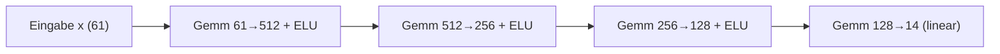
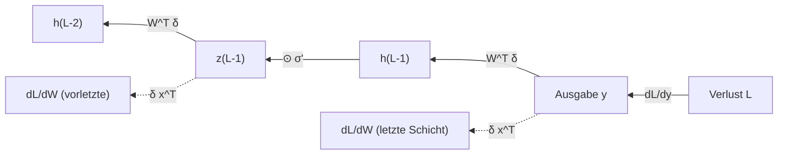
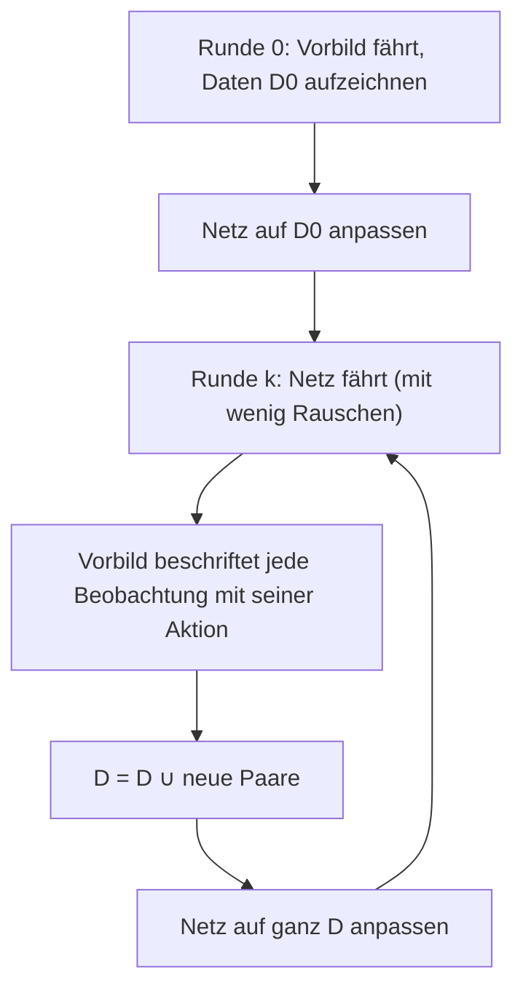
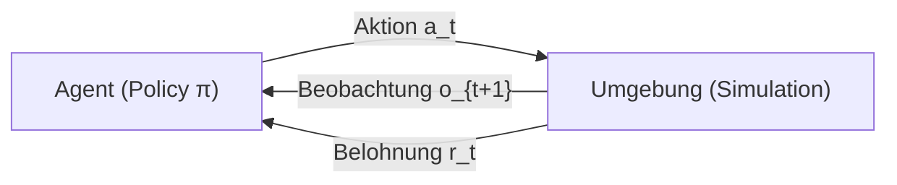
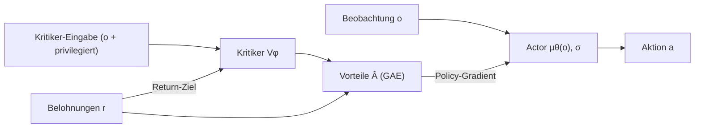
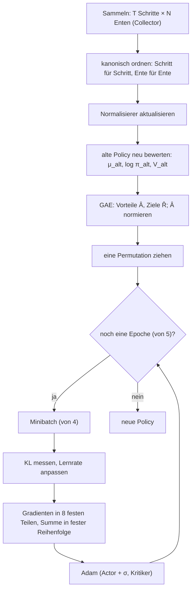
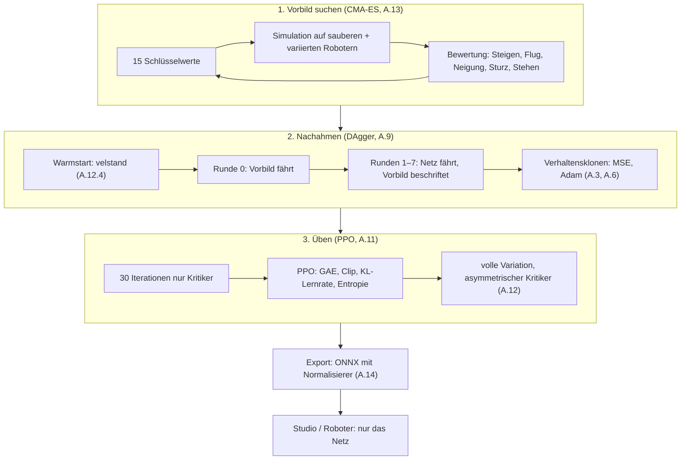

# Anhang A – Grundlagen: neuronale Netze, Nachahmung und Reinforcement Learning

Dieser Anhang erklärt das Handwerkszeug, mit dem Kerns Lehrer Netze für die Micro Duck trainiert.
Er setzt nur Schulmathematik voraus: Ableitungen, Summen, ein wenig Wahrscheinlichkeit. Jeder
Begriff wird erst allgemein eingeführt und dann an der Stelle in Kern gezeigt, an der er umgesetzt
ist. Die Fachkapitel [Kapitel 14](14-lehrer.md) (der Lehrer) und [Kapitel 15](15-eigene-modelle.md)
(eigene Modelle) verweisen hierher.

Der Code, um den es geht, liegt in `src/lehrer/` und `include/kern/lehrer/`:

| Datei | Inhalt |
|---|---|
| `nn.h`, `nn.cpp` | `Mlp` (das Netz), Vorwärts- und Rückwärtsrechnung, `Adam`, `Normalizer` |
| `ppo.h`, `ppo.cpp` | `Policy`, `Collector`, `Rollout`, `Ppo` (Lernverfahren), `imitate` (Verhaltensklonen) |
| `env.h` | `Env`, `Task`, `DuckEnv`, `Rng`, die Größen 61 Beobachtungen und 14 Aktionen |
| `vorbild.h`, `vorbild.cpp` | Sprung-Vorbild, seine Suche mit CMA-ES, DAgger |
| `cmaes.h`, `cmaes.cpp` | CMA-ES |
| `spielen.h`, `spielen.cpp` | das Spielnetz (Ball, Socke) mit eigenem Vorbild und DAgger |
| `onnx_export.cpp` | Export ins ONNX-Format |
| `recipe.h`, `recipe.cpp` | die Trainingsrezepte (welche Einstellungen für welche Aufgabe) |

---

## A.1 Was ein neuronales Netz ist

### A.1.1 Eine Funktion mit vielen Stellschrauben

Ein neuronales Netz ist zunächst nichts Geheimnisvolles: eine Funktion $f_\theta$, die einen
Eingangsvektor $x$ auf einen Ausgangsvektor $y$ abbildet,

$$y = f_\theta(x).$$

- $x \in \mathbb{R}^n$: die Eingabe. Beim Micro Duck sind das 61 Zahlen (Lage des Rumpfs, Gelenkwinkel,
  Gelenkgeschwindigkeiten, die letzte Aktion, Befehle) – `kObs = 61` in `env.h`.
- $y \in \mathbb{R}^m$: die Ausgabe. Beim Micro Duck 14 Servoziele – `kActions = 14`.
- $\theta$: die **Parameter** (Gewichte und Biases), oft Zehn- oder Hunderttausende Zahlen. Sie werden
  nicht von Hand gesetzt, sondern gelernt.

„Lernen“ heißt: $\theta$ so verändern, dass $f_\theta$ tut, was wir wollen. Was „wollen“ bedeutet,
legt eine Zahl fest, die wir minimieren – die Verlustfunktion (Abschnitt A.3).

### A.1.2 Das Neuron

Der Baustein ist das künstliche Neuron. Es bildet eine gewichtete Summe seiner Eingänge, addiert
einen Versatz und schickt das Ergebnis durch eine nichtlineare Funktion:

$$z = \sum_{i=1}^{n} w_i\, x_i + b, \qquad h = \sigma(z).$$

- $x_i$: die Eingänge,
- $w_i$: die Gewichte (wie stark ein Eingang zählt, auch negativ),
- $b$: der Bias (die Schwelle),
- $z$: die **Voraktivierung**,
- $\sigma$: die **Aktivierungsfunktion**,
- $h$: die Ausgabe des Neurons.

```
 x1 ──w1──┐
 x2 ──w2──┼──► Σ + b ──► z ──► σ(z) ──► h
 x3 ──w3──┘
```

### A.1.3 Die Schicht und das mehrschichtige Perzeptron

Viele Neuronen nebeneinander, die dieselben Eingänge sehen, bilden eine **Schicht**. In
Matrixschreibweise:

$$z = W x + b, \qquad h = \sigma(z),$$

mit $W \in \mathbb{R}^{m \times n}$ (eine Zeile pro Neuron), $b \in \mathbb{R}^m$, und $\sigma$
elementweise angewendet. Schichten hintereinander ergeben ein **mehrschichtiges Perzeptron** (MLP,
*multilayer perceptron*):

$$h^{(0)} = x,\qquad h^{(l)} = \sigma\!\left(W^{(l)} h^{(l-1)} + b^{(l)}\right),\qquad y = W^{(L)} h^{(L-1)} + b^{(L)}.$$

Die letzte Schicht ist in Kern **linear** (ohne $\sigma$): Servoziele und Werte dürfen jede reelle
Zahl sein.



**In Kern:** `Mlp` in `nn.h`. Die Form wird als Liste `dims` angegeben: Eingänge, verborgene
Schichten, Ausgänge. `PpoConfig` (in `ppo.h`) setzt standardmäßig `actor_hidden{512, 256, 128}`;
die Rezepte geben dem Kritiker `{256, 128}` (`recipe_for` in `recipe.cpp`). Das Spielnetz ist
`23 → 256 → 128 → 9` (`make_play_learner` in `spielen.h`).

Wie viele Parameter sind das? Eine Schicht $n \to m$ hat $n\cdot m$ Gewichte und $m$ Biases. Für
den Actor $61 \to 512 \to 256 \to 128 \to 14$:

| Schicht | Gewichte | Biases |
|---|---|---|
| 61 → 512 | 31 232 | 512 |
| 512 → 256 | 131 072 | 256 |
| 256 → 128 | 32 768 | 128 |
| 128 → 14 | 1 792 | 14 |
| **Summe** | **196 864** | **910** |

Zusammen sind das **197 774** Parameter.

Kern legt alle Parameter in **einen** zusammenhängenden Vektor `params_`; `w_[l]` und `b_[l]` sind
Versätze in diesen Vektor. Die Gewichte stehen **eingangsweise** (`w[i * out + o]`): Für einen festen
Eingang $i$ liegen die Gewichte zu allen Ausgängen hintereinander. Warum das so ist, steht in
A.2.2.

### A.1.4 Aktivierungsfunktionen, insbesondere ELU

Ohne Nichtlinearität wäre ein MLP nutzlos tief: Hintereinandergeschaltete lineare Abbildungen sind
wieder eine lineare Abbildung, $W_2(W_1 x) = (W_2W_1)x$. Erst $\sigma$ erlaubt es, gekrümmte
Zusammenhänge darzustellen (etwa „Knie stärker beugen, je schneller der Rumpf nach vorn kippt, aber
nur bis zum Anschlag“).

Gebräuchliche Aktivierungen:

| Name | Formel | Ableitung | Eigenschaft |
|---|---|---|---|
| tanh | $\tanh z$ | $1-\tanh^2 z$ | beschränkt, sättigt an beiden Enden |
| ReLU | $\max(0,z)$ | $0$ oder $1$ | einfach, aber „tote“ Neuronen bei $z<0$ |
| **ELU** | $z$ für $z>0$, sonst $e^{z}-1$ | $1$ für $z>0$, sonst $e^{z}$ | glatt, negativ bis $-1$, kein totes Gebiet |

```
 ELU(z)
   2 |                    /
   1 |                 /
   0 |-------------__/------------ z
  -1 |_______----
      -4   -2    0    2
```

Kern verwendet **ELU** mit $\alpha = 1$ – wie rsl_rl, die Bibliothek, mit der Pollen Robotics die
Netze der Micro Duck trainiert. Im Code (`Mlp::forward`):

```cpp
y[k] = y[k] > 0 ? y[k] : kern::dm::expm1(y[k]);  // ELU
```

Zwei Details lohnen den Blick:

- `expm1(z)` berechnet $e^z - 1$ genau, auch für kleine $|z|$, wo `exp(z) - 1` Stellen verliert.
- Es ist `kern::dm::expm1`, nicht `std::expm1`: Kerns deterministische Mathematikbibliothek (musl,
  siehe A.11.10 und [Anhang C](C-grundlagen-physik.md)), damit das Ergebnis auf jeder Plattform
  bitgleich ist.

Für die Rückwärtsrechnung braucht man die Ableitung. Für $z \le 0$ ist $\text{ELU}'(z) = e^z$, und
weil $h = e^z - 1$, gilt $e^z = h + 1$. Man muss $z$ also gar nicht speichern; die Ausgabe genügt.
Genau das nutzt `Mlp::backward`:

```cpp
// Through the ELU of the layer below: y > 0 passes, else dy/dx = y + 1.
if (y <= 0) prev[k] *= y + 1;
```

### A.1.5 Initialisierung

Vor dem Lernen müssen die Gewichte irgendwelche Werte haben. Alle auf 0 zu setzen wäre fatal: Jedes
Neuron einer Schicht rechnete dasselbe und bekäme denselben Gradienten, sie blieben für immer
Zwillinge. Man zieht sie deshalb zufällig, und zwar so klein, dass die Voraktivierungen nicht mit
jeder Schicht wachsen. Kern macht es wie PyTorchs `nn.Linear`:

$$w, b \sim \mathcal{U}\!\left(-\tfrac{1}{\sqrt{n_\text{in}}},\ \tfrac{1}{\sqrt{n_\text{in}}}\right).$$

Begründung: Eine Summe von $n_\text{in}$ unabhängigen Termen hat eine Varianz proportional zu
$n_\text{in}$; die Skalierung mit $1/\sqrt{n_\text{in}}$ hält sie in der Größenordnung 1.

`Mlp::init` hat zusätzlich einen Faktor `output_gain` für die letzte Schicht, mit dem man die
anfänglichen Ausgaben klein machen kann.

---

## A.2 Die Vorwärtsrechnung

### A.2.1 Was „vorwärts“ heißt

Die Vorwärtsrechnung ist einfach das Auswerten der Formel aus A.1.3, Schicht für Schicht. In der
Praxis rechnet man nicht eine Eingabe, sondern einen **Batch** von $B$ Eingaben auf einmal. Die
Eingaben stehen als Zeilen in einer Matrix $X \in \mathbb{R}^{B \times n}$, und eine Schicht
berechnet

$$Y = X W^\top + \mathbf{1} b^\top.$$

### A.2.2 Wie Kern das schnell macht

`dense` in `nn.cpp` berechnet $y_{r,o} = b_o + \sum_i x_{r,i}\, w_{i,o}$ und verarbeitet dabei vier
Zeilen $r$ gleichzeitig:

```cpp
for (i32 i = 0; i < in; ++i) {
  const f32 a0 = x0[i], a1 = x1[i], a2 = x2[i], a3 = x3[i];
  const f32* wi = w + i * out;             // alle Gewichte von Eingang i
  for (i32 o = 0; o < out; ++o) {
    y0[o] += wi[o] * a0;  y1[o] += wi[o] * a1;  ...
  }
}
```

Die innerste Schleife läuft über aufeinanderfolgende Speicherstellen von `wi` und `y` – eine
„axpy“-Operation ($y \leftarrow y + a\,x$), die der Compiler vektorisieren kann, **ohne die
Reihenfolge der Additionen zu ändern**. Das ist der Grund für das eingangsweise Speicherlayout: Mit
zeilenweise gespeicherten Gewichten wäre die innere Schleife ein Skalarprodukt, das der Compiler nur
vektorisiert, wenn er Summen umordnen darf – und umgeordnete Gleitkommasummen sind nicht mehr
bitgleich (A.11.10).

Der Kopf von `nn.cpp` sagt genau das: „Weights are stored input-major so that both passes run as
contiguous axpy loops the compiler vectorises without reassociating sums.“

### A.2.3 Der Cache

Für das Lernen braucht man später die Zwischenergebnisse. `Mlp::forward` bekommt dafür optional einen
`Cache`: `act[0]` ist die Eingabe, `act[l+1]` die Ausgabe der Schicht $l$ (nach ELU). Ohne Cache
(beim bloßen Handeln) wechselt die Funktion zwischen zwei Puffern und hält nichts fest.

---

## A.3 Verlustfunktionen

Die Verlustfunktion $\mathcal{L}(\theta)$ misst, wie schlecht das Netz gerade ist. Lernen bedeutet,
sie zu minimieren.

### A.3.1 Mittlerer quadratischer Fehler

Für Regressionsaufgaben (die Ausgabe ist eine Zahl, kein Etikett) ist der **mittlere quadratische
Fehler** (MSE, *mean squared error*) üblich:

$$\mathcal{L}_\text{MSE} = \frac{1}{N\,m}\sum_{r=1}^{N}\sum_{j=1}^{m}\left(y_{r,j} - t_{r,j}\right)^2.$$

- $N$: Anzahl der Beispiele im Batch,
- $m$: Anzahl der Ausgänge,
- $y_{r,j}$: Ausgabe des Netzes,
- $t_{r,j}$: Zielwert.

Seine Ableitung nach einer Ausgabe ist besonders einfach:

$$\frac{\partial \mathcal{L}}{\partial y_{r,j}} = \frac{2\,(y_{r,j} - t_{r,j})}{N\,m}.$$

**In Kern:** Verhaltensklonen (`Ppo::imitate`) nutzt genau diesen Verlust; die Zeile

```cpp
p.dout[...] = 2 * d / static_cast<f32>(m * act_);
```

ist die Formel oben ($d = y - t$, `m` die Minibatch-Größe, `act_` die Zahl der Aktionen). Auch der
Wertverlust des Kritikers in PPO ist ein quadratischer Fehler (A.11.7).

### A.3.2 Verlust als Landschaft

Man kann sich $\mathcal{L}$ als Landschaft über dem Raum aller Parameter vorstellen: Jeder Punkt
$\theta$ hat eine Höhe. Wir stehen irgendwo (nach der Initialisierung) und wollen ins Tal. Die
Landschaft hat bei Hunderttausenden Dimensionen keine Karte – wir spüren nur die Neigung unter den
Füßen. Diese Neigung ist der Gradient.

---

## A.4 Gradientenabstieg

### A.4.1 Die Grundidee

Der **Gradient** $\nabla_\theta \mathcal{L}$ ist der Vektor aller partiellen Ableitungen
$\partial \mathcal{L}/\partial \theta_k$. Er zeigt in die Richtung des steilsten Anstiegs. Also geht
man ein Stück in die Gegenrichtung:

$$\theta \leftarrow \theta - \eta\, \nabla_\theta \mathcal{L}.$$

- $\eta$: die **Lernrate** (Schrittweite).

Ist $\eta$ zu klein, kommt man kaum voran; ist sie zu groß, springt man über das Tal hinweg und
schaukelt sich auf. Ein eindimensionales Beispiel: $\mathcal{L}(\theta) = \theta^2$, Gradient
$2\theta$. Mit $\eta = 0{,}1$ wird aus $\theta = 1$ der Wert $0{,}8$, dann $0{,}64$ – stetige
Annäherung. Mit $\eta = 1{,}1$ wird aus $1$ der Wert $-1{,}2$, dann $1{,}44$ – Divergenz. Die Grenze
ist hier $\eta < 1$ (Faktor $|1 - 2\eta| < 1$).

### A.4.2 Stochastischer Gradientenabstieg und Minibatches

Den exakten Gradienten über *alle* Beispiele zu berechnen, ist teuer. Man schätzt ihn deshalb auf
einer zufälligen Teilmenge, einem **Minibatch**, und macht viele kleine Schritte. Das nennt man
stochastischen Gradientenabstieg (SGD). Der Schätzfehler wirkt wie Rauschen; kleine Minibatches
rauschen mehr. Das ist in Kern ein spürbares Thema: Mit wenigen Dutzend Enten sind die
PPO-Minibatches klein und der Gradient verrauscht (`docs/lehrer.md`, Abschnitt „Warum PPO allein
nicht reicht“).

Eine **Epoche** ist ein Durchgang durch alle Daten. `Ppo::imitate` mischt die Beispiele pro Epoche
neu (Fisher-Yates mit Kerns eigenem `Rng`), der PPO-Lerner zieht eine Permutation pro Iteration
(„One permutation for all epochs, as rsl_rl's mini_batch_generator“).

### A.4.3 Gradientenbegrenzung

Ein einzelner Ausreißer im Batch kann einen riesigen Gradienten erzeugen und das Netz mit einem
Schritt zerstören. Dagegen begrenzt man die **Norm** des gesamten Gradienten:

$$g \leftarrow g \cdot \min\!\left(1,\ \frac{c}{\lVert g \rVert_2}\right).$$

Die Richtung bleibt, nur die Länge wird gedeckelt. **In Kern:** `Adam::max_norm` (Standard 1,0, wie
rsl_rl). `Adam::step` berechnet die Norm über alle übergebenen Blöcke zusammen (in `f64`, um
Rundungsfehler bei Hunderttausenden Quadraten klein zu halten) – beim Actor also über die
Netzgewichte **und** die Standardabweichungen der Aktionen gemeinsam.

---

## A.5 Backpropagation

### A.5.1 Die Kettenregel, systematisch angewendet

Wie bekommt man $\partial\mathcal{L}/\partial\theta_k$ für 200 000 Parameter, ohne 200 000-mal neu zu
rechnen? Durch die Kettenregel, rückwärts von der Ausgabe zur Eingabe. Für eine Schicht
$z = Wx + b$, $h = \sigma(z)$ gilt, wenn man $\delta^{h} = \partial\mathcal{L}/\partial h$ (den
„Fehler an der Ausgabe der Schicht“) schon kennt:

$$\delta^{z} = \delta^{h} \odot \sigma'(z),$$
$$\frac{\partial\mathcal{L}}{\partial W} = \delta^{z}\, x^\top,\qquad
  \frac{\partial\mathcal{L}}{\partial b} = \delta^{z},\qquad
  \frac{\partial\mathcal{L}}{\partial x} = W^\top \delta^{z}.$$

- $\odot$: elementweises Produkt,
- $\partial\mathcal{L}/\partial x$ ist das $\delta^h$ der Schicht darunter – so wandert der Fehler
  nach unten.

Über einen Batch werden die Gewichtsgradienten aufsummiert: $\partial\mathcal{L}/\partial w_{i,o} =
\sum_r x_{r,i}\,\delta_{r,o}$.



### A.5.2 Eine Beispielrechnung von Hand

Ein Netz mit einem Eingang, einem verborgenen ELU-Neuron und einem linearen Ausgang:

$$z = w_1 x + b_1,\quad h = \text{ELU}(z),\quad y = w_2 h + b_2,\quad \mathcal{L} = (y - t)^2.$$

Startwerte: $x = 1$, $t = 1$, $w_1 = 0{,}5$, $b_1 = -1$, $w_2 = 2$, $b_2 = 0{,}5$.

**Vorwärts:**

| Größe | Rechnung | Wert |
|---|---|---|
| $z$ | $0{,}5 \cdot 1 - 1$ | $-0{,}5$ |
| $h$ | $e^{-0{,}5} - 1$ | $-0{,}39347$ |
| $y$ | $2 \cdot (-0{,}39347) + 0{,}5$ | $-0{,}28694$ |
| $\mathcal{L}$ | $(-0{,}28694 - 1)^2$ | $1{,}65621$ |

**Rückwärts:**

| Größe | Rechnung | Wert |
|---|---|---|
| $\partial\mathcal{L}/\partial y$ | $2(y - t)$ | $-2{,}57388$ |
| $\partial\mathcal{L}/\partial w_2$ | $\partial\mathcal{L}/\partial y \cdot h$ | $1{,}01274$ |
| $\partial\mathcal{L}/\partial b_2$ | $\partial\mathcal{L}/\partial y$ | $-2{,}57388$ |
| $\partial\mathcal{L}/\partial h$ | $\partial\mathcal{L}/\partial y \cdot w_2$ | $-5{,}14776$ |
| $\text{ELU}'(z)$ | $h + 1$ (weil $z \le 0$) | $0{,}60653$ |
| $\partial\mathcal{L}/\partial z$ | $-5{,}14776 \cdot 0{,}60653$ | $-3{,}12227$ |
| $\partial\mathcal{L}/\partial w_1$ | $\partial\mathcal{L}/\partial z \cdot x$ | $-3{,}12227$ |
| $\partial\mathcal{L}/\partial b_1$ | $\partial\mathcal{L}/\partial z$ | $-3{,}12227$ |

**Ein Schritt Gradientenabstieg** mit $\eta = 0{,}1$:
$w_2 = 1{,}89873$, $b_2 = 0{,}75739$, $w_1 = 0{,}81223$, $b_1 = -0{,}68777$.

**Erneut vorwärts:** $z = 0{,}12445$ (jetzt positiv, ELU lässt durch), $h = 0{,}12445$,
$y = 1{,}89873 \cdot 0{,}12445 + 0{,}75739 = 0{,}99369$, $\mathcal{L} \approx 4 \cdot 10^{-5}$.
Ein einziger Schritt hat den Fehler hier fast beseitigt – bei echten Netzen mit vielen Beispielen,
die sich widersprechen, geht es in winzigen Schritten voran.

### A.5.3 In Kern

`Mlp::backward(cache, dout, grad, dx)` setzt A.5.1 Schicht für Schicht von oben nach unten um:

1. Bias-Gradient: $\sum_r \delta_{r,o}$.
2. Gewichtsgradient: $\sum_r x_{r,i}\,\delta_{r,o}$, wieder vier Zeilen pro Durchlauf.
3. Eingangsgradient $\delta W^\top$: Kern transponiert $W$ einmal in einen Puffer `wt` und benutzt
   dann **dieselbe** Funktion `dense` wie vorwärts.
4. Durch die ELU der Schicht darunter: mal $(y+1)$, wo $y \le 0$.

Die Gradienten werden zu `grad` **addiert** (nicht überschrieben). Das erlaubt, Teilbatches auf
mehreren Threads zu rechnen und hinterher zu summieren (A.11.10). Mit `dx` bekommt man auf Wunsch auch
$\partial\mathcal{L}/\partial x$.

Woher weiß man, dass das stimmt? Durch Vergleich mit **finiten Differenzen**:
$\partial\mathcal{L}/\partial\theta_k \approx (\mathcal{L}(\theta + \varepsilon e_k) - \mathcal{L}(\theta - \varepsilon e_k)) / (2\varepsilon)$.
`docs/lehrer.md` nennt den entsprechenden Test („Gradient gegen finite Differenzen“).

---

## A.6 Adam

### A.6.1 Warum nicht einfach SGD?

Reiner Gradientenabstieg hat zwei Schwächen: Er verwendet für alle Parameter dieselbe Schrittweite,
obwohl manche Gradienten groß und andere winzig sind, und er reagiert nervös auf verrauschte
Gradienten. **Adam** (Kingma und Ba, 2015) behebt beides mit zwei gleitenden Mittelwerten pro
Parameter:

$$m_t = \beta_1 m_{t-1} + (1-\beta_1)\, g_t, \qquad v_t = \beta_2 v_{t-1} + (1-\beta_2)\, g_t^2,$$
$$\hat m_t = \frac{m_t}{1-\beta_1^t},\qquad \hat v_t = \frac{v_t}{1-\beta_2^t},\qquad
  \theta_t = \theta_{t-1} - \eta\,\frac{\hat m_t}{\sqrt{\hat v_t} + \epsilon}.$$

- $g_t$: der Gradient im Schritt $t$,
- $m_t$: das „Moment“, ein geglätteter Gradient (Richtung),
- $v_t$: der geglättete quadrierte Gradient (typische Größe),
- $\beta_1 = 0{,}9$, $\beta_2 = 0{,}999$: Glättungsfaktoren,
- $\hat m_t, \hat v_t$: **Bias-Korrektur** – beide starten bei 0 und wären am Anfang zu klein,
- $\epsilon = 10^{-8}$: verhindert Division durch 0.

Der Schritt ist pro Parameter etwa $\eta \cdot (\text{Richtung} / \text{typische Größe})$, also
dimensionslos und für alle Parameter ähnlich groß.

**Beispiel:** Im allerersten Schritt ist $m_1 = 0{,}1\,g$, $v_1 = 0{,}001\,g^2$, nach Korrektur
$\hat m_1 = g$, $\hat v_1 = g^2$ – der Schritt ist $\eta \cdot g/|g| = \pm\eta$, **unabhängig von
der Größe des Gradienten**. Ob $g = 10^{-6}$ oder $g = 10^{3}$: Der Parameter bewegt sich um die
Lernrate.

### A.6.2 In Kern

`Adam` in `nn.h` hat PyTorchs Standardwerte (`lr = 1e-3`, `beta1 = 0.9`, `beta2 = 0.999`,
`eps = 1e-8`) und davor die Normbegrenzung (A.4.3). `Adam::step` schreibt die Bias-Korrektur so,
wie PyTorch sie rechnet:

```cpp
const f32 step = lr / c1, root_c2 = std::sqrt(c2);          // c1 = 1 - β1^t, c2 = 1 - β2^t
b.params[k] -= step * m_[at] / (std::sqrt(v_[at]) / root_c2 + eps);
```

Das ist mathematisch $\eta\,\hat m/(\sqrt{\hat v} + \epsilon)$. Die Potenzen $\beta^t$ kommen aus
`kern::dm::pow` (deterministisch). Die Momente `m()`, `v()` und der Zähler `t()` gehören zum
Checkpoint (`Ppo::save`): Ein fortgesetzter Lauf macht genau die Schritte, die der ununterbrochene
gemacht hätte.

Actor und Kritiker haben **eigene** Adam-Instanzen (`actor_adam_`, `critic_adam_`), und
`Ppo::imitate` legt sich für das Verhaltensklonen eine dritte, frische an – damit die Momente des
Klonens nicht in das spätere PPO hineinwirken.

---

## A.7 Normalisierung der Eingaben

### A.7.1 Das Problem

Die 61 Beobachtungen haben sehr verschiedene Größenordnungen: Gelenkwinkel in Radiant (Zehntel),
Gelenkgeschwindigkeiten in rad/s (bis zu zweistellig), der Schwerkraftvektor zwischen −1 und 1.
Ein Netz kann damit zwar umgehen, lernt aber langsamer: Bei gleicher Initialisierung dominieren die
großen Eingänge die Summen, und die Gradienten der Gewichte zu großen Eingängen sind entsprechend
groß.

### A.7.2 Die Lösung: laufende Standardisierung

Man rechnet jeden Eingang auf Mittelwert 0 und Standardabweichung 1 um:

$$\tilde x_i = \frac{x_i - \mu_i}{\sigma_i + 0{,}01}.$$

- $\mu_i$, $\sigma_i$: Mittelwert und Standardabweichung des Eingangs $i$ über alles bisher
  Beobachtete,
- $0{,}01$: verhindert Division durch 0 bei Eingängen, die (fast) konstant sind.

Weil sich die Verteilung beim Lernen verschiebt (eine bessere Policy erlebt andere Zustände), werden
$\mu$ und $\sigma^2$ laufend nachgeführt. Für einen neuen Batch mit $n_B$ Beispielen, Mittelwert
$\mu_B$ und Varianz $\sigma_B^2$ und bisher $n$ Beispielen ergibt **Chans paralleler Algorithmus**:

$$\delta = \mu_B - \mu,\qquad n' = n + n_B,\qquad \mu' = \mu + \delta\,\frac{n_B}{n'},$$
$$\sigma'^2 = \frac{\sigma^2 n + \sigma_B^2 n_B + \delta^2\,\frac{n\,n_B}{n'}}{n'}.$$

Die Formel ist exakt: Sie ergibt dasselbe, als hätte man alle Daten auf einmal gesehen, und braucht
dafür nur die drei Zahlen $(\mu, \sigma^2, n)$.

### A.7.3 In Kern

`Normalizer` in `nn.h` („rsl_rl's EmpiricalNormalization“) setzt das um (`update`, in `f64`
gerechnet). Zwei Punkte sind wichtig:

- **Er gehört zum Netz.** Ein Netz, das mit normierten Eingaben gelernt hat, ist ohne genau diese
  Normierung wertlos. Deshalb schreibt der ONNX-Export ihn als `Sub` (Mittelwert) und `Div`
  ($\sigma + 0{,}01$) an den Anfang des Graphen (A.14), und `Policy::serialize` gibt ihn mit.
- **Er kann eingefroren werden.** Beim Warmstart aus Pollens velstand-Netz übernimmt Kern dessen
  Normalisierer und friert ihn ein (`freeze_actor_normalizer`, `Ppo::warm_start`). Für neue Eingänge,
  die das alte Netz nie gesehen hat (die Sprungphase in den Plätzen 55 und 56), setzt es Mittelwert 0
  und Teiler 1 und die zugehörigen Gewichte auf 0 – das gewarmstartete Netz handelt dann **exakt**
  wie das Original, bis es lernt, die neuen Eingänge zu nutzen.

Der Lerner aktualisiert die Normalisierer einmal pro Iteration mit allen gesammelten Beobachtungen
und bewertet die alte Policy danach **mit den neuen Normalisierern** neu (`Ppo::learn`). Der Grund
steht in `docs/lehrer.md`: „bei einigen Dutzend Umgebungen wandern die Normalisierer sonst
merklich“, und die Wahrscheinlichkeitsverhältnisse von PPO (A.11.4) wären verfälscht.

---

## A.8 Überanpassung und Generalisierung

Ein Netz mit 200 000 Parametern kann eine kleine Datenmenge auswendig lernen: Auf den
Trainingsbeispielen ist der Fehler winzig, auf neuen Beispielen groß. Das ist **Überanpassung**
(*overfitting*). Die üblichen Gegenmittel:

| Mittel | Idee |
|---|---|
| mehr und vielfältigere Daten | weniger auswendig zu lernen |
| Validierungsdaten | auf Daten prüfen, die nie zum Lernen dienten |
| früh aufhören | das beste Netz nach der Validierung nehmen, nicht das letzte |
| kleinere Netze, Regularisierung | weniger Kapazität zum Auswendiglernen |

In Robotik heißt Überanpassung meist: Das Netz hat sich auf **genau diese Simulation** eingestellt –
auf diese Masse, diese Reibung, dieses Servo. In der echten Welt ist alles ein wenig anders. Das
Gegenmittel ist Variation (Domain Randomization, A.12). Kern prüft deshalb jedes Netz zweimal: auf
dem **sauberen** Roboter und unter **voller Variation** (`kern_lehrer --eval`, `JumpReport`,
`PlayReport`). Auch die Auswahl der Runde beim Spielnetz (`docs/lehrer.md`, Abschnitt 8)
ist frühes Aufhören nach einer Bewertung.

---

## A.9 Überwachtes Lernen und Nachahmungslernen

### A.9.1 Überwachtes Lernen

Beim **überwachten Lernen** gibt es Paare $(x, t)$: zu jeder Eingabe die richtige Antwort. Das Netz
lernt die Abbildung, indem es einen Verlust wie den MSE minimiert. Das ist die einfachste Form des
Lernens – vorausgesetzt, jemand liefert die richtigen Antworten.

### A.9.2 Verhaltensklonen

Beim Robotiklernen ist die „richtige Antwort“ die Aktion eines Experten. Hat man einen Experten,
der eine Aufgabe vormacht, und zeichnet man Paare (Beobachtung, Aktion des Experten) auf, kann man
ein Netz überwacht darauf trainieren. Das heißt **Verhaltensklonen** (*behavior cloning*, BC).

**In Kern:** `Ppo::imitate(observations, target, epochs, batch, learning_rate, seed)` passt den
Mittelwert des Actors per MSE an die Zielaktionen an – Adam mit eigenen Momenten, Minibatches in
fester Reihenfolge. Der Experte heißt in Kern **Vorbild**: Beim Sprung ist es `JumpTeacher`
(`vorbild.h`), beim Spielen `PlayEnv::teacher` (`spielen.h`).

### A.9.3 Verteilungsverschiebung

Verhaltensklonen hat einen tückischen Fehler. Das Netz lernt nur Zustände, die der Experte besucht
hat. Macht es einen kleinen Fehler, landet es in einem Zustand, den der Experte nie erreicht hätte –
dort hat es keine Daten und macht einen größeren Fehler, und so weiter. Die Fehler häufen sich. Das
heißt **Verteilungsverschiebung** (*distribution shift* oder *covariate shift*): Die Verteilung der
Zustände beim Testen ist eine andere als beim Lernen, weil das Netz die Zustände selbst erzeugt.

```
 Experte:  ●──●──●──●──●──●──●   (immer in der Mitte)
 Klon:     ●──●──●─╲
                    ●─╲          kleiner Fehler → unbekannter Zustand
                       ●──╲      → größerer Fehler → ...
                           ●  Sturz
```

Quantitativ (Ross und Bagnell): Macht der Klon in jedem Schritt mit Wahrscheinlichkeit $\varepsilon$
einen Fehler, kann der Gesamtfehler über $T$ Schritte wie $\varepsilon T^2$ wachsen statt wie
$\varepsilon T$.

### A.9.4 DAgger

**DAgger** (*Dataset Aggregation*, Ross, Gordon und Bagnell, 2011) dreht den Spieß um: Nicht der
Experte fährt, sondern der Schüler – und der Experte sagt in jedem Zustand, was **er** getan hätte.



So entstehen Daten genau in den Zuständen, in die der Schüler gerät, und die Verteilungsverschiebung
verschwindet schrittweise.

**In Kern:** `dagger_episodes` in `vorbild.cpp`:

- Runde 0: Das Vorbild fährt (`round == 0 || !student`).
- Später: Der Schüler fährt (`student->act`), mit Rauschen $0{,}05 \cdot \mathcal{N}(0,1)$ pro Aktion
  „for coverage“ – damit auch Zustände knapp neben seiner eigenen Bahn vorkommen.
- In jedem Takt wird die Aktion des Vorbilds als Etikett gespeichert.
- `JumpImitation::round_from` hängt die neuen Daten an alle bisherigen an und passt das Netz an
  **alles** an (`imitate(..., 10, 256, 1e-3f, ...)`: 10 Epochen, Minibatch 256, Lernrate $10^{-3}$).

Das Rezept des Sprungs hat 8 Runden à 96 Episoden; laut `docs/lehrer.md` springt das Netz ab
Runde 7 zum ersten Mal echt. Das Spielnetz lernt ebenso (`imitate_play`).

Ein Detail, das DAgger überhaupt erst möglich macht: Das Vorbild des Spielnetzes sieht **dasselbe**
wie das Netz und hat „kein verstecktes Gedächtnis“ (`docs/lehrer.md`, Abschnitt 8). Eine Funktion
von Beobachtungen kann ein Netz exakt lernen; eine Funktion, die von verborgenen Größen abhängt,
nicht.

---

## A.10 Reinforcement Learning von Grund auf

Verhaltensklonen braucht einen Experten. Gibt es keinen – oder soll das Netz besser werden als der
Experte –, braucht man **Reinforcement Learning** (RL, bestärkendes Lernen): Das Netz probiert, die
Umgebung belohnt oder bestraft, und das Netz lernt, mehr Belohnung zu bekommen.

### A.10.1 Der Kreislauf



**In Kern** ist die Umgebung eine `Env` (`env.h`): `reset()`, dann im Takt `observation()` und
`step(action)`, das ein `Step{reward, terminal, timeout}` zurückgibt. `DuckEnv` ist eine Ente in ihrer
eigenen GameWorld, headless, ein Schritt ist ein Regeltakt von 20 ms (`kControlDt = 0.02`, 50 Hz).

### A.10.2 Markov-Entscheidungsprozess

Mathematisch beschreibt man das als **Markov-Entscheidungsprozess** (MDP) $(S, A, P, R, \gamma)$:

- $S$: die Menge der Zustände $s$ (der vollständige physikalische Zustand der Ente: alle Lagen und
  Geschwindigkeiten),
- $A$: die Menge der Aktionen $a$ (hier $\mathbb{R}^{14}$),
- $P(s' \mid s, a)$: die Übergangswahrscheinlichkeit (hier: die Physik, plus Zufall wie Stöße),
- $R(s, a)$: die Belohnung,
- $\gamma \in [0,1)$: der Diskontfaktor (A.10.5).

„Markov“ heißt: Der nächste Zustand hängt nur vom jetzigen Zustand und der Aktion ab, nicht von der
Vorgeschichte.

### A.10.3 Zustand und Beobachtung

Der Agent sieht den Zustand meist **nicht** vollständig, sondern nur eine **Beobachtung** $o$: was
seine Sensoren liefern, verrauscht und verspätet. Dann spricht man von einem teilweise beobachtbaren
MDP (POMDP). Die Ente sieht ihre Gelenkwinkel (mit Rauschen und Encoder-Versatz), ihr Gyro, den
Schwerkraftvektor, ihre letzte Aktion und die Befehle – aber nicht ihre wahre Höhe über dem Boden
oder ihre Geschwindigkeit im Raum.

**In Kern:** `Task::Noise` (`env.h`) legt fest, wie die Beobachtung vom Zustand abweicht: Gyro
$\pm 0{,}03$, Schwerkraft $\pm 0{,}01$, Gelenkwinkel $\pm 0{,}001$ plus Encoder-Versatz $\pm 0{,}015$
pro Episode, Gelenkgeschwindigkeit $\pm 0{,}25$, IMU 0–1 Takt verspätet. Die letzte Aktion gehört
zur Beobachtung – ein einfaches Gedächtnis, das das POMDP-Problem lindert.

### A.10.4 Belohnung und Return

Die **Belohnung** $r_t$ ist eine Zahl pro Schritt. Sie ist die einzige Stelle, an der man dem
Agenten sagt, was er tun soll – und der Agent nimmt sie wörtlich. `docs/lehrer.md` berichtet von
Läufen, in denen die Ente „auf dem Schwanz sitzen, Hechtsprung, sich abstützen“ lernte, weil die
Belohnung das zuließ. Jede dieser Lücken wurde mit einer strengeren Regel geschlossen.

**In Kern:** `Task::reward(tick, terminal)` liefert die Belohnung; nach mjlabs Konvention ist sie die
Summe $\sum_k w_k \cdot \text{Term}_k \cdot \Delta t$ (Gewicht mal Term mal Taktdauer). Die Tabelle der
Terme des Sprungs (airborne, lift, landed, imitate, upright, fall …) steht in `docs/lehrer.md`.
`Task::terms` hält die Einzelterme des letzten Takts für Berichte fest.

Der **Return** ist die Summe der künftigen Belohnungen. Ohne Gewichtung wäre er bei langen Episoden
unbeschränkt; deshalb diskontiert man.

### A.10.5 Diskontierung

$$G_t = r_t + \gamma\, r_{t+1} + \gamma^2 r_{t+2} + \dots = \sum_{k=0}^{\infty} \gamma^k\, r_{t+k}.$$

- $G_t$: der diskontierte Return ab Schritt $t$,
- $\gamma$: der Diskontfaktor.

Intuition: Eine Belohnung in $k$ Schritten zählt nur $\gamma^k$-mal so viel wie eine jetzt. Die
**effektive Vorausschau** ist etwa $1/(1-\gamma)$ Schritte. Kern nutzt $\gamma = 0{,}99$
(`PpoConfig::gamma`): rund 100 Takte, also 2 s bei 50 Hz – so lang wie ein ganzer Sprung
(`kJumpSeconds = 2`, die Phase läuft als $t/2\,\text{s}$ von 0 bis 1). Nach 100 Schritten ist $0{,}99^{100} \approx 0{,}37$, nach 300 nur noch
$\approx 0{,}05$.

Wichtig ist die Rekursion

$$G_t = r_t + \gamma\, G_{t+1},$$

auf der alles Weitere aufbaut.

### A.10.6 Policy

Die **Policy** $\pi$ ist die Entscheidungsregel des Agenten. Eine **deterministische** Policy gibt zu
jeder Beobachtung eine Aktion, $a = \mu_\theta(o)$. Eine **stochastische** Policy gibt eine
Wahrscheinlichkeitsverteilung, $a \sim \pi_\theta(\cdot \mid o)$. Zum Lernen braucht man die
stochastische Form (A.10.10), zum Handeln auf dem Roboter nimmt man den Mittelwert.

**In Kern:** `Policy` (`ppo.h`) besteht aus `actor` (dem MLP), `normalizer` und `stddev` (der
Streuung pro Aktion). `Policy::act` liefert den **Mittelwert** – „what the exported network
computes“.

### A.10.7 Wertfunktionen

Die **Zustandswertfunktion** einer Policy ist der erwartete Return ab einem Zustand:

$$V^\pi(s) = \mathbb{E}_\pi\left[G_t \mid s_t = s\right].$$

Die **Aktionswertfunktion** ist der erwartete Return, wenn man erst $a$ tut und danach $\pi$ folgt:

$$Q^\pi(s, a) = \mathbb{E}\left[r_t + \gamma V^\pi(s_{t+1}) \mid s_t = s, a_t = a\right].$$

$V$ sagt, wie gut eine Lage ist; $Q$ sagt, wie gut eine bestimmte Handlung in dieser Lage ist.

### A.10.8 Vorteil

Der **Vorteil** (*advantage*) ist der Unterschied:

$$A^\pi(s,a) = Q^\pi(s,a) - V^\pi(s).$$

$A > 0$: Die Aktion war besser als das, was die Policy im Mittel tut. $A < 0$: schlechter. Genau
diese Information braucht das Lernen: „Mach mehr von dem, was besser als üblich war.“

Eine einfache Schätzung des Vorteils aus einem einzigen Schritt ist der **TD-Fehler**
(*temporal difference*):

$$\delta_t = r_t + \gamma\, V(s_{t+1}) - V(s_t).$$

Er sagt: Was ist passiert ($r_t$ plus der Wert, wo wir angekommen sind), verglichen mit dem, was
wir erwartet hatten ($V(s_t)$).

### A.10.9 Episoden: Ende und Zeitlimit

Eine Episode endet auf zwei grundverschiedene Arten:

- **terminal**: Die Ente ist gestürzt. Danach gibt es keine Zukunft; $V(s_{\text{nach}}) = 0$.
- **timeout**: Die Zeit ist um. Die Ente stünde aber noch und hätte eine Zukunft – das Zeitlimit
  ist eine Eigenschaft des Trainings, nicht der Welt.

Wer beides gleich behandelt, bringt dem Netz bei, dass es kurz vor Episodenende sinnlos ist, sich
anzustrengen. **In Kern** unterscheidet `Env::Step` die beiden (`terminal`, `timeout`), und GAE
behandelt ein Zeitlimit mit einem **Bootstrap**: Die Belohnung des letzten Schritts bekommt
$\gamma V(s_t)$ dazu, als ginge es so weiter (`ppo.cpp`: „a time-out is bootstrapped with the value
where it stood (rsl_rl)“):

```cpp
const f32 reward = reward_[row] + (timeout_[row] ? cfg_.gamma * v : 0.0f);
```

### A.10.10 Policy-Gradient

Wie verändert man $\theta$, damit der erwartete Return $J(\theta) = \mathbb{E}_{\pi_\theta}[G_0]$
steigt? Die Belohnung hängt über die Physik von der Aktion ab, und die Physik ist nicht
differenzierbar. Der Trick ist das **Policy-Gradient-Theorem**:

$$\nabla_\theta J(\theta) = \mathbb{E}_{\pi_\theta}\left[\sum_t \nabla_\theta \log \pi_\theta(a_t \mid o_t)\; A_t\right].$$

- $\log \pi_\theta(a_t \mid o_t)$: die Log-Wahrscheinlichkeit, dass die Policy genau die gewählte
  Aktion wählt,
- $A_t$: der Vorteil dieser Aktion.

Man differenziert nur die Policy, nie die Physik. Intuition: Hat eine Aktion einen positiven
Vorteil, macht man sie wahrscheinlicher; bei negativem Vorteil unwahrscheinlicher. Darum braucht man
eine **stochastische** Policy – nur sie probiert verschiedene Aktionen aus und hat eine
differenzierbare Wahrscheinlichkeit.

### A.10.11 Die Gaußsche Policy

Für kontinuierliche Aktionen ist die übliche Wahl eine Normalverteilung, deren Mittelwert das Netz
liefert und deren Streuung ein eigener lernbarer Parameter pro Aktion ist:

$$a_j = \mu_{\theta,j}(o) + \sigma_j\,\xi_j,\qquad \xi_j \sim \mathcal{N}(0,1).$$

Die Log-Wahrscheinlichkeit des ganzen Aktionsvektors ist die Summe über die Dimensionen:

$$\log \pi_\theta(a \mid o) = \sum_{j=1}^{m}\left[-\frac{(a_j - \mu_j)^2}{2\sigma_j^2} - \log\sigma_j - \tfrac12\log 2\pi\right].$$

Ihre Ableitungen, die das Lernen braucht:

$$\frac{\partial \log\pi}{\partial \mu_j} = \frac{a_j - \mu_j}{\sigma_j^2},\qquad
  \frac{\partial \log\pi}{\partial \sigma_j} = \frac{(a_j - \mu_j)^2}{\sigma_j^3} - \frac{1}{\sigma_j}.$$

**In Kern:**

- Ziehen (`Collector::collect`):
  `a[j] = mu[j] + policy.stddev[j] * r.normal();`
  mit `Rng::normal` (Box-Muller, aus `kern::dm::log` und `kern::dm::cos`).
- Log-Wahrscheinlichkeit (`Ppo::learn`, `Ppo::update`):
  `logp += -0.5f * d * d / (sd * sd) - kern::dm::log(sd) - 0.5f * kLog2Pi;`
  mit `kLog2Pi` $= \log 2\pi = 1{,}83787706641$.
- Ableitungen (`Ppo::update`):
  `k.dmu[...] = g * d / (sd * sd);` und `k.dstd[j] += g * (d * d / (sd * sd * sd) - 1 / sd);`
- Startstreuung `init_std` (Standard 1,0; das Sprungrezept 0,3), Untergrenze `kMinStd = 1e-3`.
- Nach der Nachahmung setzt `begin_practice` die Streuung auf `practice_std` (Sprung: 0,1): Ein
  Netz, das schon gut springt, soll nicht mit großem Rauschen alles wieder verlernen.

Jede Ente hat ihren **eigenen** Zufallsstrom, abgeleitet aus Seed und globalem Index (`Collector`,
`env_rng_`): „what an environment does depends on its global index only, never on which worker steps
it.“

### A.10.12 Entropie

Die **Entropie** einer Verteilung misst ihre Unbestimmtheit. Für eine Normalverteilung hängt sie nur
von $\sigma$ ab:

$$H = \sum_{j}\left(\tfrac12 + \tfrac12\log 2\pi + \log\sigma_j\right).$$

Beispiel: $\sigma = 1$ ergibt pro Dimension $1{,}419$; $\sigma = 0{,}1$ ergibt $-0{,}884$ (die
differentielle Entropie kann negativ sein). Ohne Gegenmaßnahme schrumpft $\sigma$ beim Lernen oft zu
schnell, der Agent hört auf zu erkunden und bleibt bei der ersten brauchbaren Lösung hängen. Ein
**Entropie-Bonus** im Verlust, $-c_H H$, hält ihn offen.

**In Kern:** `entropy_coef` (Standard 0,01; Sprung 0,005). Weil $H$ nicht von der Beobachtung abhängt,
ist er „the same for every sample“ und wird einmal pro Minibatch berechnet; sein Gradient nach
$\sigma_j$ ist $-c_H/\sigma_j$:

```cpp
first.dstd[j] += -cfg_.entropy_coef / policy_.stddev[j];
```

---

## A.11 Actor-Critic, GAE und PPO

### A.11.1 Actor-Critic

Für den Policy-Gradient braucht man den Vorteil, also eine Schätzung von $V$. Diese liefert ein
zweites Netz, der **Kritiker** (*critic*) $V_\phi(s)$. Das Policy-Netz heißt **Actor**. Beide lernen
gleichzeitig: Der Kritiker lernt, Returns vorherzusagen; der Actor lernt aus den Vorteilen, die der
Kritiker berechnet.



**In Kern:** `Ppo` hat `policy_.actor` und `critic_`, jeweils mit eigenem Normalisierer
(`policy_.normalizer`, `critic_norm_`) und eigenem Adam. Der Kritiker hat einen Ausgang
(`c.push_back(1)` im Konstruktor).

Ein wichtiges Detail aus der Praxis: Nach der Nachahmung ist der Actor schon gut, der Kritiker aber
weiß nichts. Seine Vorteile wären Zufall und würden den guten Actor zerstören. Kern lässt deshalb
zuerst **nur den Kritiker** lernen (`set_actor_frozen`, `Recipe::critic_warmup = 30` Iterationen).

### A.11.2 Generalized Advantage Estimation

Zwischen dem TD-Fehler $\delta_t$ (wenig Rauschen, aber verzerrt, wenn $V$ falsch ist) und dem
vollen Return $G_t - V(s_t)$ (unverzerrt, aber sehr verrauscht) gibt es ein Kontinuum. **GAE**
(Schulman et al., 2016) mischt alle Zwischenstufen mit einem zweiten Faktor $\lambda$:

$$\hat A_t = \sum_{k=0}^{\infty} (\gamma\lambda)^k\, \delta_{t+k},$$

oder rekursiv, rückwärts in der Zeit gerechnet:

$$\hat A_t = \delta_t + \gamma\lambda\, \hat A_{t+1}.$$

- $\lambda = 0$: nur der TD-Fehler,
- $\lambda = 1$: der volle Monte-Carlo-Vorteil,
- Kern: $\lambda = 0{,}95$ (`PpoConfig::lam`).

Das **Ziel des Kritikers** ist dann $\hat R_t = \hat A_t + V(s_t)$.

**Beispielrechnung** mit $\gamma = 0{,}99$, $\lambda = 0{,}95$ ($\gamma\lambda = 0{,}9405$), drei
Schritten ohne Episodenende, Belohnungen $r = (1, 0, 2)$, Werten $V = (5, 4, 6)$ und dem Wert nach
dem letzten Schritt $V_3 = 3$:

| $t$ | $\delta_t = r_t + \gamma V_{t+1} - V_t$ | $\hat A_t = \delta_t + 0{,}9405\,\hat A_{t+1}$ | $\hat R_t = \hat A_t + V_t$ |
|---|---|---|---|
| 2 | $2 + 2{,}97 - 6 = -1{,}03$ | $-1{,}03$ | $4{,}97$ |
| 1 | $0 + 5{,}94 - 4 = 1{,}94$ | $1{,}94 - 0{,}9687 = 0{,}9713$ | $4{,}9713$ |
| 0 | $1 + 3{,}96 - 5 = -0{,}04$ | $-0{,}04 + 0{,}9135 = 0{,}8735$ | $5{,}8735$ |

Schritt 0 hatte selbst einen leicht negativen TD-Fehler, ist aber insgesamt vorteilhaft, weil er
in einen Zustand führte, von dem aus es besser lief als erwartet.

**In Kern** (`Ppo::learn`) ist das genau diese Schleife, pro Ente rückwärts über die $T$ Schritte
eines Rollouts:

```cpp
const f32 delta = reward + live * cfg_.gamma * next - v;
adv = delta + live * cfg_.gamma * cfg_.lam * adv;
return_buf_[row] = adv + v;
```

`live` ist 0 nach einem Ende (terminal oder timeout): Dann gibt es weder $\gamma V(s_{t+1})$ noch
eine Fortsetzung der Rekursion. Für den letzten Schritt des Rollouts kommt $V(s_{T})$ aus
`last_critic`, der Kritiker-Beobachtung, wo jede Ente am Ende stand. Danach werden die Vorteile über
den ganzen Batch auf Mittelwert 0 und Standardabweichung 1 normiert – das macht die Größe des
Policy-Gradienten unabhängig von der Größenordnung der Belohnung.

### A.11.3 Warum ein naiver Policy-Gradient instabil ist

Man könnte nun einfach $\sum_t \log\pi_\theta(a_t|o_t)\hat A_t$ maximieren. Das Problem: Die Daten
stammen von der **alten** Policy. Macht man einen großen Schritt, ist die neue Policy weit weg, die
Vorteile gelten für sie nicht mehr, und man kann in einem Schritt eine gute Policy zerstören – mit
schlechten Daten in der nächsten Runde, aus denen man sich kaum erholt. Mehrere Epochen auf
denselben Daten (was effizient wäre) verschlimmern das.

### A.11.4 PPO: das geclippte Ziel

**Proximal Policy Optimization** (Schulman et al., 2017) begrenzt, wie weit sich die Policy pro
Update bewegen darf. Zentral ist das **Wahrscheinlichkeitsverhältnis**

$$\rho_t(\theta) = \frac{\pi_\theta(a_t \mid o_t)}{\pi_{\theta_\text{alt}}(a_t \mid o_t)} = \exp\left(\log\pi_\theta - \log\pi_{\theta_\text{alt}}\right).$$

$\rho = 1$: Die neue Policy wählt die Aktion so wahrscheinlich wie die alte. Das geclippte Ziel ist

$$L^\text{CLIP}(\theta) = \mathbb{E}_t\left[\min\left(\rho_t \hat A_t,\ \operatorname{clip}(\rho_t, 1-\varepsilon, 1+\varepsilon)\,\hat A_t\right)\right],$$

mit $\varepsilon = 0{,}2$ (`PpoConfig::clip`). Man **maximiert** es; Kern minimiert sein Negatives
und schreibt das Minimum deshalb als Maximum der negierten Terme:

```cpp
const f32 ratio = kern::dm::exp(clamp(logp - logp_buf_[row], -20.0f, 20.0f));
const f32 s1 = -adv * ratio, s2 = -adv * clamp(ratio, 1 - cfg_.clip, 1 + cfg_.clip);
k.sloss += max_of(s1, s2);
const f32 g = s1 >= s2 ? -adv * ratio * inv : 0.0f;  // d(loss)/d(logp)
```

Die Ableitung nach $\log\pi$ ist $-\hat A\rho$ (denn $\partial\rho/\partial\log\pi = \rho$), aber nur,
wenn der ungeclippte Term den Ausschlag gibt; sonst 0.

### A.11.5 Warum Clipping stabil ist

Die vier Fälle:

| Vorteil | Verhältnis | aktiver Term | Gradient | Bedeutung |
|---|---|---|---|---|
| $\hat A > 0$ | $\rho \le 1{,}2$ | ungeclippt | fließt | gute Aktion wahrscheinlicher machen |
| $\hat A > 0$ | $\rho > 1{,}2$ | geclippt | **0** | schon genug verstärkt: aufhören |
| $\hat A < 0$ | $\rho \ge 0{,}8$ | ungeclippt | fließt | schlechte Aktion unwahrscheinlicher machen |
| $\hat A < 0$ | $\rho < 0{,}8$ | geclippt | **0** | schon genug abgeschwächt: aufhören |

Beispiel: $\hat A = 1$, $\rho = 1{,}3$: $s_1 = -1{,}3$, $s_2 = -1{,}2$, $\max = -1{,}2$ ist der
geclippte Term, der Gradient ist 0. Der Schritt, der die Policy noch weiter in diese Richtung
schieben würde, findet nicht statt.

Wichtig ist die **Asymmetrie**: Hat eine Aktion mit $\hat A < 0$ schon $\rho = 1{,}3$ (die neue
Policy wählt die schlechte Aktion *häufiger*), ist $s_1 = 1{,}3 > s_2 = 1{,}2$ – der ungeclippte Term
gilt, und der Gradient korrigiert den Fehler. PPO ist pessimistisch: Verbesserungen werden gedeckelt,
Verschlechterungen nie. Das Ziel ist eine untere Schranke für den wahren Gewinn.

```
 L(ρ) für  > 0                L(ρ) für  < 0
   │        ____________          │‾‾‾‾‾‾‾‾╲
   │      ╱                       │          ╲
   │    ╱                         │            ╲
   └───┴────┴──── ρ               └───┴────┴─── ρ
      0.8  1.2                       0.8  1.2
```

### A.11.6 Adaptive Lernrate über die KL-Divergenz

Zusätzlich zum Clipping regelt Kern (wie rsl_rl) die Lernrate nach der **KL-Divergenz** zwischen
alter und neuer Policy – ein Maß, wie verschieden zwei Verteilungen sind. Für zwei Normalverteilungen
pro Dimension:

$$D_\text{KL}\left(\mathcal N(\mu_0,\sigma_0^2)\,\Vert\,\mathcal N(\mu_1,\sigma_1^2)\right) = \log\frac{\sigma_1}{\sigma_0} + \frac{\sigma_0^2 + (\mu_0 - \mu_1)^2}{2\sigma_1^2} - \frac12.$$

Kern summiert das über die Aktionen, mittelt über den Minibatch und regelt:

- $D_\text{KL} > 2 \cdot 0{,}01$: Lernrate durch 1,5 (mindestens $10^{-5}$),
- $D_\text{KL} < 0{,}01 / 2$: Lernrate mal 1,5 (höchstens $10^{-2}$).

(`PpoConfig::desired_kl = 0.01`, `adaptive_lr = true`.) Das ist ein einfacher Regler, der die
Policy-Änderung pro Schritt in einem Band hält – große Schritte, wenn es ruhig ist, kleine, wenn die
Policy springt.

### A.11.7 Wertverlust

Der Kritiker minimiert $(V_\phi(s_t) - \hat R_t)^2$. Auch hier clippt Kern (`clipped_value_loss`):
Die neue Wertschätzung darf sich höchstens um $\varepsilon$ von der Schätzung beim Sammeln entfernen,
und es zählt der größere der beiden Fehler:

$$L^V = \max\left((V - \hat R)^2,\ (V_\text{alt} + \operatorname{clip}(V - V_\text{alt}, -\varepsilon, \varepsilon) - \hat R)^2\right),$$

mit Gewicht `value_coef = 1`.

### A.11.8 Ein PPO-Update im Ganzen



Die Werte von Kerns `PpoConfig`: `steps_per_env = 24` (Sprung: 48), `epochs = 5`, `minibatches = 4`,
`clip = 0.2`, `gamma = 0.99`, `lam = 0.95`, `learning_rate = 1e-3` (Sprung: $10^{-4}$).

### A.11.9 Sammeln und Lernen getrennt

Kern trennt die beiden Hälften bewusst: Ein `Collector` braucht nur die `Policy` (Actor,
Normalisierer, Streuung) und gibt einen `Rollout` zurück; der Lerner (`Ppo::learn`) nimmt die
Rollouts aller Sammler. Beide lassen sich in flache Puffer serialisieren. So können die Sammler
native Threads sein oder Web Worker im Browser (`docs/lehrer.md`, Abschnitt 6).

### A.11.10 Determinismus beim Lernen

Gleitkommaaddition ist nicht assoziativ: $(a + b) + c$ und $a + (b + c)$ können im letzten Bit
verschieden sein. Summiert man Gradienten in einer Reihenfolge, die von der Zahl der Threads abhängt,
bekommt man auf 2 und 16 Kernen verschiedene Netze. Kern verhindert das:

- Jede Ente hat ihren Seed aus (Seed, globaler Index).
- Der Lerner ordnet die Rollouts kanonisch, bevor er rechnet („One canonical order, whatever the
  split into rollouts“).
- Jede Minibatch wird in **genau 8** Teile geschnitten (`kLearnChunks = 8`), deren Gradienten in
  fester Reihenfolge addiert werden – egal ob 1, 2 oder 16 Threads sie rechnen.
- Alle transzendenten Funktionen kommen aus `kern::dm` (musl), alles wird ohne FMA-Zusammenfassung
  übersetzt.

Das Ergebnis: Gleicher Seed und gleiche Zahl Enten ergeben dasselbe Netz, nativ wie im Browser
(Test `lehrer_runs_the_same_on_any_number_of_workers`). Die Hintergründe zu Gleitkomma, FMA und libm
stehen in [Anhang C](C-grundlagen-physik.md), Abschnitt C.9.

---

## A.12 Von der Simulation in die Wirklichkeit

### A.12.1 Die Realitätslücke

Ein in der Simulation gelerntes Netz trifft auf einen Roboter, der anders ist: Massen sind ungenau
gemessen, Servos streuen, Reibung hängt vom Boden ab, Sensoren rauschen und verspäten sich. Ein Netz,
das sich auf die exakte Simulation eingestellt hat, versagt dort. Diese **Sim-to-Real-Lücke** zu
überbrücken, ist der Kern des Robotiklernens.

Zwei Strategien ergänzen sich:

1. **Die Simulation der Wirklichkeit annähern:** genaue Modelle, kalibriert an Messungen (Kern:
   Gerätemodelle und Kalibrierung, [Kapitel 16](16-kalibrierung.md)).
2. **Das Netz unempfindlich machen:** Es lernt in vielen leicht verschiedenen Welten, sodass die
   echte nur eine weitere ist.

### A.12.2 Domänen-Randomisierung

Bei der **Domänen-Randomisierung** (*domain randomization*) zieht jede Episode ihre physikalischen
und sensorischen Parameter neu aus Verteilungen. Ein Netz, das in allen diesen Welten funktioniert,
hat gelernt, was ihnen gemeinsam ist.

**In Kern** (`docs/lehrer.md`, Abschnitt 5; `Task::Start`, `Task::Noise`, `DuckEnv::servo`):

| Was | Variation |
|---|---|
| Start | Gier zufällig, ±3° Neigung, Sohlenreibung 0,7–1,3 |
| Bau | Rumpfmasse und -trägheit ±5 %, Schwerpunkt von Rumpf und Kopf (Lehrplan 3 → 15 mm bzw. 3 → 10 mm) |
| Servos | aus den Streuungen des Profils (XL330: Reibung, Rotorträgheit ±10 %), Totzeit 15–30 ms |
| Sensoren | Rauschen auf Gyro, Schwerkraft, Gelenkwinkeln, -geschwindigkeiten; Encoder-Versatz; IMU-Verzug |
| Stöße | alle 3–6 s ±0,3 m/s, ab Iteration 300 (bis 500 mit 27 % der Stärke) |

Zwei Feinheiten:

- **Lehrpläne** (*curricula*): Manche Variationen kommen erst schrittweise. `Task::progress(iteration)`
  verbreitert die Schwerpunktstreuung ab Iteration 200 über 600 Iterationen, `Recipe::push_scale`
  schaltet die Stöße erst ab Iteration 300 zu. Zu viel Variation am Anfang verhindert, dass die
  Bewegung überhaupt entsteht.
- **Was nicht gemessen werden kann, wird variiert.** `ServoProfile` hat neben den Werten die
  Streuungen `spread_*` und `delay_min`/`delay_max`: „training draws each servo's values within
  these, so that the policy does not depend on what the measurement could not pin down.“

### A.12.3 Der asymmetrische Kritiker

Der Kritiker wird nur beim Lernen gebraucht; auf dem Roboter läuft allein der Actor. Also darf der
Kritiker Dinge sehen, die der Roboter nicht messen kann – das macht seine Wertschätzung genauer und
die Vorteile weniger verrauscht. Das ist der **asymmetrische Actor-Critic**.

**In Kern** (`DuckEnv::observe` in `duck_env.cpp`):

> „The critic sees the clean state; the actor what the robot's sensors give (noise, bias).“

- Der Kritiker bekommt die 61 Beobachtungen **ohne Rauschen** und dahinter `Task::privileged()`
  zusätzliche Werte.
- Beim Sprung sind das 9 (`tasks.cpp`): Höhe des Rumpfs relativ zum Start, seine Geschwindigkeit in
  x, y, z, beide Sohlenkontakte, beide Fußhöhen und ob die Ente schon geflogen ist.
- Das Spielnetz hat `PlayEnv::kPrivileged = 6`.
- `Env::critic_size()` ist entsprechend `kObs + privileged()`.

### A.12.4 Warmstart

Statt von zufälligen Gewichten zu beginnen, kann ein Netz von einem trainierten ausgehen. Kerns
Sprung beginnt als Pollens **velstand**-Netz (`Recipe::warm_start = "velstand"`, `Ppo::warm_start`):
Es kann schon stehen und balancieren und muss nur noch den Sprung dazulernen. Die Gewichte werden
dabei aus dem ONNX-Layout (`[out][in]`, Gemm mit `transB`) in Kerns eingangsweises Layout umsortiert.

---

## A.13 Evolutionäre Verfahren: CMA-ES

### A.13.1 Wenn es keinen Gradienten gibt

Manche Optimierungsprobleme haben keinen nutzbaren Gradienten. Beispiele in Kern:

- **Das Sprung-Vorbild:** 15 Zahlen (Servoziele des linken Beins zu fünf Zeitpunkten), bewertet
  durch eine ganze Simulation mit Sturz, Flug und Landung. Die Bewertung ist verrauscht (jede
  Generation andere Roboter) und stückweise flach.
- **Die Kalibrierung:** Parameter eines Servoprofils so wählen, dass die Simulation Messungen
  reproduziert (`kalibrierung.cpp` optimiert 6 Parameter).

Für solche Fälle eignen sich **Evolutionsstrategien**: Man zieht Kandidaten um einen Mittelpunkt,
bewertet sie und verschiebt den Mittelpunkt zu den besseren.

### A.13.2 Die Idee von CMA-ES

**CMA-ES** (*Covariance Matrix Adaptation Evolution Strategy*, Hansen) zieht die Kandidaten aus einer
mehrdimensionalen Normalverteilung und lernt nicht nur ihren Mittelpunkt, sondern auch ihre Form:

$$x_k = m + \sigma\, y_k,\qquad y_k = B D z_k,\qquad z_k \sim \mathcal N(0, I).$$

- $m$: der Mittelpunkt der Suche,
- $\sigma$: die globale Schrittweite,
- $C = B D^2 B^\top$: die Kovarianzmatrix (Form und Ausrichtung der Suchwolke); $B$ ihre
  Eigenvektoren, $D$ die Wurzeln ihrer Eigenwerte,
- $\lambda$ Kandidaten pro Generation, die besten $\mu = \lambda/2$ zählen.

```
 Generation 1          Generation 5            Generation 20
   ·  ·   ·              · ·                      ·
  ·  ●  ·  ·            ·●··                     ●:
   · ·  ·               ·  ·  ↗                  (schmal, entlang
  (rund, groß)         (gestreckt Richtung Tal)    des Tals)
```

Die Aktualisierung pro Generation (nach dem Sortieren der Kandidaten nach Kosten):

1. **Gewichte** für die $\mu$ Besten: $w_i \propto \ln(\mu + \tfrac12) - \ln i$, normiert auf
   Summe 1. Die effektive Zahl $\mu_\text{eff} = 1/\sum w_i^2$.
2. **Mittelpunkt:** $m \leftarrow m + \sigma \sum_i w_i\, y_{i:\lambda}$.
3. **Evolutionspfad für die Schrittweite:**
   $p_\sigma \leftarrow (1 - c_\sigma) p_\sigma + \sqrt{c_\sigma(2-c_\sigma)\mu_\text{eff}}\; B \sum_i w_i z_{i:\lambda}$.
4. **Schrittweite:**
   $\sigma \leftarrow \sigma \exp\left(\frac{c_\sigma}{d_\sigma}\left(\frac{\lVert p_\sigma\rVert}{\chi_n} - 1\right)\right)$,
   mit $\chi_n = \mathbb E\lVert\mathcal N(0,I)\rVert \approx \sqrt n\left(1 - \frac{1}{4n} + \frac{1}{21n^2}\right)$.
   Gehen aufeinanderfolgende Schritte in dieselbe Richtung (langer Pfad), wird $\sigma$ größer;
   heben sie sich auf (kurzer Pfad), kleiner.
5. **Kovarianz:** Rang-1-Update aus dem Evolutionspfad $p_c$ und Rang-$\mu$-Update aus den besten
   Schritten:
   $C \leftarrow (1 - c_1 - c_\mu) C + c_1 p_c p_c^\top + c_\mu \sum_i w_i\, y_{i:\lambda} y_{i:\lambda}^\top$.

Die Lernraten $c_\sigma, d_\sigma, c_c, c_1, c_\mu$ hängen nur von $n$ und $\mu_\text{eff}$ ab und
sind in Hansens Tutorial festgelegt; Kern übernimmt die Formeln wörtlich.

### A.13.3 In Kern

`cmaes_minimise` in `cmaes.cpp`, nach Hansens Tutorial (2016):

- Populationsgröße $\lambda = 4 + \lfloor 3 \ln n\rfloor$, wenn nicht angegeben (für die 6 Parameter
  der Kalibrierung: 9). Die Vorbildsuche gibt 16 vor.
- Die Eigenzerlegung von $C$ macht ein Jacobi-Verfahren („n is small“).
- Normalverteilte Zahlen in doppelter Genauigkeit aus Kerns eigenem `Rng` und `kern::dm` –
  deterministisch, eine Kalibrierung ist reproduzierbar.
- Der Startpunkt wird zuerst bewertet: „the result is never worse than where it began.“
- Alle Kandidaten einer Generation gehen gemeinsam an `evaluate_all`, das sie parallel bewerten kann.
- Das Ergebnis enthält `best` (bester bewerteter Punkt) **und** `mean` (Mittelpunkt am Ende). Bei
  verrauschten Kosten ist `mean` die bessere Antwort: Der beste Punkt hatte vielleicht nur Glück.
  `search_jump_demo` gibt deshalb `demo_of(r.mean)` zurück.

Die Vorbildsuche (`search_jump_demo`) bewertet jeden Kandidaten mit `score_jump_demo` über 6
Episoden: die erste auf dem sauberen Roboter, die übrigen unter voller Variation. „All candidates of
a generation meet the same ones“ – innerhalb einer Generation werden die Kandidaten fair verglichen,
zwischen Generationen wechseln die Roboter.

Die Schlüsselwerte des Vorbilds werden über $\text{Amplitude} \cdot \tanh(\cdot)$ auf Servoziele
abgebildet (`demo_targets`): CMA-ES sucht im unbeschränkten Raum, die Ziele bleiben trotzdem in
$\pm 2{,}5$ rad. Auch dieses $\tanh$ ist aus `kern::dm::expm1` gebaut.

---

## A.14 ONNX als Austauschformat

### A.14.1 Was ONNX ist

**ONNX** (*Open Neural Network Exchange*) ist ein offenes Dateiformat für Rechengraphen. Ein Modell
ist ein Graph aus Knoten (Operatoren wie `Gemm`, `Elu`, `Sub`) mit benannten Tensoren dazwischen;
die Gewichte liegen als Konstanten (*initializers*) in derselben Datei. Gespeichert wird es als
Protocol-Buffers-Nachricht. Laufzeitumgebungen wie ONNX Runtime führen es aus – auf dem Roboter, im
Browser oder auf dem Server –, ohne die Software zu kennen, die es trainiert hat.

Für ein MLP braucht man nur wenige Operatoren:

| Operator | Wirkung |
|---|---|
| `Sub`, `Div` | elementweise; hier die Normalisierung $(x - \mu)/(\sigma + 0{,}01)$ |
| `Gemm` | $Y = X W^\top + b$ (mit Attribut `transB = 1`) |
| `Elu` | die Aktivierung |

### A.14.2 In Kern

`export_onnx` in `onnx_export.cpp` schreibt den Graphen mit einem **eigenen, winzigen
Protobuf-Schreiber** (`class Pb`: Varints, Schlüssel, Blobs) – keine Bibliothek nötig:

```
obs [1,61] ─► Sub(obs_mean) ─► Div(obs_div) ─► Gemm ─► Elu ─► … ─► Gemm ─► actions [1,14]
```

- Opset 17, Eingang `obs` $[1, 61]$, Ausgang `actions` $[1, 14]$ – wie Pollens Netze.
- Die Gewichte werden als `[out][in]` geschrieben (`transB`), also aus Kerns eingangsweisem Layout
  umsortiert.
- Metadaten mit denselben Schlüsseln wie bei Pollen, dazu `task` und `lehrer`; das Spielnetz hat
  eigene (`play_metadata`).
- Der Test `lehrer_exports_onnx_like_pollens_networks` liest die Datei mit Kern und vergleicht bis
  $10^{-4}$ mit dem Actor; ONNX Runtime lädt sie ebenfalls (`docs/lehrer.md`, Abschnitt 4).

Exportiert wird nur der **Mittelwert** der Policy: Auf dem Roboter wird nicht mehr erkundet, die
Streuung $\sigma$ und der Kritiker bleiben im Lerner.

---

## A.15 Wie alles im Lehrer zusammenkommt

Jetzt lässt sich der Weg vom leeren Netz zum springenden Roboter als Ganzes lesen. Die Einzelheiten
stehen in [Kapitel 14](14-lehrer.md); wie man eigene Aufgaben und Netze baut, in
[Kapitel 15](15-eigene-modelle.md).



| Grundbegriff | Abschnitt | Wo in Kern |
|---|---|---|
| MLP, ELU | A.1 | `Mlp` (`nn.h`), `Mlp::forward` |
| Backpropagation | A.5 | `Mlp::backward` |
| MSE, Verhaltensklonen | A.3, A.9 | `Ppo::imitate` |
| Adam, Gradientenbegrenzung | A.4, A.6 | `Adam` (`nn.h`) |
| Normalisierung | A.7 | `Normalizer`; im ONNX als Sub/Div |
| MDP, Beobachtung, Belohnung | A.10 | `Env`, `Task`, `DuckEnv` (`env.h`) |
| Gaußsche Policy, Entropie | A.10 | `Policy`, `Collector`, `Ppo::update` |
| Actor-Critic, GAE, PPO | A.11 | `Ppo::learn`, `Ppo::update`, `PpoConfig` |
| Domänen-Randomisierung | A.12 | `Task::Noise`, `Task::Start`, `ServoProfile::spread_*` |
| asymmetrischer Kritiker | A.12 | `Task::privileged`, `DuckEnv::critic()` |
| DAgger | A.9 | `dagger_episodes`, `JumpImitation`, `imitate_play` |
| CMA-ES | A.13 | `cmaes_minimise`; Vorbildsuche, Kalibrierung |
| ONNX | A.14 | `export_onnx` |
| Determinismus | A.11.10 | feste Chunks, kanonische Ordnung, `kern::dm` |

Die Leitlinie dahinter steht am Ende von `vorbild.h`: „At run time there is only the network: the
demonstration exists only while it learns.“ Alles in diesem Anhang – Vorbild, Kritiker, Streuung,
Variation – ist Gerüst, das beim Lernen hilft und danach abgebaut wird. Was bleibt, ist eine
Normalisierung und eine Handvoll Matrixmultiplikationen mit ELU dazwischen.

---

© 2026 Christian Heinrich Hohlfeld · Alle Rechte vorbehalten · [Impressum und Rechte](00-impressum.md)
