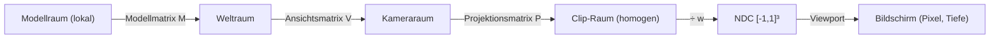
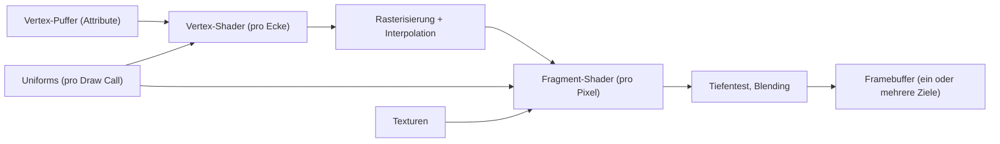
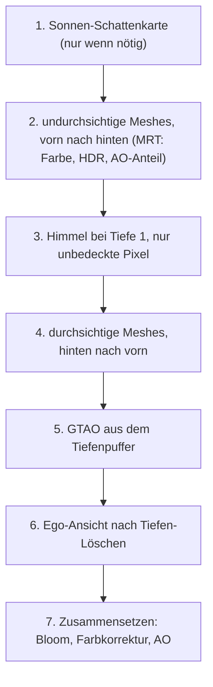
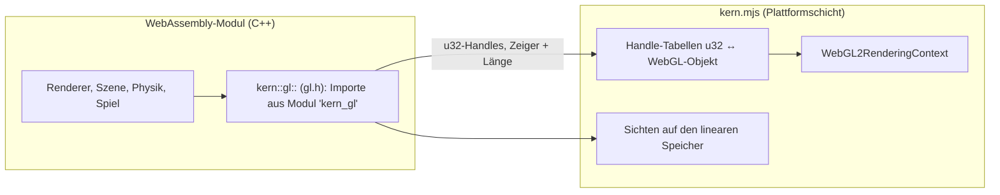

# Anhang B – Grundlagen: Echtzeit-Rendering

Dieser Anhang erklärt, wie aus Dreiecken im Speicher ein Bild auf dem Bildschirm wird – schnell genug
für 60 Bilder pro Sekunde im Browser. Er beginnt bei Koordinaten und Matrizen, geht über die
Grafikpipeline und Shader zu Licht, Schatten, Umgebungsverdeckung und Farbraum und endet bei der
Frage, warum Kern WebAssembly und WebGL2 genau so verbindet, wie es das tut. Die Fachkapitel
[Kapitel 4](04-grafik.md) (Grafik) und [Kapitel 5](05-szene-und-geometrie.md) (Szene und Geometrie)
verweisen hierher.

Der Code liegt in:

| Datei | Inhalt |
|---|---|
| `include/kern/math/math.h` | `Vec3`, `Quat`, `Mat4` (spaltenweise), `Camera`, Projektion |
| `include/kern/scene/frustum.h`, `bvh.h` | Sichtpyramide, BVH für Strahltests |
| `include/kern/gfx/renderer.h`, `src/gfx/renderer.cpp` | der Renderer und der Ablauf eines Bildes |
| `src/gfx/standard_shader.cpp` | der Standard-Shader (Licht, Tonemapping, Nebel) |
| `src/gfx/shadow.cpp` | Sonnen-Schattenkarte |
| `src/gfx/gtao.cpp` | Ground-Truth Ambient Occlusion |
| `src/gfx/bloom.cpp` | HDR-Kopie, Bloom, Zusammensetzen |
| `src/gfx/sky.cpp` | prozeduraler Himmel |
| `include/kern/gfx/gl.h`, `web/kern.mjs` | die WebGL2-Brücke zwischen WebAssembly und Browser |

---

## B.1 Koordinatenräume

### B.1.1 Warum es mehrere Räume gibt

Ein Modell – etwa der Rumpf der Micro Duck – wird einmal in seinem eigenen Koordinatensystem
beschrieben. Es steht aber an einer bestimmten Stelle der Welt, wird von einer Kamera gesehen und
landet schließlich auf bestimmten Pixeln. Jeder dieser Schritte ist ein Wechsel des
Koordinatensystems:



| Raum | Was er beschreibt |
|---|---|
| Modellraum | Eckpunkte relativ zum Ursprung des Modells, wie sie im Mesh stehen |
| Weltraum | alle Objekte in einem gemeinsamen System (Meter, Z oben) |
| Kameraraum | relativ zur Kamera: Kamera im Ursprung, Blick entlang $-z$ |
| Clip-Raum | nach der Projektion, vierdimensional (homogen) |
| NDC | normalisierte Gerätekoordinaten, sichtbarer Bereich ist der Würfel $[-1,1]^3$ |
| Bildschirm | Pixel und Tiefenwert $[0,1]$ |

### B.1.2 Homogene Koordinaten

Eine Drehung oder Skalierung ist eine $3\times 3$-Matrix; eine Verschiebung aber nicht, denn
$x \mapsto x + t$ ist nicht linear. Der Trick: Man hängt eine vierte Komponente an. Ein **Punkt**
bekommt $w = 1$, eine **Richtung** $w = 0$:

$$\begin{pmatrix} R & t \\ 0 & 1 \end{pmatrix}\begin{pmatrix} p \\ 1 \end{pmatrix} = \begin{pmatrix} Rp + t \\ 1\end{pmatrix},\qquad
\begin{pmatrix} R & t \\ 0 & 1 \end{pmatrix}\begin{pmatrix} v \\ 0 \end{pmatrix} = \begin{pmatrix} Rv \\ 0\end{pmatrix}.$$

Punkte werden verschoben, Richtungen nicht – genau richtig. Und alle Transformationen sind jetzt
$4\times 4$-Matrizen, die man hintereinander multiplizieren kann:

$$p_\text{clip} = P \cdot V \cdot M \cdot p_\text{modell}.$$

**In Kern:** `Mat4::transform_point` rechnet mit $w = 1$, `Mat4::transform_vector` mit $w = 0$,
`Mat4::transform(Vec4)` allgemein.

### B.1.3 Kerns Konventionen

Der Kopf von `math.h` sagt es in einem Satz: „column-major 4x4 matrices (OpenGL layout). World
convention: metres, right-handed, Z up.“

- **Meter**: alle Längen.
- **Rechtshändig, Z oben**: $x$ und $y$ spannen den Boden auf, $z$ zeigt nach oben. Die Standardkamera
  (`Camera` in `math.h`) steht bei `eye{0, -18, 8}`, schaut auf `target{0, 0, 2}` mit `up{0, 0, 1}`.
  Auch die Physik nutzt Z oben ([Anhang C](C-grundlagen-physik.md)), und der Himmel rechnet mit
  `d.z` als Höhe über dem Horizont.
- **Spaltenweise** (*column-major*): Element (Zeile $r$, Spalte $c$) steht in `m[c * 4 + r]`. Die
  Verschiebung einer Transformationsmatrix steht damit in `m[12]`, `m[13]`, `m[14]`
  (`Mat4::translation`). WebGL erwartet genau dieses Layout, deshalb gibt `kern.mjs`
  `uniformMatrix4fv(…, false, …)` an – „nicht transponieren“.
- **Spaltenvektoren**: Eine Matrix wirkt von links, $p' = Mp$. Bei einem Produkt $A \cdot B$ wirkt
  zuerst $B$. `Mat4::trs` baut deshalb „Translation * rotation * scale“: erst skalieren, dann drehen,
  dann verschieben.
- **Quaternionen** $(x, y, z, w)$ für Drehungen (`Quat`), mit `Quat::rotate` als
  $v + 2w(q\times v) + q \times (2\, q \times v)$.

### B.1.4 Die Ansichtsmatrix

Die Ansichtsmatrix bringt die Welt in den Kameraraum. `Mat4::look_at(eye, target, up)` baut eine
orthonormale Basis:

$$z_c = \frac{\text{eye} - \text{target}}{\lVert\cdot\rVert},\quad x_c = \frac{\text{up} \times z_c}{\lVert\cdot\rVert},\quad y_c = z_c \times x_c.$$

Die Kamera schaut also entlang $-z_c$ (OpenGL-Konvention). Die Matrix ist die Inverse der
Kamera-Lage: Drehung transponiert, Verschiebung $-(x_c\cdot\text{eye}, y_c\cdot\text{eye}, z_c\cdot\text{eye})$.
Liegen Blickrichtung und `up` parallel, ist die Basis entartet; Kern meldet das (`ok = false`), und
der Renderer verweigert das Bild („degenerate camera direction/up“).

### B.1.5 Die perspektivische Projektion

Perspektive heißt: Was doppelt so weit weg ist, erscheint halb so groß. Die Bildschirmposition ist
also proportional zu $x/(-z)$. Eine Division durch die Tiefe kann eine Matrix nicht – aber sie kann
die Tiefe in die vierte Komponente $w$ schreiben, und die Hardware teilt anschließend durch $w$
(**perspektivische Division**).

`Mat4::perspective(fov, aspect, near, far)` baut die OpenGL-Matrix

$$P = \begin{pmatrix} f/a & 0 & 0 & 0\\ 0 & f & 0 & 0 \\ 0 & 0 & \frac{f_\text{ar}+n}{n - f_\text{ar}} & \frac{2 f_\text{ar} n}{n - f_\text{ar}} \\ 0 & 0 & -1 & 0\end{pmatrix},\qquad f = \frac{1}{\tan(\text{fov}/2)}.$$

- fov: vertikaler Öffnungswinkel (Kern: $\pi/3$, also 60°; die Viewports von Kern Studio haben 70°),
- $a$: Seitenverhältnis Breite/Höhe,
- $n$, $f_\text{ar}$: nahe und ferne Clipping-Ebene (Kern: 0,05 m und 1800 m).

Die Zeile $(0, 0, -1, 0)$ schreibt $w_\text{clip} = -z_\text{kamera}$, die positive Entfernung vor
der Kamera.

**Beispiel.** Bild $960 \times 540$ ($a = 1{,}778$), fov 60°, also $f = 1{,}732$ und
$f/a = 0{,}974$. Ein Punkt im Kameraraum $(1;\ 0{,}5;\ -10)$:

| Schritt | Rechnung | Ergebnis |
|---|---|---|
| Clip $x, y, w$ | $0{,}974 \cdot 1$, $1{,}732 \cdot 0{,}5$, $10$ | $0{,}974$, $0{,}866$, $10$ |
| NDC | $\div w$ | $0{,}0974$, $0{,}0866$ |
| Pixel | $(\text{ndc}+1)/2 \cdot (960, 540)$ | $(526{,}8;\ 293{,}4)$ von unten links |

Für parallele Projektion (Editor-Ansichten von oben, vorn, Seite) gibt es `Mat4::ortho`;
`projection_matrix(camera, aspect)` wählt nach `Camera::orthographic`.

### B.1.6 Tiefe ist nicht linear

Die Indizes folgen hier GLSL und Kerns spaltenweisem Layout, `P[Spalte][Zeile]`: $P_{22}$ ist das
Element $\frac{f_\text{ar}+n}{n-f_\text{ar}}$ (`m[10]`), $P_{32}$ das Element $\frac{2 f_\text{ar} n}{n-f_\text{ar}}$
in Spalte 3, Zeile 2 der Matrix oben (ab 0 gezählt; `m[14]`). Die Tiefe in NDC ist
$z_\text{ndc} = -P_{22} + P_{32}/w$, also bis auf eine Konstante **proportional zu $1/w$**. Die
Tiefenpuffer-Werte $d = (z_\text{ndc}+1)/2$ drängen sich deshalb in der Ferne gegen 1. Mit Kerns
$n = 0{,}05$, $f_\text{ar} = 1800$ ($P_{22} \approx -1{,}0000556$, $P_{32} \approx -0{,}1000028$):

| Entfernung $w$ | Tiefenwert $d$ | Auflösung bei 24 Bit ($\Delta d = 2^{-24}$) |
|---|---|---|
| 1 m | 0,950026 | |
| 10 m | 0,995028 | ≈ 0,1 mm |
| 100 m | 0,999528 | ≈ 1,2 cm |
| 1000 m | 0,999978 | ≈ 1,2 m |

Die Auflösung folgt aus $\Delta w \approx \Delta d \cdot 2w^2/|P_{32}|$: Sie wird quadratisch mit der
Entfernung schlechter und hängt fast nur von $n$ ab. Deshalb ist die nahe Ebene so wichtig: Sie zu
verdoppeln, verdoppelt die Genauigkeit überall.

Kerns GTAO braucht die echte Entfernung aus dem Tiefenpuffer zurück und rechnet die Formel
rückwärts, mit genau den Matrixelementen $P_{22}$ und $P_{32}$ als Uniform `uProj`:

```glsl
float viewDepth(float d) { return uProj.w / ((d * 2.0 - 1.0) + uProj.z); }
```

### B.1.7 Normalen transformieren

Normalen sind keine gewöhnlichen Richtungen: Unter einer ungleichmäßigen Skalierung würden sie mit
der Modellmatrix schief. Richtig ist die **inverse Transponierte** des $3\times3$-Teils:

$$n' = \left(M_{3\times3}^{-1}\right)^\top n.$$

**In Kern:** `normal_matrix3` in `math.h` berechnet sie (über die Adjunkte) – auf der CPU, einmal
pro Instanz, wenn sich die Transformation ändert (`Renderer::build_instances`). Der Vertex-Shader
bekommt sie als drei Attribute `iNormal0..2`. Eine singuläre Matrix (Skalierung 0) wird abgelehnt.

---

## B.2 Rasterisierung und Tiefenpuffer

### B.2.1 Vom Dreieck zu Pixeln

Nach der Projektion liegen die drei Ecken eines Dreiecks als Bildschirmpunkte vor. Die
**Rasterisierung** bestimmt, welche Pixel (genauer: welche Pixelmittelpunkte) innerhalb liegen.
Für jedes solche Pixel entsteht ein **Fragment**. Die Werte der Ecken (Farbe, Normale, Weltposition,
Texturkoordinaten) werden dazwischen interpoliert, mit baryzentrischen Gewichten $\lambda_0 + \lambda_1
+ \lambda_2 = 1$:

$$v = \lambda_0 v_0 + \lambda_1 v_1 + \lambda_2 v_2.$$

Weil die Perspektive nicht linear ist, interpoliert die GPU **perspektivisch korrekt** (sie
interpoliert $v/w$ und $1/w$ linear und teilt).

```
     v2
     /\
    /  \       ■ = Pixelmittelpunkt im Dreieck → Fragment
   / ■■ \
  / ■■■■ \
 /________\
v0        v1
```

### B.2.2 Der Tiefenpuffer

Mehrere Dreiecke können dasselbe Pixel treffen. Welches ist vorn? Der **Tiefenpuffer** (Z-Buffer)
speichert pro Pixel die bisher kleinste Tiefe. Ein neues Fragment wird nur geschrieben, wenn seine
Tiefe den Test besteht (etwa „kleiner oder gleich“). So kommt es auf die Zeichenreihenfolge nicht an
– für undurchsichtige Objekte.

**In Kern:**

- Die Szene läuft mit `depthFunc(LEQUAL)`.
- Undurchsichtige Meshes werden **von vorn nach hinten** sortiert (`opaque_` nach
  `sort_distance` aufsteigend): Was verdeckt ist, scheitert schon am Tiefentest, bevor der teure
  Fragment-Shader läuft (*early depth rejection*).
- Durchsichtige Meshes werden **von hinten nach vorn** gezeichnet, mit Blending
  `SRC_ALPHA, ONE_MINUS_SRC_ALPHA` und abgeschaltetem Tiefenschreiben (`depthMask(0)`): Für
  Transparenz kommt es auf die Reihenfolge an.
- Der Himmel wird bei Tiefe 1 (ferne Ebene) **nach** den undurchsichtigen Objekten gezeichnet
  (`gl_Position = vec4(ndc, 1.0, 1.0)`): Nur Pixel, auf denen noch nichts liegt, bestehen `LEQUAL`
  und rechnen den Himmels-Shader.
- Die Ego-Ansicht (Gegenstände in der Hand, `viewmodel`) kommt zuletzt nach einem Löschen des
  Tiefenpuffers, „so a wall in front of the camera cannot cut it“.

### B.2.3 Rückseiten

Bei geschlossenen Körpern sind Dreiecke, die von der Kamera wegzeigen, immer verdeckt. Die GPU
erkennt sie an der Umlaufrichtung ihrer Ecken auf dem Bildschirm und verwirft sie
(**Backface Culling**). `Mesh::cull_mode()` wählt: doppelseitige Materialien und Linien ohne Culling;
gespiegelte Instanzen (negative Determinante) mit vertauschter Seite; ein Mesh, dessen Instanzen
teils gespiegelt sind und teils nicht, ebenfalls ohne Culling.

---

## B.3 Die GPU-Pipeline und Shader in WebGL2

### B.3.1 Die Pipeline



Programmierbar sind zwei Stufen:

- Der **Vertex-Shader** läuft einmal pro Ecke. Er muss `gl_Position` (Clip-Koordinaten) liefern und
  kann weitere Werte an den Fragment-Shader weitergeben (`out`).
- Der **Fragment-Shader** läuft einmal pro Fragment. Er bekommt die interpolierten Werte (`in`) und
  schreibt eine oder mehrere Farben.

### B.3.2 Attribute, Uniforms, Varyings, Texturen

| Begriff | Ändert sich | Beispiel in Kerns Standard-Shader |
|---|---|---|
| **Attribut** | pro Ecke (oder pro Instanz) | `aPosition`, `aNormal`, `aColor`, `aUV`; pro Instanz `iModel0..3`, `iTint`, `iNormal0..2` |
| **Uniform** | pro Draw Call | `uViewProjection`, `uSunDirection`, `uMaterial`, `uExposure` |
| **Varying** (`out`/`in`) | interpoliert pro Fragment | `vWorld`, `vNormal`, `vColor`, `vUV` |
| **Textur** | Bilddaten, abgetastet | `uTexture`, `uSunShadowMap` |

Die Attribute haben feste Plätze (`layout(location=…)`), die in `standard_shader.cpp` und im
Schatten-Shader übereinstimmen. Erweiterungen (`ShaderExtension`) hängen eigene Attribute, Uniforms
und Code-Stücke an festgelegten Stellen ein (`build_standard_shader`), ohne den Standard-Shader zu
kopieren.

### B.3.3 Instancing

Viele gleiche Objekte (Bäume, Kisten, Gliedmaßen gleicher Form) teilen sich die Geometrie. Statt
für jedes einen Draw Call abzusetzen, zeichnet man alle mit **einem** Aufruf und gibt jeder Instanz
eigene Attribute mit. Ein Attribut mit `vertexAttribDivisor(i, 1)` rückt nicht pro Ecke, sondern pro
Instanz vor.

**In Kern** ist jedes Mesh instanziert: Die Modellmatrix kommt als vier `vec4`-Attribute
(`iModel0..3`), der Farbton als `iTint`, die Normalenmatrix als `iNormal0..2`. Gezeichnet wird immer
mit `drawElementsInstanced` oder `drawArraysInstanced`. Bewegt sich etwas, ändert
`Renderer::update_instances` nur diese Ströme; die Geometrie bleibt auf der GPU („per-frame CPU cost
follows what moves“).

### B.3.4 Skinning

Weiche Figuren (ein Charakter, dessen Haut den Knochen folgt) verformen jede Ecke mit bis zu vier
Knochenmatrizen:

$$p' = \sum_{k=1}^{4} w_k\, B_{j_k}\, p,\qquad \sum w_k = 1.$$

Der Vertex-Shader macht das mit `aJoints`, `aWeights` und `uniform mat4 uBones[32]`, sowohl im
Standard- als auch im Schatten-Shader.

### B.3.5 Mehrere Ausgaben auf einmal

Ein Fragment-Shader kann gleichzeitig in mehrere Bilder schreiben (*multiple render targets*, MRT).
Kerns Standard-Shader hat drei Ausgänge:

```glsl
layout(location=0) out vec4 outColor;  // fertige Farbe (sRGB, 8 Bit)
layout(location=1) out vec4 outHdr;    // lineares HDR-Licht (16 Bit Gleitkomma) für Bloom
layout(location=2) out vec4 outAo;     // Anteil indirekten Lichts für die Umgebungsverdeckung
```

So braucht Kern für Bloom und Umgebungsverdeckung **keinen zweiten Geometrie-Durchgang** (B.7, B.8).

---

## B.4 Beleuchtung

### B.4.1 Was ein Pixel hell macht

Physikalisch misst ein Pixel die **Strahldichte** $L_o$, die von der Oberfläche in Richtung Auge
geht. Die Rendering-Gleichung (Kajiya) beschreibt sie als Summe über alles einfallende Licht:

$$L_o(\omega_o) = L_e + \int_{\Omega} f_r(\omega_i, \omega_o)\, L_i(\omega_i)\, (n\cdot\omega_i)\, d\omega_i.$$

- $L_e$: Eigenleuchten,
- $f_r$: die **BRDF** – wie viel Licht aus Richtung $\omega_i$ in Richtung $\omega_o$ reflektiert wird,
- $L_i$: einfallendes Licht,
- $n \cdot \omega_i$: der Kosinus des Einfallswinkels (schräges Licht verteilt sich auf mehr Fläche).

Echtzeit-Rendering zerlegt das Integral in handliche Teile: direktes Licht von wenigen Quellen
(Sonne, Punktlichter) und indirektes Licht aus der Umgebung, das man stark vereinfacht.

### B.4.2 Lambert: diffuse Reflexion

Eine matte Oberfläche streut gleichmäßig in alle Richtungen. Ihre BRDF ist konstant:
$f_r = \rho/\pi$ mit der Albedo $\rho$ (Anteil reflektierten Lichts). Für eine Lichtquelle mit
Bestrahlungsstärke $E$ senkrecht zum Licht:

$$L_o = \frac{\rho}{\pi}\, E\, \max(0, n \cdot l).$$

- $l$: Richtung zur Lichtquelle (normiert),
- $n$: Flächennormale.

Der Faktor $1/\pi$ sorgt für Energieerhaltung: Eine weiße Fläche ($\rho = 1$) wirft nicht mehr Licht
zurück, als sie empfängt.

**In Kern:**

```glsl
float ndl = max(dot(n, sun), 0.0);
vec3 rgb = base * (1.0 - metal) * (uSunColor * ndl * shadow + point * PI) / PI + indirect;
```

`base` ist die Albedo (Vertexfarbe × Material × Textur, in linearen Farbraum gewandelt), `uSunColor`
die Sonne als lineare Farbe mal Intensität (Standard `{2.8, 2.47, 2.11}`), `shadow` der Faktor aus
der Schattenkarte (B.5). Metalle haben keinen diffusen Anteil (`1 - metal`).

**Beispiel:** Graue Fläche $\rho = 0{,}5$, Sonne unter 45° ($n\cdot l = 0{,}707$), roter Kanal
$E = 2{,}8$: $L = 0{,}5 \cdot 2{,}8 \cdot 0{,}707 / \pi = 0{,}315$.

### B.4.3 Punktlichter

Ein Punktlicht fällt mit der Entfernung ab. Physikalisch mit $1/d^2$, was aber nie null wird. Kern
nutzt eine Abschwächung, die bei der Reichweite $r$ glatt auf 0 geht:

$$\text{att} = \frac{\left(\max\left(0,\ 1 - d^2/r^2\right)\right)^2}{1 + d^2/r^2}.$$

Bis zu 6 Punktlichter (`kMaxPointLights = 6`), jedes mit Position, Reichweite, Farbe und Intensität
(`uPointPosRange`, `uPointColorIntensity`); $d^2$ ist nach unten auf 0,04 begrenzt, damit ein Licht
direkt auf einer Fläche nicht unendlich hell wird.

### B.4.4 Spiegelnde Reflexion: von Blinn-Phong zu Mikrofacetten

Glänzende Oberflächen reflektieren gerichtet. Das klassische **Blinn-Phong**-Modell nimmt den
**Halbvektor** $h = \text{normalize}(l + v)$ zwischen Licht- und Blickrichtung und setzt
$L_\text{spec} \propto (n\cdot h)^s$ mit einem Glanzexponenten $s$: Liegt $h$ nahe an $n$, sieht man
die Spiegelung der Lichtquelle.

Moderne Renderer (*physically based rendering*, PBR) begründen das physikalisch mit der
**Mikrofacetten-Theorie**: Eine raue Oberfläche besteht aus winzigen Spiegeln mit verteilten
Normalen. Die Cook-Torrance-BRDF ist

$$f_\text{spec} = \frac{D(h)\, F(v,h)\, G(l,v)}{4\,(n\cdot l)(n\cdot v)}.$$

- $D$: **Normalenverteilung** – welcher Anteil der Mikrospiegel zeigt in Richtung $h$?
- $F$: **Fresnel** – wie viel wird überhaupt reflektiert? (bei streifendem Blick mehr)
- $G$: **Geometrie** – wie viel Licht verdecken sich die Mikrospiegel gegenseitig?

Gebräuchlich sind:

- **GGX/Trowbridge-Reitz:** $D = \dfrac{\alpha^2}{\pi\left((n\cdot h)^2(\alpha^2 - 1) + 1\right)^2}$
  mit $\alpha = \text{Rauheit}^2$.
- **Schlick-Fresnel:** $F = F_0 + (F_{90} - F_0)(1 - \cos\theta)^5$, mit $F_0 \approx 0{,}04$ für
  Nichtmetalle und $F_0 = $ Grundfarbe für Metalle.

### B.4.5 Was Kerns Standard-Shader tatsächlich rechnet

Kern hat zwei Materialparameter, `uPbr = (roughness, metalness)`. Der spiegelnde Anteil wird nur
gerechnet, wenn `metal > 0` oder `rough < 0.95`:

```glsl
vec3 F0 = mix(vec3(0.04), base, metal);
vec3 F = F0 + (max(vec3(1.0 - rough), F0) - F0) * pow(1.0 - NdV, 5.0);
...
float a2 = rough * rough * rough * rough;                       // α² mit α = rough²
float d = a2 / (PI * pow(NdH * NdH * (a2 - 1.0) + 1.0, 2.0));   // GGX
rgb += F * uSunColor * ndl * shadow * min(d, 40.0) * 0.25;
```

Im Einzelnen:

- $D$ ist GGX mit $\alpha = r^2$.
- $F$ ist Schlick mit einem rauheitsabhängigen $F_{90} = \max(1 - r, F_0)$: Raue Flächen glänzen am
  Rand weniger (eine verbreitete Näherung für Umgebungsreflexion).
- Ein eigener Geometrieterm fehlt. Der Faktor $0{,}25$ ist das $1/4$ der Cook-Torrance-Formel, wenn man
  $G = (n\cdot l)(n\cdot v)$ setzt (die „implizite“ Geometriefunktion) – dann kürzt sich der Nenner
  bis auf die 4. Multipliziert mit $E\,(n\cdot l)$ ergibt das genau die Zeile oben.
- $D$ ist auf 40 begrenzt, damit sehr glatte Flächen keine einzelnen Pixel mit riesigen Werten
  erzeugen.

Dazu kommt eine Umgebungsreflexion: der Himmel in Spiegelrichtung $R = \text{reflect}(-V, n)$, je
nach Rauheit zwischen diffuser Himmelsbeleuchtung und schärferem Himmelsverlauf gemischt, mal $F$.

Kerns Standard-Shader ist also ein **vereinfachtes PBR-Modell**: Lambert für diffuses Licht,
GGX + Schlick für Glanzlichter der Sonne, ein Fresnel-gewichteter Himmel als Reflexion. Glas
(`surfaceGlass`, von Erweiterungen gesetzt) spiegelt zusätzlich den Himmel, damit Scheiben nicht
schwarz wirken.

### B.4.6 Indirektes Licht

Licht, das von Himmel und Boden kommt, berechnet Kern ohne Strahlverfolgung aus wenigen Farben:

- **Hemisphären-Licht:** zwischen `uGroundColor` (unten) und `uSkyColor` (oben), gemischt nach
  $n_z$ – eine nach oben zeigende Fläche bekommt Himmelslicht, eine nach unten zeigende Bodenlicht.
- **Umgebungsbestrahlung** `envIrradiance(n)`: ein Verlauf aus Zenit, Horizont und Boden
  (`uEnvZenith`, `uEnvHorizon`, `uEnvGround`), mal `uEnvIntensity`.

Dieser indirekte Anteil wird in einer eigenen Variable `indirect` mitgeführt. Der Grund: Die
Umgebungsverdeckung (B.8) soll nur ihn abdunkeln, „sun and point lights keep their own shadowing“.

---

## B.5 Schattenkarten

### B.5.1 Die Idee

Ein Punkt liegt im Schatten, wenn zwischen ihm und der Lichtquelle etwas ist. Für eine gerichtete
Lichtquelle wie die Sonne rendert man die Szene **aus Sicht der Sonne** und speichert pro Texel nur
die Tiefe des nächsten Objekts – die **Schattenkarte**. Beim normalen Rendern rechnet man jeden Punkt
in den Raum der Sonne um und vergleicht: Ist seine Tiefe größer als die gespeicherte, liegt etwas
davor.

```
   Sonne ═══╗  (orthografische Projektion)
            ║  ↓   ↓   ↓   ↓
            ║     ███          gespeicherte Tiefe: Dach
            ║  ↓  ███  ↓   ↓
            ║  ── ─── ─────    Boden hinter dem Dach: Tiefe größer → Schatten
```

### B.5.2 Die Probleme und ihre Lösungen

| Problem | Ursache | Gegenmittel |
|---|---|---|
| **Schattenakne** (Streifen auf beleuchteten Flächen) | Die Fläche verdeckt sich wegen begrenzter Auflösung selbst | Tiefen-Bias, Polygon-Offset |
| **Peter Panning** (Schatten löst sich vom Objekt) | zu viel Bias | Bias klein halten |
| **harte, gezackte Kanten** | ein Texel deckt viele Pixel | Filterung (PCF) |
| **Flimmern** bei Kamerabewegung | die Karte verschiebt sich um Bruchteile eines Texels oder ändert ihre Größe | Ausrichtung am Texelraster, eine Karte fester Größe |
| **unscharfe Schatten in der Nähe** | die Karte deckt viel mehr ab, als man sieht | die Karte an die Sicht anpassen (Schattendistanz) |

### B.5.3 In Kern

`SunShadowMap` in `passes.h` und `shadow.cpp`:

- **Orthografisch:** Die Sonne ist unendlich weit weg, ihre Strahlen sind parallel.
  `Mat4::ortho(-e, e, -e, e, 0.2f, e * 4) * Mat4::look_at(...)` mit der halben Seitenlänge
  `extent` (Standard 120 m) und einer Auflösung von 512 Texeln (Zweierpotenz 128–4096). Ein Texel
  deckt damit $2 \cdot 120 / 512 \approx 0{,}47$ m.
- **An die Sicht angepasst:** Mit einer Schattendistanz (`set_shadow_distance`, in Levels
  `WorldSettings::shadow_distance`, Standard 80 m) deckt die Karte statt des festen Quadrats die
  umschließende Kugel des Sichtkegels bis zu dieser Entfernung ab (stabile Schattenkarte nach Valient
  2008). Die Kugel ändert ihre Größe nicht, wenn sich die Kamera dreht; ihr Radius ist die halbe
  Seitenlänge. Kleinere Schattendistanz heißt kleinere Texel, also schärfere Schatten. Am Rand blendet
  der Schatten über das letzte Zehntel der Distanz aus.
- **Am Texelraster ausgerichtet:** `focus_key` rundet den Fokus (das Kameraziel bzw. den
  Kugelmittelpunkt) in der Ebene senkrecht zur Sonne auf ganze Texel. Die Karte springt dann nur um ganze Texel und flimmert nicht.
  Der gerundete Fokus ergibt zusammen mit der Ausdehnung einen **Cache-Schlüssel**: Solange er, die Sonne und die
  Schattenwerfer gleich bleiben, wird die Karte wiederverwendet (`RenderStats::shadow_reused`).
- **Nur Tiefe:** `colorMask(0, 0, 0, 0)`, ein leerer Fragment-Shader, Ziel `DEPTH_COMPONENT24`.
- **Bias dreifach:** beim Erzeugen `polygonOffset(2, 3)` (verschiebt die Tiefe abhängig von der
  Neigung des Dreiecks), beim Abfragen `uSunShadowBias` (Standard 0,0012, in Studio und exportierten Spielen 0,0014) und ein **Normal Offset**
  (Holbert 2011): Nachgeschlagen wird einen Texel von der Fläche weg entlang ihrer Normale, mehr bei
  streifendem Licht. So gibt es keine Akne, ohne dass ein großer konstanter Bias den Schatten vom
  Objekt löst.
- **Hardware-PCF:** Die Tiefentextur hat `TEXTURE_COMPARE_MODE = COMPARE_REF_TO_TEXTURE` und
  `LINEAR`-Filterung. Ein Zugriff über `sampler2DShadow` vergleicht dann die vier nächsten Texel und
  interpoliert die Ergebnisse – weiche Kanten aus einem einzigen `texture()`-Aufruf.
- **Optimiertes PCF** (Castaño 2013, „The Witness“): Aus 4 bzw. 9 solcher Hardware-Taps entsteht ein
  zeltgefilterter 3 × 3- bzw. 5 × 5-Kern. Jeder Tap sitzt so zwischen den Texeln, dass die bilineare
  Gewichtung der Hardware genau die Zeltgewichte ergibt. `ShadowOptions::filter` wählt 1, 4 oder 9
  Taps; Studio nimmt auf Telefonen 4, auf dem Desktop 9.
- Nur Meshes mit `casts_shadow()` und innerhalb der Sichtpyramide der Sonne werden gezeichnet.

Im Standard-Shader:

```glsl
vec3 lookup = vWorld + n * (uSunShadowTexel.z * (0.6 + 1.4 * (1.0 - ndl)));  // Normal Offset
vec4 clip = uSunShadowProjection * vec4(lookup, 1.0);
vec3 uvz = clip.xyz / clip.w * 0.5 + 0.5;                  // NDC → [0,1]
shadow = sunShadow(uvz);                                   // 1, 4 oder 9 Taps
```

Abgefragt wird nur, wenn die Fläche der Sonne zugewandt ist (`ndl > 0.0`) – sonst ist sie ohnehin
dunkel.

---

## B.6 HDR, Tonemapping und Gamma

### B.6.1 Hoher Dynamikumfang

Echtes Licht hat einen riesigen Bereich: Die Sonnenscheibe ist um Größenordnungen heller als ein
Schatten. Kerns Sonne hat eine Intensität von bis zu 2,8 – lineare Werte über 1 sind normal. Ein
Bildschirm kann aber nur 0 bis 1 darstellen. Rechnet man im **linearen HDR-Raum** (*high dynamic
range*) und bildet erst am Ende auf den Bildschirmbereich ab, bleiben helle Bereiche differenziert,
statt hart abzuschneiden.

### B.6.2 Tonemapping

Die Abbildung von $[0, \infty)$ auf $[0, 1]$ heißt **Tonemapping**. Eine gute Kurve ist im
Mittelbereich fast linear, komprimiert die Lichter weich und sättigt nie hart:

```
 Ausgabe
  1 |            ____________
    |        _--
    |      /
    |    /
    |  /
  0 |/________________________ Eingabe (linear)
    0    1    2    3    4
```

**In Kern** ist es die ACES-Filmkurve in der Fassung von three.js (MIT, siehe Anhang D; `acesFilmic` in
`kGlslToneMap`):

1. Belichtung: `c *= uExposure / 0.6`.
2. Eine Matrix in den Arbeitsfarbraum der Kurve (`inM`).
3. Die rationale Näherung von RRT+ODT:
   $\text{rrtOdt}(v) = \dfrac{v(v + 0{,}0245786) - 0{,}000090537}{v(0{,}983729 v + 0{,}4329510) + 0{,}238081}$.
4. Zurück (`outM`), auf $[0,1]$ begrenzen.

Danach optional eine Farbkorrektur (`gradeColor`: etwas mehr Sättigung, eine sanfte S-Kurve, warme
Lichter und kühle Schatten).

### B.6.3 Gamma und sRGB

Bildschirme und Bilddateien speichern Farben nicht linear, sondern in **sRGB**: Dunkle Töne bekommen
mehr der 256 Stufen, weil das Auge dort feiner unterscheidet. Rechnen muss man aber **linear** –
Licht addiert sich linear. Also:

1. Eingangsfarben (Texturen, Vertexfarben aus sRGB-Quellen) **nach linear** wandeln,
2. linear rechnen,
3. am Ende **nach sRGB** wandeln.

Die exakten sRGB-Formeln (in `kGlslToneMap`):

$$c_\text{lin} = \begin{cases} c/12{,}92 & c \le 0{,}04045 \\ \left(\frac{c + 0{,}055}{1{,}055}\right)^{2{,}4} & \text{sonst}\end{cases}\qquad
c_\text{sRGB} = \begin{cases} 12{,}92\,c & c \le 0{,}0031308 \\ 1{,}055\, c^{1/2{,}4} - 0{,}055 & \text{sonst}\end{cases}$$

**Beispiel:** Lineares Mittelgrau 0,18 wird zu sRGB $1{,}055 \cdot 0{,}18^{1/2{,}4} - 0{,}055 = 0{,}461$ –
knapp die Hälfte der Skala, obwohl es nur 18 % des Lichts sind.

Vertexfarben, die schon linear vorliegen, überspringen die Umwandlung (`uLinearColor`; im Browser
markiert über `markLinearColors` in `kern.mjs`).

### B.6.4 Nebel

Nach dem Tonemapping mischt Kern Nebel ein, wie three.js („FogExp2 after the colour-space
conversion“; MIT, siehe Anhang D):

$$\text{fog} = 1 - e^{-(\rho_f\, d)^2}.$$

- $\rho_f$: Nebeldichte (Standard 0,00085),
- $d$: Entfernung vom Auge.

Bei 100 m sind das 0,7 %, bei 1000 m 51 %. Mit `fog_height_falloff` wird der Nebel nach oben dünner:
Kern mittelt $e^{-k z}$ entlang des Sichtstrahls analytisch,
$\frac{e^{-kz_0} - e^{-kz_1}}{k (z_1 - z_0)}$. Mit `fog_sun_scatter` leuchtet der Dunst in
Sonnenrichtung (Faktor $\mu^8$ mit $\mu = \cos$ des Winkels zur Sonne).

---

## B.7 Bloom

### B.7.1 Was Bloom ist

Sehr helle Stellen überstrahlen in Kameras und im Auge ihre Umgebung. Diesen Lichthof nennt man
**Bloom**. Man berechnet ihn aus dem HDR-Bild:

1. **Helle Anteile ausschneiden** (oberhalb einer Schwelle),
2. **unscharf machen** (Gauß-Filter, oft auf verkleinerten Bildern – billiger und breiter),
3. **zurückaddieren**.

### B.7.2 Der Gauß-Filter mit linearer Abtastung

Ein Gauß-Filter ist **separierbar**: Ein 2D-Filter $9\times 9$ (81 Zugriffe) ist dasselbe wie ein
horizontaler und ein vertikaler $9\times1$-Filter (18 Zugriffe). Mit der bilinearen Filterung der
Hardware geht es noch billiger: Ein Zugriff **zwischen** zwei Texeln liefert ihren gewichteten
Mittelwert. Fünf Zugriffe ersetzen so neun Gewichte.

**In Kern** (`kBlur` in `bloom.cpp`):

| Versatz (Texel) | Gewicht |
|---|---|
| 0 | 0,2270 |
| ±1,3846 | 0,3162 |
| ±3,2308 | 0,0703 |

Die Gewichte summieren sich zu $0{,}2270 + 2\cdot0{,}3162 + 2\cdot0{,}0703 = 1$.

### B.7.3 Kerns Bloom-Durchgang

- Die Szene schreibt gleichzeitig in ein RGBA8-Ziel (fertige Farbe) und in eine lineare
  **RGBA16F**-Kopie (`outHdr`).
- Helle Anteile mit weicher Schwelle: `c * smoothstep(0.88, 0.88 + 0.35, max(c.r, c.g, c.b))`, auf
  einem Viertel der Auflösung.
- Unschärfe auf zwei Ebenen: $1/4$ und $1/8$ der Auflösung; Stärken 0,13 und 0,08.
- Zusammensetzen: `scene + present(hdr + bloom) - present(hdr)`. `present` ist Tonemapping +
  Farbkorrektur + sRGB. Addiert wird also nur der **Unterschied**, den der Bloom nach dem
  Tonemapping macht – Pixel ohne Bloom bleiben bitgenau, wie die Szene sie gerendert hat.
- Ein Bildzeit-Wächter schaltet den Lichthof für die Sitzung ab, wenn das Gerät im Mittel über 27 ms
  pro Bild braucht (3,5 s lang), außer er ist erzwungen (`BloomOptions::forced`).

---

## B.8 Umgebungsverdeckung: SSAO und GTAO

### B.8.1 Was verdeckt wird

In Ecken, Fugen und unter Objekten kommt weniger Umgebungslicht an, weil ein Teil des Himmels
verdeckt ist. Diese **Umgebungsverdeckung** (*ambient occlusion*, AO) ist für die Tiefenwirkung eines
Bildes sehr wichtig. Sie betrifft nur indirektes Licht; die Sonne hat ihre eigenen Schatten.

Die exakte Größe ist die kosinusgewichtete Sichtbarkeit über die Halbkugel:

$$\text{AO}(p) = \frac{1}{\pi}\int_{\Omega} V(p, \omega)\,(n\cdot\omega)\,d\omega.$$

- $V(p,\omega) = 1$, wenn von $p$ aus in Richtung $\omega$ nichts im Weg ist, sonst 0.

### B.8.2 Im Bildraum rechnen

Strahlen durch die ganze Szene zu verfolgen, ist zu teuer. **Screen-Space Ambient Occlusion** (SSAO)
nutzt stattdessen den Tiefenpuffer: Für jedes Pixel rekonstruiert man die Position im Kameraraum und
prüft Nachbarpixel, ob sie „über“ dem Punkt liegen. Klassisches SSAO zählt Stichproben in einer
Kugel und ist eine grobe Schätzung.

**GTAO** (*Ground-Truth Ambient Occlusion*, Jimenez et al. 2016) rechnet das Integral in Scheiben
(*slices*) systematisch aus:

1. Pro Pixel einige Richtungen $\phi$ in der Bildebene (Scheiben).
2. In jeder Scheibe sucht man auf beiden Seiten den **Horizont**: den höchsten Winkel, unter dem eine
   Nachbarfläche den Himmel verdeckt.
3. Zwischen den beiden Horizontwinkeln $h_0$, $h_1$ ist der Himmel sichtbar. Das Integral der
   kosinusgewichteten Sichtbarkeit über diesen Bogen hat eine geschlossene Form. Mit $\gamma$, dem
   Winkel der in die Scheibe projizierten Normale:

$$\hat a(h, \gamma) = \tfrac14\left(\cos\gamma + 2h\sin\gamma - \cos(2h - \gamma)\right),$$

   und die Sichtbarkeit der Scheibe ist $\lVert n_\text{proj}\rVert\left(\hat a(h_0,\gamma) + \hat a(h_1,\gamma)\right)$.
4. Mitteln über die Scheiben.

```
             Horizont h1
   Blick ↓      ╲   │n   ╱  Horizont h0
                 ╲  │   ╱
   ████████       ╲ │  ╱      ████
   ████████████────●────────████████
                  Pixel
   sichtbarer Himmel: Bogen zwischen h0 und h1
```

### B.8.3 In Kern

`AmbientOcclusionPass` (`passes.h`, `gtao.cpp`) folgt Intels XeGTAO (MIT, siehe Anhang D):

- Die Normale wird **aus der Tiefe** rekonstruiert (pro Achse der Nachbar mit dem kleineren
  Tiefensprung), es gibt keinen Normalenpuffer.
- Der Effektradius ist in Weltmetern (`AoOptions::radius`, Standard 1,6) und wird pro Pixel in
  Bildpixel umgerechnet; nahe Flächen sind gedeckelt.
- `fastAcos` (Lagardes Näherung, max. Fehler 0,0068 rad) statt `acos`.
- Ein $4\times4$-Ordnungsmuster dreht die Scheiben von Pixel zu Pixel; ein tiefensensibler
  $4\times4$-Filter integriert genau dieses Muster wieder weg, ohne über Kanten zu verwischen.
- Qualitätsstufen wie XeGTAO: low $1\times2$, medium $2\times2$, high $3\times3$, ultra $9\times3$
  (Scheiben × Schritte pro Seite), auf Mobilgeräten halbe Auflösung. Ein Bildzeit-Wächter stuft auf
  langsamen Geräten herunter (`adaptive`).
- Das Ergebnis ist ein RG16F-Bild: (Sichtbarkeit, Kameratiefe). Die Tiefe dient beim Hochskalieren:
  Texel anderer Flächen bekommen kein Gewicht.

**Angewendet wird nur auf indirektes Licht.** Der Standard-Shader schreibt in den dritten Ausgang
`outAo` den Anteil indirekten Lichts pro Farbkanal (schon um den Nebel verringert) und die
Helligkeit der Albedo. Beim Zusammensetzen (`kCombine` in `bloom.cpp`) wird dann

$$h' = h \cdot \left(1 - s \cdot \left(1 - \text{mb}(v, \rho)\right)\right)$$

gerechnet: $h$ das HDR-Licht, $s$ der indirekte Anteil, $v$ die GTAO-Sichtbarkeit, und
$\text{mb}$ die **Mehrfachreflexions-Näherung** aus dem GTAO-Paper – helle Albedo gewinnt Licht
zurück, das zwischen den Verdeckern hin- und herspringt:

```glsl
vec3 a = 2.0404 * albedo - 0.3324, b = -4.7951 * albedo + 0.6417, c = 2.7552 * albedo + 0.6903;
return max(vec3(v), ((v * a + b) * v + c) * v);
```

Weil der Standard-Shader den indirekten Anteil ohnehin kennt, braucht Kern dafür keinen
G-Buffer-Durchgang: „Ambient occlusion without a second geometry pass“ (`renderer.cpp`).

---

## B.9 Himmel und Atmosphäre

### B.9.1 Die Physik

Der Himmel ist blau, weil Luftmoleküle kurzwelliges Licht stärker streuen
(**Rayleigh-Streuung**, $\propto \lambda^{-4}$). Am Horizont ist der Weg durch die Atmosphäre länger,
das Licht wird mehrfach gestreut und heller, bei tiefer Sonne rötlich. Um die Sonne herum streuen
größere Teilchen (Aerosole) vorwärts – die **Mie-Streuung** erzeugt den hellen Hof. Physikalische
Himmelsmodelle integrieren diese Streuung entlang des Sichtstrahls.

### B.9.2 Was Kern tut

Kerns `SkyPass` ist bewusst **kein** Streuungsintegral, sondern ein analytisches Modell („Rayleigh-like
gradient“, `passes.h`), das sich billig pro Pixel auswerten lässt:

- **Verlauf** zwischen Horizont- und Zenitfarbe nach der Höhe über dem Horizont, $\text{mix}(\text{hor}, \text{zen}, h^{0{,}45})$.
- **Goldene Stunde:** Je näher die Sonne am Horizont, desto stärker wird der Horizont orange
  (`dusk`), mit einem Band, das zur Sonnenseite hin heller ist.
- **Sonnenscheibe und Mie-Hof:** $\mu = \cos(\angle(\text{Blick}, \text{Sonne}))$; der Hof als
  $0{,}22\mu^8 + 0{,}5\mu^{64}$, die Scheibe als steiler `smoothstep` bei $\mu \approx 0{,}9993$.
- **Nacht:** Mond (gleiches Prinzip) und Sterne aus einem Zellhash, mit leichtem Funkeln.
- **Wolken:** 5 Oktaven Wertrauschen (*fBm*), auf eine Ebene über dem Betrachter projiziert
  (`d.xy / (d.z + 0.12)`), vom Wind verschoben, zur Sonne hin aufgehellt.
- **Atmosphäre:** `SkyAtmosphere` übergibt Nebelfarbe und Sonnenstreuung der Szene, damit Horizont
  und ferne Geometrie ineinander übergehen.

Gezeichnet wird ein bildschirmfüllendes Dreieck. Der Vertex-Shader baut aus den NDC-Ecken die
Blickrichtung (`uForward + ndc.x * tanHalf.x * uRight + ndc.y * tanHalf.y * uUp`) und setzt die
Tiefe auf 1 – siehe B.2.2.

---

## B.10 Culling und Szenenstrukturen

### B.10.1 Die Sichtpyramide

Was außerhalb des Bildes liegt, muss man nicht zeichnen. Der sichtbare Bereich einer perspektivischen
Kamera ist ein Pyramidenstumpf (*frustum*) aus sechs Ebenen. Gribb und Hartmann haben gezeigt, dass
man diese Ebenen direkt aus der kombinierten Matrix $PV$ ablesen kann: Sie sind Summen und
Differenzen der vierten Zeile mit den ersten drei,

$$\text{Ebene}_{\pm x} = r_4 \pm r_1,\quad \text{Ebene}_{\pm y} = r_4 \pm r_2,\quad \text{Ebene}_{\pm z} = r_4 \pm r_3,$$

wobei $r_i$ die Zeilen von $PV$ sind und ein Punkt $p$ innen liegt, wenn
$a x + b y + c z + d \ge 0$ für alle sechs Ebenen gilt.

**In Kern:** `Frustum::from_matrix` in `frustum.h` (mit spaltenweisem Zugriff `m[3] + sign * m[axis]`
usw.) normiert die Ebenen, und `sphere_visible` testet eine **Hüllkugel**: Sie ist sicher außerhalb,
wenn ihr Mittelpunkt weiter als der Radius hinter einer Ebene liegt.

```
       \         /
        \  ●    /     ● sichtbar
   ○     \     /      ○ verworfen: Abstand zur linken Ebene < -r
          \   /
           \ /
          Kamera
```

Der Test ist **konservativ**: Er verwirft nie etwas Sichtbares, lässt aber manchmal Unsichtbares
durch (Kugeln nahe einer Ecke des Stumpfs). Der Renderer wendet ihn auf jedes Mesh an, das nicht
gehäutet ist (*skinned*: dessen Knochen können die Hüllkugel verlassen) und dessen Material
`frustum_culled` gesetzt hat (`stats.culled_meshes`); die Schattenkarte auf ihre eigene Pyramide. Die Hüllkugel eines
instanzierten Meshes umschließt alle Instanzen (`instanced_bounds`).

### B.10.2 Hierarchien von Hüllkörpern (BVH)

Bei vielen Objekten oder großen Meshes will man nicht jedes einzeln testen. Eine **Bounding Volume
Hierarchy** (BVH) ordnet sie in einen Baum: Jeder Knoten hat einen Hüllquader, der alle Kinder
umschließt. Trifft ein Strahl oder eine Pyramide einen Knoten nicht, kann der ganze Teilbaum
übersprungen werden – statt $O(n)$ Tests braucht man typischerweise $O(\log n)$.

```
            [ alle ]
           /        \
     [ links ]    [ rechts ]
      /    \        /    \
   [△△]  [△△]   [△△]  [△△]   Blätter: Dreiecke
```

**In Kern** dient die BVH (`Bvh` in `bvh.h`) dem **Picking**, nicht dem Zeichnen: Statische
Welt-Meshes ab 36 Dreiecken (`kBvhMinTriangles`) bekommen einen Baum über ihre Dreiecke, gebaut mit
Median-Teilungen (`nth_element`) in flachen Arrays. Strahltests nutzen den Slab-Test für Quader
(`intersect_aabb`) und Möller-Trumbore für Dreiecke (`intersect_triangle`). Bewegte Meshes nehmen den
exakten Brute-Force-Weg. Eine BVH für die Physik hat Box3D selbst ([Anhang C](C-grundlagen-physik.md),
C.3).

---

## B.11 Draw Calls und Zustandswechsel

### B.11.1 Warum die CPU der Engpass sein kann

Jeder **Draw Call** (`drawElementsInstanced` usw.) kostet CPU-Zeit im Treiber: Er prüft den
GL-Zustand, bindet Puffer, lädt Uniforms hoch. In WebGL kommt der Weg von WebAssembly über
JavaScript in den Browser und dessen Validierung dazu. Tausende kleine Draw Calls können ein Bild
länger machen als die eigentliche GPU-Arbeit. Ebenso kosten **Zustandswechsel**: ein anderes
Programm, eine andere Textur, ein anderer Cull-Modus.

### B.11.2 Was Kern dagegen tut

| Maßnahme | Wo |
|---|---|
| **Ein** Standardprogramm für alle Meshes; Varianten über Uniforms und Erweiterungen | `Renderer::program_`, `build_standard_shader` |
| Instancing: ein Draw Call pro Mesh, egal wie viele Instanzen | `draw_mesh` |
| Uniforms nur hochladen, wenn sich der Wert ändert (auch Matrizen und Arrays, inhaltlich verglichen) | `UniformCache` (`program.h`) |
| Pro-Bild-Uniforms einmal setzen | `set_frame_uniforms` |
| gebundene Textur und Cull-Modus merken | `bound_texture_`, `cull_state_` |
| Schattenkarte nur neu zeichnen, wenn sich etwas ändert | Cache-Schlüssel in `render` |
| Sichtpyramide vor dem Zeichnen | `Frustum::sphere_visible` |
| Geometrie einmal hochladen, danach nur Instanzströme | `upsert`, `update_instances` |

`RenderStats` berichtet die Zahl der Draw Calls, der Dreiecke und Instanzen, der verworfenen Meshes,
CPU- und (wenn der Browser `EXT_disjoint_timer_query_webgl2` bietet) GPU-Zeit.

### B.11.3 Der Ablauf eines Bildes

Aus dem Kopf von `renderer.h`:



---

## B.12 Warum WebAssembly und WebGL2 so verbunden sind

### B.12.1 Die Ausgangslage

Kern ist C++. Im Browser gibt es aber keine Grafiktreiber-API für nativen Code, nur JavaScript-APIs.
**WebAssembly** (WASM) ist ein kompaktes Bytecode-Format, das der Browser in Maschinencode übersetzt;
ein WASM-Modul hat einen linearen Speicher (ein großes Byte-Array) und kann nur Funktionen aufrufen,
die ihm beim Laden als **Importe** übergeben werden. **WebGL2** ist die Grafik-API des Browsers,
weitgehend OpenGL ES 3.0.

### B.12.2 Kerns Aufbau

Kern übersetzt mit wasi-sdk für `wasm32-wasip1` (`build.sh`). Die Grenze zum Browser ist schmal und
klar:



- **`gl.h`** deklariert genau die WebGL2-Funktionen, die die Engine benutzt, mit
  `import_module("kern_gl")`. GPU-Objekte sind „opaque u32 handles (0 = null) managed by the host“,
  Daten werden als „pointers into the module's linear memory plus a byte count“ übergeben.
- **`kern.mjs`** tut laut eigenem Kopf „exactly three things and contains no engine logic“: das
  Modul mit den Importen `kern_gl` und `kern_env` und einem minimalen WASI instanziieren, die
  Handle-Tabellen und den Kontextverlust verwalten, und `KernRenderer` als dünne Fassade anbieten.
- Daten fließen **ohne Kopie in JavaScript-Objekte**: `bufferData` übergibt `self.u8` (eine Sicht auf
  den WASM-Speicher) mit Versatz und Länge; `uniformMatrix4fv` liest direkt aus `self.f32`. Nach
  einem Speicherwachstum werden die Sichten erneuert (`refresh`).
- `KernRenderer` legt den WebGL2-Kontext ohne Antialiasing und ohne Alpha an (`antialias: false, alpha:
  false`) – Kern rendert in eigene Ziele und setzt selbst zusammen. Ausnahme: Kern Studio und
  exportierte Spiele erzeugen ihren Kontext selbst und fordern `antialias: true` an
  (`web/studio/studio.mjs`, `web/studio/game.mjs`).

### B.12.3 Warum so

| Entscheidung | Grund |
|---|---|
| Engine vollständig in C++/WASM | eine Codebasis für Browser und nativ (Tests, Lehrer, Server); deterministische Physik und Mathematik ([Anhang C](C-grundlagen-physik.md), C.9) |
| JavaScript nur als dünne Schicht | jede Logik in JS wäre doppelt zu pflegen und nicht testbar wie der C++-Kern |
| feste, kleine Import-Liste | was die Engine braucht, steht an einer Stelle (`gl.h`) und in einem Objekt (`kern_gl`) |
| Handles statt JS-Objekten | WASM kann keine JS-Objekte halten; ganze Zahlen kann es |
| eigene CPU-Kopien aller Meshes und Texturen | **Kontextverlust**: Der Browser kann den WebGL-Kontext jederzeit wegnehmen. `context_restored()` baut alle Programme neu und lädt alles aus den CPU-Kopien wieder hoch |
| wenige, große Draw Calls, Uniform-Cache | jeder GL-Aufruf überquert die WASM–JS-Grenze und die Validierung des Browsers |
| Headless-Modus | ohne GPU bleiben Meshes auf der CPU, „nothing touches GL“ (`set_headless`) – so läuft der Lehrer dieselbe Welt ohne Grafik |
| ein Thread im WASM | Box3D läuft mit `workerCount = 1` („single-threaded WebAssembly“); Parallelität im Browser kommt aus Web Workern mit eigenen Modulen (Lehrer) |

---

## B.13 Zusammenfassung: Grundbegriff und Kern

| Grundbegriff | Abschnitt | Wo in Kern |
|---|---|---|
| homogene Koordinaten, spaltenweise Matrizen | B.1 | `Mat4` (`math.h`) |
| Z oben, rechtshändig, Meter | B.1.3 | `math.h`, `Camera` |
| Ansicht, Perspektive, Tiefe | B.1.4–B.1.6 | `look_at`, `perspective`, `viewDepth` in `gtao.cpp` |
| Normalenmatrix | B.1.7 | `normal_matrix3`, `iNormal0..2` |
| Tiefentest, Sortierung, Transparenz | B.2 | `Renderer::render` |
| Vertex-/Fragment-Shader, Attribute, Uniforms, MRT | B.3 | `standard_shader.cpp` |
| Lambert, GGX, Schlick, Hemisphärenlicht | B.4 | `kFragmentLighting` |
| Schattenkarte, PCF, Texel-Ausrichtung, Schattendistanz, Normal Offset | B.5 | `SunShadowMap`, `Renderer::set_shadow_distance` |
| HDR, ACES, sRGB, Nebel | B.6 | `kGlslToneMap`, Nebel im Standard-Shader |
| Bloom | B.7 | `BloomPass` |
| GTAO | B.8 | `AmbientOcclusionPass`, `kCombine` |
| Himmel | B.9 | `SkyPass` |
| Sichtpyramide, BVH | B.10 | `Frustum`, `Bvh` |
| Draw Calls, Zustandswechsel | B.11 | `UniformCache`, Instancing, Caches |
| WASM + WebGL2 | B.12 | `gl.h`, `kern.mjs` |

Wie man diese Bausteine in einem eigenen Spiel einsetzt – Materialien, Licht, Kamera, Meshes und
Instanzen –, zeigen [Kapitel 4](04-grafik.md) und [Kapitel 5](05-szene-und-geometrie.md).

---

© 2026 Christian Heinrich Hohlfeld · Alle Rechte vorbehalten · [Impressum und Rechte](00-impressum.md)
