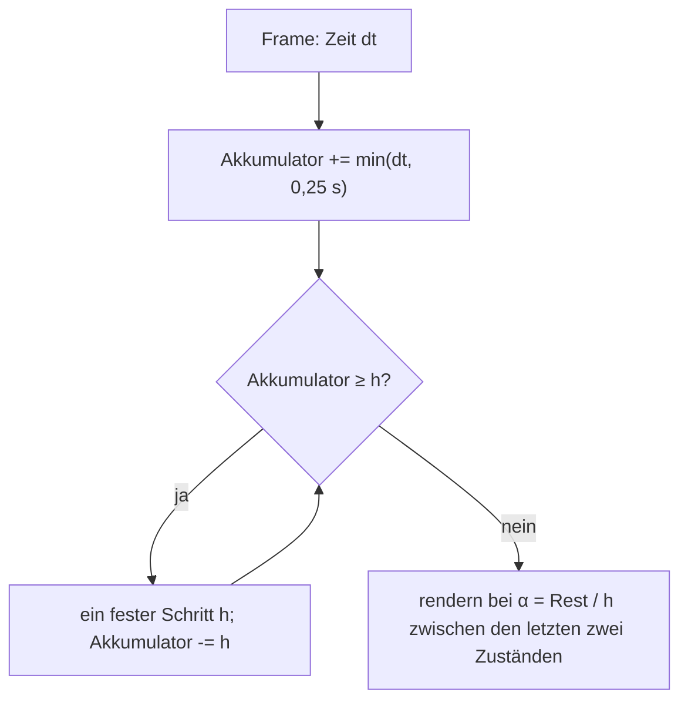
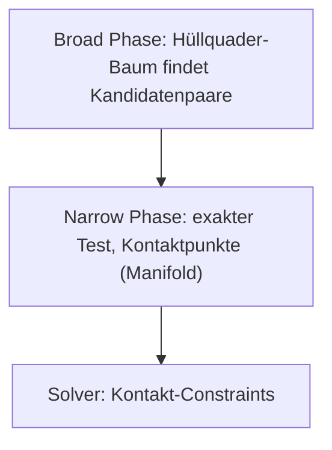
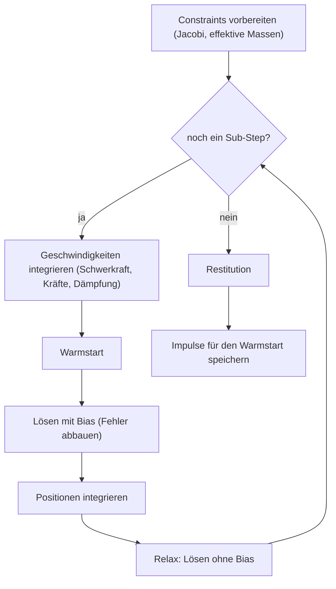
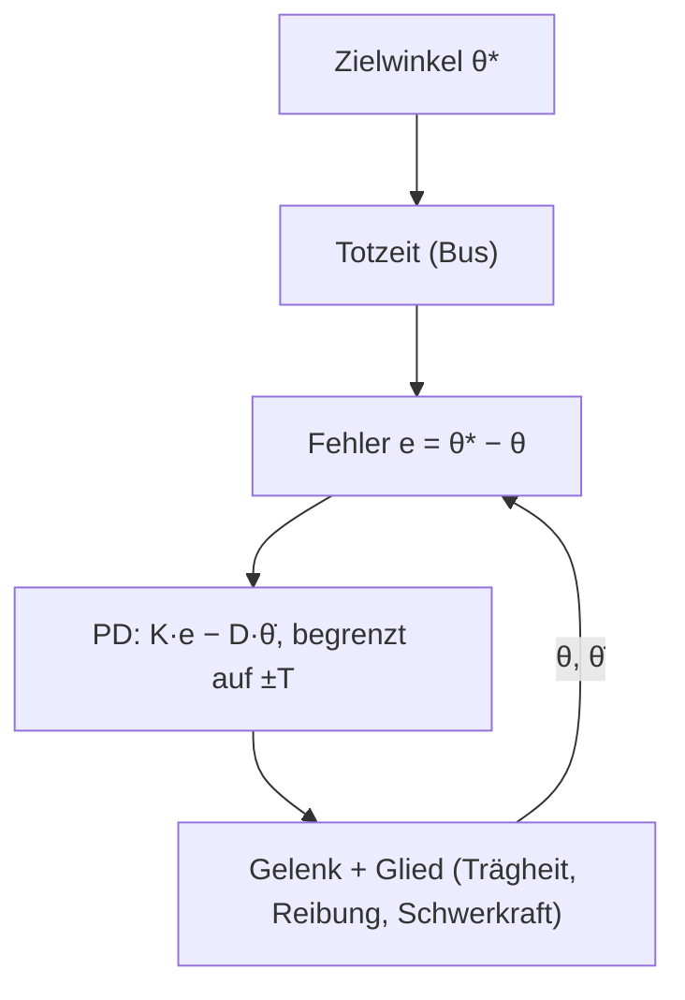

# Anhang C – Grundlagen: Physiksimulation

Dieser Anhang erklärt, wie eine Starrkörpersimulation funktioniert: was ein Körper „ist“, wie man
ihn in der Zeit vorwärts rechnet, wie Kollisionen gefunden und aufgelöst werden, was Reibung und
Elastizität bedeuten, wie Gelenke und Servos arbeiten und warum eine Simulation auf jedem Rechner
Bit für Bit gleich herauskommen kann. Kern simuliert mit **Box3D**, Erin Cattos 3D-Nachfolger von
Box2D v3 (`third_party/box3d`), und legt eine dünne C++-Schicht darüber
(`include/kern/physics/physics.h`, `src/physics/physics.cpp`). Das Fachkapitel ist
[Kapitel 6](06-physik.md); die verbindlichen Regeln für Kerns Physikcode stehen in
`docs/physics.md`.

Zitate aus Box3D sind mit Datei angegeben (`box3d:src/solver.c` usw.); sie beziehen sich auf den
eingebundenen Stand.

---

## C.1 Starrkörper und ihr Zustand

### C.1.1 Was ein Starrkörper ist

Ein **Starrkörper** verformt sich nicht: Der Abstand zweier seiner Punkte bleibt immer gleich. Das ist
eine Näherung – jeder echte Körper gibt nach –, aber für Roboterglieder, Kisten und Autos eine sehr
gute. Ihr großer Vorteil: Die Bewegung eines Starrkörpers ist mit wenigen Zahlen vollständig
beschrieben.

### C.1.2 Der Zustand

| Größe | Symbol | Bedeutung | Einheit |
|---|---|---|---|
| Position | $x$ | Lage des Schwerpunkts in der Welt | m |
| Orientierung | $q$ | Drehung als Einheitsquaternion | – |
| lineare Geschwindigkeit | $v$ | Geschwindigkeit des Schwerpunkts | m/s |
| Winkelgeschwindigkeit | $\omega$ | Drehachse × Drehrate | rad/s |

Dazu die **Masseneigenschaften**, die sich nicht ändern:

| Größe | Symbol | Bedeutung | Einheit |
|---|---|---|---|
| Masse | $m$ | Trägheit gegen Beschleunigung | kg |
| Schwerpunkt | $c$ | im körpereigenen System | m |
| Trägheitstensor | $I$ | Trägheit gegen Drehung, $3\times3$, symmetrisch | kg·m² |

Der Trägheitstensor ist im Körpersystem konstant; in Weltkoordinaten dreht er mit:
$I_\text{welt} = R\, I\, R^\top$ mit der Drehmatrix $R$ von $q$.

**In Kern:** `BodySettings` (`physics.h`) setzt Lage, Drehung und Anfangsgeschwindigkeiten;
`World::pose`, `linear_velocity`, `angular_velocity` lesen sie. Masse und Trägheit entstehen aus den
Formen und ihrer Dichte (`ShapeMaterial::density`) oder werden vorgegeben:
`World::set_mass_data(body, mass, center, inertia[6])` mit den sechs Einträgen
$I_{xx}, I_{yy}, I_{zz}, I_{xy}, I_{xz}, I_{yz}$ – so bekommen importierte Roboter (MJCF, URDF) ihre
gemessenen Werte. Konventionen wie im Renderer: Meter, Sekunden, Kilogramm, **Z oben**, Quaternionen
$(x, y, z, w)$, Schwerkraft standardmäßig $(0, 0, -9{,}80665)$ m/s².

### C.1.3 Die Bewegungsgleichungen

Newton für die Verschiebung, Euler für die Drehung:

$$m\,\dot v = F,\qquad \dot x = v,$$
$$I\,\dot\omega + \omega \times (I\omega) = \tau,\qquad \dot q = \tfrac12\, \omega \otimes q.$$

- $F$: Summe der Kräfte (Schwerkraft $m g$, Federn, Kontakte, Motoren),
- $\tau$: Summe der Drehmomente,
- $\omega \times (I\omega)$: der **Kreiselterm**. Er ist null, wenn $\omega$ eine Hauptachse ist,
  und sorgt sonst für Präzession und das Taumeln langer, dünner Körper,
- $\omega \otimes q$: Quaternionenprodukt mit $\omega$ als reinem Quaternion $(\omega, 0)$.

Eine Simulation muss diese Differentialgleichungen in diskreten Zeitschritten lösen. Das ist die
**Integration**.

---

## C.2 Integration

### C.2.1 Das Grundproblem

Man kennt den Zustand zur Zeit $t$ und will ihn zur Zeit $t + h$. Die Ableitungen sind bekannt, aber
sie ändern sich während des Schritts. Jedes Integrationsverfahren ist eine Annahme darüber, *welche*
Ableitung man für den ganzen Schritt nimmt.

### C.2.2 Drei Verfahren am Federschwinger

Das beste Testobjekt ist der ungedämpfte Federschwinger $\ddot x = -\omega^2 x$ (Masse an einer
Feder, Kreisfrequenz $\omega = \sqrt{k/m}$). Seine Energie ist konstant; ein gutes Verfahren sollte
sie weder aufblähen noch vernichten.

**Explizites Euler-Verfahren** – alles mit den alten Werten:

$$v_{n+1} = v_n - h\,\omega^2 x_n,\qquad x_{n+1} = x_n + h\,v_n.$$

**Semi-implizites (symplektisches) Euler-Verfahren** – erst die Geschwindigkeit, dann die Position
**mit der neuen Geschwindigkeit**:

$$v_{n+1} = v_n - h\,\omega^2 x_n,\qquad x_{n+1} = x_n + h\,v_{n+1}.$$

**Implizites Euler-Verfahren** – die Kraft am **Ende** des Schritts:

$$v_{n+1} = v_n - h\,\omega^2 x_{n+1},\qquad x_{n+1} = x_n + h\,v_{n+1}.$$

Das ist ein Gleichungssystem in $x_{n+1}, v_{n+1}$, hier noch leicht lösbar.

Was passiert über viele Schritte? Man kann für jedes Verfahren einen Verstärkungsfaktor pro Schritt
berechnen:

| Verfahren | Verstärkung pro Schritt | Verhalten |
|---|---|---|
| explizit | $\sqrt{1 + (h\omega)^2} > 1$ | Energie **wächst** immer, explodiert |
| semi-implizit | $= 1$ für $h\omega < 2$ | Energie schwankt, bleibt aber beschränkt; ab $h\omega \ge 2$ instabil |
| implizit | $1/\sqrt{1 + (h\omega)^2} < 1$ | Energie **fällt**, immer stabil (künstliche Dämpfung) |

**Beispiel:** Eine Feder mit 30 Hz ($\omega = 188{,}5$ rad/s) bei einem Schritt von 1/60 s:
$h\omega = 3{,}14$. Explizit wächst die Amplitude pro Schritt um den Faktor 3,3 – nach zehn Schritten
um das 150 000-Fache. Semi-implizit liegt $h\omega$ über 2: ebenfalls instabil. Implizit wird die
Schwingung stark gedämpft, bleibt aber stabil.

Bei einem kleinen Schritt ($h\omega = 0{,}25$) sieht man das Verhalten der drei Verfahren deutlich:


### C.2.3 Was Box3D tut

Box3D integriert **semi-implizit**, und zwar pro Sub-Schritt in zwei getrennten Phasen
(`box3d:src/solver.c`):

1. **Geschwindigkeiten** (`b3IntegrateVelocitiesTask`):
   $v \leftarrow h\,(m^{-1} F + g) + \dfrac{v}{1 + h\,c}$, ebenso $\omega$ mit $I^{-1}\tau$. Die
   Dämpfung $c$ (`linear_damping`, `angular_damping`) geht als Padé-Näherung $1/(1 + hc)$ von
   $e^{-hc}$ ein – der Faktor liegt immer zwischen 0 und 1, die Dämpfung ist damit stabil.
2. Dazwischen löst der **Solver** die Constraints (Kontakte, Gelenke), die die Geschwindigkeiten
   korrigieren (C.6).
3. **Positionen** (`b3IntegratePositionsTask`): $x \leftarrow x + h\,v$ mit der **neuen**
   Geschwindigkeit, Drehung über `b3IntegrateRotation`:
   $q \leftarrow \text{normalize}\left(q + \tfrac12 (h\omega, 0) \otimes q\right)$.

Zwei Feinheiten aus dem Code:

- Den **Kreiselterm** löst Box3D implizit mit einem Newton-Schritt (`B3_GYROSCOPIC_ITERATIONS = 1`):
  „This improves the simulation of long skinny bodies.“ Explizit gerechnet würde er Energie
  hineinpumpen.
- Geschwindigkeiten sind gedeckelt: linear auf `maximum_linear_speed` (Kern: 400 m/s), die
  Winkelgeschwindigkeit auf $\pi/4$ pro festem Zeitschritt (`B3_MAX_ROTATION * inv_dt`, mit $dt$
  dem ganzen Schritt, nicht dem Sub-Schritt).

Kerns eigene Dämpfungsregel folgt daraus: „Die eingebaute Dämpfung nutzen (implizit). Selbst
gebautes $F = -c\,v$ mit großem $c$ ist explizit und wird an leichten Bodies instabil“
(`docs/physics.md`, Abschnitt 6).

### C.2.4 Fester Zeitschritt

Eine Simulation sollte **nie** mit der schwankenden Bildzeit rechnen: Ein langsamer Frame hieße ein
großer Schritt, und große Schritte machen Federn instabil (C.2.2) und das Ergebnis maschinenabhängig.
Die Lösung ist Glenn Fiedlers **Akkumulator** („Fix Your Timestep“):



**In Kern:** `GameWorld::step` (`src/game/runtime.cpp`):

- $h = 1/\text{step\_hz}$, Standard 60 Hz, bei der Micro Duck 100 Hz (`kWalkerStepHz`).
- Ein Frame wird auf 0,25 s begrenzt, höchstens 0,1 s Simulation pro Frame („spiral of death“:
  Ein Schritt, der länger als $h$ dauert, holt sonst nie auf). Ist man trotzdem im Rückstand, fallen
  ganze Schritte weg, die Phase bleibt.
- Vor jedem Schritt wird die Lage gemerkt (`prev`); gerendert wird zwischen `prev` und der aktuellen
  Lage mit $\alpha$ (`compute_world_matrices`). So sieht die Bewegung bei 144 Hz Bildschirm und 60 Hz
  Physik flüssig aus.
- Die Simulationszeit zählt Schritte, statt Gleitkommazeit aufzusummieren.

### C.2.5 Sub-Steps

Box3D teilt jeden festen Schritt intern in **Sub-Steps** (`World::step(dt, substeps)`, Kern-Standard
4, für Roboter 16, `kWalkerSubsteps`). Jeder Sub-Step integriert und löst neu (C.6.4). Kleinere
Schritte machen Gelenkketten steifer: Bei der Hüfte der Ente wuchs laut `docs/physics.md` die
Gelenklücke bei 4 Sub-Steps unter Last auf 5 cm, bei 16 bleibt sie unter 1 mm.

Für die Micro Duck: 100 Hz Schritt, 16 Sub-Steps, also ein Sub-Step von
$h = 1/1600\,\text{s} = 0{,}625$ ms.

---

## C.3 Kollisionserkennung

### C.3.1 Zwei Phasen

Bei $n$ Körpern gibt es $n(n-1)/2$ Paare – bei 1000 Körpern fast 500 000. Jedes Paar genau zu prüfen,
ist zu teuer. Deshalb arbeitet man in zwei Phasen:



### C.3.2 Broad Phase

Jede Form bekommt einen achsenparallelen **Hüllquader** (AABB). Zwei Formen können sich nur berühren,
wenn ihre Quader sich überlappen – ein Test aus sechs Vergleichen. Die Quader liegen in einem
**dynamischen AABB-Baum** (einer BVH, siehe [Anhang B](B-grundlagen-rendering.md), B.10.2), sodass man
die Überlappungen eines Quaders in $O(\log n)$ findet.

Damit sich der Baum nicht jeden Schritt ändern muss, sind die Quader **vergrößert** (Box3D:
`B3_AABB_MARGIN_FRACTION`, laut `docs/physics.md` bis 50 mm): Erst wenn ein Körper seinen
vergrößerten Quader verlässt, wird der Baum angepasst. Statische Körper haben einen eigenen Baum
(`box3d:src/broad_phase.c`, `bp->trees[b3_staticBody]`).

### C.3.3 Narrow Phase: konvexe Formen

Für die exakten Tests sind **konvexe** Formen entscheidend: Zwischen zwei Punkten der Form liegt die
ganze Verbindungsstrecke in ihr. Kugel, Kapsel, Quader und **konvexe Hüllen** sind konvex. Für sie
gibt es effiziente, robuste Verfahren:

- **GJK** (Gilbert-Johnson-Keerthi): Abstand zweier konvexer Formen über ihre Minkowski-Differenz
  $A - B = \{a - b\}$. Die Formen berühren sich genau dann, wenn $A - B$ den Ursprung enthält; GJK
  nähert sich ihm mit einfachen Simplexen (Punkt, Strecke, Dreieck, Tetraeder) und braucht von jeder
  Form nur eine **Stützfunktion** $s(d) = \arg\max_{p} p\cdot d$ (der äußerste Punkt in Richtung
  $d$). Box3D: `b3ShapeDistance` in `box3d:src/distance.c`.
- **SAT** (*Separating Axis Theorem*): Zwei konvexe Polyeder überlappen sich nicht genau dann, wenn
  es eine trennende Achse gibt – eine Flächennormale einer der beiden oder das Kreuzprodukt zweier
  Kanten. Box3D erzeugt Kontakte zwischen Hüllen so (`box3d:src/convex_manifold.c`, „We found a
  separating axis“), mit einem Cache der zuletzt trennenden Achse.

Das Ergebnis ist ein **Manifold**: eine Kontaktnormale und bis zu einige Kontaktpunkte, jeweils mit
Abstand (negativ bei Durchdringung).


### C.3.4 Konvexe Hüllen

Eine **konvexe Hülle** ist die kleinste konvexe Form, die eine Punktmenge umschließt – wie ein
Gummituch, das man um die Punkte spannt. Nicht konvexe Teile (ein Fuß mit Aussparung, ein Auto)
setzt man aus mehreren Hüllen zusammen.

**In Kern:** `ShapeKind::hull`. `World::create_shape` gibt die Punkte an `b3CreateHull` (höchstens
`B3_MAX_HULL_VERTICES = 128`); flache oder entartete Punktmengen lehnt Box3D ab („Box3D rejected the
hull (flat, degenerate or too many features)“). Beliebige Dreiecksnetze (`ShapeKind::mesh`) sind nur
für **statische** Körper erlaubt; `hull_mesh` erzeugt für die Anzeige die Dreiecke einer Hülle.

### C.3.5 Spekulative Kontakte und Toleranzen

Ein schnelles Objekt kann in einem Schritt durch eine dünne Wand fliegen (*tunneling*). Box3D erzeugt
Kontaktpunkte deshalb schon **vor** der Berührung, solange der Abstand kleiner als die
**spekulative Distanz** ist (`B3_SPECULATIVE_DISTANCE` = 4 × Linear Slop = 20 mm). Für einen solchen
Punkt mit Abstand $s > 0$ erlaubt der Solver eine Annäherung von höchstens $s$ in diesem Schritt
(„speculative bias“, `velocityBias = s * inv_h` in `box3d:src/contact_solver.c`). Für sehr schnelle
Körper gibt es zusätzlich **Continuous Collision** (Kern lässt sie an, `enable_continuous`; schnelle
Spielerfahrzeuge werden `bullet`).

Die Toleranzen sind in Metern festgelegt (`box3d:include/box3d/constants.h`):

| Toleranz | Wert |
|---|---|
| Linear Slop (erlaubte Durchdringung) | 5 mm |
| Speculative Distance | 20 mm |
| Contact Recycling | 50 mm |

Deshalb sollen bewegte Körper zwischen 0,1 m und 10 m groß sein. Die Micro Duck mit 2–4 cm großen
Gliedern wird in Kern **4-fach skaliert** simuliert (`kWalkerScale = 4`), mit Froude-Ähnlichkeit:
Längen ×4, Massen ×64, Zeiten ×2 (`docs/physics.md`, Abschnitt 1). Nach außen (Beobachtungen der
Netze, Logs) gehen echte Einheiten.

---

## C.4 Kontakte, Reibung und Restitution

### C.4.1 Die Kontaktbedingung

Zwei Körper dürfen sich nicht durchdringen. Für einen Kontaktpunkt mit Normale $n$ (von A nach B),
Abstand $s$ und relativer Normalgeschwindigkeit $v_n = (v_B + \omega_B \times r_B - v_A - \omega_A
\times r_A)\cdot n$ lautet die Bedingung:

$$s \ge 0,\qquad \lambda_n \ge 0,\qquad s\,\lambda_n = 0.$$

- $\lambda_n$: der **Normalimpuls** (Kraft × Zeit) am Kontakt,
- $\lambda_n \ge 0$: Kontakte können nur drücken, nie ziehen,
- $s\lambda_n = 0$: Entweder berührt man sich ($s = 0$) und drückt, oder man ist getrennt und es
  gibt keine Kraft.

Solche Bedingungen heißen **Komplementaritätsbedingungen**. Ein Solver erfüllt sie nicht exakt, aber
näherungsweise (C.6).

### C.4.2 Coulomb-Reibung

Die Reibung wirkt in der Kontaktebene gegen das Gleiten. Das **Coulombsche Gesetz** begrenzt sie
durch die Normalkraft:

$$\lVert \lambda_t \rVert \le \mu\, \lambda_n.$$

- $\lambda_t$: Reibungsimpuls (zweidimensional, in der Tangentialebene),
- $\mu$: Reibungskoeffizient.

Solange die nötige Haftkraft unter der Grenze liegt, **haftet** der Kontakt (keine Gleitbewegung);
wird sie überschritten, **gleitet** er mit Reibung $\mu\lambda_n$ entgegen der Gleitrichtung. Die
erlaubten Kräfte bilden einen **Reibungskegel** um die Normale mit halbem Öffnungswinkel
$\arctan\mu$:


Physikalisch unterscheidet man Haft- und Gleitreibung ($\mu_s > \mu_k$). Box3D kennt nur **einen**
Koeffizienten.

**In Box3D** (`box3d:src/contact_solver.c`, „Central friction“): Die Reibung wird nicht pro
Kontaktpunkt, sondern einmal **im Zentrum des Manifolds** gelöst, mit der Summe der Normalimpulse
aller Punkte als Grenze. Der Reibungskegel ist **rund**: Ist $\lVert\lambda_t\rVert$ zu groß, wird
der Vektor auf die Länge $\mu\sum\lambda_n$ gekürzt, nicht jede Komponente einzeln. Dazu kommt eine
**Drehreibung** um die Normale („twist friction“), begrenzt durch $\mu$ mal Hebelarme mal
Normalimpulse.

### C.4.3 Reibwerte kombinieren

Jede Form hat ihren eigenen Reibwert (`ShapeMaterial::friction`, Standard 0,6). Berühren sich zwei
Formen, braucht der Kontakt **einen** Wert. Box3D nimmt standardmäßig das **geometrische Mittel**
(`box3d:src/physics_world.c`, `b3DefaultFrictionCallback`):

$$\mu = \sqrt{\mu_A\, \mu_B}.$$

Beispiele:

| $\mu_A$ | $\mu_B$ | $\sqrt{\mu_A\mu_B}$ | arithmetisches Mittel |
|---|---|---|---|
| 0,6 | 0,6 | 0,6 | 0,6 |
| 0,6 | 1,0 | 0,775 | 0,8 |
| 0,05 (Eis) | 1,0 (Gummi) | 0,224 | 0,525 |
| 0 | 1,0 | 0 | 0,5 |

Das geometrische Mittel hat eine nützliche Eigenschaft: Eine reibungsfreie Fläche ($\mu = 0$) bleibt
reibungsfrei, egal womit sie sich paart. Aber es bleibt eine **Faustregel** – echte Materialpaare
haben ihre eigenen Werte.

### C.4.4 Kerns Paar-Reibung: `physics::Surface`

Genau hier geht Kern einen Schritt weiter. `physics.h`:

> „What a surface is made of, where a pair of materials has its own measured friction (two materials
> do not simply combine: TPU on cotton has its own measured value, not the mean of
> TPU on TPU and cotton on cotton). Any pair not in
> surface_friction() combines the shapes' friction as Box3D does, sqrt(a x b).“

- `enum class Surface : u8 { none, cloth, tpu, floor }` – woraus eine Oberfläche besteht.
- `ShapeMaterial::surface` wird als `userMaterialId` an Box3D übergeben.
- Kern ersetzt Box3Ds Reibungsfunktion (`def.frictionCallback = pair_friction`):

```cpp
float pair_friction(float fa, uint64_t ma, float fb, uint64_t mb) {
  const f32 f = ma && mb && ma <= 3 && mb <= 3 ? surface_friction(Surface(ma), Surface(mb)) : -1.0f;
  return f >= 0 ? f : sqrtf(fa * fb);
}
```

- `surface_friction` (Haftreibung trockener Paare, mit Literaturbereichen im Kommentar):

| Paar | $\mu$ | Begründung im Code |
|---|---|---|
| Baumwollstrick auf Baumwollstrick | 0,5 | Faden auf Faden 0,3, Strick auf sich 0,4–0,6 |
| TPU (weiche Schnabelpolster) auf Baumwolle | 0,8 | Elastomere auf Textil 0,6–1,0 |
| Baumwolle auf Holz-/Laminatboden | 0,4 | Stoff auf Holz 0,3–0,5 |

Alle anderen Paare fallen auf $\sqrt{\mu_A\mu_B}$ zurück. Wozu? Die Micro Duck hebt eine Socke mit
dem Schnabel auf (`spielen.cpp`): Ob der Biss hält, hängt genau an diesen Paaren – Polster auf Socke
muss greifen, Socke auf Boden muss rutschen. Ein einziger Reibwert pro Form kann das nicht
gleichzeitig darstellen.

### C.4.5 Restitution

Die **Restitution** $e$ (Stoßzahl) gibt an, wie viel der Annäherungsgeschwindigkeit nach einem Stoß
als Trennungsgeschwindigkeit übrig bleibt:

$$v_n^+ = -e\, v_n^-.$$

$e = 0$: völlig unelastisch (der Körper bleibt liegen); $e = 1$: vollkommen elastisch.

**In Box3D und Kern:**

- `ShapeMaterial::restitution` (0–1, Standard 0). Kombiniert wird mit dem **Maximum**
  (`b3DefaultRestitutionCallback`): Ein Gummiball springt auch auf Beton.
- **Schwelle:** Langsamere Stöße als `restitution_threshold` (Kern: 1 m/s) prallen nicht ab. Sonst
  würde ein ruhender Körper wegen kleiner Geschwindigkeitsreste ewig zittern.
- Restitution wird **nach** dem eigentlichen Lösen angewendet, mit der Normalgeschwindigkeit von
  vor dem Schritt (`b3_stageRestitution` nach den Sub-Steps, `restitution_iterations`, Kern: 2).

### C.4.6 Rollwiderstand

Eine ideale Kugel auf einer idealen Ebene rollt ewig: Der Kontakt ist ein Punkt, Reibung bremst das
Rollen nicht. Echte Kugeln und Unterlagen verformen sich ein wenig; das erzeugt ein bremsendes Moment,
den **Rollwiderstand**. Mit einem Rollwiderstandsbeiwert $c_{rr}$ ist die Bremskraft
$F = c_{rr}\, F_n$, das Moment also $\tau = c_{rr}\, r\, F_n$.

**In Box3D** (`box3d:src/contact.c`, `contact_solver.c`): Der Kontakt bekommt
$c = \max(c_A, c_B) \cdot r_\text{max}$ ($r$ der Radius der Kugel oder Kapsel; bei Hüllen im
eingebundenen Stand ein Viertel des Innenradius), und der Solver begrenzt den Dreh-Impuls, der das
Rollen bremst, auf $c \cdot \sum\lambda_n$ – genau die Form $\tau \le c_{rr}\,r\,F_n$.

**In Kern:** `ShapeMaterial::rolling_resistance`. `docs/lehrer.md` (Abschnitt 8) berichtet, wozu er
nötig war: „Die Socke kroch von selbst über den Boden (runde Stoffklumpen rollten). Sie hat jetzt
Rollwiderstand und liegt still.“ und „Der Ball rollte ewig. Er hat jetzt Rollwiderstand wie ein
Gummiball auf Holz.“

---

## C.5 Gelenke und Constraints

### C.5.1 Constraints als Gleichungen

Ein **Gelenk** schränkt die relative Bewegung zweier Körper ein. Mathematisch ist das eine
**Constraint-Funktion** $C(x) = 0$ der Lagen, etwa „Punkt $p_A$ von Körper A und Punkt $p_B$ von
Körper B fallen zusammen“: $C = p_B - p_A = 0$. Leitet man sie ab, erhält man eine Bedingung an die
Geschwindigkeiten:

$$\dot C = J\, u = 0.$$

- $u$: die Geschwindigkeiten beider Körper $(v_A, \omega_A, v_B, \omega_B)$,
- $J$: die **Jacobi-Matrix** des Constraints – wie sich $C$ mit den Geschwindigkeiten ändert.

Der Solver sucht einen Impuls $\lambda$ entlang $J^\top$, der die Bedingung erfüllt:

$$u \leftarrow u + M^{-1}J^\top\lambda,\qquad \lambda = -m_\text{eff}\,(J u + b),\qquad m_\text{eff} = \left(J M^{-1} J^\top\right)^{-1}.$$

- $M$: die Massenmatrix (Massen und Trägheiten beider Körper),
- $m_\text{eff}$: die **effektive Masse** – wie schwer sich der Constraint „anfühlt“,
- $b$: ein Korrekturterm für schon vorhandene Fehler (Drift).

Für ein Drehgelenk um die Achse $a$ ist die effektive Masse der Drehung um die Achse besonders
einfach:

$$m_\text{eff} = \frac{1}{a^\top\left(I_A^{-1} + I_B^{-1}\right)a}.$$

### C.5.2 Box3Ds Gelenke

| Typ (`JointType`) | Was er festhält |
|---|---|
| `revolute` | Drehgelenk (Scharnier) um die z-Achse des Gelenkrahmens |
| `prismatic` | Schiebegelenk entlang der x-Achse |
| `spherical` | Kugelgelenk, optional mit Kegelgrenze |
| `distance` | Abstand (auch als Seil mit Min/Max) |
| `weld` | starre Verbindung (optional weich) |
| `wheel` | Rad mit Federung und Lenkung |
| `motor` | treibt die relative Lage über Geschwindigkeit und Feder |
| `parallel` | hält Achsen parallel (weich aufrecht halten) |
| `filter` | nur Kollisionsfilter zwischen zwei Körpern |

`JointSettings` (in `physics.h`) ist eine gemeinsame Beschreibung, aus der jeder Typ liest, was er
braucht: Federn (`hertz`, `damping_ratio`), Grenzen (`lower`, `upper`), Motoren (`motor_speed`,
`max_motor_torque`). Revolute-Gelenke drehen um die **z-Achse** ihres Rahmens;
`physics::frame_from_axis` baut einen passenden Rahmen aus einer Achse. Ein Preset wird in seiner
**Ruhepose** gebaut: Dort liegt der Nullwinkel, und Grenzen müssen ihn enthalten
(`docs/physics.md`, Abschnitt 4).

---

## C.6 Der Solver

### C.6.1 Viele Constraints auf einmal

Ein Roboter hat 15 Gelenke und Dutzende Kontaktpunkte, die alle gleichzeitig gelten sollen, und jeder
Impuls an einem verändert die anderen. Exakt wäre das ein großes lineares Komplementaritätsproblem.
Echtzeit-Engines lösen es **iterativ**: Sie gehen die Constraints nacheinander durch, lösen jeden für
sich mit den aktuellen Geschwindigkeiten, und wiederholen das. Das ist ein **projiziertes
Gauß-Seidel-Verfahren**, in der Spielephysik als **Sequential Impulses** bekannt.

### C.6.2 Akkumulierte Impulse und Clamping

Ungleichungen wie $\lambda_n \ge 0$ werden auf den **akkumulierten** Impuls angewendet, nicht auf
die Einzelschritte. Aus Box3Ds Kontaktlöser:

```c
float deltaImpulse = -cp->normalMass * ( vn + velocityBias );
float newImpulse = b3MaxFloat( cp->normalImpulse + deltaImpulse, 0.0f );   // λ ≥ 0
deltaImpulse = newImpulse - cp->normalImpulse;
cp->normalImpulse = newImpulse;
```

Ein Einzelschritt darf also negativ sein (zu viel geschoben wird zurückgenommen), nur die Summe
nicht. Bei der Reibung wird entsprechend auf den Kegel projiziert (C.4.2).

### C.6.3 Warmstart

Ruhende Stapel brauchen jeden Schritt fast dieselben Impulse. Beginnt man mit den Impulsen des
letzten Schritts statt mit 0 (**Warmstart**), konvergiert der Solver in wenigen Iterationen. Box3D
hat dafür eine eigene Phase `b3_stageWarmStart`.

### C.6.4 Weiche Constraints und der Soft Step

Ein harter Constraint korrigiert Fehler sofort und vollständig – das erzeugt Zittern und kann Energie
hineinbringen. Box3D macht alle Constraints **weich**: Jeder verhält sich wie eine sehr steife,
gedämpfte Feder mit Frequenz $f$ (Hertz) und Dämpfungsgrad $\zeta$, die **implizit** gelöst wird –
also mit der Stabilität aus C.2.2. Aus Frequenz, Dämpfung und Sub-Step $h$ entstehen drei Zahlen
(`b3MakeSoft` in `box3d:src/solver.h`):

$$\omega = 2\pi f,\qquad
\text{biasRate} = \frac{\omega}{2\zeta + h\omega},\qquad
\text{massScale} = \frac{h\omega(2\zeta + h\omega)}{1 + h\omega(2\zeta + h\omega)},\qquad
\text{impulseScale} = \frac{1}{1 + h\omega(2\zeta + h\omega)}.$$

Der Impuls eines Kontakts mit Durchdringung $s < 0$ ist dann
(`box3d:src/contact_solver.c`):

$$\Delta\lambda = -m_\text{eff}\left(\text{massScale}\cdot v_n + \text{bias}\right) - \text{impulseScale}\cdot\lambda,\qquad
\text{bias} = \max\left(\text{massScale}\cdot\text{biasRate}\cdot s,\ -v_\text{max}\right).$$

- $\text{biasRate}\cdot s$: wie schnell die Durchdringung abgebaut wird,
- $v_\text{max}$: Obergrenze dieser Ausdrückgeschwindigkeit (`contact_speed`, Kern: 3 m/s),
- massScale + impulseScale = 1: zwischen „hart“ (massScale 1) und „gar nicht“ (impulseScale 1).

**Beispiel** mit Kerns Kontaktwerten ($f = 30$ Hz, $\zeta = 10$) bei der Micro Duck ($h = 1/1600$ s):
$h\omega = 0{,}1178$, $2\zeta + h\omega = 20{,}118$, also
biasRate $= 9{,}37\,\text{s}^{-1}$, massScale $= 0{,}703$, impulseScale $= 0{,}297$. Eine
Durchdringung von 1 mm wird mit $0{,}703 \cdot 9{,}37 \cdot 0{,}001 \approx 6{,}6$ mm/s
herausgeschoben – sanft statt ruckartig. Das gilt für Kontakte zwischen zwei bewegten Körpern.
Kontakte mit statischen Körpern – also auch Füße auf dem Boden – rechnet Box3D mit doppelter
Frequenz und halber Dämpfung (`staticSoftness` in `box3d:src/physics_world.c`: 60 Hz, $\zeta = 5$);
dort ist biasRate $= 36{,}8\,\text{s}^{-1}$, massScale $= 0{,}707$, und 1 mm wird mit etwa 26 mm/s
abgebaut.

Der Ablauf eines festen Schritts, den Box3D **Soft Step** nennt (`box3d:src/solver.c`):



Der **Relax**-Durchgang (`useBias = false`) entfernt die Geschwindigkeit, die das Abbauen von
Fehlern erzeugt hat. Ohne ihn würden Körper nach einer Korrektur mit dieser Geschwindigkeit
weiterfliegen.

### C.6.5 Die Grenzen der Steifigkeit

Eine Feder lässt sich nur auflösen, wenn sie langsamer schwingt als der Sub-Step abtastet. Box3D
begrenzt deshalb (laut `docs/physics.md`, Abschnitt 3, und im Code):

- Gelenk-Hertz auf $0{,}25 \cdot$ Sub-Step-Rate (`box3d:src/joint.c`,
  `b3MinFloat( joint->constraintHertz, 0.25f * context->inv_h )`),
- Kontakt-Hertz auf $0{,}125 \cdot$ Sub-Step-Rate (`box3d:src/physics_world.c`).

Bei der Micro Duck (1600 Sub-Steps/s) also höchstens 400 Hz für Gelenke und 200 Hz für Kontakte; Kerns
Servogelenke nutzen 240 Hz Weichheit in der Welt. Steifere Gelenke bekommt man nur mit mehr
Sub-Steps. Federn hält Kern zusätzlich unter der halben Sub-Step-Frequenz (Nyquist:
`max_hertz = 0,5 · step_hz · substeps` in `create_joints`).

### C.6.6 Massenverhältnisse

Ein iterativer Solver verteilt Impulse nach den effektiven Massen. Hängt ein schwerer Körper an einem
leichten, braucht er sehr viele Iterationen, bis die Impulse durchgereicht sind; in der Zwischenzeit
dehnen sich Gelenke. Faustregel: Nachbarmassen innerhalb von etwa 10:1 halten
(`docs/physics.md`, Abschnitt 2). Kern gibt den 5-g-Hüftbügeln der Ente deshalb eine Mindestmasse und
macht ein starres Teil zu **einem** Körper mit mehreren Formen, statt Körper zusammenzuschweißen.

---

## C.7 Servos als Regelkreis

### C.7.1 Was ein Positionsservo tut

Ein Modellbauservo wie der Dynamixel XL330 der Micro Duck bekommt einen **Zielwinkel** und regelt
den Motor so, dass das Gelenk ihn erreicht. Im Inneren ist das ein **Regelkreis**: Er misst den
Winkel, vergleicht mit dem Ziel und erzeugt ein Moment.



### C.7.2 Der PD-Regler

Der einfachste brauchbare Regler ist der **PD-Regler**:

$$\tau = K\,(\theta^* - \theta) - D\,\dot\theta.$$

- $K$: Steifigkeit (proportionaler Anteil), N·m/rad – wie eine Drehfeder,
- $D$: Dämpfung (differentieller Anteil), N·m·s/rad – wie ein Stoßdämpfer,
- $\theta^*$: Zielwinkel, $\theta$: Istwinkel, $\dot\theta$: Winkelgeschwindigkeit.

Mit der Trägheit $J$ am Gelenk ergibt sich ein gedämpfter Schwinger:

$$J\ddot\theta + D\dot\theta + K\theta = K\theta^*,\qquad
\omega_0 = \sqrt{K/J},\qquad \zeta = \frac{D}{2\sqrt{KJ}}.$$

$\zeta < 1$: schwingt über; $\zeta = 1$: aperiodischer Grenzfall; $\zeta > 1$: kriecht.

**Beispiel mit den XL330-Werten aus Kern** (`src/game/walker.cpp`): $K = 0{,}554$ N·m/rad,
$D = 0{,}053$ N·m·s/rad und – nur die Rotorträgheit durch das Getriebe betrachtet – $J = 0{,}0018$ kg·m²
(`kArmature`):

$$\omega_0 = \sqrt{0{,}554/0{,}0018} = 17{,}5\,\text{rad/s}\ (2{,}8\,\text{Hz}),\qquad
\zeta = \frac{0{,}053}{2\sqrt{0{,}554\cdot0{,}0018}} = 0{,}84.$$

Ein weicher, gut gedämpfter Servo. Mit dem angehängten Glied ist $J$ größer und $\omega_0$ kleiner.
`docs/lehrer.md` nennt die Folge für das Lernen: „Die Servos sind weich (0,554 N·m/rad, Höchstmoment
bei 1,7 rad Abweichung): Das Netz muss Ziele weit hinter den Gelenkgrenzen setzen.“

### C.7.3 Sättigung

Ein Motor hat ein Höchstmoment $T$. Das Moment ist also

$$\tau = \operatorname{clamp}\!\left(K(\theta^* - \theta),\ -T,\ T\right) - D\,\dot\theta.$$

Die Grenze wird bei einer Abweichung von $T/K$ erreicht; für den XL330 $0{,}963/0{,}554 = 1{,}74$ rad
– die „1,7 rad“ oben.

### C.7.4 Reibung im Gelenk

Getriebe haben **Coulomb-Reibung**: ein konstantes Gegenmoment $F$ gegen die Bewegungsrichtung, das
ein ruhendes Gelenk bis zu diesem Moment festhält. Für den XL330: $F = 0{,}0048$ N·m.

### C.7.5 Totzeit

Zwischen dem Senden eines Befehls und seiner Wirkung vergeht Zeit (Bus, Verarbeitung). Eine
**Totzeit** $\tau_d$ verschiebt das Signal, ohne es zu verändern. Für eine Schwingung mit Frequenz
$f$ ist das eine Phasenverschiebung von $\varphi = 2\pi f \tau_d$. Bei 2,8 Hz und 20 ms:
$\varphi = 0{,}35$ rad $\approx 20°$. Totzeit kostet Phasenreserve – ein Regler, der ohne sie stabil
ist, kann mit ihr ins Schwingen geraten. Eine Policy, die nie mit Totzeit gelernt hat, versagt auf
dem echten Roboter.

### C.7.6 In Kern: `servo_step`

`src/game/servo.cpp` setzt das Modell mit Box3Ds eigenen Bausteinen um – keine Zusatzkräfte, keine
gesetzten Geschwindigkeiten:

```cpp
void servo_step(World& world, const Joint& joint, f32 target, f32 stiffness, f32 damping,
                f32 friction, f32 torque) {
  const f32 q = world.joint_angle(joint);
  const f32 k = max_of(1e-6f, stiffness);
  const f32 reach = torque > 0 ? torque / k : 1e9f;
  world.set_joint_spring(joint, q + clamp(target - q, -reach, reach), k, max_of(0.0f, damping));
  world.set_joint_motor(joint, friction > 0, 0, max_of(0.0f, friction));
}
```

Die drei Teile:

1. **PD als Gelenkfeder.** Die Feder des Revolute-Gelenks *ist* der PD-Regler: Moment
   $K(\theta^* - \theta) - D\dot\theta$. Sie wird von Box3Ds Soft Step implizit gelöst und ist
   deshalb „stable at any stiffness“ (C.6.4).
2. **Sättigung durch begrenztes Ziel.** Statt das Moment zu kappen, wird das **Ziel** auf
   $\theta \pm T/K$ begrenzt; dann kann $K \cdot e$ nie über $T$ steigen – „a Dynamixel's duty cycle
   saturates the same way.“
3. **Reibung als Motor.** Ein Gelenkmotor mit Sollgeschwindigkeit 0 und Höchstmoment $F$ hält das
   Gelenk, bis mehr als $F$ anliegt – genau Coulomb-Reibung (die Gelenkreibung aus Erin Cattos Box3D-Dokumentation).

Box3D erwartet Federn aber nicht in N·m/rad, sondern als Frequenz und Dämpfungsgrad. Die Umrechnung
macht `World::set_joint_spring` an der Grenze, mit der effektiven Masse aus C.5.1:

$$m = \frac{1}{a^\top(I_A^{-1}+I_B^{-1})a},\qquad \omega = \sqrt{K/m},\qquad f = \frac{\omega}{2\pi},\qquad \zeta = \frac{D}{2 m\omega}.$$

Das ist „the same mass revolute_joint.c computes in its prepare step“; weil sich $m$ mit der Lage
ändert, wird `set_joint_spring` jeden Schritt aufgerufen.

Die **Rotorträgheit** (Armature) ist eine Masseneigenschaft: eine Scheibe auf der Gelenkachse
(`docs/physics.md`, Abschnitt 5). Die **Totzeit** ist eine Warteschlange: Jeder Physikschritt schiebt
die aktuellen Ziele hinten an und gibt die vorderen an die Servos (`walker.cpp`, „the servos get the
command sent `delay` steps ago“). Die Länge ist $\text{round}(\tau_d \cdot \sqrt{S} \cdot
\text{step\_hz})$ – bei der Micro Duck mit 20 ms, $\sqrt{4} = 2$ (Zeitskalierung) und 100 Hz also 4
Weltschritte.

Alle Werte stehen in einem **Geräteprofil** (`ServoProfile` in `servo.h`): $K$, $D$, $F$, $T$,
Armature, Totzeit, und für das Training ihre Streuungen. Dieselbe Funktion `servo_step` treibt das
Studio, den Lehrer und den Kalibrierstand ([Kapitel 16](16-kalibrierung.md)) – „one law for the
Studio, the Lehrer and the calibration rig“.

---

## C.8 Kräfte, Impulse und was man nicht tun sollte

Ein paar Regeln aus `docs/physics.md` (Abschnitt 6), die direkt aus den Grundlagen folgen:

- **Dauerlasten als Kräfte, jeden Schritt.** Kräfte werden nach jedem Schritt zurückgesetzt.
- **Sprünge als Impuls** ($\Delta p = m\,\Delta v$, `apply_linear_impulse_to_center`), keine gesetzte
  Geschwindigkeit.
- **Keine Geschwindigkeiten an Körpern mit Gelenken oder Kontakten setzen.** Das übergeht den Solver,
  kämpft gegen die Constraints und pumpt Energie hinein („Ein ‚Gyro‘ auf Geschwindigkeitsebene ließ
  den Rumpf der Ente springen“).
- **Keine Hilfskräfte für Roboter** („In der echten Welt gibt es sie auch nicht“). Was ein Netz in
  einer Simulation mit Hilfskräften lernt, gilt nicht für den Roboter.

---

## C.9 Determinismus

### C.9.1 Was Determinismus heißt

Eine Simulation ist **deterministisch**, wenn gleiche Anfangszustände und gleiche Eingaben **Bit für
Bit** dieselben Ergebnisse liefern. Für Kern ist das zentral: Ein Trainingslauf soll auf jedem Gerät
dasselbe Netz ergeben, ein Fehler soll reproduzierbar sein, und ein abgespieltes Roboterlog soll
überall gleich herauskommen (`docs/lehrer.md`, Abschnitt 7).

Physiksimulationen sind **chaotisch**: Ein Unterschied im letzten Bit wächst exponentiell. „Ein Bit
wird in einer Robotersimulation in Sekunden zu einem anderen Gang.“ Fast gleich reicht deshalb nicht.

### C.9.2 Gleitkomma ist nicht assoziativ

IEEE-754-Gleitkommazahlen runden nach jeder Operation. Jede einzelne Operation (+, −, ×, ÷, √) ist
exakt festgelegt – das Ergebnis ist die korrekt gerundete exakte Zahl. Aber die **Reihenfolge** zählt:

$$(0{,}1 + 0{,}2) + 0{,}3 = 0{,}6000000000000001,\qquad 0{,}1 + (0{,}2 + 0{,}3) = 0{,}6\quad(\text{double}).$$

Daraus folgen die Gefahren:

- **Umordnen durch den Compiler.** Mit `-ffast-math` darf er Summen umordnen, um zu vektorisieren.
  Kern verbietet diese Optionen.
- **Parallele Summen.** Teilt man eine Summe auf Threads auf, hängt die Reihenfolge von der Zahl der
  Threads ab. Kern summiert in festen Teilen in fester Reihenfolge ([Anhang A](A-grundlagen-neuronale-netze.md),
  A.11.10).

### C.9.3 FMA

Moderne Prozessoren haben **Fused Multiply-Add**: $a \cdot b + c$ in **einer** Operation mit
**einer** Rundung. Ohne FMA wird $a\cdot b$ gerundet und dann $+c$ noch einmal gerundet. Beide sind
korrekt – aber verschieden. Ein Compiler darf bei `-ffp-contract=fast` (oder implizit bei manchen
Zielen wie ARM oder `-march=native`) aus `a*b+c` ein FMA machen, in WebAssembly aber nicht. Dann
weichen nativ und Browser ab.

**In Kern:** Alles – Kern, Box3D, die Mathematikbibliothek – wird mit `-ffp-contract=off` übersetzt
(`tools/lehrer.sh`, `tests/run.sh`). Box3D läuft im Skalar-Pfad (`BOX3D_DISABLE_SIMD`), wie in
WebAssembly.

### C.9.4 Eine deterministische libm

$+$, $\times$ und $\sqrt{\ }$ sind von IEEE exakt vorgeschrieben, **$\sin$, $\cos$, $\exp$, $\log$,
$\text{pow}$, $\text{atan2}$ aber nicht**. glibc, Apples libm, Androids bionic und wasi-libc runden sie
im letzten Bit unterschiedlich. Kern bringt deshalb seine eigene mit: die Implementierungen von
**musl** (MIT-Lizenz, `third_party/musl_math`, umbenannt in `kern_musl_*`), erreichbar über
`kern::dm::` in `include/kern/core/dmath.h`. Die Regel für neuen Code:

> „Alles, was die Simulation speist, nutzt `kern::dm::sin` usw. statt `std::sin`.“

Man sieht das überall im Code dieses Buchs: `kern::dm::expm1` in der ELU, `kern::dm::log` in der
Gauß-Policy, `kern::dm::tan` in `Mat4::perspective`, `kern::dm::cos` in `Rng::normal`. `sqrt`, `fabs`
und `floor` sind exakt und bleiben `std::`. Box3D hat eigene deterministische Winkelfunktionen.

### C.9.5 Weitere Quellen von Nichtdeterminismus

| Quelle | Kerns Gegenmittel |
|---|---|
| variabler Zeitschritt | fester Schritt mit Akkumulator (C.2.4) |
| Threads im Solver | Box3D mit `workerCount = 1` |
| Zufall | eigener `Rng` (splitmix64) mit Seeds aus (Seed, Index) |
| Zeitmessung im Simulationspfad | Simulationszeit zählt Schritte |

### C.9.6 Prüfen

Determinismus muss man messen. `determinism_fingerprint` (`env.h`) lässt Pollens velstand-Netz die
saubere Ente 400 Regeltakte steuern und hasht pro Takt die exakten Bits des Zustands (Rumpflage und
-geschwindigkeit, alle Gelenkwinkel und -geschwindigkeiten). Zwei Builds sind genau dann bitgleich,
wenn die Listen gleich sind; der erste abweichende Index sagt, wann sie auseinanderlaufen. Die
Referenz liegt in `tests/determinism_fingerprint.txt`; laut `docs/lehrer.md` prüft CI sie mit GCC
auf x86, mit WebAssembly in Node und mit Apple clang auf ARM.

Ein zweiter Test zur Skalierung zeigt, wie fein das ist: Ein frei hängendes Servo-Bein in 1-facher
und 4-facher Größe läuft **Bit für Bit gleich**, weil die Skalierungsfaktoren Zweierpotenzen sind und
Gleitkomma dann identisch rundet (`physics_scale_is_a_unit_system`, `docs/physics.md`).

---

## C.10 Zusammenfassung: Grundbegriff und Kern

| Grundbegriff | Abschnitt | Wo in Kern / Box3D |
|---|---|---|
| Zustand, Masse, Trägheit | C.1 | `BodySettings`, `set_mass_data` (`physics.h`) |
| semi-implizite Integration, Kreiselterm | C.2.3 | `box3d:src/solver.c` |
| fester Zeitschritt, Interpolation | C.2.4 | `GameWorld::step` |
| Sub-Steps | C.2.5 | `World::step(dt, substeps)`, `kWalkerSubsteps = 16` |
| Broad/Narrow Phase, GJK, SAT | C.3 | `box3d:src/broad_phase.c`, `distance.c`, `convex_manifold.c` |
| konvexe Hüllen | C.3.4 | `ShapeKind::hull`, `b3CreateHull` |
| Coulomb-Reibung, runder Kegel | C.4.2 | Box3D „Central friction“ |
| Reibwerte kombinieren | C.4.3–C.4.4 | `pair_friction`, `physics::Surface`, `surface_friction` |
| Restitution | C.4.5 | `ShapeMaterial::restitution`, `WorldSettings::restitution_threshold` |
| Rollwiderstand | C.4.6 | `ShapeMaterial::rolling_resistance` |
| Gelenke, effektive Masse | C.5 | `JointSettings`, `set_joint_spring` |
| Sequential Impulses, Warmstart, Soft Step | C.6 | `b3MakeSoft`, `b3SolverStage_*` |
| PD-Servo, Sättigung, Reibung, Totzeit | C.7 | `servo_step`, `ServoProfile`, Warteschlange in `walker.cpp` |
| Determinismus | C.9 | `-ffp-contract=off`, `kern::dm`, `determinism_fingerprint` |

Wie man in Kern Körper, Formen, Gelenke und Motoren anlegt und welche Werte sich bewährt haben, zeigt
[Kapitel 6](06-physik.md); wie die Servoprofile an Messungen kalibriert werden,
[Kapitel 16](16-kalibrierung.md).

---

© 2026 Christian Heinrich Hohlfeld · Alle Rechte vorbehalten · [Impressum und Rechte](00-impressum.md)
